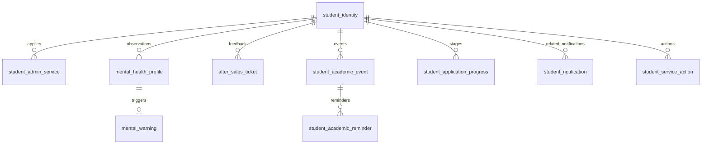

# 学生智能助手模块建表方案

版本：V1.0，2026-10-14。学生助手模块负责人开始建表。

**建议采用四张原业务表扩展、三张新增功能表，并按需补齐三张共享表，共十张候选物理表。** 共享表有等价实现就复用，不按每个组员各建一份。

本文件是可以评审和据此实施的方案，配套 SQL 为**空白测试库初始化草案**；未连接数据库、未执行建表、未修改原仓库。现有数据库是否已建表尚未核验。

## 1. 阅读基线与实际发现

阅读目录：`D:/GitProject/StuProject`；本地提交：`116e530fb2326dbf1ee2793aa6a0b634d1167ca3`。

| 资料                                                                                         | 本方案采用的内容                           |
| ------------------------------------------------------------------------------------------ | ---------------------------------- |
| 01需求拆解/学生智能助手.txt                                                                          | 七类业务、四张核心业务表、请假/投诉/预警闭环            |
| 02需求文档/学生智能助手.md                                                                           | 功能范围、历史波动、学业提醒、CRM进度、Dify相关能力需求    |
| 03开发设计/开发设计文档.md，第五部分                                                                      | 学生输入→多意图路由→业务处理→写入/查询→反馈；教务/CRM依赖  |
| 04接口设计/接口设计文档.txt，通用说明、4.6/4.7、第五部分                                                        | 统一响应、NL2SQL旧入口、企业审批指令、五个已有学生接口     |
| 05数据库设计/数据库设计文档.md，第四/五/六部分                                                                | 原有四业务表与知识向量表；企业投诉表重复；报告数据依赖        |
| 总需求.txt、企业智能助手.md、智能报告.md                                                                  | 班主任审批与跟进、学生成绩分工、投诉分类/时效/满意度及心理周报   |
| StuProject_开发文档.md、06开发文档中的成员记录/开发流程/总体讲解                                                  | 共享事实源、身份绑定、通知重试、分层、状态流转、文档缺口与旧方案冲突 |
| app/database.py、core/response.py、core/logger.py、main.py、scripts/init_db.py、environment.yml | 现有工程基础和初始化方式                       |

用户所称“学生助手.txt”，当前实际文件名为“学生智能助手.txt”。其余成员文档的重复需求作为交叉核对，不视为新的独立业务需求。

已识别的问题：

1. 原行政服务表没有请假起止时间、审批人和审批时间，无法完整审批。
2. 心理画像把历史放在 JSON 中，但未规定记录粒度；心理周报需要可排序、可聚合的时间序列。
3. 工单没有区分投诉与建议，也没有负责人和处理时效字段。
4. 缺少学业节点、提醒设置、CRM进度的关系型结构；NL2SQL不能凭空查询外部系统的数据。
5. 学生侧 after_sales_ticket 与企业侧 complaint_feedback 重复，须统一事实源。
6. 原知识向量表属于知识检索设计；本期 AI 使用 Dify，其知识切片与向量由 Dify 管理。
7. 部分旧开发文档仍主张 NL2SQL 增删改，与你的新分工冲突。**以你本次指令为准：查询接口调用 NL2SQL；增删改由各模块 Python 业务代码执行。**

## 2. 实现边界与小组协作

| 内容                                 | 实现与维护方式                                        |
| ---------------------------------- | ---------------------------------------------- |
| 七类意图识别、情绪/风险识别、投诉摘要、生活RAG、升学推荐     | Dify Chatflow/Workflow；Python校验结构化输出并执行业务动作    |
| 面向学生/员工的数据查询接口                     | Python鉴权后调用组长独立NL2SQL查询接口，不重复开发SQL生成器          |
| 请假提交/撤销/审批、工单创建/跟进/结案、预警写入/处理、提醒设置 | SQLAlchemy ORM/参数化固定语句；权限、校验、状态机、事务由services负责 |
| 教务/CRM同步、通知发送和重试、定时提醒              | Python适配器和tasks；外部事实采用确定性upsert，不能让AI生成源数据     |
| 共用学生/员工身份、权限、NL2SQL审计              | 小组共用基础设施；学生模块只定义所需契约                           |
| 学生成绩                               | 复用企业模块 student_score；本方案不再建一份成绩表               |
| 企业端请假审批、投诉跟进、预警处置                  | 企业api调用同一学生业务service/内部接口；同一ORM和事实表，保证事务规则一致   |

“硬编码增删改”指业务代码定义确定的操作，不是拼接用户输入，也不是把数据库账号密码写进代码。写事务内部的读取/加锁、权限核对和任务扫描用固定查询；这些属于确定性流程，不通过模型决定更新哪一行。用户可见查询接口统一接组长服务。生活知识问答属于Dify RAG，不属于关系库NL2SQL查询。

六人共开发时，业务表由学生模块维护迁移；企业模块共享读写服务；报告模块消费约定数据；组长维护NL2SQL、身份和公共契约。迁移进入同一条小组迁移历史，公共表只有一名维护人，避免不同分支重复建表。

## 3. 建表总览：哪些必须增加

| 表                            | 处理方式          | 必要性与没有它的影响                            |
| ---------------------------- | ------------- | ------------------------------------- |
| student_admin_service        | 保留并补字段        | 记录申请与审批责任，不能只留自然语言理由和状态               |
| mental_health_profile        | 保留，定义每次评估一行   | 查询心理历史和周报，不反复覆盖最新画像或累积大JSON           |
| mental_warning               | 保留并补来源和处置字段   | 高危预警必须可定位、分派、人工跟进和关闭                  |
| after_sales_ticket           | 保留并成为共用工单     | 投诉/建议提交、处理、解决、满意度可追溯                  |
| student_academic_event       | 新增功能表         | 多个DDL/考试节点需独立时间和外部ID；行政申请不能充当考试日历     |
| student_academic_reminder    | 新增功能表         | 节点和提醒订阅分开，支持每人/每节点的多个提前量与取消           |
| student_application_progress | 新增功能表，已有镜像时复用 | 支持多申请、多阶段；让NL2SQL能查结构化进度并显示更新时间       |
| student_identity             | 共享前置，无等价实现时新增 | 统一student_id、责任老师、教务/CRM身份映射；不是新建账号系统 |
| student_notification         | 共享表，无等价实现时新增  | 业务完成与消息送达分离，失败可重试、重启可恢复、站内可已读         |
| student_service_action       | 共享表，无等价实现时新增  | 保留审批责任与多轮跟进历史，一表承载三类业务处理事件            |

**数量口径：学生业务表7张（原4+新增3），共享配套3张，完整独立测试基线10张。** 如果小组已提供学生主表、通知表、业务事件表，适配后只维护7张业务表；已有教务/CRM镜像也应继续复用。

本期不另建学生知识向量表、完整教务/CRM系统表、聊天全文表、心理历史子表、三套审批/投诉/预警历史表、营销漏斗/推荐历史表和附件表。现有需求可由Dify、原表追加行、通用操作记录及现有项目数据支持；新增上述表没有已确定的独立数据生命周期。

## 4. 四张原表新增字段清单

四张原表合计新增30个字段；下列字段均在后面的字典说明必要性。原字段仅细化类型、精度和状态枚举。

| 原表                        | 新增字段                                                                                                                         | 解决的明确问题                           |
| ------------------------- | ---------------------------------------------------------------------------------------------------------------------------- | --------------------------------- |
| student_admin_service（8个） | leave_start_at、leave_end_at；reviewer_id、reviewed_at、approval_comment；request_key、request_hash、version                        | 请假时段、审批责任、重复提交、多人并发审批             |
| mental_health_profile（5个） | risk_level、observed_at、source_event_id、workflow_run_id、analysis_version                                                      | 风险统计、历史事件时间、AI重复回调、运行及口径追溯        |
| mental_warning（7个）        | profile_id、follower_id、acknowledged_at、closed_at、handling_result、version、updated_at                                          | 预警来源唯一、人工接手/处置、并发处理               |
| after_sales_ticket（10个）   | feedback_type、summary、category、follower_id、first_response_at、resolved_at、satisfaction_score、request_key、request_hash、version | 投诉/建议区分、AI摘要、报告分类/时效/满意度、分派、幂等、并发 |

心理原文不新增到画像表。history_data 为旧设计兼容字段，保持 NULL，历史统一由多行画像记录提供；已有JSON历史须迁移成带时间戳的行，不制造不存在的时间或分值。

category 与 satisfaction_score 来自现有智能报告的投诉分类、时效和最终满意度要求。满意度可为空，统计时注明已评价数/已解决工单数；若小组明确取消满意度指标，可同时删除字段和评分接口，而不是用模型补分。

## 5. 字段、索引与关系字典

数据库基线假设为 MySQL 8.0.16及以上、InnoDB、utf8mb4；此版本门槛用于确保CHECK约束生效，最终应核验实际服务器版本。[MySQL官方CHECK说明](https://dev.mysql.com/doc/refman/8.0/en/create-table-check-constraints.html)。

id、student_id及员工引用统一使用有符号BIGINT，与原设计一致；已有共享表如采用UNSIGNED或UUID，必须统一类型并重定向外键后再执行。时间统一用DATETIME(6)保存UTC，连接设置+00:00，接口输入带时区、输出ISO 8601；DATETIME不会替你自动保存时区。[MySQL官方日期时间类型说明](https://dev.mysql.com/doc/refman/8.0/en/datetime.html)。

所有状态值在Python枚举中用小写英文；界面映射为中文。常用检索/统计字段使用独立列；JSON仅作可变附加数据。字典中的默认值和空值约束与配套SQL由同一结构生成。

### 5.1 学生身份与责任老师映射（student_identity）

现有文档反复使用 student_id，却没有学生主表和责任老师关系；审批路由、教务/CRM身份匹配必须有权威关联。此表只补业务身份映射，不建设第二套登录系统。

| 字段             | 类型/约束                                                                            | 说明          | 变更   | 保留或新增理由                                 |
| -------------- | -------------------------------------------------------------------------------- | ----------- | ---- | --------------------------------------- |
| id             | BIGINT；NOT NULL AUTO_INCREMENT                                                   | 主键          | 通用字段 | 稳定关联业务记录，使用文档约定的自增 BIGINT。              |
| student_no     | VARCHAR(64) COLLATE utf8mb4_bin；NOT NULL                                         | 统一学号/业务编号   | 新表   | 供组员确定同一学生，避免姓名重名关联。                     |
| student_name   | VARCHAR(100)；NOT NULL                                                            | 学生显示姓名      | 新表   | 用于审批待办和通知的可读展示；不能用作唯一身份。                |
| teacher_id     | BIGINT；NULL                                                                      | 责任老师统一员工ID  | 新表   | 把申请、工单和预警路由到负责人；绑定未完成可为空，提交和预警须有明确兜底规则。 |
| edu_student_id | VARCHAR(128) COLLATE utf8mb4_bin；NULL                                            | 教务系统学生ID    | 新表   | 与外部教务身份关联，避免误同步其他学生节点。                  |
| crm_student_id | VARCHAR(128) COLLATE utf8mb4_bin；NULL                                            | CRM系统学生ID   | 新表   | 与外部申请身份关联，避免按姓名匹配进度。                    |
| created_at     | DATETIME(6)；NOT NULL DEFAULT CURRENT_TIMESTAMP(6)                                | 创建时间（UTC）   | 通用字段 | 保留创建时点，支持统计与追溯。                         |
| updated_at     | DATETIME(6)；NOT NULL DEFAULT CURRENT_TIMESTAMP(6) ON UPDATE CURRENT_TIMESTAMP(6) | 最后更新时间（UTC） | 新表   | 识别最近状态变化；不能替代业务发生时间。                    |

索引与约束：

- PRIMARY KEY (id)
- UNIQUE KEY uk_student_no (student_no)
- UNIQUE KEY uk_edu_student (edu_student_id)
- UNIQUE KEY uk_crm_student (crm_student_id)
- KEY idx_student_teacher (teacher_id)

业务规则：

- teacher_id 逻辑关联小组共用员工表/身份服务；员工实体未定，不擅自建立虚构外键。
- 本版假设一个教务源、一个CRM源；如果统一身份服务已经有这些字段，复用其学生表并重定向 SQL 中的学生外键，删去本表。

### 5.2 学生行政服务（student_admin_service）

保留原行政服务表，将请假时段和审批责任补齐。

| 字段               | 类型/约束                                                                            | 说明                                       | 变更       | 保留或新增理由                                            |
| ---------------- | -------------------------------------------------------------------------------- | ---------------------------------------- | -------- | -------------------------------------------------- |
| id               | BIGINT；NOT NULL AUTO_INCREMENT                                                   | 主键                                       | 保留/通用    | 稳定关联业务记录，使用文档约定的自增 BIGINT。                         |
| student_id       | BIGINT；NOT NULL                                                                  | 统一学生ID                                   | 保留       | 关联同一个学生事实源，支撑本人数据隔离与跨模块关联。                         |
| apply_type       | VARCHAR(20)；NOT NULL                                                             | 申请类型 leave/academic                      | 保留       | 区分请假和考务申请；实际教务节点另表保存。                              |
| apply_content    | TEXT；NOT NULL                                                                    | 申请理由/内容                                  | 保留       | 保留学生提交的完整业务理由。                                     |
| approval_status  | VARCHAR(20)；NOT NULL DEFAULT 'pending'                                           | 审批状态 pending/approved/rejected/cancelled | 保留（规范枚举） | 统一 pending/approved/rejected/cancelled，跨模块不混用中文状态。 |
| edu_related_data | JSON；NULL                                                                        | 考务关联扩展信息                                 | 保留       | 仅保留可变附加信息，审批核心字段不放JSON。                            |
| leave_start_at   | DATETIME(6)；NULL                                                                 | 请假开始时间（UTC）                              | 新增       | 只存因病请假一天无法判定具体时间范围，审批和冲突校验需要结构化时间。                 |
| leave_end_at     | DATETIME(6)；NULL                                                                 | 请假结束时间（UTC）                              | 新增       | 校验结束晚于开始，支持精确请假时段。                                 |
| reviewer_id      | BIGINT；NULL                                                                      | 指定/实际审批老师ID                              | 新增       | 创建时确定审批负责人，并校验企业端是否有权审批。                           |
| reviewed_at      | DATETIME(6)；NULL                                                                 | 审批发生时间（UTC）                              | 新增       | 记录审批完成时点，而非使用最后更新时间猜测。                             |
| approval_comment | TEXT；NULL                                                                        | 审批意见/驳回原因                                | 新增       | 学生收到可解释结果，老师处理有依据。                                 |
| request_key      | VARCHAR(64) CHARACTER SET ascii COLLATE ascii_bin；NOT NULL                       | 请求幂等键                                    | 新增       | 同一学生重复提交只创建一条记录，由调用方生成并在重试时复用。                     |
| request_hash     | CHAR(64) CHARACTER SET ascii COLLATE ascii_bin；NOT NULL                          | 规范化请求SHA-256                             | 新增       | 相同幂等键配不同内容时拒绝，而不是返回错误的旧结果。                         |
| version          | INT；NOT NULL DEFAULT 1                                                           | 乐观锁版本                                    | 新增       | 条件更新防止多人并发覆盖，成功后递增。                                |
| created_at       | DATETIME(6)；NOT NULL DEFAULT CURRENT_TIMESTAMP(6)                                | 创建时间（UTC）                                | 保留/通用    | 保留创建时点，支持统计与追溯。                                    |
| updated_at       | DATETIME(6)；NOT NULL DEFAULT CURRENT_TIMESTAMP(6) ON UPDATE CURRENT_TIMESTAMP(6) | 最后更新时间（UTC）                              | 保留       | 识别最近状态变化；不能替代业务发生时间。                               |

索引与约束：

- PRIMARY KEY (id)
- UNIQUE KEY uk_admin_request (student_id, request_key)
- KEY idx_admin_student (student_id, created_at)
- KEY idx_admin_review (reviewer_id, approval_status, created_at)
- CONSTRAINT fk_admin_student FOREIGN KEY (student_id) REFERENCES student_identity(id)
- CONSTRAINT ck_admin_type CHECK (apply_type IN ('leave', 'academic'))
- CONSTRAINT ck_admin_status CHECK (approval_status IN ('pending', 'approved', 'rejected', 'cancelled'))
- CONSTRAINT ck_admin_leave CHECK (apply_type <> 'leave' OR (leave_start_at IS NOT NULL AND leave_end_at IS NOT NULL AND leave_end_at > leave_start_at))
- CONSTRAINT ck_admin_decision CHECK (approval_status NOT IN ('approved', 'rejected') OR (reviewer_id IS NOT NULL AND reviewed_at IS NOT NULL))
- CONSTRAINT ck_admin_version CHECK (version >= 1)

业务规则：

- 请假时开始/结束必填；考务申请可为空。驳回意见非空由业务层校验。
- pending → approved/rejected/cancelled；已结束状态不可被第二次审批覆盖。

### 5.3 心理评估历史记录（沿用画像表名）（mental_health_profile）

每次完成的情绪评估保存一行，按 student_id + observed_at 查询历史，不增加另一张心理历史表。

| 字段               | 类型/约束                                                       | 说明                            | 变更       | 保留或新增理由                                     |
| ---------------- | ----------------------------------------------------------- | ----------------------------- | -------- | ------------------------------------------- |
| id               | BIGINT；NOT NULL AUTO_INCREMENT                              | 主键                            | 保留/通用    | 稳定关联业务记录，使用文档约定的自增 BIGINT。                  |
| student_id       | BIGINT；NOT NULL                                             | 统一学生ID                        | 保留       | 关联同一个学生事实源，支撑本人数据隔离与跨模块关联。                  |
| emotion_tag      | VARCHAR(50)；NOT NULL                                        | 情绪标签                          | 保留       | 表达本次评估的主要情绪标签。                              |
| emotion_score    | DECIMAL(5,2)；NOT NULL                                       | 情绪分值0～100，越高表示状态越平稳           | 保留（明确精度） | 本方案约定越高表示状态越平稳；须在Dify输出契约中统一口径，不代表诊断。       |
| history_data     | JSON；NULL                                                   | 旧历史JSON兼容字段                   | 保留但停止写入  | 供原设计过渡兼容；新数据用多行记录表示历史，避免双份事实源。              |
| risk_level       | VARCHAR(20)；NOT NULL                                        | 本次风险 low/medium/high/critical | 新增       | 支持风险分布与周报，风险等级和情绪分值不互相替代。                   |
| observed_at      | DATETIME(6)；NOT NULL                                        | 被评估消息发生时间（UTC）                | 新增       | 区分对话发生时间与异步分析入库时间，正确计算历史趋势。                 |
| source_event_id  | VARCHAR(128) CHARACTER SET ascii COLLATE ascii_bin；NOT NULL | 本次源消息/事件ID                    | 新增       | 同一消息重复回调只写一次；业务层创建稳定事件ID，不以重新生成的Dify运行ID去重。 |
| workflow_run_id  | VARCHAR(128) CHARACTER SET ascii COLLATE ascii_bin；NULL     | Dify工作流运行ID                   | 新增       | 定位生成该评估的AI运行，便于复盘和失败排查。                     |
| analysis_version | VARCHAR(64)；NOT NULL                                        | 心理分析配置版本                      | 新增       | 版本调整后仍能解释分值和风险判定口径；版本由你们发布流程指定。             |
| created_at       | DATETIME(6)；NOT NULL DEFAULT CURRENT_TIMESTAMP(6)           | 创建时间（UTC）                     | 保留/通用    | 保留创建时点，支持统计与追溯。                             |

索引与约束：

- PRIMARY KEY (id)
- UNIQUE KEY uk_profile_source (student_id, source_event_id)
- UNIQUE KEY uk_profile_owner (id, student_id)
- KEY idx_profile_history (student_id, observed_at)
- KEY idx_profile_report (observed_at, risk_level)
- CONSTRAINT fk_profile_student FOREIGN KEY (student_id) REFERENCES student_identity(id)
- CONSTRAINT ck_profile_score CHECK (emotion_score >= 0 AND emotion_score <= 100)
- CONSTRAINT ck_profile_risk CHECK (risk_level IN ('low', 'medium', 'high', 'critical'))

业务规则：

- 不在 student_id 上建唯一约束，否则只能保存最新一条，丢失历史波动。
- 原始完整聊天由Dify/统一会话服务管理；此表不重复保存心理聊天原文。

### 5.4 心理预警与处置（mental_warning）

补齐预警来源、负责人和人工跟进闭环；不因AI调用成功就标记已解决。


| 字段              | 类型/约束                                                                            | 说明                               | 变更       | 保留或新增理由                              |
| --------------- | -------------------------------------------------------------------------------- | -------------------------------- | -------- | ------------------------------------ |
| id              | BIGINT；NOT NULL AUTO_INCREMENT                                                   | 主键                               | 保留/通用    | 稳定关联业务记录，使用文档约定的自增 BIGINT。           |
| student_id      | BIGINT；NOT NULL                                                                  | 统一学生ID                           | 保留       | 关联同一个学生事实源，支撑本人数据隔离与跨模块关联。           |
| profile_id      | BIGINT；NOT NULL                                                                  | 触发预警的评估ID                        | 新增       | 关联触发来源，唯一约束阻止同一评估重复告警；组合外键保证同一学生。    |
| trigger_reason  | TEXT；NOT NULL                                                                    | 必要的预警原因                          | 保留       | 保留触发依据，仅授权处理者访问，通知正文不复制原因。           |
| risk_level      | VARCHAR(20)；NOT NULL                                                             | 预警风险 high/critical               | 保留（规范枚举） | 本版仅高危及紧急风险触发预警，中风险作为画像记录。            |
| follower_status | VARCHAR(20)；NOT NULL DEFAULT 'pending'                                           | 人工跟进状态 pending/processing/closed | 保留（规范枚举） | pending/processing/closed，和消息投递状态分开。 |
| follower_id     | BIGINT；NULL                                                                      | 负责老师统一员工ID                       | 新增       | 授权谁接手；无法分派时允许先记录并升级到配置的兜底负责人。        |
| acknowledged_at | DATETIME(6)；NULL                                                                 | 老师确认接手时间（UTC）                    | 新增       | 判断预警是否已被人员响应，支持人工响应时效。               |
| closed_at       | DATETIME(6)；NULL                                                                 | 人工关闭时间（UTC）                      | 新增       | 明确完成时点，防止预警长期悬挂。                     |
| handling_result | TEXT；NULL                                                                        | 人工处置结果                           | 新增       | 关闭须说明结果，多轮过程另存操作记录。                  |
| version         | INT；NOT NULL DEFAULT 1                                                           | 乐观锁版本                            | 新增       | 条件更新防止多人并发覆盖，成功后递增。                  |
| created_at      | DATETIME(6)；NOT NULL DEFAULT CURRENT_TIMESTAMP(6)                                | 创建时间（UTC）                        | 保留/通用    | 保留创建时点，支持统计与追溯。                      |
| updated_at      | DATETIME(6)；NOT NULL DEFAULT CURRENT_TIMESTAMP(6) ON UPDATE CURRENT_TIMESTAMP(6) | 最后更新时间（UTC）                      | 新增       | 识别最近状态变化；不能替代业务发生时间。                 |

索引与约束：

- PRIMARY KEY (id)
- UNIQUE KEY uk_warning_profile (profile_id)
- KEY idx_warning_student (student_id, created_at)
- KEY idx_warning_follower (follower_id, follower_status, created_at)
- CONSTRAINT fk_warning_student FOREIGN KEY (student_id) REFERENCES student_identity(id)
- CONSTRAINT fk_warning_profile FOREIGN KEY (profile_id, student_id) REFERENCES mental_health_profile(id, student_id)
- CONSTRAINT ck_warning_risk CHECK (risk_level IN ('high', 'critical'))
- CONSTRAINT ck_warning_status CHECK (follower_status IN ('pending', 'processing', 'closed'))
- CONSTRAINT ck_warning_closed CHECK (follower_status <> 'closed' OR (follower_id IS NOT NULL AND acknowledged_at IS NOT NULL AND closed_at IS NOT NULL AND handling_result IS NOT NULL))
- CONSTRAINT ck_warning_version CHECK (version >= 1)

业务规则：

- pending → processing → closed；关闭操作由授权老师执行。
- 预警落库、操作记录及通知任务在一个事务内提交；没有路由负责人时记录未路由通知并升级，不能丢弃预警。

### 5.5 投诉与建议统一工单（after_sales_ticket）

以此表作为学生售后工单唯一事实源，企业助手处理同一条工单。

| 字段                 | 类型/约束                                                                            | 说明                                         | 变更       | 保留或新增理由                                       |
| ------------------ | -------------------------------------------------------------------------------- | ------------------------------------------ | -------- | --------------------------------------------- |
| id                 | BIGINT；NOT NULL AUTO_INCREMENT                                                   | 主键                                         | 保留/通用    | 稳定关联业务记录，使用文档约定的自增 BIGINT。                    |
| student_id         | BIGINT；NOT NULL                                                                  | 统一学生ID                                     | 保留       | 关联同一个学生事实源，支撑本人数据隔离与跨模块关联。                    |
| feedback_type      | VARCHAR(20)；NOT NULL DEFAULT 'complaint'                                         | 反馈类型 complaint/suggestion                  | 新增       | 需求明确包含建议，不能把所有反馈都统计成投诉。                       |
| complaint_content  | TEXT；NOT NULL                                                                    | 反馈原始内容                                     | 保留       | 字段名兼容旧接口，投诉/建议都保存完整提交内容。                      |
| summary            | VARCHAR(500)；NULL                                                                | Dify生成的工单摘要                                | 新增       | 老师快速阅读；AI失败可为空，不能因此阻断反馈提交。                    |
| category           | VARCHAR(32)；NOT NULL DEFAULT 'other'                                             | visa/application/life/other                | 新增       | 原智能报告需求包含投诉分类统计，存结构化类别避免周报重复猜分类。              |
| process_status     | VARCHAR(20)；NOT NULL DEFAULT 'pending'                                           | 处理状态 pending/processing/resolved/cancelled | 保留（规范枚举） | pending/processing/resolved/cancelled，统一两端状态。 |
| follower_id        | BIGINT；NULL                                                                      | 工单负责人统一员工ID                                | 新增       | 实现分派与授权处理，不以名字字符串关联老师。                        |
| first_response_at  | DATETIME(6)；NULL                                                                 | 首次人工响应时间（UTC）                              | 新增       | 计算响应时效，系统自动回复不计作人工响应。                         |
| resolved_at        | DATETIME(6)；NULL                                                                 | 最终解决时间（UTC）                                | 新增       | 计算解决时效并在结案时触发学生通知。                            |
| solution           | TEXT；NULL                                                                        | 最终解决方案                                     | 保留       | 结案时必须填写解决说明。                                  |
| satisfaction_score | TINYINT；NULL                                                                     | 学生自愿评分1～5                                  | 新增（报告协作） | 原总需求/智能报告要求最终满意度；只由学生评价，不由模型推断，未评价保持NULL。     |
| request_key        | VARCHAR(64) CHARACTER SET ascii COLLATE ascii_bin；NOT NULL                       | 请求幂等键                                      | 新增       | 同一学生重复提交只创建一条记录，由调用方生成并在重试时复用。                |
| request_hash       | CHAR(64) CHARACTER SET ascii COLLATE ascii_bin；NOT NULL                          | 规范化请求SHA-256                               | 新增       | 相同幂等键配不同内容时拒绝，而不是返回错误的旧结果。                    |
| version            | INT；NOT NULL DEFAULT 1                                                           | 乐观锁版本                                      | 新增       | 条件更新防止多人并发覆盖，成功后递增。                           |
| created_at         | DATETIME(6)；NOT NULL DEFAULT CURRENT_TIMESTAMP(6)                                | 创建时间（UTC）                                  | 保留/通用    | 保留创建时点，支持统计与追溯。                               |
| updated_at         | DATETIME(6)；NOT NULL DEFAULT CURRENT_TIMESTAMP(6) ON UPDATE CURRENT_TIMESTAMP(6) | 最后更新时间（UTC）                                | 保留       | 识别最近状态变化；不能替代业务发生时间。                          |

索引与约束：

- PRIMARY KEY (id)
- UNIQUE KEY uk_ticket_request (student_id, request_key)
- KEY idx_ticket_student (student_id, created_at)
- KEY idx_ticket_follower (follower_id, process_status, created_at)
- KEY idx_ticket_report (created_at, category)
- CONSTRAINT fk_ticket_student FOREIGN KEY (student_id) REFERENCES student_identity(id)
- CONSTRAINT ck_ticket_type CHECK (feedback_type IN ('complaint', 'suggestion'))
- CONSTRAINT ck_ticket_category CHECK (category IN ('visa', 'application', 'life', 'other'))
- CONSTRAINT ck_ticket_status CHECK (process_status IN ('pending', 'processing', 'resolved', 'cancelled'))
- CONSTRAINT ck_ticket_resolved CHECK (process_status <> 'resolved' OR (follower_id IS NOT NULL AND first_response_at IS NOT NULL AND resolved_at IS NOT NULL AND solution IS NOT NULL))
- CONSTRAINT ck_ticket_score CHECK (satisfaction_score IS NULL OR (satisfaction_score BETWEEN 1 AND 5 AND process_status = 'resolved'))
- CONSTRAINT ck_ticket_version CHECK (version >= 1)

业务规则：

- pending → processing → resolved；学生仅能撤销尚未处理的工单。
- 多次跟进的操作人/时间/备注用 student_service_action 保存；不额外建工单历史表。
- 企业端 complaint_feedback 不建立第二份可写副本；旧表如已有数据，采用映射迁移后切换接口，本方案不擅自删表。

### 5.6 学生学业节点镜像（student_academic_event）

论文DDL和考试是有具体时间的节点，不是行政申请单；本地结构化镜像让组长NL2SQL可查，并给提醒提供稳定引用。

| 字段                | 类型/约束                                                                            | 说明               | 变更   | 保留或新增理由                          |
| ----------------- | -------------------------------------------------------------------------------- | ---------------- | ---- | -------------------------------- |
| id                | BIGINT；NOT NULL AUTO_INCREMENT                                                   | 主键               | 通用字段 | 稳定关联业务记录，使用文档约定的自增 BIGINT。       |
| student_id        | BIGINT；NOT NULL                                                                  | 统一学生ID           | 新表   | 关联同一个学生事实源，支撑本人数据隔离与跨模块关联。       |
| source_system     | VARCHAR(32) CHARACTER SET ascii COLLATE ascii_bin；NOT NULL                       | 教务来源编码           | 新表   | 明确哪个外部系统负责数据；当前可固定 education。    |
| external_event_id | VARCHAR(128) COLLATE utf8mb4_bin；NOT NULL                                        | 外部节点ID           | 新表   | 同步幂等，不用标题和日期当主键。                 |
| event_type        | VARCHAR(20)；NOT NULL                                                             | ddl/exam         | 新表   | 区分截止日期和考试节点。                     |
| title             | VARCHAR(200)；NOT NULL                                                            | 论文/考试标题          | 新表   | 一名学生可能有多门考试、多篇论文，必须能区分。          |
| due_at            | DATETIME(6)；NOT NULL                                                             | 节点时间（UTC）        | 新表   | 查询、排序和提醒计算的核心结构化字段。              |
| source_timezone   | VARCHAR(64)；NOT NULL                                                             | 来源IANA时区         | 新表   | 留学场景跨地区，展示时区并正确解释只有日期的源数据。       |
| event_status      | VARCHAR(20)；NOT NULL DEFAULT 'active'                                            | active/cancelled | 新表   | 源节点取消时停止提醒；不物理删掉已有引用。            |
| event_version     | INT；NOT NULL DEFAULT 1                                                           | 影响提醒的节点版本        | 新表   | 截止时间变化时使旧提醒作废，并允许新版本再次发送。        |
| source_updated_at | DATETIME(6)；NULL                                                                 | 源系统更新时间（UTC）     | 新表   | 防止旧同步覆盖新节点；源无版本/时间时需按一次同步任务串行处理。 |
| synced_at         | DATETIME(6)；NOT NULL                                                             | 最后成功同步时间（UTC）    | 新表   | 展示数据新鲜度；同步失败不伪造成功时间。             |
| created_at        | DATETIME(6)；NOT NULL DEFAULT CURRENT_TIMESTAMP(6)                                | 创建时间（UTC）        | 通用字段 | 保留创建时点，支持统计与追溯。                  |
| updated_at        | DATETIME(6)；NOT NULL DEFAULT CURRENT_TIMESTAMP(6) ON UPDATE CURRENT_TIMESTAMP(6) | 最后更新时间（UTC）      | 新表   | 识别最近状态变化；不能替代业务发生时间。             |

索引与约束：

- PRIMARY KEY (id)
- UNIQUE KEY uk_academic_source (student_id, source_system, external_event_id)
- UNIQUE KEY uk_academic_owner (id, student_id)
- KEY idx_academic_student (student_id, event_status, due_at)
- CONSTRAINT fk_academic_student FOREIGN KEY (student_id) REFERENCES student_identity(id)
- CONSTRAINT ck_academic_type CHECK (event_type IN ('ddl', 'exam'))
- CONSTRAINT ck_academic_status CHECK (event_status IN ('active', 'cancelled'))
- CONSTRAINT ck_academic_version CHECK (event_version >= 1)

业务规则：

- 仅缓存节点，不建设课程、排课和教务系统。
- 若外部数据只给日期且未给截止时刻，不擅自定23:59；适配器按明确的业务契约补全后才能用于自动提醒。

### 5.7 学生学业提醒订阅与执行状态（student_academic_reminder）

学业节点说明何时发生，提醒表说明某学生是否设置以及提前多久提醒，二者生命周期不同。

| 字段                | 类型/约束                                                                            | 说明                            | 变更   | 保留或新增理由                    |
| ----------------- | -------------------------------------------------------------------------------- | ----------------------------- | ---- | -------------------------- |
| id                | BIGINT；NOT NULL AUTO_INCREMENT                                                   | 主键                            | 通用字段 | 稳定关联业务记录，使用文档约定的自增 BIGINT。 |
| student_id        | BIGINT；NOT NULL                                                                  | 统一学生ID                        | 新表   | 关联同一个学生事实源，支撑本人数据隔离与跨模块关联。 |
| academic_event_id | BIGINT；NOT NULL                                                                  | 对应学业节点ID                      | 新表   | 引用实际节点，组合外键阻止为其他学生的节点设提醒。  |
| lead_minutes      | INT；NOT NULL                                                                     | 提前分钟数                         | 新表   | 支持24小时、1小时等多个提醒时间；0表示到点提醒。 |
| notify_at         | DATETIME(6)；NOT NULL                                                             | 计划提醒时点（UTC）                   | 新表   | 任务按时间索引扫描，不在每次对话里计算全部提醒。   |
| event_version     | INT；NOT NULL                                                                     | 对应节点版本                        | 新表   | 任务执行前核对节点仍有效且版本一致。         |
| status            | VARCHAR(20)；NOT NULL DEFAULT 'pending'                                           | pending/queued/sent/cancelled | 新表   | 区分未到点、已进入通知队列、实际已投递和取消。    |
| sent_at           | DATETIME(6)；NULL                                                                 | 当前版本成功通知时间（UTC）               | 新表   | 成功才记录，任务失败不会冒充已提醒。         |
| created_at        | DATETIME(6)；NOT NULL DEFAULT CURRENT_TIMESTAMP(6)                                | 创建时间（UTC）                     | 通用字段 | 保留创建时点，支持统计与追溯。            |
| updated_at        | DATETIME(6)；NOT NULL DEFAULT CURRENT_TIMESTAMP(6) ON UPDATE CURRENT_TIMESTAMP(6) | 最后更新时间（UTC）                   | 新表   | 识别最近状态变化；不能替代业务发生时间。       |

索引与约束：

- PRIMARY KEY (id)
- UNIQUE KEY uk_reminder_setting (student_id, academic_event_id, lead_minutes)
- KEY idx_reminder_due (status, notify_at)
- CONSTRAINT fk_reminder_event FOREIGN KEY (academic_event_id, student_id) REFERENCES student_academic_event(id, student_id)
- CONSTRAINT ck_reminder_lead CHECK (lead_minutes >= 0)
- CONSTRAINT ck_reminder_version CHECK (event_version >= 1)
- CONSTRAINT ck_reminder_status CHECK (status IN ('pending', 'queued', 'sent', 'cancelled'))
- CONSTRAINT ck_reminder_sent CHECK (status <> 'sent' OR sent_at IS NOT NULL)

业务规则：

- 同节点同提前量只保留一份设置，取消后可重新开启；已发送的同版本不再次发送。
- 截止时间或状态改变时，同事务更新/取消提醒与未发送通知；历史发送情况留在通知表。

### 5.8 留学申请阶段最新镜像（student_application_progress）

组长NL2SQL只能查询数据库，不会天然访问外部CRM API；保留最小的申请阶段镜像，解决多申请、多阶段和过期数据展示。

| 字段                      | 类型/约束                                                                            | 说明                                              | 变更   | 保留或新增理由                               |
| ----------------------- | -------------------------------------------------------------------------------- | ----------------------------------------------- | ---- | ------------------------------------- |
| id                      | BIGINT；NOT NULL AUTO_INCREMENT                                                   | 主键                                              | 通用字段 | 稳定关联业务记录，使用文档约定的自增 BIGINT。            |
| student_id              | BIGINT；NOT NULL                                                                  | 统一学生ID                                          | 新表   | 关联同一个学生事实源，支撑本人数据隔离与跨模块关联。            |
| source_system           | VARCHAR(32) CHARACTER SET ascii COLLATE ascii_bin；NOT NULL                       | CRM/申请系统来源                                      | 新表   | 定位权威来源，当前可固定 crm。                     |
| external_application_id | VARCHAR(128) COLLATE utf8mb4_bin；NOT NULL                                        | 外部申请单ID                                         | 新表   | 一个学生可申请多所院校，不能只按student_id存三列。        |
| application_name        | VARCHAR(200)；NOT NULL                                                            | 申请院校/项目展示名                                      | 新表   | 让学生区分不同申请的进度。                         |
| stage_code              | VARCHAR(32)；NOT NULL                                                             | document_review/school_application/visa_process | 新表   | 对应原查询接口的三类进度，按阶段存一行。                  |
| stage_status            | VARCHAR(64)；NOT NULL                                                             | 源系统映射后的阶段状态                                     | 新表   | 不同阶段状态不同；统一映射字典由CRM契约确定，不凭空假设全阶段共用枚举。 |
| detail                  | VARCHAR(500)；NULL                                                                | 必要进度说明                                          | 新表   | 解释补材料等具体事项，避免只显示审核中。                  |
| source_updated_at       | DATETIME(6)；NULL                                                                 | 源系统更新时间（UTC）                                    | 新表   | 拒绝旧事件覆盖新进度。                           |
| synced_at               | DATETIME(6)；NOT NULL                                                             | 最后成功同步时间（UTC）                                   | 新表   | 外部故障时明确缓存时点，不声称实时。                    |
| created_at              | DATETIME(6)；NOT NULL DEFAULT CURRENT_TIMESTAMP(6)                                | 创建时间（UTC）                                       | 通用字段 | 保留创建时点，支持统计与追溯。                       |
| updated_at              | DATETIME(6)；NOT NULL DEFAULT CURRENT_TIMESTAMP(6) ON UPDATE CURRENT_TIMESTAMP(6) | 最后更新时间（UTC）                                     | 新表   | 识别最近状态变化；不能替代业务发生时间。                  |

索引与约束：

- PRIMARY KEY (id)
- UNIQUE KEY uk_progress_stage (student_id, source_system, external_application_id, stage_code)
- KEY idx_progress_student (student_id, synced_at)
- CONSTRAINT fk_progress_student FOREIGN KEY (student_id) REFERENCES student_identity(id)
- CONSTRAINT ck_progress_stage CHECK (stage_code IN ('document_review', 'school_application', 'visa_process'))


业务规则：

- 每个申请每个阶段保留当前快照；现需求只查当前进度，因此不增加CRM全量表或进度历史表。
- 若组长接口已有统一外部同步镜像，直接复用，不再建此表。

### 5.9 通知任务与收件记录（student_notification）

审批、投诉、预警及提醒都要求通知，独立保存投递状态才能失败重试并避免把业务成功与消息失败混为一谈。

| 字段                  | 类型/约束                                                                            | 说明                                       | 变更   | 保留或新增理由                                                   |
| ------------------- | -------------------------------------------------------------------------------- | ---------------------------------------- | ---- | --------------------------------------------------------- |
| id                  | BIGINT；NOT NULL AUTO_INCREMENT                                                   | 主键                                       | 通用字段 | 稳定关联业务记录，使用文档约定的自增 BIGINT。                                |
| student_id          | BIGINT；NOT NULL                                                                  | 统一学生ID                                   | 新表   | 关联同一个学生事实源，支撑本人数据隔离与跨模块关联。                                |
| business_type       | VARCHAR(32)；NOT NULL                                                             | 关联业务类型                                   | 新表   | 定位administration/mental_warning/ticket/academic_reminder。 |
| business_id         | BIGINT；NOT NULL                                                                  | 关联业务记录ID                                 | 新表   | 通知可跳转原记录，具体外键按类型由业务层验证。                                   |
| event_key           | VARCHAR(128) CHARACTER SET ascii COLLATE ascii_bin；NOT NULL                      | 通知事件稳定去重键                                | 新表   | 相同状态事件、收件人和渠道只创建一次任务；预警可区分首发与升级。                          |
| recipient_type      | VARCHAR(20)；NOT NULL                                                             | student/employee                         | 新表   | 学生通知和老师待办使用同一机制。                                          |
| recipient_id        | BIGINT；NULL                                                                      | 统一收件人ID                                  | 新表   | 正常任务必填；高危无负责人时可保存NULL未路由任务并重试/升级。                         |
| channel             | VARCHAR(20)；NOT NULL DEFAULT 'in_app'                                            | in_app/enterprise                        | 新表   | 首版可用站内通知；企业移动通知交给组选定渠道适配器。                                |
| content             | VARCHAR(500)；NOT NULL                                                            | 最小必要通知内容                                 | 新表   | 保存可展示的审批/工单结果；心理通知只提示需跟进，不复制风险原因或原文。                      |
| status              | VARCHAR(20)；NOT NULL DEFAULT 'pending'                                           | pending/processing/sent/failed/cancelled | 新表   | 区分排队、租约处理中、成功、最终失败、已取消。                                   |
| attempts            | INT；NOT NULL DEFAULT 0                                                           | 尝试次数                                     | 新表   | 限制重试和识别长期投递失败。                                            |
| next_retry_at       | DATETIME(6)；NOT NULL DEFAULT CURRENT_TIMESTAMP(6)                                | 下次可尝试时间（UTC）                             | 新表   | 指数退避，防止失败时持续轰炸渠道。                                         |
| locked_until        | DATETIME(6)；NULL                                                                 | 处理租约截止（UTC）                              | 新表   | 任务进程崩溃后可回收，不永久停留processing。                               |
| provider_message_id | VARCHAR(128) COLLATE utf8mb4_bin；NULL                                            | 外部渠道回执ID                                 | 新表   | 核对投递结果；不把HTTP请求发出当作接收成功。                                  |
| last_error          | VARCHAR(500)；NULL                                                                | 脱敏失败摘要                                   | 新表   | 人工排查与恢复；不存凭据和敏感原文。                                        |
| sent_at             | DATETIME(6)；NULL                                                                 | 实际投递成功时间（UTC）                            | 新表   | 业务和提醒完成的依据。                                               |
| read_at             | DATETIME(6)；NULL                                                                 | 收件人阅读时间（UTC）                             | 新表   | 送达不等于老师接手，站内已读是独立状态。                                      |
| created_at          | DATETIME(6)；NOT NULL DEFAULT CURRENT_TIMESTAMP(6)                                | 创建时间（UTC）                                | 通用字段 | 保留创建时点，支持统计与追溯。                                           |
| updated_at          | DATETIME(6)；NOT NULL DEFAULT CURRENT_TIMESTAMP(6) ON UPDATE CURRENT_TIMESTAMP(6) | 最后更新时间（UTC）                              | 新表   | 识别最近状态变化；不能替代业务发生时间。                                      |

索引与约束：

- PRIMARY KEY (id)
- UNIQUE KEY uk_notification_event (event_key)
- KEY idx_notification_due (status, next_retry_at)
- KEY idx_notification_lease (status, locked_until)
- KEY idx_notification_inbox (recipient_type, recipient_id, status, created_at)
- KEY idx_notification_business (business_type, business_id)
- CONSTRAINT fk_notification_student FOREIGN KEY (student_id) REFERENCES student_identity(id)
- CONSTRAINT ck_notification_business CHECK (business_type IN ('administration', 'mental_warning', 'ticket', 'academic_reminder'))
- CONSTRAINT ck_notification_recipient CHECK (recipient_type IN ('student', 'employee'))
- CONSTRAINT ck_notification_channel CHECK (channel IN ('in_app', 'enterprise'))
- CONSTRAINT ck_notification_status CHECK (status IN ('pending', 'processing', 'sent', 'failed', 'cancelled'))
- CONSTRAINT ck_notification_attempts CHECK (attempts >= 0)
- CONSTRAINT ck_notification_sent CHECK (status <> 'sent' OR (recipient_id IS NOT NULL AND sent_at IS NOT NULL))

业务规则：

- 业务变更与任务入库同事务；发送外部消息在事务提交后进行。
- 采用至少一次投递；外部渠道应使用event_key幂等，不能承诺网络故障下绝对只发一次。
- student_id 是业务归属；老师收件箱必须按recipient_id和角色授权，不能仅凭学生归属开放消息。

### 5.10 学生服务操作与多轮跟进记录（student_service_action）

主表只存当前状态，审批责任和多轮工单/预警跟进必须有追加历史；一张共用记录表替代三张独立历史表。

| 字段            | 类型/约束                                                       | 说明                                                       | 变更   | 保留或新增理由                      |
| ------------- | ----------------------------------------------------------- | -------------------------------------------------------- | ---- | ---------------------------- |
| id            | BIGINT；NOT NULL AUTO_INCREMENT                              | 主键                                                       | 通用字段 | 稳定关联业务记录，使用文档约定的自增 BIGINT。   |
| student_id    | BIGINT；NOT NULL                                             | 统一学生ID                                                   | 新表   | 关联同一个学生事实源，支撑本人数据隔离与跨模块关联。   |
| business_type | VARCHAR(32)；NOT NULL                                        | administration/mental_warning/ticket                     | 新表   | 区分关联的主记录。                    |
| business_id   | BIGINT；NOT NULL                                             | 关联主记录ID                                                  | 新表   | 定位具体申请、工单或预警；业务层验证类型和学生一致。   |
| action_type   | VARCHAR(32)；NOT NULL                                        | 动作 create/approve/reject/cancel/assign/follow/close/rate | 新表   | 表示具体业务行为，包含不改变状态的追加跟进。       |
| from_status   | VARCHAR(20)；NULL                                            | 动作前状态                                                    | 新表   | 用于追溯状态改变；首次创建可为空。            |
| to_status     | VARCHAR(20)；NULL                                            | 动作后状态                                                    | 新表   | 记录当时结果，多轮备注可保持相同状态。          |
| operator_type | VARCHAR(20)；NOT NULL                                        | student/employee/system                                  | 新表   | 区分学生、员工与系统任务责任主体。            |
| operator_id   | BIGINT；NULL                                                 | 统一操作者ID                                                  | 新表   | 学生/员工必填；系统任务为空并通过trace_id追踪。 |
| note          | TEXT；NULL                                                   | 必要操作说明/人工跟进备注                                            | 新表   | 保留每次干预和工单跟进，不反复覆盖主表最终结果。     |
| event_key     | VARCHAR(128) CHARACTER SET ascii COLLATE ascii_bin；NOT NULL | 操作事件幂等键                                                  | 新表   | 重试不重复追加操作记录；同一业务动作使用稳定ID。    |
| trace_id      | VARCHAR(64) CHARACTER SET ascii COLLATE ascii_bin；NOT NULL  | 日志链路ID                                                   | 新表   | 关联统一日志排查，和幂等业务键分开。           |
| created_at    | DATETIME(6)；NOT NULL DEFAULT CURRENT_TIMESTAMP(6)           | 创建时间（UTC）                                                | 通用字段 | 保留创建时点，支持统计与追溯。              |

索引与约束：

- PRIMARY KEY (id)
- UNIQUE KEY uk_action_event (event_key)
- KEY idx_action_business (business_type, business_id, created_at)
- KEY idx_action_student (student_id, created_at)
- CONSTRAINT fk_action_student FOREIGN KEY (student_id) REFERENCES student_identity(id)
- CONSTRAINT ck_action_business CHECK (business_type IN ('administration', 'mental_warning', 'ticket'))
- CONSTRAINT ck_action_operator CHECK (operator_type IN ('student', 'employee', 'system'))
- CONSTRAINT ck_action_actor CHECK (operator_type = 'system' OR operator_id IS NOT NULL)

业务规则：

- 只追加成功业务操作，不由普通修改/删除接口改历史。心理处理备注按心理权限访问。
- 这是业务处置记录；组长的NL2SQL查询审计和技术日志仍由共用模块负责，不能靠本表替代。

## 6. 表关系与数据粒度

`student_identity.id` 是全部学生业务的统一身份；`teacher_id/reviewer_id/follower_id` 逻辑关联小组共用员工身份，不存第二套员工账号。



预警与画像、提醒与学业节点使用包含student_id的组合外键，阻止“记录ID正确但属于另一学生”的关联。所有学生业务外键默认RESTRICT，不级联删除业务历史。

通知和操作表的business_type/business_id属于多态引用，数据库不能用一个外键跨多个表；写服务必须核验记录存在、类型匹配、student_id一致。通知的recipient_id可能是学生或员工，也由身份服务核验。成员不得通过通用任意表CRUD绕过上述规则。

数据粒度：行政表一行一次申请；画像表一行一次源事件评估；预警表一行一次高危评估；工单一行一次投诉/建议；学业表一行一个学生的一个外部节点；提醒表一行节点的一个提前量；进度表一行申请的一个阶段最新状态；通知表一行一次逻辑投递；操作表一行一次成功业务操作。

## 7. 写入、事务、幂等和任务执行

### 7.1 请假闭环

1. 学生api从登录上下文得到student_id；Schema校验起止时间、理由和幂等键。
2. 找到责任老师；无有效负责人时拒绝创建不可审批申请，并返回明确配置错误。
3. 在同一事务内创建pending申请、create操作记录、老师待办通知；返回申请ID。
4. 企业端按申请ID调用同一审批service，验证老师权限、当前pending状态、expected_version。通过带状态/版本的条件UPDATE修改一行；0行时返回冲突，不能覆盖别人审批。
5. 同一事务内写approve/reject操作记录和学生结果通知，提交后由任务投递。
6. 网络重试重复请求返回原业务结果；同键不同内容返回409业务错误。

reviewer_id创建时保存审批责任；责任转交要通过明确的分派动作和操作记录，不能悄悄改成另一个人。原申请内容映射：leave_content → apply_content；apply_id → id。

### 7.2 心理记录与预警

Dify输出情绪标签、约定分值、risk_level、trigger_reason；Python做枚举/范围校验，不接受模型给出的SQL、student_id或任意跟进老师。source_event_id由服务在源消息生成时固定，重新分析时仍沿用原ID；workflow_run_id仅用于运行追踪，不能当作唯一业务去重来源。

一次成功评估追加画像行。high/critical时，在同一事务创建对应预警、操作记录和老师通知；profile_id唯一避免AI回调重复触发。事务提交后通知，不等待NL2SQL查询流程。Dify失败返回可识别的分析不可用错误，不以low等级填补；重试使用原source_event_id。

老师接手时写acknowledged_at，追加follow记录；最终人工关闭才写closed_at和handling_result。消息已读不等于人工接手。负责人缺失时仍保存预警和recipient_id=NULL的未路由通知，任务优先解析配置的值班/兜底负责人；解析失败保留待处理记录并输出必要告警。具体升级间隔、值班人和渠道由组长/业务流程配置，不在建表时虚构人员。

画像原始风险与人工最终处置是不同事实。画像原则上不可被普通CRUD覆盖；人工修正/重新判定须保留原记录与对应说明。

### 7.3 投诉/建议闭环

工单先保留原始反馈，Dify摘要可为空，类别失败默认other。创建、分派/跟进、结案均执行确定性业务逻辑。老师首次真实回应才填写first_response_at，结案要求非空solution、resolved_at及负责人；记录resolved操作并在同事务创建学生通知。

request_hash基于规范化原始业务参数，不包括AI生成摘要、trace_id和当前时间，避免模型每次生成不同摘要破坏幂等。学生评分仅允许本人对resolved工单提交1～5分，后续改分记录rate事件；未评价保持NULL。

现有complaint_feedback如已建且有数据：确认是否包含非学生投诉 → 按来源/原ID迁移学生工单并保留映射 → 对账状态/负责人/时效 → 企业接口切换到共用service。非学生投诉仍归原模块。不要按内容相同简单合并，更不能在两张表里各更新一份。尚未建表时直接对齐小组文档为after_sales_ticket。

### 7.4 教务/CRM同步与提醒

适配器经身份映射拉取外部数据，按来源唯一键upsert。synced_at只表示真实成功同步时点；源数据时间source_updated_at用于拒绝旧事件覆盖，源无时间/版本时同一来源按任务串行，不能凭到达时间判定业务新旧。查询API显示synced_at和缓存过期状态；数据过期返回明确提示并调度刷新，不由AI补造当前进度。

学业节点时间/取消状态改变时锁定该节点，递增event_version，更新关联提醒时点/版本并取消旧版本未发送通知。提醒任务按status=pending且notify_at到期扫描，核验节点归属、版本、active状态；同事务转为queued并插入唯一event_key通知。投递成功后按该版本条件更新reminder为sent，旧版本回执不能标记新版本已发送。

提醒设置lead_minutes可为0；建议一期支持一个学生为每个节点设置多个提前量。同节点同提前量唯一约束阻止重复订阅；到期已过去、节点已取消和他人节点由service拒绝。没有返回的外部节点不等于已取消，必须以源系统的删除/取消契约为准。

进度镜像只保存当前状态，不保存CRM全量数据；多个院校申请按external_application_id分组返回。若组长已有统一同步表或可直接查询权威源的适配器，复用它并删去重复镜像，仍须落实提醒所需的稳定节点标识。

### 7.5 通知与操作记录的可靠性

业务写入、操作记录和通知任务由同一service事务控制；API层不各自commit。发送外部HTTP/Dify请求不持有长数据库事务，避免锁等待。派发任务先短事务领取租约，提交后发送，再短事务落回执；租约超时可重试。重试失败后保留failed和脱敏last_error，需要人工/运维重新投递。高危任务以业务类型优先扫描，不等待普通提醒积压。

event_key由服务生成稳定、长度受限的键（建议把业务类型/ID、动作事件ID或节点版本、渠道和接收路由标识规范化后SHA-256）；同一重试沿用原键。尚未路由的高危通知使用固定未路由目标标识，后续补负责人时复用原任务。真实升级通知使用独立升级事件键。

外部通知采用至少一次投递，渠道支持幂等就把event_key传给渠道；HTTP超时发生在已发出消息之后时仍可能收到重复消息，数据库唯一键本身不能保证外部世界的严格一次投递。老师在手机端必须通过有鉴权的企业入口查看待办/审批，通知文本不携带越权查看心理信息的链接令牌。

操作记录只追加；被拒绝请求和技术异常写统一日志，组长NL2SQL查询审计独立负责。同一动作幂等键重试时对比已有business_type/business_id/action_type/operator_id/note，内容不一致应拒绝，不能把旧成功结果用到另一个动作上。

### 7.6 删除与状态流转

本期不对已提交申请、工单、预警提供直接物理DELETE。学生撤销申请/待处理反馈、取消提醒均由固定UPDATE改变状态并保留操作记录。合规数据清理由权限受控的后台任务执行，按组内确定的保留期限处理画像、敏感备注、引用及备份；不预先给所有表增加软删除字段。

version只给有多人处理的申请、预警、工单。事件/进度同步用来源更新时间与串行契约；提醒用节点版本；通知用租约与状态条件控制。不要不分业务地给每张表加同样的版本列。

## 8. 查询接组长NL2SQL的必需契约

原接口文档的POST /api/v1/enterprise/nl2sql是旧入口示例。你说明组长已独立拆出查询接口，但当前仓库未找到其最终地址和完整请求模型。**以组长实际接口为准**，学生模块将调用集中到services/nl2sql_client.py中，通过config配置地址。配套《联调与验收清单》给出所需契约，不擅自当作已实现接口。

学生读接口：api鉴权 → service选择业务场景并组装可信身份/允许字段 → 组长查询服务 → 检验结果归属与响应结构 → 统一响应。请假、工单、学业、进度、提醒和站内通知列表都按此方式接入。

组长接口至少应接收自然语言/查询意图、服务端可信subject、角色与数据范围、trace_id，支持业务上下文中的申请ID/节点ID，并返回结构化rows和实际数据时间。student_id从服务端身份取得；自然语言中的“我是某某”、Dify参数和客户端传来的ID都不能扩大授权。

NL2SQL执行账号只读；表/字段白名单由服务配置；限制查询行数/超时；所有JOIN、子查询、UNION都须落实学生/老师行权限，不能只给字符串追加一个WHERE。MySQL中的普通只读账号和统一视图不会自动完成每个学生的数据隔离，权限必须由可信查询服务强制执行。客户端不接收SQL详情。

默认学生允许查看本人申请、本人反馈、本人节点、本人提醒、本人申请进度和本人收件通知；不能通过student_id读取发给老师的预警通知。mental_health_profile、mental_warning与心理跟进note不开放给学生通用NL2SQL；授权老师按负责关系访问，报告账号只取批准的聚合范围。技术幂等键、请求hash、AI运行ID、错误摘要和组内审计字段不进入普通学生查询白名单。

若NL2SQL失败或返回不合规范的数据，统一返回可识别的依赖错误；不能默默改走无权限过滤的任意SQL。后台授权核验、更新加锁和定时扫描仍为固定参数查询。

## 9. 与要求一致的项目分层

```text
app/
  main.py                         # 注册学生及企业协作路由
  config.py                       # 组长查询地址、Dify应用、同步/通知配置
  database.py                     # 小组统一MySQL引擎/会话
  models/student.py               # 本方案业务ORM，复用共享实体
  schemas/student.py              # 请求、Dify结构、查询结果与状态枚举
  api/student.py                  # 学生路由、身份依赖、统一响应
  services/student_service.py     # 申请、工单、预警状态机与事务
  services/nl2sql_client.py        # 调用组长查询接口，不实现SQL生成
  services/dify_client.py          # 共用AI客户端，复用已有实现
  services/education_adapter.py   # 教务同步适配
  services/crm_adapter.py         # CRM同步适配
  services/notification_service.py# 通知入队与发送适配
  tasks/student_reminder.py       # 提醒调度
  tasks/student_sync.py           # 来源同步
  tasks/notification_dispatch.py  # 通知投递/重试/租约回收
  core/logger.py                 # 统一日志
  core/response.py               # {code,message,data} + 异常处理
  logs/                         # 日志目录
scripts/                        # 初始化与一次性迁移脚本
migrations/                     # 小组单一迁移历史（采用Alembic时）
tests/                          # 学生业务和协作验收测试
```


结构落实MVC分层职责：api为控制入口、schemas为输入输出契约、models为持久化、services承载业务；前端或Dify交互承担展示。不要把SQL、状态机和外部请求都塞进路由。

复用core/response.py中的ResponseModel、success/fail、BusinessException与全局处理器，不重写第二套响应工具。业务成功code=0；参数/未授权沿用400/401，并与组长扩展403（禁止）、404（资源不存在）、409（幂等/并发冲突）、503（依赖不可用）；HTTP状态与业务code的映射一起写入API契约。当前业务异常处理器HTTP返回200，应遵守组内现状后统一调整，不能仅学生模块另定规则；还须覆盖RequestValidationError和HTTPException，保证参数错误也统一响应。

日志复用core/logger.py，仅记录trace_id、操作者ID、业务ID、动作、耗时和脱敏错误；不打印数据库密码、Dify API Key、完整心理/投诉原文或任意模型SQL。

当前工程需先对齐：

- database.py是mysql+pymysql同步引擎；environment.yml有pymysql与SQLAlchemy，未发现aiomysql/asyncmy。你要求异步引擎，应由公共基础设施负责人统一改create_async_engine、AsyncSession和异步会话依赖，并选择异步驱动；学生模块不能局部混用同步Session和await。SQL表设计本身不受影响。
- main.py仍导入database.py不存在的init_db，启动前应去掉该导入或按小组方案补齐；建表已由scripts/init_db.py独立负责。
- models当前只有空\_\_init\__.py，没有业务ORM；所以初始化脚本目前不会从模型创建这些表。定义模型后才可运行脚本。
- Base.metadata.create_all只创建缺失表，不给已有表补字段。新字段必须用审核后的迁移脚本/Alembic执行，不能以再次create_all替代。

## 10. 建表与开发实施顺序

| 步骤        | 你要完成的内容                                                   | 可检查结果                        |
| --------- | --------------------------------------------------------- | ---------------------------- |
| 1 契约对齐    | 同学生/员工身份维护人确认ID类型、责任老师、共用表；同企业模块确认统一工单和审批service；拿到组长查询接口 | 本方案三个共享表是否复用、外键目标和API契约清晰    |
| 2 数据库基线   | 在测试库核验SELECT VERSION()、SHOW TABLES及已有同名表SHOW CREATE TABLE | 判断空库初始化还是已有数据迁移；不连接生产试改      |
| 3 模型/迁移   | 新建或扩展ORM；统一索引、CHECK、注释、外键；进入小组迁移历史                        | ORM与本方案一致，可从空白库创建            |
| 4 最小闭环    | 优先完成请假→老师审批→学生通知，再完成投诉/建议处理                               | 幂等/并发/权限及通知重试验证通过            |
| 5 心理记录/预警 | Dify结构契约、去重、老师处理和未路由升级                                    | 一条源消息一条评估，一次高危一条预警，人工可接手     |
| 6 外部同步/提醒 | 教务节点、CRM阶段镜像、版本重排及定时通知                                    | NL2SQL可查真实镜像，提醒不会用旧截止时间发送    |
| 7 查询与报告联调 | 接组长NL2SQL、企业工作台和报告读取字段                                    | 本人数据隔离、统计口径、结构化响应一致          |
| 8 文档和验收   | 同步六类文档并保留测试结果                                             | 小组有唯一需求、开发设计、数据库、API、开发、测试基线 |

SQL文件按依赖排序，适合全部候选表都不存在的测试库。它故意不用IF NOT EXISTS；遇到已建表直接报错，避免旧结构被静默跳过。不要用--force忽略错误继续执行。MySQL DDL可能已部分成功，不能靠ROLLBACK整体撤销；执行中断后检查已创建表，再用迁移继续。

Git Bash空白测试库执行示例（不是本轮已执行操作）：

```bash
# 将文件放到scripts目录后，用户名/库名换成小组测试环境；-p会交互输入密码。
mysql -h 127.0.0.1 -P 3306 -u YOUR_DB_USER -p --default-character-set=utf8mb4 YOUR_TEST_DB < scripts/student_assistant_schema.sql
```

本轮交付文件名为“学生智能助手_建表草案.sql”，拷贝进项目并改名为scripts/student_assistant_schema.sql后才符合示例路径。此例假设MySQL命令行客户端已安装，不能用仓库内init_db.py凭空读取这份SQL。已有表迁移需要先盘点实际结构、回填必填字段、调整状态枚举、核对重复数据，再加唯一约束/外键；未知旧数据不能提供直接覆盖迁移。

## 11. 六类文档同步与验收

完整API调整表、Dify/组长查询契约与验收矩阵放在配套《学生智能助手_联调与验收清单.md》。

| 小组统一文档  | 本模块须补齐                                        |
| ------- | --------------------------------------------- |
| 需求文档    | 保留七场景；明确高危人工接管、建议和满意度、跨时区提醒、只读NL2SQL边界        |
| 开发设计文档  | Dify/Python分工、企业协作service、事务/幂等/状态机、外部同步和通知重试 |
| 数据库设计文档 | 本方案字典、粒度、索引/外键、共用工单事实源、知识库由Dify管理             |
| API接口文档 | 身份绑定、结构化请假起止、审批/跟进/评分/提醒/通知接口、错误码与查询调用方式      |
| 开发文档    | ORM导入、迁移执行、环境配置、异步改造、tasks启动和日志规范             |
| 测试文档    | 正常闭环、越权、幂等、并发、AI/外部失败、通知租约恢复和节点改期用例           |

## 12. 假设与当前验证范围

MySQL版本、实际已有数据库表、员工身份源、组长最终查询路由、教务/CRM字段契约和外部通知渠道尚未提供；方案用最小可用契约，列为实施时对接事项，不当作既成事实。

本轮只读取本地项目文件并生成方案、SQL和联调清单；未读取或输出.env中的秘密，未改动仓库，未连数据库。对字段唯一性、主外键引用、索引列和文档/SQL一致性做静态核对；未在MySQL真实执行，数据库DDL执行和行为验收必须在测试库完成。

静态核对结果：10张候选表、133个总字段（其中四原表新增30个）、10条外键、43条显式主键/唯一键/索引定义，12条SQL语句。字段字典与DDL同源；未发现重复字段、无效索引列、外键类型/目标唯一键/顺序错误或引号括号不闭合。此结果不能代替MySQL实际执行与上表行为验收。
