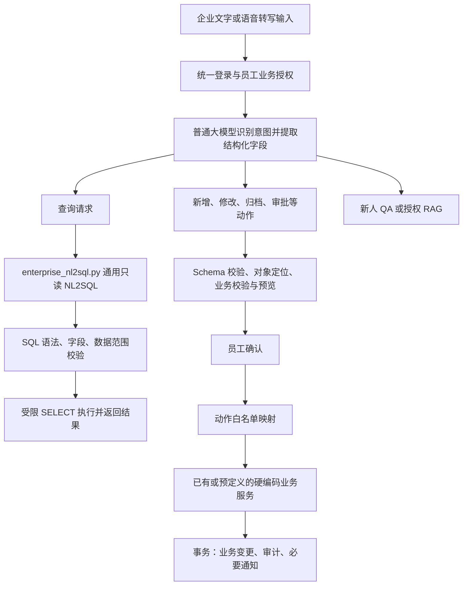
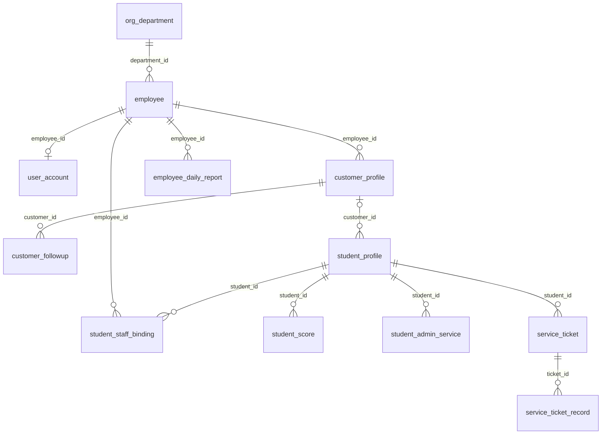

# 企业管理模块实施方案说明

> 日期：2026-10-16。状态：开发阶段协作方案，企业与学生模块均未完成落地测试或联合验收。  
> 本轮交付：仅修订本文件与同目录 `jlj.md`，不修改代码、SQL、Dify YAML、配置或数据库。  
> 最终口径：**NL2SQL 只读；增删改由普通大模型提取动作和关键字段，再调用预先编写的硬编码业务接口或服务。**
> 本次方案修订：统一公共 JWT 与唯一请假表 `student_admin_service`。学生模块维护请假、心理及老师接口；企业开发页面/编排及工单处理，不重复开发审批服务。双方采用完全相同的“附录 B：联合协作契约 V1”，共享字段、职责、状态、权限和主外键均以此为准。

## 1. 业务背景与负责范围

项目服务留学咨询与学生服务机构，包含客户研判、客服 Agent、企业智能助手、学生智能助手、智能报告五个模块。企业管理模块面向内部员工，负责把客户跟进、日报、教务和售后处理串联起来。

本方案把“企业管理”对应到需求文档中的“企业智能助手”，不扩大为 CRM、人事或教务系统本体。

| 业务 | 企业管理负责的功能 | 与其他模块的边界 |
| --- | --- | --- |
| 意向客户 | 文字/语音录入、档案查询、追加跟进、状态更新、归档 | 客服和客户研判提供线索；已有 CRM 时通过适配器对接，不另建完整 CRM |
| 员工日报 | 口述/文字提取、本人提交与修订、管理者按部门查阅 | 正式日/周汇总报告交给智能报告模块；不重复建设报告表 |
| 组织查询 | 部门层级、职能、员工工作联系方式 | 复用组织主数据，不承担薪酬、人事流程 |
| 新人指引 | 标准 QA、制度文档 RAG、答案来源及版本 | 资料由企业维护；没有来源不生成确定性制度结论 |
| 学生成绩 | 授权学生/课程的录入、查询、更正、作废 | 复用学生主档；外部教务仅提供只读接口时，不提供本地修改冒充教务成功 |
| 学生请假 | 老师待办、详情、审批结果展示与审批入口 | 统一账号 JWT；学生提交与老师审批共用 `student_admin_service` 和固定业务服务，旧契约适配见第 2、6 节 |
| 投诉反馈 | 工单查询、分派、跟进、给出解决方案 | 学生提交、确认解决、重开及评价由学生模块负责；共用同一工单 |
| 主动待办 | 客户跟进提醒、待审批请假、待处理投诉、站内通知 | 定时任务只生成提醒，不自动代替员工审批或处理业务 |

语音输入先转写成文本，再进入与文字相同的处理链。第一阶段可先接收已有转写文本；真实音频上传与转写适配作为同一需求的后续交付，不把“能提交文字”当作语音功能已经完成。

## 2. 阅读依据、当前事实与已知差异

### 2.1 主要依据

原方案参考下列业务资料。本次只基于本文件与同目录 `jlj.md` 对齐开发契约，未重新核验代码、SQL、配置、真实数据库或部署环境。历史引用不是已完成测试的证据。

| 依据 | 本方案的使用方式 |
| --- | --- |
| [总需求](../../01需求拆解/总需求.txt)、[企业需求拆解](../../01需求拆解/企业智能助手.txt)、[企业需求文档](../../02需求文档/企业智能助手.md) | 确认功能范围、业务背景及跨模块协作 |
| [开发设计文档](../../03开发设计/开发设计文档.md)、[通用接口设计](../../04接口设计/接口设计文档.txt)、[数据库设计文档](../../05数据库设计/数据库设计文档.md) | 获取原始分层和接口意图；早期简化字段不直接覆盖公共 SQL |
| [公共建表脚本](../../../scripts/sql/all.sql) | 本地字段字典的主要依据；读取脚本不代表已核验真实数据库 |
| [历史企业设计](../../../scripts/sql/bk/企业智能助手/企业智能助手_功能与数据库设计方案.md) | 参考精简后的表、角色与只读 NL2SQL 边界；统一账号以当前代码为准 |
| [学生企业侧对接](../../04接口设计/学生助手_企业侧对接.md)、[企业侧 OpenAPI](../../04接口设计/学生助手_企业侧_OpenAPI.json) | 确认学生侧公布的 13 个协作接口及交接约定 |
| `app/core/dify.py`、`app/core/auth.py`、`app/core/authorization.py`、`app/access_control.yaml`、`app/models/user_account.py`、`app/config.py` | 复用 HTTP、登录、权限及配置入口，区分现状与待实现能力 |

本文所有“拟新增”“建议”“目标态”均为后续实施方案，不表示相关文件、接口已经实现。

### 2.2 学生请假统一开发边界

双方均处于开发阶段，取消“学生接口已可用”与“企业需补齐同一接口”的并行假设。下表为唯一目标分工，不依据历史提交或某个文件是否缺少认定已完成状态。

| 项目 | 统一约定 | 负责方 |
| --- | --- | --- |
| 事实表/主键 | `student_admin_service.id` 对外为 `apply_id`，只处理 `apply_type=leave` | 公共表结构双方共同维护 |
| 学生接口 | 提交、列表、详情、撤回四种方法，只访问本人 | 学生模块，`app/api/student_leave.py` |
| 老师接口 | 请假查询/审批、心理预警/处置、学生通知共 10 种方法 | 学生模块，`app/api/student.py`；企业不重复注册 |
| 唯一请假服务 | `StudentLeaveService` 实现提交、查询、撤回及老师审批 | 学生维护，其他学生/企业服务只委托 |
| 老师工作台 | 授权待办、详情、审批确认和结果展示 | 企业开发页面及调用编排 |
| 工单协作 | 学生提交/补充/确认/重开/评价，企业分派/处理/给方案 | 按动作拆分，字段和事务见附录 B |
| 当前交付状态 | 均按开发和待测试目标管理 | 双方按联合验收清单举证 |

**统一公共账号 JWT 与 `student_admin_service`，不建设企业请假替代表或双写。**开发阶段直接使用附录 B，不默认建设历史兼容层；只有核实存在旧调用方或真实历史数据时才另行制定适配/迁移。本轮不操作数据库。

表清单、API 字段与学生文档统一。历史 `student_leave_request` 只在 A.16 作为停用结构说明，不进入当前建表或路由清单。

### 2.3 其他需要区分的现状

- 早期文档的 `intention_customer` 对应目前的 `customer_profile` 与 `customer_followup`；`complaint_feedback` / `after_sales_ticket` 对应共享的 `service_ticket` 与 `service_ticket_record`。不重复建设同义事实表。
- 当前统一登录身份有 `admin`、`employee`、`customer`、`student`；`consultant`、`manager`、`teacher` 等属于员工业务角色，不能直接当作新的 `identity_type`。
- 公共权限依赖负责身份级动作授权，业务授权层检查角色、归属、绑定及负责人，不能只改菜单可见性。
- 企业 NL2SQL 采用 schema 和受控只读契约；学生固定查询独立维护，不把企业 SQL 生成响应当作学生查询结果。
- 代码是否可复用需后续核验；缺失功能由所属模块按固定规则实现。学生维护唯一请假服务，企业不得按文件名另起同一审批逻辑。

### 2.4 请假统一落地方案

**一张事实表、一套业务服务、一套登录身份。**学生提交、老师列表/详情、老师审批和学生结果查询都定位 `student_admin_service` 同一条记录，并强制 `apply_type=leave`，不能把考务申请当作请假处理。

| 事项 | 已选设计 |
| --- | --- |
| 登录身份 | `JWT.sub → user_account.user_id → student_id / employee_id`，复用公共认证，不再单独签发学生模块的 `actor_type/actor_id` 登录令牌 |
| 唯一事实表 | `student_admin_service`；数据库主键为 `id`，API 对外统一称 `apply_id` |
| 固定业务服务 | 学生维护唯一 `StudentLeaveService` 与 `student_leave_repository.py`，统一提交/查询/撤回/审批；企业只调用 |
| 当前审批人 | 可空 BIGINT 物理外键 `reviewer_id → employee.employee_id`；未分派为 NULL，审批时等于真实当前员工 |
| 实际操作人 | 审批事务在 `operation_log.employee_id` 保存实际审批员工；快照保留审批前后的指定审批人、状态、意见与版本，不将旧的两个员工字段机械合并 |
| 审批结果 | 目标字段为 `approval_status、reviewed_at、approval_comment、row_version`，双方映射相同列；现有结构待核对，不新增同义列 |
| 状态 | `pending → approved/rejected`；学生撤回为 `pending → cancelled`；批准、驳回、撤回后不能再次审批 |
| 通知与审计 | 审批结果、操作记录、学生结果通知和幂等回执同事务提交；企业端不重复更新或重复入队 |

旧契约字段与目标模型的转换仅发生在接口边界：

| 旧交接字段/状态 | 目标字段/状态 | 转换要求 |
| --- | --- | --- |
| `leave_request_id` / `apply_id` | `apply_id`，对应 `student_admin_service.id` | 仅同一对象的命名映射；旧表历史 ID 不保证等于新表 ID，迁移时须独立建立映射 |
| `reason` | `apply_content` | 请假理由原文，不用 AI 摘要替换 |
| `start_at` / `end_at` | `leave_start_at` / `leave_end_at` | 统一 UTC，接口时间包含偏移 |
| `submitted` / `withdrawn` | `pending` / `cancelled` | 旧兼容入口入站转换；旧响应如需保留契约再反向转换；标准接口只使用目标状态 |
| `approved` / `rejected` | 同名状态 | 保持含义 |
| `approver_employee_id` | `reviewer_id` | 指定审批老师，不代表任何历史实际决策者 |
| `decision_employee_id` | 成功审批审计中的 `operation_log.employee_id` | 从对应成功审批事件读取，不能仅凭当前 `reviewer_id` 推断历史操作者；历史缺失时明确缺失 |
| `decision_at` / `decision_comment` | `reviewed_at` / `approval_comment` | 审批形成结果后写入 |
| `leave_type` | `edu_related_data.leave_type` | 与当前提交服务一致，仅暴露受控扩展键，不透传内部 AI 分析结果 |
| `request_no` / `attachment_key` | 本地无直接等价列 | 标准契约不承诺原样返回；兼容调用方确有需要时另定可追溯来源或字段扩展，不编造值或默默丢弃附件 |

开发交付直接按附录 B 更新 Schema、接口导出和前端，不混合两套状态。只有核实存在旧调用方时才另定明确版本的适配入口；本期不默认实施兼容。适配也只能委托同一固定服务，不访问另一张请假表或新增登录校验器。

如果目标环境已有 `student_leave_request` 历史数据，后续先备份、核对记录数与关联，再单独制定一次性迁移：建立旧 ID 到目标 ID 的映射，转换状态，保留指定/实际审批人及时间、意见，重映射相关通知与审计引用，完成抽样核对后切换写入口。两张表均有数据时不能简单按姓名合并或直接复用旧主键；迁移完成后停止旧表写入，旧数据按留存要求处理。没有旧数据则无需迁移，本轮不操作数据库。

## 3. 总体处理链与分层



关键约定：

1. **只读查询**可以走固定列表/详情接口，也可以由 `enterprise_nl2sql.py` 将自然语言与 schema 转成受限 `SELECT`。
2. **增删改**由普通模型返回 `action + target + fields + missing_fields`，后端映射到已经编写好的函数。提取“SQL 所需关键字”指业务字段和值，不要求模型输出 SQL 文本、表名、列名或 SQL 片段。
3. 客户状态、成绩、审批、投诉等业务规则由硬编码服务决定；普通模型不能通过 `action` 任意调用模块函数。
4. Dify 和模型不直连业务库，不拿业务库账号，不负责鉴权、提交事务、计算真实操作者或发送业务成功回执。
5. 同进程优先直接调用公共服务，不为复用自己应用里的函数再发 HTTP；跨服务才通过专用客户端调用公开契约。

## 4. 所需表、结构与字段

### 4.1 清单与归属

本地方案需要 **15 张关联表：1 张统一账号表、12 张企业/共享支持表、2 张学生共享主表**。这是依赖清单，不是要新建 15 张表；已有同名表复用。四类核心业务是客户、日报、投诉、成绩，其余表用于身份、关系、过程、知识及通知。

| 表 | 用途 | 企业模块责任 |
| --- | --- | --- |
| `user_account` | 统一登录账号、身份与业务主键映射 | 复用公共认证；不复制密码到员工表 |
| `org_department` | 部门层级、职能、主管 | 查询与授权基础，维护入口限企业配置人员 |
| `employee` | 员工资料、部门、业务角色、有效状态 | 复用/映射，角色维护必须受控 |
| `customer_profile` | 意向客户当前档案、负责人、状态 | 主要负责 |
| `customer_followup` | 多次跟进及下次跟进安排 | 主要负责 |
| `employee_daily_report` | 员工每天正式提交的日报 | 主要负责 |
| `student_profile` | 学生唯一主档 | 学生共享主表；不另建企业学生身份 |
| `student_staff_binding` | 学生与班主任、成绩人员、服务顾问关系 | 授权基础；复用公共数据 |
| `student_score` | 学生数值成绩与当前有效状态 | 主要负责，受教务权威来源约束 |
| `student_admin_service` | 学生行政申请与唯一请假事实源 | 学生提交、老师审批、学生结果共用；请假固定筛选 `apply_type=leave` |
| `service_ticket` | 学生投诉/建议主工单 | 企业处理，学生提交与确认，共用事实源 |
| `service_ticket_record` | 多轮沟通、分派、解决、确认过程 | 共用；区分内部与学生可见 |
| `knowledge_entry` | 新人 QA、制度原文和索引元数据 | 主要负责，不在本地重复存 Dify 向量 |
| `business_notification` | 站内通知、去重、投递与重试 | 共用；企业任务只消费归属自己的事件 |
| `operation_log` | 幂等回执、操作者、变更前后快照 | 共用；只能由后端写入 |

学生心理评估、心理预警、学业节点及申请进度表属于学生模块。企业需要协作时调用它的接口，不把心理原文加入通用 NL2SQL schema。正式报告复用报告模块，不在本清单新增报告表。

### 4.2 公共结构约定

- 以 `scripts/sql/all.sql` 的字段为本地基线，MySQL、InnoDB、`utf8mb4`；主键/外键使用对应内部 `BIGINT`，姓名、手机号、工号不作为关联键。
- 时间瞬间存 UTC，接口时间带明确偏移；日报日期按 `Asia/Shanghai` 的机构工作日计算。
- 多数可变表含 `created_at`、`updated_at`、`row_version`；更新必须带 `expected_version`，条件匹配后版本加一。账号表没有 `row_version`，处理记录为追加记录，仅有 `created_at`，不强行假定所有表字段相同。
- 外键默认限制删除，业务删除采用客户归档、成绩/日报作废、部门/关系/知识停用；投诉过程与审计不通过通用接口物理删除。
- 手机号保存密文，查询使用服务端生成的带密钥匹配 token。模型不得自行生成密文或匹配 token；数据库密码、密码哈希、登录身份键和密钥不进入 NL2SQL schema 或模型提示词。
- `user_account` 一条记录对应一种身份。`admin` 身份三类业务外键均为空；其他身份只填写对应的员工、客户或学生外键。以当前 ORM 和 SQL 的约束为准，部分旧说明没有描述 `admin`，不据此删除当前管理员身份。

### 4.3 关系、索引与约束



图中仅展示主要业务关系；通知、审计和知识的具体关联见字段说明。

| 表/关系 | 关键约束与索引 |
| --- | --- |
| 账号 | 用户名唯一；员工/客户/学生外键分别唯一；身份与关联一致 |
| 部门/员工 | 部门编码、工号唯一；登录来源+身份键唯一；层级禁止成环；目标主管字段 `org_department.employee_id → employee.employee_id` 为可空物理 FK，循环依赖顺序见附录 B |
| 客户 | 客户编号、外部 CRM ID 唯一；负责人+状态、部门+状态、手机号匹配 token 索引；`lost` 必须有流失原因；手机号 token 不设唯一，避免错误合并共用号码的客户 |
| 跟进 | 客户+发生时间+主键索引；待跟进状态+下次时间索引；追加内容不覆盖历史；`pending` 必须有下次时间 |
| 日报 | `(employee_id, report_date)` 唯一；提交部门+日期+状态索引；正式内容非空 |
| 学生 | 学号、外部教务 ID、独立 CRM 学生 ID 唯一；关联客户不自动授予客户账号读取学生档案的权限 |
| 学生员工关系 | 员工+关系类型+状态、学生+关系类型+状态索引；生效期有效；同一学生的有效主班主任冲突由事务校验处理，不能只依赖布尔字段 |
| 成绩 | `(student_id, course_code, term_code, assessment_code, attempt_no)` 唯一；`0 ≤ score_value ≤ max_score`，满分大于 0，考核次数至少 1 |
| 本地行政申请 | 学生+请求键唯一；审批人+状态+创建时间索引；请假结束晚于开始；批准/驳回需审批人及审批时间 |
| 工单 | 工单编号唯一；负责人+状态+解决期限索引；进入 `awaiting_student` 或 `closed` 必须有方案；评价 1～5 |
| 处理记录 | `record_key` 唯一；工单+时间+主键索引；员工、学生、服务操作者三选一；追加保存 |
| 知识 | 条目编码唯一；状态+访问部门+失效时间索引；发布需审核、起效时间及索引就绪；FAQ 有问题和答案，文档有正文或受控来源 |
| 通知 | `dedupe_key` 唯一；状态+下次重试时间索引；员工接收人与学生接收人二选一 |
| 审计 | `operation_key` 唯一；对象+时间、操作者+时间索引；员工、学生、服务操作者三选一 |

`business_notification` / `operation_log` 的 `entity_type + entity_id` 是受控逻辑引用，不是同时指向多张表的物理外键。对象类型由后端动作白名单决定。

完整字段字典见附录 A，逐表列出字段、类型、可空性、默认值、主键与说明。

## 5. 鉴权身份、业务角色与数据范围

### 5.1 复用统一身份

统一登录使用已有 `POST /api/v1/auth/login`；后续请求携带 `Authorization: Bearer <access_token>`，由 `get_current_account` 查询真实账号。不得默认 `user_id = employee_id`。

所有需要登录的学生、企业业务接口统一经过这一 JWT 认证入口，登录及明确公开的接口例外。当前 FastAPI 项目以公共 `get_current_account` 依赖挂载到受保护路由，接口再通过权限依赖取得同一账号上下文；这里的“统一鉴权中间层”不要求每个接口自行解析 JWT，也不新增学生侧校验器。同进程不为验票反复 HTTP 调用登录接口。若公共基础设施后续改为真正的 JWT 中间件，则由它提供同一当前账号上下文，业务层继续复用，避免中间件和依赖各维护一套校验。

| 层次 | 负责内容 | 请假审批必须满足的条件 |
| --- | --- | --- |
| 公共 JWT 认证 | 按公共配置验证令牌、查询真实账号及身份关联 | 取得真实 `user_id` 与 `employee_id`，不信任客户端提交的身份字段 |
| 接口动作授权 | 员工状态、角色、动作权限 | 有效员工、`teacher` 角色及 `student.admin_service.review` 权限 |
| 固定业务授权 | 对象归属、有效绑定、指定审批人、申请状态与版本 | 有效 `class_teacher` 关系、`reviewer_id=当前员工`、`apply_type=leave`、状态 `pending` 且版本匹配 |

学生提交或查询结果时，同样先通过公共 JWT，再在服务中限定 `student_id=当前账号.student_id`。JWT 有效不意味着能读取他人申请或审批任意学生。角色、绑定和申请状态必须在实际写入时重新核验。

| 统一身份 | 企业模块入口 |
| --- | --- |
| `employee` | 经员工状态、业务角色和数据范围检查后访问 |
| `admin` | 当前是系统管理身份，不绑定员工；不自动取得全部客户、成绩、投诉和审批权限。系统账号管理由公共模块负责 |
| `student` | 使用学生自助接口；不能访问企业员工接口 |
| `customer` | 使用客户/客服相关接口；不能访问企业员工接口 |
| 系统任务 | 使用受控服务上下文；当前账号结构未定义 `service` 登录身份，不通过新增伪员工绕过授权 |

员工必须处于 `active`、所属部门有效。企业业务角色来自 `employee.role_codes`，不是请求体或 Dify 返回值。每次实际执行业务前重新读取有效状态与关系。

### 5.2 员工业务角色

沿用现有候选角色，不新增一整套角色关系表。所有有效业务员工享有普通员工基础能力，兼任角色按每个动作分别计算数据范围。

| 角色代码 | 中文角色 | 可调用的功能组 | 数据权限范围 |
| --- | --- | --- | --- |
| `employee` | 普通员工 | 本人日报、通讯录、新人指引、本人待办/通知、授权内自然语言查询 | 本人日报与通知；公开于内部的组织资料；已发布且有权访问的知识 |
| `consultant` | 客户顾问 | 基础能力 + 客户新增/查询/修改/状态/跟进/归档 | `customer_profile.employee_id = 当前员工`；新增负责人和部门由后端绑定为本人及本人部门 |
| `manager` | 部门主管 | 基础能力 + 部门客户管理/分派、部门日报查阅/即时汇总、部门投诉分派与处理督办 | 仅本人当前主部门；本期默认不自动包含子部门；日报以提交时部门快照过滤 |
| `teacher` | 班主任/学生服务人员 | 基础能力 + 学生最小档案、成绩只读、本人负责请假审批、授权工单跟进 | 有效 `class_teacher` 或 `service_advisor` 绑定；请假还需本人为当前审批人，工单还需本人为当前处理人 |
| `academic` | 教务人员 | 基础能力 + 成绩查询、录入、更正、作废 | 有效 `score_editor` 绑定的学生和课程；不因同部门自动拥有全体学生成绩修改权 |
| `admin`（员工角色） | 企业配置管理员 | 基础能力 + 部门/员工配置、受控角色分配、知识维护、学生员工关系维护、企业操作审计 | 配置资源；业务敏感数据需额外业务角色。与不绑定员工的统一身份 `admin` 区分 |

补充规则：

- `manager` 本身不授予请假审批或成绩修改；主管兼班主任/教务时，分别按绑定范围检查对应动作。
- `teacher` 的成绩只读使用班主任绑定；成绩写入必须具备 `academic` 与对应 `score_editor`。课程为空不视为自动全课程，本期需显式授权课程。
- 工单处理可以由具有 `teacher` 角色且有 `service_advisor` 绑定的员工承担；分派后仍需检查当前负责人，不能仅凭任意学生关系处理任意工单。
- 权限集合不能与另一角色的范围随意交叉组合。例如“主管部门范围 + 教务修改能力”不能推导为修改全部门成绩。
- 联系方式仅返回受控工作联系方式，默认脱敏；不返回密文字段、个人登录身份键或密码哈希。

### 5.3 授权落点

复用公共登录后，在 `app/core/enterprise_authorization.py` 增加企业授权依赖，得到 `employee_id、department_id、role_codes、动作对应的数据范围`。现有 YAML 继续管理公共身份、页面和模块入口；企业细粒度策略由该层解释，不能假定现有 `require_permission()` 已支持这些业务角色。

新增企业权限查询接口 `GET /api/v1/enterprise/me/permissions` 返回有效功能与范围摘要，供前端展示。后端每个列表、详情、导出、自然语言查询和写操作仍独立检查权限。查询范围应在数据库读取前约束，不能先取全库结果再由模型过滤。

## 6. 接口、权限标识与允许调用的角色

### 6.1 企业模块拟实现/复用的接口

下表以 `/api/v1/enterprise` 为统一前缀，**路径列均为此前缀后的相对路径**。除明确注明既有登录外，本节为目标接口清单，不代表本地已经全部实现。保留早期企业接口的 `customer`、`daily-report`、`nl2sql`、`command` 命名。

“全体员工”指通过有效状态检查的业务员工；“配置管理员”指员工业务角色 `admin`。客户权限范围见第 5 节，不能因为接口列了主管就读取其他部门。

| 方法 | 相对路径 | 作用/权限标识 | 允许角色与范围 |
| --- | --- | --- | --- |
| GET | `/me/permissions` | 当前权限 `enterprise.access` | 全体员工，本人 |
| GET | `/customer`、`/customer/{customer_id}` | 客户列表/详情 `enterprise.customer.read` | 顾问本人客户；主管本部门客户 |
| POST | `/customer` | 新增 `enterprise.customer.create` | 顾问本人；主管本部门，指定负责人必须是本部门有效顾问 |
| PUT | `/customer/{customer_id}` | 修改普通资料 `enterprise.customer.update` | 顾问本人；主管本部门；不接受角色/归属等越权字段 |
| PUT | `/customer/{customer_id}/status` | 状态更新 `enterprise.customer.status` | 顾问本人；主管本部门 |
| POST | `/customer/{customer_id}/assign` | 转派 `enterprise.customer.assign` | 主管本部门；目标顾问同部门 |
| DELETE | `/customer/{customer_id}` | 归档 `enterprise.customer.archive` | 顾问本人；主管本部门；不是物理删除 |
| GET | `/customer/{customer_id}/followups` | 跟进查询 `enterprise.customer.read` | 可读该客户者 |
| POST | `/customer/{customer_id}/followups` | 追加跟进 `enterprise.customer.followup` | 可写该客户者；记录实际操作者 |
| PUT | `/customer/{customer_id}/followups/{followup_id}/schedule` | 完成/取消下次跟进安排 `enterprise.customer.followup` | 可写该客户者；不覆盖历史沟通原文 |
| POST | `/daily-report` | 提交本人日报 `enterprise.daily.write_own` | 全体员工，仅本人；同一日期不重复新增 |
| GET | `/daily-report`、`/daily-report/{report_id}` | 日报查阅 `enterprise.daily.read` | 本人；主管按提交部门快照读取本部门 |
| PUT | `/daily-report/{report_id}` | 修订 `enterprise.daily.write_own` | 仅原作者，版本校验 |
| DELETE | `/daily-report/{report_id}` | 作废 `enterprise.daily.write_own` | 仅原作者，原因必填，保留历史 |
| POST | `/daily-report/summary` | 部门即时汇总 `enterprise.daily.summary` | 主管本部门；只基于授权已提交内容，不代替正式报告模块 |
| GET | `/organization`、`/employees` | 部门树/通讯录 `enterprise.organization.read` | 全体员工，工作信息白名单 |
| GET | `/students`、`/students/{student_id}` | 学生最小档案 `enterprise.student.read` | 班主任/服务人员按有效关系；教务按成绩关系；配置管理员的维护视图只给必要主档字段 |
| GET | `/scores`、`/scores/{score_id}` | 成绩查询 `enterprise.score.read` | 班主任所负责学生；教务的学生/课程范围 |
| POST | `/scores` | 成绩录入 `enterprise.score.write` | 教务，学生与课程绑定有效 |
| PUT | `/scores/{score_id}` | 更正 `enterprise.score.write` | 教务，范围有效，更正原因必填 |
| DELETE | `/scores/{score_id}` | 作废 `enterprise.score.void` | 教务，范围有效，作废原因必填 |
| GET | `/tickets`、`/tickets/{ticket_id}` | 投诉列表/详情 `enterprise.ticket.read` | 老师本人被分派且关系有效的工单；主管本部门 |
| POST | `/tickets/{ticket_id}/assign` | 分派 `enterprise.ticket.assign` | 主管本部门，目标处理人有效且有学生服务关系 |
| POST | `/tickets/{ticket_id}/followups` | 人工跟进 `enterprise.ticket.handle` | 当前处理老师；主管如需亲自办理先按规则分派给本人并具备所需关系 |
| POST | `/tickets/{ticket_id}/resolve` | 给出方案 `enterprise.ticket.handle` | 当前处理老师；转为 `awaiting_student`，不直接关闭 |
| GET | `/knowledge`、`/knowledge/{knowledge_id}` | 知识查询 `enterprise.knowledge.read` | 全体员工；全员或本人部门可见、已发布且生效 |
| POST | `/onboarding/ask` | QA/RAG `enterprise.knowledge.read` | 全体员工；检索前限定部门和可见版本 |
| GET | `/todos` | 待办聚合 `enterprise.todo.read_own` | 全体员工，仅本人有权处理的事项 |
| GET | `/notifications` | 企业消息 `enterprise.notification.read_own` | 全体员工，仅本人企业模块消息 |
| POST | `/notifications/{notification_id}/read` | 已读 `enterprise.notification.read_own` | 本人接收的消息；不等于业务处理完成 |
| POST | `/nl2sql` | 自然语言只读查询 `enterprise.query` | 全体员工，但具体对象仍需客户/日报/成绩等权限 |
| POST | `/command` | 提取动作并生成预览 `enterprise.command` | 全体员工，按目标业务动作授权；不写库 |
| POST | `/command/confirm` | 确认并调用固定服务 `enterprise.command` + 目标动作权限 | 同一员工，重新校验权限、版本、有效期及参数摘要 |
| POST / PUT / DELETE | `/departments`、`/departments/{department_id}` | 部门新增/修改/停用 `enterprise.organization.manage` | 配置管理员；禁止成环，停用前检查有效员工与业务关联 |
| POST / PUT | `/employees`、`/employees/{employee_id}` | 员工资料维护 `enterprise.employee.manage` | 配置管理员；密码和系统账号由公共认证模块管理 |
| PUT | `/employees/{employee_id}/roles` | 角色配置 `enterprise.role.manage` | 配置管理员，完整审计；普通资料接口不能顺带改角色 |
| POST / PUT / DELETE | `/student-bindings`、`/student-bindings/{binding_id}` | 新增/修改/停用绑定 `enterprise.binding.manage` | 配置管理员；学生/员工存在、课程与关系有效 |
| POST / PUT / DELETE | `/knowledge`、`/knowledge/{knowledge_id}` | 新增/编辑草稿/停用 `enterprise.knowledge.manage` | 配置管理员，版本变化后重新审核与索引 |
| POST | `/knowledge/{knowledge_id}/publish` | 审核发布 `enterprise.knowledge.publish` | 配置管理员，审核信息及索引就绪；不得由模型直接发布 |
| GET | `/operation-logs` | 企业审计 `enterprise.audit.read` | 配置管理员，仅企业事件，敏感快照脱敏，不读取学生心理处置原文 |

组合行中的集合路径用于 POST，`/{id}` 用于 PUT/DELETE，不意味着对每个路径开放所有列出的方法。配置维护接口可后于核心业务交付，角色与数据基础可先由受控初始化数据提供。

### 6.2 学生协作接口与请假目标契约

以下全部路径由学生模块开发和注册，企业只维护调用方，不另建 `enterprise_student.py` 重复注册。全部为待测试目标，具体字段与权限见附录 B。本轮只改两份协作文档。

| 方法 | 完整路径 | 主体与范围 |
| --- | --- | --- |
| GET | `/api/v1/internal/student/leave` | 统一 JWT + 审批权限 + 有效班主任关系；按当前 `reviewer_id` 查询本人的请假，目标筛选参数为 `approval_status` |
| GET | `/api/v1/internal/student/leave/{apply_id}` | 同上，`apply_id=student_admin_service.id`，返回最新 `row_version` |
| POST | `/api/v1/internal/student/leave/{apply_id}/decision` | 同一指定班主任；请求含 `expected_version`、`decision`、`comment` 与幂等头；调用共享固定审批服务 |
| GET | `/api/v1/internal/student/notifications` | 当前老师的学生模块通知 |
| POST | `/api/v1/internal/student/notifications/{notification_id}/read` | 本人通知已读 |
| GET | `/api/v1/internal/student/warnings` | 授权老师；学生心理协作入口，非通用员工查询 |
| GET | `/api/v1/internal/student/warnings/{warning_id}` | 授权老师与实际负责人 |
| POST | `/api/v1/internal/student/warnings/{warning_id}/ack` | 授权负责老师接手 |
| POST | `/api/v1/internal/student/warnings/{warning_id}/follow` | 授权负责老师人工跟进 |
| POST | `/api/v1/internal/student/warnings/{warning_id}/close` | 授权负责老师填写处理结果后关闭 |
| POST | `/api/v1/internal/student/sync/academic` | Bearer `STUDENT_SYNC_TOKEN`，映射 `service_code=student_sync、scopes=[student:sync]`，不是老师 JWT |
| POST | `/api/v1/internal/student/sync/progress` | 同上 |
| POST | `/api/v1/internal/student/sync/{kind}/pull` | 同上；`kind=academic/progress` |

心理协作与同步由学生开发，企业不重复实现。所有人员业务接口统一公共 JWT；同步接口单独校验服务凭据并映射 scope，不接受个人 JWT。系统 `admin` 不自动视作老师或同步身份，不接受旧学生自签登录令牌。

请假目标契约如下，路径保持上表约定：

- 列表筛选使用 `approval_status=pending/approved/rejected/cancelled`，可省略；仅查询 `apply_type=leave`，分页和 `total` 应用相同授权范围。
- 列表项及详情统一返回 `apply_id、student_id、apply_type、apply_content、approval_status、leave_start_at、leave_end_at、reviewer_id、reviewed_at、approval_comment、row_version、created_at、updated_at`；可额外返回受控的 `leave_type` 展示字段。仅输出这些业务字段，不透传 `edu_related_data` 全量内容、`request_hash` 或其他内部信息。
- `reviewed_at`、`approval_comment` 在未审批时可为 null；`reviewer_id` 未分派时可为 null，但不会出现在任意老师的审批列表，也不能由老师自行指定身份领取。
- 审批 body 为 `expected_version、decision、comment`，`decision` 仅允许 `approved/rejected`；`comment` 最多 2000 字，驳回时必填，批准时可省略。审批人、学生 ID、审批时间、目标表不接受客户端指定。
- 审批成功 `data` 返回 `apply_id、approval_status、row_version、reviewed_at、reviewer_id`。所有学生/老师业务方法统一 HTTP 200 + 第 6.3 节信封，应用产生的鉴权/校验错误同样处理；公共登录维持公共契约。运行行为仍待编码与测试。

学生侧使用 `/api/v1/student/leave` 入口，共用同一事实表和固定服务；以下均为开发与待测试目标：

| 方法 | 完整路径 | 权限与业务条件 |
| --- | --- | --- |
| POST | `/api/v1/student/leave` | 公共 JWT + `student.admin_service.create`，绑定本人 `student_id`，写入 `pending` 并按有效主班主任分派 `reviewer_id` |
| GET | `/api/v1/student/leave` | 目标本人列表；公共 JWT + `student.admin_service.read_own`，固定本人 `student_id` 与 `apply_type=leave` |
| GET | `/api/v1/student/leave/{apply_id}` | 目标本人结果详情；同上，不可查看其他学生；业务字段与老师详情的目标口径一致 |
| DELETE | `/api/v1/student/leave/{apply_id}` | 目标本人撤回；新增明确动作权限 `student.admin_service.withdraw_own`，携带幂等键及 `expected_version`，仅允许本人 `pending → cancelled`，保留申请与审计 |

学生目标撤回权限需由公共 YAML 显式授予学生身份，不能用查询权限隐含授予写权限。撤回与审批共用状态/版本并发控制，一方先完成后另一方返回 409。无班主任时提交记录仍可保留待分派，不自动授权任意老师接管；后续受控分派须检查有效主班主任并留审计。

### 6.3 请求与响应约定

- 目标所有企业/学生/老师业务接口统一 HTTP 200 + `{code,message,data}`：0 成功，400 参数，401 身份，403 动作权限，404 对象不可见/不存在，409 状态/版本/幂等冲突，500 内部错误，503 依赖不可用；应用校验与鉴权错误同样封装。公共登录维持公共契约，网络/代理非200仍须处理，目标尚待实现与测试。
- 列表统一 `limit=1..100、offset≥0`，返回 `items、total、limit、offset`；统计总数也必须应用相同数据范围。
- 所有企业/学生业务写入、聊天与确认请求使用 `Idempotency-Key`，8～128 位可见 ASCII；同提交重试复用原键，同键不同参数返回 409。修改已有对象需 `expected_version`，通知已读等单调动作例外；提醒代次和会话版本按附录 B。历史校验如有差异，后续按目标契约改造，不在开发阶段保留冲突格式。
- 当前人、部门、操作者从服务端身份取得。客户转派等明确允许的目标人员字段须单独验证；日报不能接收任意 `employee_id` 代写。
- 普通查询返回业务数据和必要来源说明，不默认返回 SQL、异常堆栈、数据库结构或完整敏感字段。

### 6.4 固定请假审批服务与事务

表单审批与对话中的 `leave.decide` 都调用同一审批函数；自然语言路径先完成预览确认，固定服务不调用 NL2SQL，也不让 Dify 直接写库。

1. 读取统一认证账号，检查员工有效状态、`teacher` 角色及审批动作权限；从账号关联取得真实员工 ID。
2. 仅在有权访问的请假集合内定位 `apply_id`，核验学生有效状态、有效 `class_teacher` 关系和 `reviewer_id=当前员工`。无动作权限为 403；对象不存在或不在授权范围为 404，避免泄露他人申请。
3. 将真实员工、动作、申请 ID、决定、意见、预期版本规范化计算参数摘要；按真实操作者、动作和请求幂等键生成唯一 `operation_key`。同键不同参数为 409；已成功的同参数重试在重验当前身份和范围后回放原回执，不再次审批或入队通知。
4. 对新操作在同一事务中占用幂等键，重新检查相关关系和申请，要求 `apply_type=leave`、`approval_status=pending`、`row_version=expected_version`。使用行锁或等价并发保护，保证审批、撤回和后续可能的分派变更互斥。
5. 固定参数化更新以 `id、apply_type、reviewer_id、approval_status、row_version` 为条件，写入 `approved/rejected`、服务端 `reviewed_at`、意见及 `row_version+1`。受影响行数必须为 1，否则回滚并返回 409；已批准、驳回或撤回的申请不能再次办理。
6. 同事务写成功审批操作记录、必要前后快照和可重放回执；学生结果通知使用 `student.leave.approved` / `student.leave.rejected` 事件，`entity_type=student_admin_service`，对象 ID 为真实 `id`，由学生通知任务按去重键消费。企业页面不重复发送相同结果通知。
7. 任一步失败全部回滚；事务提交成功才返回审批成功。通知投递失败单独重试，不回退已成功审批，也不以“已入队”冒充已送达。

在当前只允许指定老师审批的规则下，`reviewer_id` 与本次实际操作员工相同；实际操作者仍由审计独立保存。若以后新增转派，必须单独记录转派前后老师及原因；不得修改 `reviewer_id` 后再据此改写历史审批人。

## 7. 增删改：普通模型提取字段，调用硬编码功能

### 7.1 普通模型的输入与输出

后端提供当前允许的动作、字段定义及必要上下文，模型只做结构化提取。原始输入、历史对话、知识文档均不能改变动作白名单。

输入例：“把 C20260018 改为已流失，原因是预算不足。”模型返回的业务结构示例：

```json
{
  "intent": "write",
  "action": "customer.change_status",
  "target": {"customer_no": "C20260018"},
  "fields": {"status": "lost", "lost_reason": "预算不足"},
  "missing_fields": [],
  "needs_clarification": false
}
```

其中不含 SQL。客户编号先在当前员工有权访问的数据内解析为内部 `customer_id`。重名、编号不明确、缺少流失原因等情况返回待补充字段，不猜测目标，不执行。

### 7.2 动作到固定功能的映射

下列是目标服务职责名，不声称当前分支已有所有同名函数。实施时绑定到实际已有函数；缺失功能先按固定业务规则补齐。

| 受控动作 | 模型允许提取的主要字段 | 后端固定功能 |
| --- | --- | --- |
| `customer.create` | 姓名、电话、学历、国家、来源、首次跟进 | 客户创建服务：编号、密文、匹配 token、归属、去重候选、审计 |
| `customer.update` | 客户定位、允许修改的普通资料 | 客户资料更新服务；不修改身份角色或随意转派 |
| `customer.change_status` | 客户定位、目标状态、流失/回退原因 | 客户状态机服务，更新状态时间，保留历史 |
| `customer.assign` | 客户定位、目标顾问、原因 | 主管转派服务，校验部门和目标顾问 |
| `customer.add_followup` | 客户定位、内容、渠道、发生时间、下次时间 | 追加跟进服务，同时维护最近跟进时间 |
| `customer.archive` | 客户定位、原因 | 客户归档服务，设置 `is_archived` |
| `daily_report.submit/update/void` | 日期、正式内容、修订或作废原因 | 本人日报固定服务，唯一键与版本校验 |
| `score.create/update/void` | 学生、课程、学期、考核、次数、得分、满分、原因 | 成绩固定服务，权限范围、数值及唯一键校验 |
| `leave.decide` | 申请定位、同意/驳回、意见 | 调用统一 `StudentLeaveService` 固定审批能力，按 `student_admin_service` 更新；审批事务、权限与幂等见第 6.4 节 |
| `ticket.assign/follow/resolve` | 工单定位、处理人、内容、可见性、方案 | 企业工单固定服务，更新状态、处理记录与必要通知 |

配置角色、账号和授权关系通过专门维护入口处理，首期不放入普通对话动作白名单。

### 7.3 预览、确认、执行

1. `POST /command` 鉴权后调用提取 Workflow，严格校验动作和字段类型，只查询本人有权访问的候选对象。
2. 生成业务预览：目标编号、当前值、将变更的字段、必要原因、当前版本及缺失字段。查询/预览阶段不写业务表。
3. 字段完整时返回短期签名确认凭证，建议 5 分钟有效，绑定当前账号、员工、动作、内部对象 ID、已规范化字段、版本、过期时间及随机请求标识。不把敏感明文放进可解码凭证；凭证保存规范化参数摘要。
4. `POST /command/confirm` 由同一员工提交相同规范化参数及凭证，后端验证摘要、有效期与归属，再检查最新角色、对象状态、绑定与版本；参数变化必须重新预览。
5. 按动作白名单调用固定服务。**确认阶段不再次要求模型解释命令，也不调用 `enterprise_nl2sql.py`。**
6. 本地事务内占用唯一幂等键，执行业务、记录前后快照、入队必要通知、保存回执；失败回滚。同键同参数回放已完成结果时仍检查当前权限。

表单直填接口提交的是已经明确的业务字段，可以直接调用同一固定服务，不为表单强制增加一次模型调用。自然语言与表单不能各自维护一份状态规则。

### 7.4 业务状态与跨系统边界

- 客户默认 `new → contacting → qualified → signed`，签约前可转 `lost`，原因必填；从 `lost` 恢复为 `contacting` 或更正已签约状态只允许主管并说明原因。归档与客户状态分开。
- 日报 `submitted → void`；正式内容由员工确认后提交，AI 摘要不能替代正式内容。作废后重新启用需明确恢复动作，不用新增记录绕过唯一键。
- 成绩 `valid → void`；更正和作废均保留旧得分、旧满分、新值及原因。教务配置为 `external_readonly` 时拒绝所有写入。
- 工单 `open/reopened → assigned → processing → awaiting_student`；学生确认后才 `closed`，未解决由学生重开。企业不能直接设置学生满意度或代替学生确认关闭。
- 学生请假统一为 `pending → approved/rejected/cancelled`，其中 `cancelled` 仅由学生本人撤回；企业老师只能审批 `pending`。服务只操作 `student_admin_service`，旧状态只在明确版本的兼容边界转换，不进入主业务模型。
- 外部 CRM/教务写回不能与本地事务假装原子提交：先生成稳定外部请求 ID，保存待处理状态，由适配器核实后完成本地快照与回执。外部超时结果不明时记为 `unknown_external`，不自动重发非幂等业务，也不返回已成功。
- Dify 调用在数据库写事务之前完成，不持有业务行锁等待模型响应。

## 8. `enterprise_nl2sql.py`：通用只读 NL2SQL

### 8.1 职责与独立契约

拟放置在 `app/services/enterprise_nl2sql.py`，作为“自然语言 + schema + 方言 + 查询限制 → SQL 候选”的通用查询编排服务。通过注入查询生成适配器支持替换模型，不复用 `app/clients/nl2sql_dify.py` 的旧 `generate_sql(question)` 契约，也不调用旧查询执行入口。

| 输入 | 来源/意义 |
| --- | --- |
| `question` | 查询语义，可保留自然语言问题，但不是只有一个 question 的旧接口 |
| `schema_context` | 后端提供允许的表/视图、字段、关系、注释、枚举；不传完整库表结构 |
| `dialect` | 本期固定 `mysql`，由后端提供 |
| `query_constraints` | 允许 SELECT、最大行数、允许聚合/排序及可用查询域 |
| `bound_filters` | 后端解析的查询条件与占位参数，日期等采用规范化值 |
| `schema_version` | 字段和查询契约版本，用于追溯 |

输出候选为 `sql_template + params + referenced_tables + referenced_columns + schema_version`。后两项只作为校验参考，实际引用必须从 SQL AST 再解析；不相信模型自报的引用清单。

这属于通用 NL2SQL 能力：生成器理解 schema 与查询约束，不内置“某一句客户话术对应某条 SQL”的硬编码模板。**只读是执行权限边界，不影响通用自然语言查询能力。**

### 8.2 查询域与数据授权

| 查询域 | 允许内容 | 强制范围 |
| --- | --- | --- |
| 客户与跟进 | 客户编号、姓名、学历、国家、状态、授权跟进内容、日期 | 顾问本人；主管本部门；跟进通过客户主键继承范围 |
| 日报 | 日期、正式内容、摘要、提交时间 | 本人或主管本部门的已提交日报 |
| 学生成绩 | 最小学生标识、课程、学期、考核、得分、满分 | 班主任所负责学生；教务所授权学生及课程 |
| 投诉 | 工单编号、分类、状态、期限和有权查看的处理内容 | 当前负责老师，或主管本部门；内部与学生可见内容按调用端区分 |
| 组织与知识 | 部门职能、员工工作信息、已发布制度元数据 | 工作字段白名单；知识按全员/本部门、生效期筛选 |

账号表、密码哈希、手机号密文、登录身份键、操作审计原始快照、心理表、系统配置不开放给通用 NL2SQL。

实施建议：由仓储层构造请求级受限 CTE/派生关系，向生成器只暴露查询域的逻辑关系；业务字段取显式列，全部行提前应用真实员工/部门/学生课程范围。模型 SQL 的表引用必须全部落在这些受限关系上，禁止回查物理基表。每个 JOIN、子查询、聚合都基于这些受限关系，不能仅给最外层拼一条 WHERE。

### 8.3 执行前校验

使用项目依赖中已有的 SQL 解析器能力，例如 `sqlglot`，按 MySQL 方言解析 AST；具体实现与该版本 API 在编码时核验。

1. 只接受一个查询语句；逐节点校验只读查询及其子查询，不仅检查字符串是否以 `SELECT` 开头。
2. 拒绝 INSERT、UPDATE、DELETE、DDL、CALL、SELECT INTO、锁定读取、系统 schema、跨库对象、任意文件/网络访问、危险函数、用户变量与递归查询等超出白名单的语法。
3. 所有逻辑表、列、函数、JOIN 关系均须在该请求的允许集合中；禁止 `SELECT *`，避免 schema 扩展后意外暴露字段。
4. 模型没有参数值决定权：占位符必须与已规范化条件一一对应，用户字符串使用绑定参数，不拼接进 SQL。
5. 真实授权范围由后端构造，不接受模型输出的 `employee_id/department_id` 作为权限依据；查询条件只能缩小当前授权集合。
6. 默认返回不超过 100 行；分页与总数查询均受限，限制执行时间、查询复杂度及 join 数；禁止用“返回行数少”代替扫描成本控制。
7. 执行使用只有受控查询权限的只读连接/数据库账号作为第二道保护；客户端不接收 SQL，不提供自由 SQL 调试执行接口。
8. SQL 校验失败、依赖不可用、查询歧义均返回明确失败/待澄清；不降级为旧的不受控查询服务。

具体表单列表、审批待办等规则固定的查询优先使用已有仓储查询，不为每次打开列表消耗模型。

## 9. Dify HTTP、配置与 YAML 交付

### 9.1 所有 Dify HTTP 统一使用公共文件

固定使用 `app/core/dify.py` 的 `DifyHttpClient`。业务适配器调用其 `post_json_sync()` 或 `post_json()`，不得另起一套 `requests`/`httpx` 调用 Dify。

| 层 | 负责什么 |
| --- | --- |
| `app/core/dify.py` | POST JSON、Bearer API Key、超时、HTTP 状态、JSON 对象返回 |
| `app/clients/enterprise_dify.py` | 普通模型提取、QA/RAG、语音等 Dify 应用的请求与结果映射 |
| `app/clients/enterprise_nl2sql_dify.py` | 独立的通用只读 NL2SQL 请求/结果映射，供通用服务注入调用 |
| `app/services/enterprise_command.py` | 业务意图、预览、确认和固定服务分发，不自行 HTTP 调模型 |
| `app/services/enterprise_nl2sql.py` | schema 组装、生成器编排、只读策略和查询协调 |

普通模型提取采用 Workflow：后端通过公共传输层请求 `/workflows/run`，输入为 `text、action_catalog、field_schema、context、contract_version`，输出为结构化 `result`。适配器同时检查 Workflow 成功状态、结果类型、契约版本及字段白名单；HTTP 200 不等于 Workflow 业务成功。

通用 NL2SQL Workflow 采用独立应用和第 8 节输入，输出结构化 `query_result`，不把字段改名后又套回旧的 question-only 适配器。Dify 外层协议仍可复用 `/workflows/run`，复用 HTTP 协议不等于复用旧业务契约。

### 9.2 `.env` 配置

**API Key、数据库密码、JWT 密钥及本模块签名/加密密钥统一从 `StuProject/.env` 经 `app/config.py` 读取。**下表为配置方案，本轮未写入或修改 `.env`，也未复制其中任何真实值。

| 变量 | 状态/用途 |
| --- | --- |
| `DIFY_API_BASE` | 已有公共 Dify 地址，包含基础 API 路径；所有企业 Workflow 共用 |
| `DIFY_API_TIMEOUT_SECONDS` | 已有配置字段，Dify 请求超时 |
| `ENTERPRISE_EXTRACT_DIFY_API_KEY` | 拟新增，普通模型字段提取应用 Key |
| `ENTERPRISE_NL2SQL_DIFY_API_KEY` | 拟新增，独立通用只读 SQL 生成应用 Key，不回退到旧通用 Key |
| `ENTERPRISE_KNOWLEDGE_DIFY_API_KEY` | 拟新增，新人 QA/RAG 应用 Key |
| `ENTERPRISE_SUMMARY_DIFY_API_KEY` | 拟新增，授权日报即时摘要应用 Key |
| `ENTERPRISE_VOICE_DIFY_API_KEY` | 语音功能交付时新增，转写应用 Key；启用前核验部署版本支持的音频协议 |
| `ENTERPRISE_DIFY_CONTRACT_VERSION` | 拟新增，企业提取/查询结果版本标识 |
| `AUTH_SECRET_KEY` | 公共登录 JWT 密钥，由公共设置统一读取；是否配置正确待后续验证，不在此声明已核验实际值 |
| `STUDENT_DIFY_KEY` / `STUDENT_SYNC_TOKEN` / `STUDENT_ACTION_SECRET` | 学生应用、服务同步与业务凭证专用；均从根 `.env` 经 `app/config.py` 读取，与学生文档一致 |
| `ENTERPRISE_CONFIRM_SECRET` | 拟新增，业务确认凭证签名；不与登录 JWT 或 Dify Key 混用 |
| `ENTERPRISE_PHONE_ENCRYPTION_KEY` | 拟新增，电话字段加密 |
| `ENTERPRISE_PHONE_LOOKUP_SECRET` | 拟新增，标准化电话匹配 token 的 HMAC 密钥 |
| `ENTERPRISE_READ_DB_USER` / `ENTERPRISE_READ_DB_PASSWORD` | 拟新增，只读查询连接凭据；地址/库名沿用公共数据库配置 |
| `DB_*` | 已有公共写库配置，硬编码业务服务使用 |
| `ENTERPRISE_SCORE_AUTHORITY` | 已有配置字段：`local` / `external_readonly`，决定成绩是否允许本地写入 |

供应商模型名称、供应商绑定在实际 Dify 环境中配置；StuProject `.env` 的应用 Key 用于调用已发布应用，不会自动变成 Dify 工作区的模型供应商 Key。若部署还需要供应商密钥，应由部署配置受控映射，不能将真实值写入 YAML、提示词或前端。

配置交付须忽略真实 `.env`、提供仅占位值的统一 `.env.example`。本轮未核验实际忽略规则或配置值，也不修改它们。启动时按启用功能校验必要变量，缺 Key 返回依赖不可用，不静默使用其他模块的 Key；不独立加载 `.env.student.local` 或 `STUDENT_DIFY_BASE`。

### 9.3 Dify YAML 放置位置与节点职责

所有拟生成的 Dify DSL `.yml` 置于根目录 `dify/enterprise/`，不放入 `app/` 或业务文档目录。

| 拟交付文件 | 工作流及节点 |
| --- | --- |
| `enterprise_extract.yml` | Start → 普通 LLM 提取动作/字段 → 结构化结果校验 → End；不生成 SQL，不请求写库接口 |
| `enterprise_nl2sql_readonly.yml` | Start（独立 schema 契约）→ 只读 SQL 生成 → 输出 SQL 模板及参数引用 → End；最终安全校验在 Python 后端 |
| `enterprise_onboarding_qa.yml` | 已授权 QA 候选 → 标准问答匹配 → 带来源答案；无匹配不编造 |
| `enterprise_onboarding_rag.yml` | 已限定可访问资料 → 检索 → 基于来源回答 → 引用/无依据说明；权限过滤在检索前完成 |
| `enterprise_daily_summary.yml` | 仅接收后端已筛选的日报 → 提炼进展/产出/风险 → 即时摘要；不自行查询全团队 |
| `enterprise_voice_transcribe.yml` | 语音交付阶段的转写应用；文件上传/转写协议按实际 Dify 部署核验，通过公共客户端适配 |
| `README.md` | 导入步骤、部署版本、模型绑定、知识库绑定、输入输出契约、环境变量名和联调说明 |

普通模型用支持结构化输出的常规模型完成提取即可，不需要用 NL2SQL 替代字段提取。提取模型与 SQL 模型可以不同，但后端输出契约保持稳定。首期 QA 与 RAG 两条路径均给出方案，资料不足时优先使用已审核 QA，不默认两套知识内容已经备齐。

真实 YAML 生成后还需要在目标 Dify 实例导入并发布、绑定模型及知识库、取得各自应用 Key，再写入服务端 `.env`。仅生成文件不等于工作流已可用，本轮也未生成 YAML。

## 10. 按现有目录分层的后续文件归位

下列是后续实施目录，不在本轮创建代码文件；优先复用已有等价文件，避免覆盖其他模块。

```text
StuProject/
├── app/
│   ├── api/
│   │   ├── enterprise.py                  # 企业 HTTP、Schema、权限依赖、结果信封
│   │   ├── student_leave.py               # 学生维护四个请假入口，复用公共 JWT
│   │   └── student.py                     # 学生维护其余业务、老师协作与同步入口；企业不重复注册
│   ├── schemas/
│   │   ├── enterprise.py                  # 请求、模型结果、预览、查询契约
│   │   └── student_leave.py               # 扩展老师查询/审批结果，统一 apply_id 与状态
│   ├── models/
│   │   ├── user_account.py                # 已有公共账号；不重复定义
│   │   ├── student_leave.py               # 复用共享 Table，补齐审批结果字段投影
│   │   └── enterprise.py                  # 未映射的企业/共享表，复用已有元数据
│   ├── core/
│   │   ├── dify.py                        # 已有唯一 Dify HTTP 入口
│   │   ├── auth.py                        # 已有统一登录依赖
│   │   ├── authorization.py               # 已有公共身份权限
│   │   ├── enterprise_authorization.py    # 员工角色与动作数据范围
│   │   └── enterprise_sql_guard.py        # SQL AST 白名单与只读校验
│   ├── clients/
│   │   ├── enterprise_dify.py             # 普通模型、知识、摘要等应用适配
│   │   └── enterprise_nl2sql_dify.py       # 新通用只读查询生成适配
│   ├── services/
│   │   ├── enterprise_command.py          # 提取、预览、确认、动作分发
│   │   ├── enterprise_nl2sql.py           # 仅通用只读 NL2SQL
│   │   ├── enterprise_customer.py         # 客户硬编码功能
│   │   ├── enterprise_daily_report.py     # 日报硬编码功能
│   │   ├── enterprise_score.py            # 成绩硬编码功能
│   │   ├── enterprise_ticket.py           # 工单硬编码功能
│   │   ├── student_leave_service.py       # 学生维护唯一请假服务，企业表单与对话只委托
│   │   ├── enterprise_knowledge.py        # 知识、组织维护协调
│   │   └── enterprise_notification.py     # 待办、站内通知与去重
│   ├── repositories/
│   │   ├── enterprise_repository.py       # 参数化读写、受限查询关系、事务内数据访问
│   │   └── student_leave_repository.py    # 扩展已有请假仓储，条件更新、版本与事务
│   ├── tasks/
│   │   └── enterprise_tasks.py            # 企业提醒扫描、通知投递/重试
│   ├── config.py                         # 追加 .env 字段声明
│   ├── access_control.yaml               # 公共入口策略，企业业务角色由专用层解释
│   └── main.py                           # 核对并挂载已补齐路由，统一公共身份依赖
├── dify/
│   └── enterprise/                       # 本模块所有 DSL 与导入说明
├── frontend/
│   ├── enterprise.html                   # 后续企业工作台
│   ├── js/enterprise.js                  # 页面、预览与确认交互
│   ├── js/api.js                         # 复用客户端，后续补 Bearer/幂等/所需方法
│   └── css/enterprise.css                # 企业页面样式
├── scripts/
│   ├── sql/enterprise/                   # 经差异核对后的增量迁移/种子数据，不放运行时代码
│   ├── run_enterprise_tasks.py            # 独立任务入口
│   └── check_enterprise_contracts.py      # 权限、SQL约束、幂等与状态联调检查
├── .env                                  # 所有本服务密钥，本轮不改
└── 业务文档/
    ├── 04接口设计/                         # 后续更新学生企业侧对接、OpenAPI、请求集合
    └── 06开发文档/接口方案/企业管理/
        └── 企业管理_实施方案说明.md         # 原总体方案位置；本轮只改09杂谈下jlj.md和msj.md
```

`api → service → repository/model` 保持单向依赖；外部应用由 `clients` 适配，公共传输放 `core`；YAML 放 `dify`，初始化/任务启动脚本放 `scripts`。共享表若已由其他 ORM/Table 映射，不在同一元数据中重复声明，也不让本模块启动时自动建表。

上表学生相关文件由学生模块维护，企业不修改出第二套审批服务或重复路由。共享表、Table 和仓储按附录 B 协同设计；学生投递 `student.` 消息，企业投递 `enterprise.` 消息，审批结果由唯一服务生产，不通过企业页面再次生成。

公共重建脚本不作为日常升级入口。后续先核对实际结构和孤儿数据，再按附录 B 生成有明确顺序的增量迁移、索引与外键；本轮未连接数据库。共享表迁移由双方统一交付，不能各自自动重建同一表。

## 11. 主动待办与通知

待办从业务事实查询，不新增通用待办主表：客户取尚未完成且到期的跟进安排；请假取 `student_admin_service` 中 `apply_type=leave、approval_status=pending、reviewer_id=当前老师` 且班主任关系有效的记录；投诉取分派给本人且未解决/已超时的工单。

定时任务按受控系统身份扫描，真实处理时员工仍须重新鉴权。提醒采用 `enterprise.` 事件前缀，通知键包含业务对象、事件、处理轮次、接收人和渠道；与学生模块的 `student.` 消息分开领取，避免重复消费。

请假审批结果属于 `student.` 事件，统一由第 6.4 节的共享审批服务入队、学生通知任务消费。企业待办可以直接聚合请假事实，不能因为企业页面展示了结果就再次生产一条相同学生通知。

业务变更和通知入队同事务；投递任务按租约领取，失败退避重试，达到上限进入 `dead_letter`。已读通知不能自动关闭工单或批准请假。站内可查不等于短信或企业微信已送达，后续外部渠道需单独验收。

## 12. 实施顺序与验收条件

本轮只修改本文件与 `jlj.md`。双方目前均未完成落地测试，以下阶段和附录 B 验收条目均为待办，不能标记为已通过。

| 阶段 | 内容 | 可检查结果 |
| --- | --- | --- |
| 1. 基础核对 | 真实表结构、可用既有硬编码服务、员工角色/绑定数据、旧请假数据与实际调用方 | 确认单表目标及是否需要历史迁移/版本适配；不直接执行破坏性重建 |
| 2. 固定业务能力 | 客户、日报、成绩、工单及授权仓储；补齐共享请假查询/审批、公共 JWT 与交接契约 | 无模型可完成学生提交→老师审批→学生结果查询；只写同一事实表，越权、状态及版本被拒绝 |
| 3. 模型动作提取 | Dify 提取 Workflow、预览、确认、动作白名单 | 提取字段后调用固定函数；模型无 SQL 写入能力；确认后不重新解释命令 |
| 4. 只读 NL2SQL | 独立 schema 契约、AST、受限关系、只读账号 | 查询语义正确；所有写语法、基表绕过、跨部门与跨学生查询被拒绝 |
| 5. 知识与语音 | QA/RAG 来源、版本、音频转写及确认 | 制度有来源；部门权限检索前生效；真实语音可完成录入/日报链路 |
| 6. 待办与前端 | 企业工作台、身份头、幂等头、任务投递 | 权限可见性与服务端一致；通知去重、重试、已读语义正确 |
| 7. 跨模块联调 | 已更新的请假目标契约、必要的旧版本适配/数据迁移、CRM/教务、报告只读数据 | 新接口口径一致，旧调用方按已明确的版本接入；不把模拟或导入 OpenAPI 当作真实联调成功 |

关键验收至少覆盖：

- 顾问不能读取/修改他人客户；主管不能跨部门读取日报；班主任不能审批非本人负责请假；教务不能修改未授权课程。
- 学生与老师的请假接口统一使用公共 JWT；旧学生自签登录令牌、学生身份访问审批接口、只有有效 JWT 但缺少班主任关系或指定审批人资格均不得通过。
- 学生提交与老师审批定位同一 `student_admin_service.id`，`apply_type=academic` 不进入请假列表或审批；学生只能查询本人结果。过期版本、重复审批、已撤回后审批及审批/撤回并发均返回冲突且不留下部分写入。
- 同一审批幂等键和相同参数只形成一次业务审批、一次成功审计与一条对应结果通知；同键换参数返回 409，失去权限后不能回放受限回执。实际审批人从审计可追溯，不依赖当前负责人推测。
- 如需旧契约适配，字段/状态转换双向明确，旧表 ID 不能误指向新表同号记录；历史数据迁移逐项核对状态、实际审批人和通知/审计引用，无旧数据时不做无意义迁移。
- 模型缺字段、目标重名或返回非法动作时不写库；模型输出 SQL 片段不能进入固定业务函数。
- 确认凭证跨用户、过期、参数篡改、版本过期均被拒绝；重复提交不重复生成客户、日报、成绩、跟进或通知。
- 成绩范围和唯一键有效；投诉给出方案后等学生确认，企业不代替学生评价。
- SQL 注入、多语句、CTE/子查询绕过、UNION/聚合越权、危险函数、无行数/耗时限制查询被拒绝或限制。
- Dify 缺配置、失败或超时不写库、不编造成功；外部写回结果不明时显示待核实。
- YAML 在目标 Dify 中真实导入、绑定模型/知识库并可调用；密钥只从服务端配置取得。

当前尚需后续环境核验的内容：真实数据库结构、既有企业固定服务是否齐全、真实 Dify 版本与模型、正式 QA/制度资料、CRM/教务权威接口，以及学生模块实际部署契约。本轮不将这些内容视为已经验证。

## 附录 A. 本地基线完整字段字典

以下为 15 张企业/公共表的目标字段字典，保留原设计基线但不代表实际数据库结构。`PK` 表示主键，`自增` 表示自动生成；可空性与条件必填由业务约束共同限制。双方所有共享主键、目标物理外键及组合唯一键以附录 B 为准，已有数据库是否符合需后续测试。

字典中的“外键”均为目标约束而非已建证明。目标必须包含可空物理 FK `org_department.employee_id → employee.employee_id` 与 `student_admin_service.reviewer_id → employee.employee_id`；迁移时核对实际结构并补齐，不能继续把它们同时描述成仅逻辑关联。部门/员工循环引用先建表后补约束，不关闭外键检查插入虚拟 ID。

### A.1 `user_account`：统一登录账号

| 字段 | 类型 | 可空 | 默认值 | 说明 |
| --- | --- | --- | --- | --- |
| `user_id` | BIGINT | 否 | `—` | PK；自增；统一用户主键 ID。 |
| `username` | VARCHAR(64) | 否 | `—` | 登录用户名，唯一。 |
| `password_hash` | VARCHAR(255) | 否 | `—` | 密码哈希，不得存储明文密码。 |
| `identity_type` | VARCHAR(20) | 否 | `—` | 目标身份：admin、employee、customer、student；身份与业务外键一致性按附录 B 的目标 CHECK 约束实现。 |
| `employee_id` | BIGINT | 是 | `NULL` | 对应员工表 employee.employee_id；非员工身份时为空。 |
| `customer_id` | BIGINT | 是 | `NULL` | 对应客户表 customer_profile.customer_id；非客户身份时为空。 |
| `student_id` | BIGINT | 是 | `NULL` | 对应学生表 student_profile.student_id；非学生身份时为空。 |
| `created_at` | DATETIME(3) | 否 | `CURRENT_TIMESTAMP(3)` | 用户记录创建时间（UTC）。 |
| `updated_at` | DATETIME(3) | 否 | `CURRENT_TIMESTAMP(3)` | 更新时自动刷新；用户记录最近更新时间（UTC）。 |

### A.2 `org_department`：部门

| 字段 | 类型 | 可空 | 默认值 | 说明 |
| --- | --- | --- | --- | --- |
| `department_id` | BIGINT | 否 | `—` | PK；自增；部门记录主键 ID，供员工、客户、学生及部门层级引用。 主键（PK）。 |
| `department_code` | VARCHAR(32) | 否 | `—` | 部门唯一业务编码。 |
| `department_name` | VARCHAR(100) | 否 | `—` | 部门名称。 |
| `parent_department_id` | BIGINT | 是 | `NULL` | 上级部门 ID，关联本表；顶级部门为空。 外键（FK）关联 org_department.department_id。 |
| `function_description` | TEXT | 是 | `NULL` | 部门职能与职责说明。 |
| `employee_id` | BIGINT | 是 | `NULL` | 部门主管员工 ID，关联 employee。 外键（FK）关联 employee.employee_id。 |
| `status` | VARCHAR(32) | 否 | `'active'` | 部门状态：active 启用、disabled 停用。 |
| `created_at` | DATETIME(3) | 否 | `CURRENT_TIMESTAMP(3)` | 记录创建时间，UTC；连接必须设置 time_zone 为 +00:00 |
| `updated_at` | DATETIME(3) | 否 | `CURRENT_TIMESTAMP(3)` | 更新时自动刷新；记录最近更新时间，UTC |
| `row_version` | INT | 否 | `1` | 并发版本号；每次业务修改由后端递增 |

### A.3 `employee`：员工

| 字段 | 类型 | 可空 | 默认值 | 说明 |
| --- | --- | --- | --- | --- |
| `employee_id` | BIGINT | 否 | `—` | PK；自增；员工主键 ID，是所有员工业务关联的内部标识，不使用工号代替。 主键（PK）。 |
| `employee_no` | VARCHAR(32) | 否 | `—` | 员工唯一工号。 |
| `full_name` | VARCHAR(100) | 否 | `—` | 员工姓名，允许重名。 |
| `department_id` | BIGINT | 否 | `—` | 当前主部门 ID，关联 org_department。 外键（FK）关联 org_department.department_id。 |
| `position_title` | VARCHAR(100) | 是 | `NULL` | 员工岗位或职务名称。 |
| `login_provider` | VARCHAR(32) | 否 | `—` | 登录来源，如企业统一登录。 |
| `login_subject` | VARCHAR(128) | 否 | `—` | 登录来源提供的不可变账号标识。 |
| `role_codes` | JSON | 否 | `—` | 受控角色代码数组；权限由后端固定配置解释。 |
| `work_phone_ciphertext` | VARBINARY(512) | 是 | `NULL` | 加密保存的工作联系电话。 |
| `work_email` | VARCHAR(254) | 是 | `NULL` | 工作邮箱。 |
| `status` | VARCHAR(32) | 否 | `'active'` | 员工状态：active 启用、disabled 停用、left 离职。 |
| `joined_date` | DATE | 否 | `—` | 入职日期。 |
| `left_date` | DATE | 是 | `NULL` | 离职日期，未离职时为空。 |
| `external_employee_id` | VARCHAR(128) | 是 | `NULL` | 权威通讯录中的员工 ID。 |
| `created_at` | DATETIME(3) | 否 | `CURRENT_TIMESTAMP(3)` | 记录创建时间，UTC；连接必须设置 time_zone 为 +00:00 |
| `updated_at` | DATETIME(3) | 否 | `CURRENT_TIMESTAMP(3)` | 更新时自动刷新；记录最近更新时间，UTC |
| `row_version` | INT | 否 | `1` | 并发版本号；每次业务修改由后端递增 |

### A.4 `customer_profile`：客户档案

| 字段 | 类型 | 可空 | 默认值 | 说明 |
| --- | --- | --- | --- | --- |
| `customer_id` | BIGINT | 否 | `—` | PK；自增；客户主键 ID，是跟进记录及关联学生使用的内部标识。 主键（PK）。 |
| `customer_no` | VARCHAR(32) | 否 | `—` | 客户唯一业务编号。 |
| `full_name` | VARCHAR(100) | 否 | `—` | 客户姓名，不作为唯一身份依据。 |
| `phone_ciphertext` | VARBINARY(512) | 是 | `NULL` | 加密保存的客户手机号。 |
| `phone_lookup_token` | CHAR(64) | 是 | `NULL` | 标准化手机号的带密钥匹配标记，用于提示重复候选。 |
| `education_level` | VARCHAR(32) | 是 | `NULL` | 客户学历层次。 |
| `target_country_code` | VARCHAR(8) | 是 | `NULL` | 意向留学国家编码。 |
| `source_channel` | VARCHAR(32) | 否 | `—` | 客户来源，如人工、客服留资或 CRM。 |
| `source_reference` | VARCHAR(128) | 是 | `NULL` | 来源留资或研判任务引用。 |
| `employee_id` | BIGINT | 是 | `NULL` | 当前顾问员工 ID，未分派时为空。 外键（FK）关联 employee.employee_id。 |
| `department_id` | BIGINT | 否 | `—` | 当前客户管理部门 ID。 外键（FK）关联 org_department.department_id。 |
| `status` | VARCHAR(32) | 否 | `'new'` | 客户状态：new、contacting、qualified、signed、lost。 |
| `status_changed_at` | DATETIME(3) | 否 | `CURRENT_TIMESTAMP(3)` | 当前客户状态开始生效的时间。 |
| `lost_reason` | TEXT | 是 | `NULL` | 流失原因，状态变为 lost 时必须填写。 |
| `last_followup_at` | DATETIME(3) | 是 | `NULL` | 最近一次有效跟进时间，由业务服务维护。 |
| `authority_source` | VARCHAR(20) | 否 | `'local'` | 数据权威来源：local 本平台、crm 外部 CRM。 |
| `external_customer_id` | VARCHAR(128) | 是 | `NULL` | CRM 中的客户 ID。 |
| `external_updated_at` | DATETIME(3) | 是 | `NULL` | 最近确认的外部客户更新时间。 |
| `is_archived` | BOOLEAN | 否 | `0` | 是否已归档，默认 false；保留销售状态和历史，归档后不进入默认客户列表。 |
| `created_at` | DATETIME(3) | 否 | `CURRENT_TIMESTAMP(3)` | 记录创建时间，UTC；连接必须设置 time_zone 为 +00:00 |
| `updated_at` | DATETIME(3) | 否 | `CURRENT_TIMESTAMP(3)` | 更新时自动刷新；记录最近更新时间，UTC |
| `row_version` | INT | 否 | `1` | 并发版本号；每次业务修改由后端递增 |

### A.5 `customer_followup`：客户跟进

| 字段 | 类型 | 可空 | 默认值 | 说明 |
| --- | --- | --- | --- | --- |
| `followup_id` | BIGINT | 否 | `—` | PK；自增；客户跟进记录主键 ID。 主键（PK）。 |
| `customer_id` | BIGINT | 否 | `—` | 本记录所属客户 ID。 外键（FK）关联 customer_profile.customer_id。 |
| `employee_id` | BIGINT | 否 | `—` | 实际执行跟进的员工 ID。 外键（FK）关联 employee.employee_id。 |
| `followup_at` | DATETIME(3) | 否 | `CURRENT_TIMESTAMP(3)` | 客户沟通实际发生时间。 |
| `channel` | VARCHAR(32) | 否 | `—` | 跟进方式，如电话、面谈或线上沟通。 |
| `content` | TEXT | 否 | `—` | 完整跟进内容。 |
| `summary` | TEXT | 是 | `NULL` | 经员工确认的跟进摘要。 |
| `next_followup_at` | DATETIME(3) | 是 | `NULL` | 计划下一次跟进的时间。 |
| `followup_status` | VARCHAR(20) | 否 | `'none'` | 下一次跟进安排状态：none 未安排、pending 待跟进、done 已完成、cancelled 已取消。 |
| `created_at` | DATETIME(3) | 否 | `CURRENT_TIMESTAMP(3)` | 记录创建时间，UTC；连接必须设置 time_zone 为 +00:00 |
| `updated_at` | DATETIME(3) | 否 | `CURRENT_TIMESTAMP(3)` | 更新时自动刷新；记录最近更新时间，UTC |
| `row_version` | INT | 否 | `1` | 并发版本号；每次业务修改由后端递增 |

### A.6 `employee_daily_report`：员工日报

| 字段 | 类型 | 可空 | 默认值 | 说明 |
| --- | --- | --- | --- | --- |
| `daily_report_id` | BIGINT | 否 | `—` | PK；自增；员工日报记录主键 ID。 主键（PK）。 |
| `employee_id` | BIGINT | 否 | `—` | 日报所属员工 ID。 外键（FK）关联 employee.employee_id。 |
| `report_date` | DATE | 否 | `—` | 日报对应机构工作日日期。 |
| `department_id_at_submit` | BIGINT | 否 | `—` | 最近提交时的部门快照。 外键（FK）关联 org_department.department_id。 |
| `submitted_content` | TEXT | 否 | `—` | 最近一次员工确认提交的正式内容，必须填写。 |
| `ai_summary` | TEXT | 是 | `NULL` | 与最近提交内容对应的辅助摘要。 |
| `status` | VARCHAR(32) | 否 | `'submitted'` | 日报状态：submitted 已提交、void 已作废。 |
| `submitted_at` | DATETIME(3) | 否 | `CURRENT_TIMESTAMP(3)` | 最近正式提交时间。 |
| `created_at` | DATETIME(3) | 否 | `CURRENT_TIMESTAMP(3)` | 记录创建时间，UTC；连接必须设置 time_zone 为 +00:00 |
| `updated_at` | DATETIME(3) | 否 | `CURRENT_TIMESTAMP(3)` | 更新时自动刷新；记录最近更新时间，UTC |
| `row_version` | INT | 否 | `1` | 并发版本号；每次业务修改由后端递增 |

### A.7 `student_profile`：学生主档

| 字段 | 类型 | 可空 | 默认值 | 说明 |
| --- | --- | --- | --- | --- |
| `student_id` | BIGINT | 否 | `—` | PK；自增；学生主键 ID，是成绩、请假、投诉及学生员工关系使用的内部标识。 主键（PK）。 |
| `student_no` | VARCHAR(32) | 否 | `—` | 学生唯一业务编号。 |
| `full_name` | VARCHAR(100) | 否 | `—` | 学生姓名，允许重名。 |
| `phone_ciphertext` | VARBINARY(512) | 是 | `NULL` | 加密保存的学生手机号。 |
| `customer_id` | BIGINT | 是 | `NULL` | 关联客户 ID，不自动授予客户账号访问学生数据的权限。 外键（FK）关联 customer_profile.customer_id。 |
| `department_id` | BIGINT | 否 | `—` | 学生教务或服务归属部门 ID。 外键（FK）关联 org_department.department_id。 |
| `login_provider` | VARCHAR(32) | 是 | `NULL` | 学生登录来源，尚未开通账号时为空。 |
| `login_subject` | VARCHAR(128) | 是 | `NULL` | 学生登录身份键，与登录来源同时填写。 |
| `status` | VARCHAR(32) | 否 | `—` | 学生服务或在读状态。 |
| `external_student_id` | VARCHAR(128) | 是 | `NULL` | 教务系统中的学生 ID。 |
| `crm_student_id` | VARCHAR(128) | 是 | `NULL` | CRM 学生独立标识；目标为非空值唯一，类型与学生文档一致；由后续统一迁移核对补齐。 |
| `is_archived` | BOOLEAN | 否 | `0` | 是否已归档，默认 false；归档不删除已有成绩、请假和投诉关联。 |
| `created_at` | DATETIME(3) | 否 | `CURRENT_TIMESTAMP(3)` | 记录创建时间，UTC；连接必须设置 time_zone 为 +00:00 |
| `updated_at` | DATETIME(3) | 否 | `CURRENT_TIMESTAMP(3)` | 更新时自动刷新；记录最近更新时间，UTC |
| `row_version` | INT | 否 | `1` | 并发版本号；每次业务修改由后端递增 |

### A.8 `student_staff_binding`：学生员工授权关系

| 字段 | 类型 | 可空 | 默认值 | 说明 |
| --- | --- | --- | --- | --- |
| `binding_id` | BIGINT | 否 | `—` | PK；自增；学生员工关系记录主键 ID。 主键（PK）。 |
| `student_id` | BIGINT | 否 | `—` | 被服务或管理的学生 ID。 外键（FK）关联 student_profile.student_id。 |
| `employee_id` | BIGINT | 否 | `—` | 承担对应职责的员工 ID。 外键（FK）关联 employee.employee_id。 |
| `relation_type` | VARCHAR(32) | 否 | `—` | 关系类型：class_teacher 班主任、score_editor 成绩人员、service_advisor 服务顾问。 |
| `course_scope_code` | VARCHAR(64) | 是 | `NULL` | 成绩权限限定的课程编码，空值需角色允许相应课程范围。 |
| `is_primary` | BOOLEAN | 否 | `0` | 是否为此业务关系的主要负责人。 |
| `valid_from` | DATETIME(3) | 否 | `CURRENT_TIMESTAMP(3)` | 关系开始生效时间。 |
| `valid_to` | DATETIME(3) | 是 | `NULL` | 关系失效时间，临时代理需要截止时间。 |
| `status` | VARCHAR(32) | 否 | `'active'` | 关系状态：active 有效、disabled 停用。 |
| `created_at` | DATETIME(3) | 否 | `CURRENT_TIMESTAMP(3)` | 记录创建时间，UTC；连接必须设置 time_zone 为 +00:00 |
| `updated_at` | DATETIME(3) | 否 | `CURRENT_TIMESTAMP(3)` | 更新时自动刷新；记录最近更新时间，UTC |
| `row_version` | INT | 否 | `1` | 并发版本号；每次业务修改由后端递增 |

### A.9 `student_score`：学生成绩

| 字段 | 类型 | 可空 | 默认值 | 说明 |
| --- | --- | --- | --- | --- |
| `score_id` | BIGINT | 否 | `—` | PK；自增；学生成绩记录主键 ID。 主键（PK）。 |
| `student_id` | BIGINT | 否 | `—` | 成绩所属学生 ID。 外键（FK）关联 student_profile.student_id。 |
| `course_code` | VARCHAR(64) | 否 | `—` | 受控课程编码。 |
| `term_code` | VARCHAR(32) | 否 | `—` | 学期编码。 |
| `assessment_code` | VARCHAR(64) | 否 | `—` | 考试、作业或其他考核项目编码。 |
| `attempt_no` | INT | 否 | `1` | 考核尝试次数，首次为 1，补考递增。 |
| `score_value` | DECIMAL(8,2) | 否 | `—` | 学生实际得分，统一采用数值制，必须填写。 |
| `max_score` | DECIMAL(8,2) | 否 | `—` | 本次考核满分，必须填写且大于零。 |
| `employee_id` | BIGINT | 否 | `—` | 最近录入或更正成绩的员工 ID。 外键（FK）关联 employee.employee_id。 |
| `status` | VARCHAR(32) | 否 | `'valid'` | 成绩状态：valid 有效、void 作废。 |
| `created_at` | DATETIME(3) | 否 | `CURRENT_TIMESTAMP(3)` | 记录创建时间，UTC；连接必须设置 time_zone 为 +00:00 |
| `updated_at` | DATETIME(3) | 否 | `CURRENT_TIMESTAMP(3)` | 更新时自动刷新；记录最近更新时间，UTC |
| `row_version` | INT | 否 | `1` | 并发版本号；每次业务修改由后端递增 |

### A.10 `student_admin_service`：本地学生行政申请

| 字段 | 类型 | 可空 | 默认值 | 说明 |
| --- | --- | --- | --- | --- |
| `id` | BIGINT | 否 | `—` | PK；自增；主键 |
| `student_id` | BIGINT | 否 | `—` | 统一学生ID |
| `apply_type` | VARCHAR(20) | 否 | `—` | 申请类型 leave/academic |
| `apply_content` | TEXT | 否 | `—` | 申请理由/内容 |
| `approval_status` | VARCHAR(20) | 否 | `'pending'` | 审批状态 pending/approved/rejected/cancelled |
| `edu_related_data` | JSON | 是 | `—` | 考务关联扩展信息 |
| `leave_start_at` | DATETIME(6) | 是 | `—` | 请假开始时间（UTC） |
| `leave_end_at` | DATETIME(6) | 是 | `—` | 请假结束时间（UTC） |
| `reviewer_id` | BIGINT | 是 | `NULL` | 目标物理 FK → employee.employee_id；当前指定审批老师，实际审批操作者另存 operation_log.employee_id。 |
| `reviewed_at` | DATETIME(6) | 是 | `—` | 审批发生时间（UTC） |
| `approval_comment` | TEXT | 是 | `—` | 审批意见/驳回原因 |
| `request_key` | VARCHAR(128) | 否 | `—` | 请求幂等键 |
| `request_hash` | CHAR(64) | 否 | `—` | 规范化请求SHA-256 |
| `row_version` | INT | 否 | `1` | 乐观锁版本 |
| `created_at` | DATETIME(3) | 否 | `CURRENT_TIMESTAMP(3)` | 创建时间（UTC） |
| `updated_at` | DATETIME(3) | 否 | `CURRENT_TIMESTAMP(3)` | 更新时自动刷新；最后更新时间（UTC） |

### A.11 `service_ticket`：投诉反馈工单

| 字段 | 类型 | 可空 | 默认值 | 说明 |
| --- | --- | --- | --- | --- |
| `ticket_id` | BIGINT | 否 | `—` | PK；自增；投诉反馈工单主键 ID，供处理记录引用。 主键（PK）。 |
| `ticket_no` | VARCHAR(32) | 否 | `—` | 统一工单业务编号。 |
| `student_id` | BIGINT | 否 | `—` | 投诉或反馈对应学生 ID。 外键（FK）关联 student_profile.student_id。 |
| `ticket_type` | VARCHAR(20) | 否 | `'complaint'` | complaint 投诉或 suggestion 建议。 |
| `category_code` | VARCHAR(32) | 否 | `—` | 申请、签证、教学等受控分类编码。 |
| `content` | TEXT | 否 | `—` | 学生提交的原始内容。 |
| `ai_summary` | TEXT | 是 | `NULL` | 辅助摘要，不覆盖学生原文。 |
| `priority` | VARCHAR(20) | 否 | `'normal'` | 处理优先级。 |
| `employee_id` | BIGINT | 是 | `NULL` | 当前处理员工 ID，未分派时为空。 外键（FK）关联 employee.employee_id。 |
| `handling_department_id` | BIGINT | 否 | `—` | 当前处理部门 ID。 外键（FK）关联 org_department.department_id。 |
| `status` | VARCHAR(32) | 否 | `'open'` | 工单状态：open 待分派、assigned 已分派、processing 处理中、awaiting_student 待学生确认、closed 已关闭、reopened 已重开。 |
| `first_response_at` | DATETIME(3) | 是 | `NULL` | 首次有效人工回应时间，自动回执不计入。 |
| `response_due_at` | DATETIME(3) | 否 | `—` | 首次回应截止时间。 |
| `resolution_due_at` | DATETIME(3) | 否 | `—` | 当前轮次解决截止时间。 |
| `solution` | TEXT | 是 | `NULL` | 当前解决方案，进入待学生确认状态时必填。 |
| `resolved_at` | DATETIME(3) | 是 | `NULL` | 最近给出解决方案的时间。 |
| `closed_at` | DATETIME(3) | 是 | `NULL` | 当前有效关闭时间。 |
| `reopen_count` | INT | 否 | `0` | 重新打开次数，默认 0。 |
| `satisfaction_score` | TINYINT | 是 | `NULL` | 学生实际评价分数，建议 1—5。 |
| `created_at` | DATETIME(3) | 否 | `CURRENT_TIMESTAMP(3)` | 记录创建时间，UTC；连接必须设置 time_zone 为 +00:00 |
| `updated_at` | DATETIME(3) | 否 | `CURRENT_TIMESTAMP(3)` | 更新时自动刷新；记录最近更新时间，UTC |
| `row_version` | INT | 否 | `1` | 并发版本号；每次业务修改由后端递增 |

### A.12 `service_ticket_record`：工单处理记录

| 字段 | 类型 | 可空 | 默认值 | 说明 |
| --- | --- | --- | --- | --- |
| `ticket_record_id` | BIGINT | 否 | `—` | PK；自增；投诉处理记录主键 ID。 主键（PK）。 |
| `ticket_id` | BIGINT | 否 | `—` | 本条业务记录所属工单 ID。 外键（FK）关联 service_ticket.ticket_id。 |
| `record_type` | VARCHAR(32) | 否 | `—` | 记录类型：分派、人工回应、备注、解决、确认、重开或升级。 |
| `employee_id` | BIGINT | 是 | `NULL` | 操作员工 ID，外键关联 employee.employee_id；员工操作时填写。 |
| `student_id` | BIGINT | 是 | `NULL` | 操作学生 ID，外键关联 student_profile.student_id；学生反馈时填写。 |
| `service_code` | VARCHAR(64) | 是 | `NULL` | 自动处理的受控服务编码；系统操作时填写，不作为员工或学生 ID。 |
| `content` | TEXT | 是 | `NULL` | 本次沟通、反馈或处理说明。 |
| `visibility` | VARCHAR(20) | 否 | `'internal'` | internal 内部可见或 student_visible 学生可见。 |
| `to_status` | VARCHAR(32) | 是 | `NULL` | 本次处理后工单状态。 |
| `cycle_no` | INT | 否 | `1` | 当前处理轮次，初次为 1，重开后递增。 |
| `record_key` | VARCHAR(160) | 否 | `—` | 唯一业务记录去重键。 |
| `created_at` | DATETIME(3) | 否 | `CURRENT_TIMESTAMP(3)` | 记录创建时间，UTC；连接必须设置 time_zone 为 +00:00 |

### A.13 `knowledge_entry`：新人指南和制度知识

| 字段 | 类型 | 可空 | 默认值 | 说明 |
| --- | --- | --- | --- | --- |
| `knowledge_id` | BIGINT | 否 | `—` | PK；自增；知识条目主键 ID。 主键（PK）。 |
| `entry_code` | VARCHAR(64) | 否 | `—` | 知识条目唯一编码。 |
| `title` | VARCHAR(200) | 否 | `—` | 知识标题。 |
| `entry_type` | VARCHAR(20) | 否 | `—` | faq 标准问答或 document 制度文档。 |
| `category_code` | VARCHAR(32) | 否 | `—` | 入职、制度或业务流程等分类编码。 |
| `question` | TEXT | 是 | `NULL` | FAQ 标准问题，faq 时必填。 |
| `answer` | TEXT | 是 | `NULL` | FAQ 标准答案，faq 时必填。 |
| `content_text` | LONGTEXT | 是 | `NULL` | 文档正文，document 时应有正文或受控来源。 |
| `source_reference` | VARCHAR(512) | 是 | `NULL` | 原文件、章节或受控资料来源定位。 |
| `employee_id` | BIGINT | 否 | `—` | 知识维护员工 ID。 外键（FK）关联 employee.employee_id。 |
| `access_department_id` | BIGINT | 是 | `NULL` | 限定访问部门；为空表示全体员工可见。 外键（FK）关联 org_department.department_id。 |
| `version_no` | INT | 否 | `1` | 当前内容版本号，内容变更时递增。 |
| `status` | VARCHAR(32) | 否 | `'draft'` | draft 草稿、published 已发布、disabled 停用。 |
| `reviewer_employee_id` | BIGINT | 是 | `NULL` | 审核该版本的员工 ID。 外键（FK）关联 employee.employee_id。 |
| `reviewed_at` | DATETIME(3) | 是 | `NULL` | 审核完成时间。 |
| `effective_from` | DATETIME(3) | 是 | `NULL` | 已发布知识开始生效的时间。 |
| `expires_at` | DATETIME(3) | 是 | `NULL` | 知识失效时间。 |
| `index_status` | VARCHAR(20) | 否 | `'pending'` | 索引状态：pending 待更新、ready 可检索、failed 失败。 |
| `external_document_id` | VARCHAR(128) | 是 | `NULL` | Dify 或外部索引中的文档 ID。 |
| `created_at` | DATETIME(3) | 否 | `CURRENT_TIMESTAMP(3)` | 记录创建时间，UTC；连接必须设置 time_zone 为 +00:00 |
| `updated_at` | DATETIME(3) | 否 | `CURRENT_TIMESTAMP(3)` | 更新时自动刷新；记录最近更新时间，UTC |
| `row_version` | INT | 否 | `1` | 并发版本号；每次业务修改由后端递增 |

### A.14 `business_notification`：业务通知

| 字段 | 类型 | 可空 | 默认值 | 说明 |
| --- | --- | --- | --- | --- |
| `notification_id` | BIGINT | 否 | `—` | PK；自增；业务通知记录主键 ID。 主键（PK）。 |
| `entity_type` | VARCHAR(32) | 否 | `—` | 关联业务实体类型，如请假、投诉或跟进。 |
| `entity_id` | BIGINT | 否 | `—` | 关联业务记录 ID，由业务服务按实体类型校验。 |
| `event_code` | VARCHAR(64) | 否 | `—` | 业务通知原因，如待审批、审批结果或投诉解决。 |
| `employee_id` | BIGINT | 是 | `NULL` | 员工接收人 ID，与学生接收人二选一。 外键（FK）关联 employee.employee_id。 |
| `student_id` | BIGINT | 是 | `NULL` | 学生接收人 ID，与员工接收人二选一。 外键（FK）关联 student_profile.student_id。 |
| `channel` | VARCHAR(20) | 否 | `—` | 投递渠道，如站内或企业消息。 |
| `title` | VARCHAR(200) | 否 | `—` | 通知标题，只包含必要信息。 |
| `content` | TEXT | 否 | `—` | 通知内容，不包含敏感业务原文。 |
| `dedupe_key` | VARCHAR(160) | 否 | `—` | 包含业务事件、轮次、接收人及渠道的唯一通知键。 |
| `delivery_status` | VARCHAR(20) | 否 | `'pending'` | pending 待发送、sending 发送中、sent 已发送、failed 失败、dead_letter 终止重试。 |
| `attempt_count` | INT | 否 | `0` | 已尝试发送次数，初值 0。 |
| `next_retry_at` | DATETIME(3) | 是 | `NULL` | 下一次允许重试时间。 |
| `lease_until` | DATETIME(3) | 是 | `NULL` | 发送任务租约截止时间，用于恢复中断任务。 |
| `sent_at` | DATETIME(3) | 是 | `NULL` | 对应渠道确认接收消息的时间。 |
| `read_at` | DATETIME(3) | 是 | `NULL` | 真实已读时间，不支持回执时为空。 |
| `last_error_code` | VARCHAR(64) | 是 | `NULL` | 最近一次发送失败的脱敏错误码。 |
| `created_at` | DATETIME(3) | 否 | `CURRENT_TIMESTAMP(3)` | 记录创建时间，UTC；连接必须设置 time_zone 为 +00:00 |
| `updated_at` | DATETIME(3) | 否 | `CURRENT_TIMESTAMP(3)` | 更新时自动刷新；记录最近更新时间，UTC |
| `row_version` | INT | 否 | `1` | 并发版本号；每次业务修改由后端递增 |

### A.15 `operation_log`：业务操作与幂等回执

| 字段 | 类型 | 可空 | 默认值 | 说明 |
| --- | --- | --- | --- | --- |
| `operation_log_id` | BIGINT | 否 | `—` | PK；自增；业务操作记录主键 ID。 主键（PK）。 |
| `operation_key` | CHAR(64) | 否 | `—` | 操作唯一键，由真实操作者、动作和请求幂等键确定，与新建对象 ID 无关。 |
| `employee_id` | BIGINT | 是 | `NULL` | 真实操作员工 ID，外键关联 employee.employee_id。 |
| `student_id` | BIGINT | 是 | `NULL` | 真实操作学生 ID，外键关联 student_profile.student_id。 |
| `service_code` | VARCHAR(64) | 是 | `NULL` | 执行自动操作的受控服务编码，不伪装成员工或学生身份。 |
| `action_code` | VARCHAR(64) | 否 | `—` | 预先定义的业务动作编码。 |
| `entity_type` | VARCHAR(32) | 否 | `—` | 被操作业务实体类型。 |
| `entity_id` | BIGINT | 是 | `NULL` | 关联对象 ID，新建未完成或失败时可为空。 |
| `request_key` | VARCHAR(128) | 否 | `—` | 逻辑业务请求幂等键，同一提交重试保持不变。 |
| `parameters_hash` | CHAR(64) | 否 | `—` | 规范化业务参数摘要，用于识别相同幂等键下的参数冲突。 |
| `before_data` | JSON | 是 | `NULL` | 变更前必要业务快照，敏感字段按规则保护。 |
| `after_data` | JSON | 是 | `NULL` | 变更后必要业务快照，保留审批及修订结果。 |
| `change_reason` | TEXT | 是 | `NULL` | 人工更正、移交、驳回、删除等业务原因。 |
| `operation_status` | VARCHAR(32) | 否 | `'processing'` | 操作状态：processing 处理中、succeeded 成功、failed 失败、pending_external 等待外部结果、unknown_external 外部结果待核实。 |
| `result_reference` | JSON | 是 | `NULL` | 受控操作回执和对象标识，用于重复请求返回原结果。 |
| `external_request_id` | VARCHAR(128) | 是 | `NULL` | 外部系统请求标识，用于查询写回结果和对账。 |
| `error_code` | VARCHAR(64) | 是 | `NULL` | 操作失败、冲突或待核实的脱敏错误码。 |
| `finished_at` | DATETIME(3) | 是 | `NULL` | 操作形成明确成功或失败结果的时间。 |
| `created_at` | DATETIME(3) | 否 | `CURRENT_TIMESTAMP(3)` | 记录创建时间，UTC；连接必须设置 time_zone 为 +00:00 |
| `updated_at` | DATETIME(3) | 否 | `CURRENT_TIMESTAMP(3)` | 更新时自动刷新；记录最近更新时间，UTC |
| `row_version` | INT | 否 | `1` | 并发版本号；每次业务修改由后端递增 |

### A.16 学生交接中的另一套请假结构（仅差异参考）

`student_leave_request` 不计入上述本地 15 张基线表，也不是本轮新增表。现有交接文档及归档企业 SQL 使用此结构：

| 字段 | 类型 | 说明 |
| --- | --- | --- |
| `leave_request_id` | BIGINT | 自增主键，交接接口中 `apply_id` 对应此值 |
| `request_no` | VARCHAR(32) | 唯一申请编号 |
| `student_id` | BIGINT | 学生外键，必填 |
| `leave_type` | VARCHAR(32) | 请假类型，必填 |
| `start_at`、`end_at` | DATETIME(3) | 起止时间，必填，结束晚于开始 |
| `reason` | TEXT | 请假原因，必填 |
| `attachment_key` | VARCHAR(512) | 可空，受控附件定位 |
| `approver_employee_id` | BIGINT | 可空，当前审批老师 |
| `status` | VARCHAR(20) | 默认 `submitted`；`approved/rejected/withdrawn` |
| `submitted_at` | DATETIME(3) | 提交时间，默认当前时间 |
| `decision_employee_id` | BIGINT | 可空，实际决策老师；审批完成必填 |
| `decision_at` | DATETIME(3) | 可空，实际决策时间；审批完成必填 |
| `decision_comment` | TEXT | 可空，驳回时必填 |
| `created_at`、`updated_at` | DATETIME(3) | 创建/更新时间 |
| `row_version` | INT | 默认 1，条件更新递增 |

此结构仅作为旧契约及历史迁移依据，**不作为新的并行事实表**。后续按第 2.4 节统一到 `student_admin_service`；只有已有旧调用方时才实施版本适配，只有确有历史数据时才实施一次性迁移。本轮只修订方案文档，不改代码或数据库。

## 附录 B：联合协作契约 V1

> 版本：enterprise-student-v1；日期：2026-10-16；状态：开发目标，全部待测试。  
> 本附录在同目录 jlj.md 与 msj.md 保持逐字一致。正文为各模块功能说明，共享结构与接口以本附录为准；修改本附录必须同时修改两份文档。本轮仅对齐文档，不证明代码或数据库已实现这些约束。

### B.1 唯一职责与运行入口

| 能力 | 唯一维护方与入口 | 另一方如何配合 |
| --- | --- | --- |
| 公共登录、账号、JWT、公共权限 | 公共能力；人员请求复用 get_current_account | 不复制签发/验票逻辑，不信任前端身份字段 |
| 学生请假四个方法 | 学生维护 app/api/student_leave.py | 企业不重复注册 /api/v1/student/leave |
| 老师请假、预警、学生通知 10 个方法及同步 3 个方法 | 学生维护 app/api/student.py | 企业开发工作台和调用编排，不创建重复 enterprise_student 路由 |
| 请假固定服务 | 学生维护 StudentLeaveService 与 student_leave_repository.py | 学生聊天、企业表单/对话均委托；同进程直接调用，跨进程走既定 API |
| 投诉学生动作 | 学生维护提交、补充、确认、重开、评价 | 不实现企业分派/处理逻辑；公共表与状态不另起副本 |
| 投诉企业动作 | 企业维护分派、跟进、给方案的 enterprise_ticket 固定服务 | 学生读取同一 service_ticket 与 service_ticket_record |
| 共享表结构与初始化 | 双方按本附录形成唯一公共迁移；公共 ORM 元数据不重复声明 | 模块不得各自建同义事实表、重建公共数据或自动建表 |
| 通知生产与投递 | 业务动作所属固定服务生产；学生任务只消费 student.，企业任务只消费 enterprise. | 企业服务可为学生收件人生产 student. 事件，但不能由两个任务同时投递 |

人员与模型都不能直接提交 SQL 写库。普通模型只提取受控动作及字段，固定服务验证权限、状态、版本并写入；NL2SQL 仅在企业受控只读查询使用。学生 local 查询为固定查询，group 模式 student-v1 需要单独响应适配，不把 SQL 模板当作业务数据。

### B.2 主键、字段类型与别名

全部数字主键及对应外键统一为有符号 BIGINT，不混用 UNSIGNED、字符串、员工工号或外部 ID。普通数据库类型可在 ORM 中表现为 Integer/BigInteger，但目标 MySQL 列类型必须匹配。唯一例外是会话键：两端 session_id 均为 VARCHAR(64)、utf8mb4、utf8mb4_bin。

| 表名 | 物理主键 | 主键类型 |
| --- | --- | --- |
| `user_account` | `user_id` | BIGINT，自增 |
| `org_department` | `department_id` | BIGINT，自增 |
| `employee` | `employee_id` | BIGINT，自增 |
| `customer_profile` | `customer_id` | BIGINT，自增 |
| `customer_followup` | `followup_id` | BIGINT，自增 |
| `employee_daily_report` | `daily_report_id` | BIGINT，自增 |
| `student_profile` | `student_id` | BIGINT，自增 |
| `student_staff_binding` | `binding_id` | BIGINT，自增 |
| `student_score` | `score_id` | BIGINT，自增 |
| `student_admin_service` | `id` | BIGINT，自增 |
| `service_ticket` | `ticket_id` | BIGINT，自增 |
| `service_ticket_record` | `ticket_record_id` | BIGINT，自增 |
| `knowledge_entry` | `knowledge_id` | BIGINT，自增 |
| `business_notification` | `notification_id` | BIGINT，自增 |
| `operation_log` | `operation_log_id` | BIGINT，自增 |
| `mental_health_profile` | `id` | BIGINT，自增 |
| `mental_warning` | `id` | BIGINT，自增 |
| `student_academic_event` | `id` | BIGINT，自增 |
| `student_academic_reminder` | `id` | BIGINT，自增 |
| `student_application_progress` | `id` | BIGINT，自增 |
| `student_assistant_session` | `session_id` | VARCHAR(64)，非自增 |
| `student_assistant_turn` | `id` | BIGINT，自增 |

目标共 22 张企业/公共/学生关联表；course_project 是额外只读项目依赖，不与上述学生表建立 FK，不纳入本附录建表职责。API 别名不更改物理主键：

| API 或动作字段 | 唯一对应字段/转换 |
| --- | --- |
| apply_id | student_admin_service.id；不能映射到已停用的 leave_request_id |
| warning_id | mental_warning.id；预警 API 的 row_version 对应物理 version |
| academic_event_id | student_academic_event.id；提醒表同名列是引用字段，不是节点表主键名 |
| reminder_id | student_academic_reminder.id |
| ticket_id / notification_id | service_ticket.ticket_id / business_notification.notification_id |
| student_id / employee_id | student_profile.student_id / employee.employee_id；不等同于 user_account.user_id |
| leave_content | 提交请求转为 student_admin_service.apply_content；详情/查询统一输出 apply_content |
| leave_type | 提交后存 edu_related_data.leave_type，响应仅投影该受控键，不输出完整内部 JSON |
| decision / comment | decision=approved/rejected 转 approval_status；comment 转 approval_comment；reviewed_at 取服务端时间 |
| complaint_content / feedback_type | 学生模型动作字段，先转 HTTP/服务参数 content / ticket_type，再写 service_ticket 同名列 |
| expected_version | 请求条件；请假/工单比对 row_version，预警比对 version；API 统一使用 row_version 表示业务版本 |

student_profile.external_student_id 是教务外部编号，crm_student_id 是 CRM 外部编号，均为可空 VARCHAR(128)，非空值分别唯一。它们不是本地外键，外部同步先按可信映射定位内部 student_id，不按姓名匹配。

### B.3 目标物理外键完整关联清单

下表全部是目标物理 FK，不是“已建立”声明。来源列与目标列依 B.2 同型；可空列仅在非 NULL 时检查。全部 ON DELETE RESTRICT / ON UPDATE RESTRICT，业务采用作废、停用或归档，禁止级联删除历史。

| 编号 | 来源表及引用字段 | 目标表及被引用字段 |
| --- | --- | --- |
| FK01 | `user_account.employee_id` | `employee.employee_id` |
| FK02 | `user_account.customer_id` | `customer_profile.customer_id` |
| FK03 | `user_account.student_id` | `student_profile.student_id` |
| FK04 | `org_department.parent_department_id` | `org_department.department_id` |
| FK05 | `org_department.employee_id` | `employee.employee_id` |
| FK06 | `employee.department_id` | `org_department.department_id` |
| FK07 | `customer_profile.employee_id` | `employee.employee_id` |
| FK08 | `customer_profile.department_id` | `org_department.department_id` |
| FK09 | `customer_followup.customer_id` | `customer_profile.customer_id` |
| FK10 | `customer_followup.employee_id` | `employee.employee_id` |
| FK11 | `employee_daily_report.employee_id` | `employee.employee_id` |
| FK12 | `employee_daily_report.department_id_at_submit` | `org_department.department_id` |
| FK13 | `student_profile.customer_id` | `customer_profile.customer_id` |
| FK14 | `student_profile.department_id` | `org_department.department_id` |
| FK15 | `student_staff_binding.student_id` | `student_profile.student_id` |
| FK16 | `student_staff_binding.employee_id` | `employee.employee_id` |
| FK17 | `student_score.student_id` | `student_profile.student_id` |
| FK18 | `student_score.employee_id` | `employee.employee_id` |
| FK19 | `student_admin_service.student_id` | `student_profile.student_id` |
| FK20 | `student_admin_service.reviewer_id` | `employee.employee_id` |
| FK21 | `service_ticket.student_id` | `student_profile.student_id` |
| FK22 | `service_ticket.employee_id` | `employee.employee_id` |
| FK23 | `service_ticket.handling_department_id` | `org_department.department_id` |
| FK24 | `service_ticket_record.ticket_id` | `service_ticket.ticket_id` |
| FK25 | `service_ticket_record.student_id` | `student_profile.student_id` |
| FK26 | `service_ticket_record.employee_id` | `employee.employee_id` |
| FK27 | `knowledge_entry.employee_id` | `employee.employee_id` |
| FK28 | `knowledge_entry.reviewer_employee_id` | `employee.employee_id` |
| FK29 | `knowledge_entry.access_department_id` | `org_department.department_id` |
| FK30 | `business_notification.employee_id` | `employee.employee_id` |
| FK31 | `business_notification.student_id` | `student_profile.student_id` |
| FK32 | `operation_log.employee_id` | `employee.employee_id` |
| FK33 | `operation_log.student_id` | `student_profile.student_id` |
| FK34 | `mental_health_profile.student_id` | `student_profile.student_id` |
| FK35 | `mental_warning.student_id` | `student_profile.student_id` |
| FK36 | `mental_warning.follower_id` | `employee.employee_id` |
| FK37 | `student_academic_event.student_id` | `student_profile.student_id` |
| FK38 | `student_application_progress.student_id` | `student_profile.student_id` |
| FK39 | `student_assistant_session.student_id` | `student_profile.student_id` |
| FK40 | `student_assistant_turn.student_id` | `student_profile.student_id` |
| FK41 | `mental_warning.(profile_id, student_id)` | `mental_health_profile.(id, student_id)` |
| FK42 | `student_academic_reminder.(academic_event_id, student_id)` | `student_academic_event.(id, student_id)` |
| FK43 | `student_assistant_turn.(session_id, student_id)` | `student_assistant_session.(session_id, student_id)` |

约束落地要求：

- reviewer_id、部门主管 employee_id 均为可空物理 FK；未分派/未设置时用 NULL，不用 0 或不存在的员工 ID。实际审批人保存在 operation_log.employee_id，不能用后来变更的 reviewer_id 推断历史。
- 复合 FK 必须有目标 UNIQUE：mental_health_profile(id, student_id)、student_academic_event(id, student_id)、student_assistant_session(session_id, student_id)。对应来源按同样顺序建索引；外键列类型、会话字符集和排序规则逐一一致。
- student_academic_reminder.student_id 通过复合 FK 传递关联学生，不另建直连学生表 FK；学生会话轮次同时有直接学生 FK 和复合会话 FK，确保不能把甲学生的消息挂在乙学生会话下。
- 业务唯一键至少包括：user_account 的 username 及三个身份外键分别唯一；日报(employee_id, report_date)；成绩(student_id, course_code, term_code, assessment_code, attempt_no)；请假(student_id, request_key)；工单 ticket_no；处理记录 record_key；通知 dedupe_key；审计 operation_key；聊天轮次(student_id, request_key)；提醒(student_id, academic_event_id, lead_minutes)。外部镜像分别按(student_id, source_system, external_event_id)和(student_id, source_system, external_application_id, stage_code)去重。
- 表创建顺序：先 org_department（主管列留 NULL），再 employee；双方表存在后建立主管回指 FK，再设置主管。其余先建被引用表，再建子表及复合约束；引用前校验记录存在，不关闭外键检查写入孤儿数据。初始化先有组织、员工、学生，再有账号/绑定/业务记录。
- 同一学生只能有一个当前有效主班主任。绑定新增、停用、主负责人切换与审批并发时锁定相同学生主记录并复核绑定；不能用 UNIQUE(student_id,is_primary) 误阻止多条非主关系。
- user_account 一个账号只对应一种 identity_type；employee/customer/student 分别只填写对应外键，admin 三类外键为空。service_code 是受控系统身份字符串，不是员工 FK。
- business_notification 接收人 employee_id/student_id 二选一；operation_log 与 service_ticket_record 的 employee_id/student_id/service_code 三选一。service_ticket_record.student_id 表示学生操作者且必须等于工单所属学生，不是任意抄写对象 ID。
- business_notification 和 operation_log 的 entity_type+entity_id 是逻辑多态引用，无法声明跨多表 FK。类型仅允许受控业务映射：student_admin_service→id、service_ticket→ticket_id、mental_warning→id、student_academic_reminder→id，以及企业已登记的数字主键实体；固定服务在同事务核验。会话字符串 ID 不写入 BIGINT entity_id。

### B.4 身份、权限、配置和统一返回

人员 Authorization: Bearer <公共JWT>，固定经 JWT.sub→user_account.user_id→业务外键定位。有效 JWT 后仍检查 employee.status=active、有效部门、role_codes、有效绑定、记录负责人和对象版本。老师审批必须具有 teacher、class_teacher 有效绑定且 reviewer_id 为本人；预警同理要求 follower_id 为本人。主管或系统管理员身份不自动获得审批或心理原文权限。

| 主体/功能组 | 目标公共权限 | 额外数据范围 |
| --- | --- | --- |
| 学生请假 | student.admin_service.create、student.admin_service.read_own、student.admin_service.withdraw_own | 本人学生档案与本人申请 |
| 学生工单 | service_ticket.create、service_ticket.read_own、student.ticket.reply_own、student.ticket.confirm_own、student.ticket.rate_own | 仅本人；只读 student_visible 沟通 |
| 学生心理/学业/提醒/进度 | student.mental.create_own、student.academic.read_own、student.reminder.manage_own、student.progress.read_own | 仅本人；不获得人工预警内部备注 |
| 学生通知/智能体 | student.notification.read_own、student.chat、student.action.confirm | 本人通知、会话及确认凭证 |
| 老师请假/心理/通知 | student.admin_service.review、student.warning.read、student.warning.handle、student.notification.read | 有效 teacher 和对应班主任/负责人关系；通知仅本人接收 |
| 企业工单 | enterprise.ticket.read、enterprise.ticket.assign、enterprise.ticket.handle | manager 限本部门分派，teacher 限有 class_teacher/service_advisor 关系且为当前处理人 |
| 上架项目只读 | course_project.read | 仅已上架项目，不授予报名/订单写权限 |

身份权限在 access_control.yaml 显式配置，细粒度角色与范围由所属模块固定服务检查。同步接口不用个人 JWT，统一校验 Bearer STUDENT_SYNC_TOKEN，映射 service_code=student_sync、scopes=[student:sync]；缺失/错误返回 code=401，身份有效但缺 scope 返回403，不降级成学生/老师身份。

所有学生、老师和企业业务方法统一 HTTP 200 + {code,message,data}；0 成功，400 参数，401 身份，403 动作权限，404 对象不可见/不存在，409 状态/版本/幂等冲突，500 内部错误，503 依赖不可用。公共登录维持公共约定；网络/代理失败仍须处理非200。列表 limit=1..100、offset≥0，返回 items/total/limit/offset，total 同样限定权限范围。

写入、聊天、确认均带 Idempotency-Key（8～128位可见ASCII）；真实操作者+动作+原始请求键计算 operation_key，同参数重试回放回执，不同参数409。已有数值版本业务对象修改带 expected_version；提醒使用 B.7 的 expected_event_version + expected_updated_at，会话并发使用后端 conversation_token 绑定的 session.version；通知已读例外。回放前重验当前身份/范围，不因重复请求再次调用模型或投递通知。

所有运行密钥只从 StuProject/.env 经 app/config.py 加载。学生专用配置也在此声明：DIFY_API_BASE、DIFY_API_TIMEOUT_SECONDS、STUDENT_DIFY_KEY、STUDENT_SYNC_TOKEN、STUDENT_ACTION_SECRET、STUDENT_QUERY_BACKEND、STUDENT_KNOWLEDGE_FILE 和需要的教务/CRM/通知适配配置；企业保留 ENTERPRISE_* 应用 Key。STUDENT_ACTION_SECRET 只签业务确认/会话凭证，不替代登录 JWT。停止另行加载 .env.student.local、STUDENT_DIFY_BASE；模块辅助配置可以做类型分组，但不能维护第二套加载来源。Dify 全部通过 app/core/dify.py；学生一个应用、企业多个应用使用各自 Key。运行配置不提交，.env.example 只有占位值。

### B.5 请假与预警对接字段及固定服务

学生模块唯一注册学生请假 POST/GET /api/v1/student/leave、GET/DELETE /api/v1/student/leave/{apply_id}；老师三方法为 GET /api/v1/internal/student/leave、GET /api/v1/internal/student/leave/{apply_id}、POST /api/v1/internal/student/leave/{apply_id}/decision。

- 提交字段为 leave_content、leave_type、leave_start_at、leave_end_at，可选 generate_ai_summary。服务绑定本人 student_id、apply_type=leave、approval_status=pending，按有效主班主任设置 reviewer_id；缺老师时保存 NULL 并标记待分派，不授权任意老师领取。
- 两侧列表筛选均为 approval_status=pending/approved/rejected/cancelled，可省略；永远限定 apply_type=leave。详情统一 data 字段：apply_id、student_id、apply_type、apply_content、leave_type、approval_status、leave_start_at、leave_end_at、reviewer_id、reviewed_at、approval_comment、row_version、created_at、updated_at；未审批的结果列允许 NULL，不输出 request_hash 或全量 edu_related_data。
- 老师审批 body 为 expected_version、decision、comment；decision=approved/rejected，驳回意见必填，最多2000字。固定条件包含 id、apply_type、reviewer_id、pending、row_version，更新影响一行才成功；版本加一，同时写 reviewed_at、approval_comment、实际员工审计和学生结果通知。
- 成功 data 返回 apply_id、approval_status、row_version、reviewed_at、reviewer_id。学生撤回仅本人 pending→cancelled，审批仅 pending→approved/rejected，撤回和审批使用同一并发保护；终态不能再审批。
- 学生持有待分派申请也可查本人记录，老师只读本人指定且班主任关系有效的申请。申请实际审批员工取成功审计，不新增或使用 decision_employee_id 替代审计。
- 预警 API 统一返回 warning_id、student_id、follower_id、follower_status、row_version 及授权允许字段，warning_id=id、row_version=version。ack 将 pending→processing，follow 保持 processing，close 仅 processing→closed 且已接手、有处理结果。三个动作均带 expected_version、note（必填，最多2000字），不得向学生普通查询输出风险依据/人工备注。

### B.6 投诉工单跨模块状态与事务

学生 HTTP 提交 content、ticket_type=complaint/suggestion、category_code；所属 student_id 来自身份，handling_department_id 来自学生归属部门，企业服务不得相信请求自行改变归属。字段缺失或无法确定有效部门时返回错误，不造外键 ID。

| 动作/负责方 | 允许前态 | 后态及必要字段 |
| --- | --- | --- |
| 学生提交 | 无 | open；employee_id=NULL、reopen_count=0，设 response_due_at/resolution_due_at，追加创建记录 |
| 企业主管分派 | open/reopened/assigned/processing | 分派有效同部门 teacher 且有该学生服务关系，设 employee_id，转 assigned；保留审计，不重置已有首次回应 |
| 企业老师跟进 | assigned/processing | processing，追加处理记录；只有实际学生可见人工回应才首次设置 first_response_at，内部备注不算 |
| 企业老师给方案 | assigned/processing | awaiting_student；solution必填、resolved_at=服务端时间，追加 student_visible 解决记录 |
| 学生确认已解决 | awaiting_student | closed；closed_at=服务端时间，学生不能代写企业方案 |
| 学生确认未解决 | awaiting_student | reopened；原因必填，reopen_count+1，清空当前 solution/resolved_at/closed_at，重算本轮期限并提示重新分派 |
| 学生补充 | open/assigned/processing/awaiting_student/reopened | 状态不变，追加 student_visible 回复；不能通过补充接口关闭或重开 |
| 学生评价 | closed | 状态不变，satisfaction_score=1..5，版本校验并审计 |

工单请求字段统一如下，所有请求还携带幂等头：

| 方法与路径 | body 字段 |
| --- | --- |
| POST /api/v1/enterprise/tickets/{ticket_id}/assign | expected_version、employee_id、reason；目标老师同处理部门并有有效 class_teacher/service_advisor 关系 |
| POST /api/v1/enterprise/tickets/{ticket_id}/followups | expected_version、content、visibility；visibility 只允许当前动作政策允许的 internal/student_visible |
| POST /api/v1/enterprise/tickets/{ticket_id}/resolve | expected_version、solution；服务强制学生可见，不接受代学生关闭 |
| POST /api/v1/student/tickets/{ticket_id}/reply | expected_version、content；服务强制 student_visible |
| POST /api/v1/student/tickets/{ticket_id}/confirm | expected_version、resolved（布尔）、comment；resolved=false 时 comment 必填 |
| POST /api/v1/student/tickets/{ticket_id}/rating | expected_version、satisfaction_score（1..5） |

所有修改校验权限/状态/expected_version，row_version+1。service_ticket_record.cycle_no=reopen_count+1，to_status 取动作后真实状态，record_key 由已核验的操作生成；可见性 internal/student_visible 由动作策略决定，学生只能创建/读取 student_visible。企业与学生写服务共用同一行锁/条件更新策略。

每个动作的工单更新、必要记录、实际操作者审计、通知与幂等回执同事务；失败整体回滚。学生确认不能设置处理人，企业不能代学生确认、重开或评价。详情/列表返回 ticket_id、student_id、ticket_type、category_code、content、status、employee_id、handling_department_id、solution、resolved_at、closed_at、reopen_count、satisfaction_score、row_version 及所需受控时间字段；学生记录接口以 visibility 过滤，禁止全量透传内部快照。

### B.7 通知引用、事件命名与提醒代次

业务服务按下表生产事件，投递任务只按 event_code 前缀分工，事件生产方与投递方可以不同：

| event_code | entity_type / entity_id | 接收人/生产方 | 唯一投递任务 |
| --- | --- | --- | --- |
| student.leave.submitted | student_admin_service / id | 指定老师 / 学生请假服务；未分派时延后生成 | StudentTasks |
| student.leave.approved / student.leave.rejected | student_admin_service / id | 申请学生 / 唯一请假审批服务 | StudentTasks |
| student.leave.cancelled | student_admin_service / id | 如有指定老师 / 学生撤回服务 | StudentTasks |
| enterprise.ticket.assigned | service_ticket / ticket_id | 新处理员工 / 企业分派服务 | EnterpriseTasks |
| student.ticket.reply | service_ticket / ticket_id | 学生 / 企业实际学生可见人工回复服务 | StudentTasks |
| student.ticket.awaiting_student | service_ticket / ticket_id | 学生 / 企业给方案服务 | StudentTasks |
| student.ticket.closed / student.ticket.reopened | service_ticket / ticket_id | 如有当前处理员工 / 学生确认服务 | StudentTasks |
| student.warning.created | mental_warning / id | 指定处理老师 / 学生预警服务 | StudentTasks |
| student.academic.reminder | student_academic_reminder / id | 提醒所属学生 / 学生提醒服务 | StudentTasks |

普通去重键由 event_code、entity_type、entity_id、变更后业务版本、recipient_type、recipient_id、channel 组成，后端生成且不超过 dedupe_key 的160字符；超长时对规范化元组做SHA-256摘要并保留事件前缀。同一事件/版本/接收人/渠道只入队一次。实体是工单时填 ticket_id、是申请时填申请 id，不填 student_id 冒充业务对象 ID。

提醒表无 row_version，不增加同义字段：以 event_version + updated_at(DATETIME(6)，UTC) 作为设置代次，仅设置/取消/节点重排更新该时间；投递状态、租约和重试不能改变设置代次。恢复/修改已有提醒及 DELETE 取消请求携带 expected_event_version 和 expected_updated_at（UTC、保留6位微秒），服务在事务内条件匹配；首次创建无旧代次，以提醒业务唯一键处理并发创建，冲突返回409。提醒通知 dedupe_key 中的“业务版本”替换为该代次，发送前重新构造当前键对比，并检查节点版本、有效状态与提醒未取消；旧代次消息不标记新代次已发送。节点表改期/取消递增 event_version 并重排任务。

站内通知仅对应收件人且 delivery_status=sent 时可读，read_at 不代表业务处理完成。业务变更与入队同事务，发送租约/重试独立处理；投递失败不重复审批，不将已入队写成已送达。外部渠道须按 notification_id 幂等。

### B.8 联合验收（以下全部待执行）

| 检查项 | 通过条件 |
| --- | --- |
| 元数据与真实 DDL | 22张表的目标主键、43条FK、类型/符号位、session字符集/排序规则和三个组合UNIQUE逐项一致；不存在指向非唯一列的FK |
| 外键数据 | 无孤儿记录；跨学生评估/提醒/会话关联被复合FK拒绝；可空负责人不使用0占位 |
| 路由与服务 | 每个方法+路径只注册一次；只有一个请假服务；企业调用目标与学生响应字段一致 |
| 身份与范围 | 公共JWT、老师角色/绑定/负责人、学生本人范围、同步凭据均按契约；跨用户/跨部门和错凭据拒绝 |
| 请假闭环 | 同一申请学生提交→老师审批→学生查结果；撤回/审批竞态只有一方成功；状态、版本、审计、结果通知一致 |
| 投诉闭环 | 同一工单分派→回应→给方案→学生确认/重开/评价；状态/轮次/可见性/接收人正确 |
| 幂等与事务 | 重试不重复业务/审计/消息，同键不同参数409；模拟中途失败不留下半条业务 |
| 通知与提醒 | student./enterprise.不重复领取，实体ID与目标表相符；旧代次不发送/不覆盖新提醒，外部回执明确 |
| 配置与模型 | 只从根.env加载，独立应用Key，统一HTTP传输；模型超时/缺字段不写库，SQL生成仅用于授权只读查询 |
| 联合状态 | 两侧字段/角色/状态表及本附录逐字一致；完成真实数据库、接口与页面联调后才能标记“已落地” |

文档一致性检查只能证明契约在文字层面对齐；真实物理约束、接口可调用及业务闭环必须在编码后按上述清单验证。


# 蒋立建个人操作文档

模块名字：学生智能助手  
负责人：蒋立建  
更新日期：2026-10-16  
系统目录：`StuProject/`（以实际工作区根目录为准）

本模块计划通过一个统一学生智能体提供请假、投诉建议、心理辅助关怀、学业提醒、申请进度、生活咨询及升学推荐，并与公共认证、企业老师端、教务、CRM 和通知任务对接。本文是开发阶段设计说明，不包含实现代码示例。

**阶段状态：学生、企业两个模块均在开发中，未完成落地测试或联合验收。**历史提交与测试描述不作为本方案已可运行的证据。本次仅修订本文件和同目录 `msj.md`；不修改代码、SQL、数据库、配置或接口导出文件。两份文档采用相同的“附录 B：联合协作契约 V1”，共享字段、权限、状态、职责和主外键以该契约为准，未经双方同步修订不得另起同义表或审批服务。

## 一、模块功能以及对应的接口和对应的数据库表

目标为一个统一 Workflow 承接七类业务，数据库操作、权限和通知由后端固定服务执行。规划 21 个学生端业务方法、10 个老师协作方法和 3 个服务同步方法；这些是开发清单，不代表已注册或可调用。公共登录不计入学生端方法数量。学生模块维护全部学生接口、10 个老师协作接口及 3 个同步接口，企业模块只建设老师页面与调用编排，不重复注册这些路径或复制审批状态机。

### 1. 学生端 HTTP 功能接口

| 功能 | 接口 | 调用用户 / 认证要求 | 对应数据库表或资源 | 功能说明 |
| --- | --- | --- | --- | --- |
| 提交请假 | `POST /api/v1/student/leave` | 已登录学生，仅本人 | student_admin_service；读取 student_profile、student_staff_binding、employee | 提交本人申请；写审计和通知，老师负责审批 |
| 请假列表 | `GET /api/v1/student/leave` | 已登录学生，仅本人 | student_admin_service | 仅本人申请 |
| 请假详情 | `GET /api/v1/student/leave/{apply_id}` | 已登录学生，仅本人 | student_admin_service | 仅本人详情 |
| 撤回请假 | `DELETE /api/v1/student/leave/{apply_id}` | 已登录学生，仅本人 | student_admin_service、operation_log | 校验版本和状态后撤回 |
| 投诉或建议 | `POST /api/v1/student/complaint` | 已登录学生，仅本人 | service_ticket、service_ticket_record | 保存诉求及初始工单记录 |
| 本人工单列表 | `GET /api/v1/student/tickets` | 已登录学生，仅本人 | service_ticket | 仅本人 |
| 本人工单详情 | `GET /api/v1/student/tickets/{ticket_id}` | 已登录学生，仅本人 | service_ticket | 仅本人 |
| 工单沟通记录 | `GET /api/v1/student/tickets/{ticket_id}/records` | 已登录学生，仅本人 | service_ticket_record | 只返回 student_visible 记录 |
| 补充工单信息 | `POST /api/v1/student/tickets/{ticket_id}/reply` | 已登录学生，仅本人 | service_ticket、service_ticket_record | 追加沟通并更新版本 |
| 确认解决或重开 | `POST /api/v1/student/tickets/{ticket_id}/confirm` | 已登录学生，仅本人 | service_ticket、service_ticket_record | 依据 resolved 流转，未解决需说明原因 |
| 工单评价 | `POST /api/v1/student/tickets/{ticket_id}/rating` | 已登录学生，仅本人 | service_ticket、operation_log | 满意度 1—5，记录操作 |
| 心理辅助评估 | `POST /api/v1/student/mental/monitor` | 已登录学生，仅本人 | mental_health_profile、mental_warning | 输入 chat_content，复用唯一 Dify 应用；必要时写预警 |
| 查询学业节点 | `GET /api/v1/student/academic` | 已登录学生，仅本人 | student_academic_event | 展示本人考试及 DDL 镜像 |
| 设置提醒 | `POST /api/v1/student/reminders` | 已登录学生，仅本人 | student_academic_event、student_academic_reminder | 校验本人节点，新增或恢复提醒 |
| 查询提醒 | `GET /api/v1/student/reminders` | 已登录学生，仅本人 | student_academic_reminder | 本人提醒 |
| 取消提醒 | `DELETE /api/v1/student/reminders/{reminder_id}` | 已登录学生，仅本人 | student_academic_reminder | 更新本人提醒状态 |
| 查询申请进度 | `GET /api/v1/student/progress` | 已登录学生，仅本人 | student_application_progress | 按不同申请和阶段展示真实来源状态 |
| 查询通知 | `GET /api/v1/student/notifications` | 已登录学生，仅本人 | business_notification | 仅本人可见通知 |
| 通知已读 | `POST /api/v1/student/notifications/{notification_id}/read` | 已登录学生，仅本人 | business_notification | 标记本人通知已读 |
| 统一智能对话 | `POST /api/v1/student/chat` | 已登录学生，仅本人 | student_assistant_session、student_assistant_turn；按场景查询业务表及知识资料 | 接收 message 和可选 conversation_token；查询返回事实，办理返回预览 |
| 确认 AI 办理 | `POST /api/v1/student/actions/confirm` | 已登录学生，仅本人 | 目标业务表、operation_log | 校验 action_token 后由固定服务执行，不再次调用模型 |

生活支持和升学推荐共用学生对话接口，分别使用 life / upgrade 意图且 action=none，不新增独立智能体或专属写表。生活资料来自已审核文件；升学场景可在具有 course_project.read 权限时只读上架项目，不自动报名、下单或生成线索。

### 2. 老师协作与服务同步接口

#### 老师/员工侧：10 个方法

| 方法与路径                                                              | 老师界面应提供的功能    | 核心表（中文用途注释）                      |
| ------------------------------------------------------------------ | ------------- | -------------------------------- |
| GET /api/v1/internal/student/leave                                 | 负责学生的请假列表     | student_admin_service（学生行政事务申请表） |
| GET /api/v1/internal/student/leave/{apply_id}                      | 查看请假详情        | student_admin_service（学生行政事务申请表） |
| POST /api/v1/internal/student/leave/{apply_id}/decision            | 同意/拒绝，提交版本和意见 | 申请表、通知表、操作审计表                    |
| GET /api/v1/internal/student/notifications                         | 老师站内通知列表      | business_notification（业务通知表）     |
| POST /api/v1/internal/student/notifications/{notification_id}/read | 老师标记已读        | business_notification（业务通知表）     |
| GET /api/v1/internal/student/warnings                              | 负责学生的预警列表     | mental_warning（学生心理预警及人工处置表）     |
| GET /api/v1/internal/student/warnings/{warning_id}                 | 授权查看预警依据      | mental_warning（学生心理预警及人工处置表）     |
| POST /api/v1/internal/student/warnings/{warning_id}/ack            | 接手预警          | 预警表、操作审计表                        |
| POST /api/v1/internal/student/warnings/{warning_id}/follow         | 记录跟进说明        | 预警表、操作审计表                        |
| POST /api/v1/internal/student/warnings/{warning_id}/close          | 记录处置结果并关闭     | 预警表、操作审计表                        |

预警动作正文包含 `expected_version、note`。老师 JWT 来自公共登录，接口还校验 `teacher` 角色、动作权限、有效 `class_teacher` 关系与实际负责人，不能因 URL 有 internal 就无鉴权调用。预警 API 统一输出 `row_version`，映射到物理列 `mental_warning.version`；请假直接映射 `student_admin_service.row_version`。

#### 同步服务：3 个方法

| 方法与路径                                          | 调用方                                | 写入目标                                           |
| ---------------------------------------------- | ---------------------------------- | ---------------------------------------------- |
| POST /api/v1/internal/student/sync/academic    | 可信教务适配服务                           | student_academic_event（学生学业截止与考试节点镜像表）及必要的提醒重排 |
| POST /api/v1/internal/student/sync/progress    | 可信 CRM 适配服务                        | student_application_progress（学生留学申请阶段最新进度镜像表）  |
| POST /api/v1/internal/student/sync/{kind}/pull | 可信服务或后台触发，kind 仅 academic/progress | 从已配置外部来源拉取并写入对应镜像表                             |

同步接口统一采用服务专用凭据：`Authorization: Bearer <STUDENT_SYNC_TOKEN>`，不是个人 JWT。后端按服务配置安全比较凭据，生成 `service_code=student_sync、scopes=[student:sync]` 的可信服务上下文；错误或缺失为 401，有效身份缺少 scope 为 403。凭据仅从根目录 `.env` 读取，不交给学生页面。推送包含内部 `student_id、source_system、records`；拉取包含内部 `student_id`，由后端读取相应教务/CRM 外部身份。个人登录和服务凭据分支不能互相降级。

### 3. 数据表与字段范围

学生负责七张专属表的目标设计：mental_health_profile、mental_warning、student_academic_event、student_academic_reminder、student_application_progress、student_assistant_session、student_assistant_turn。其 73 个目标字段见第八节；是否已建表和是否符合目标约束均需后续核验，不宣称其中任一张已通过落地测试。

请假唯一事实表为 `student_admin_service`；投诉共用 `service_ticket、service_ticket_record`；通知用 `business_notification`；幂等和审计用 `operation_log`。公共表完整普通字段由企业侧字段字典与双方附录 B 共同约定，学生侧使用相同表和主键，不再维护替代表。第八节保留专属表字段及公共关联，附录 B 补齐共享主键、物理外键目标和接口映射。

## 二、用户角色和接口鉴权

### 1. 公共 JWT 认证与业务范围校验

学生与老师使用公共账号登录接口取得 JWT，业务复用公共认证及权限依赖，按服务端真实身份、必要权限、本人归属或有效负责关系校验。internal 路径也必须认证，不能作为匿名内部接口。智能体本身不是额外拥有数据库权限的账号。

| 用户角色 / 调用主体 | 可用功能 | 权限与数据范围 |
| --- | --- | --- |
| 学生 student | 21 个学生端方法 | 仅本人记录及会话；办理先预览、再确认；不能审批或修改他人数据 |
| 老师 / 员工 employee | 10 个老师协作方法 | 需满足公共权限和负责关系；请假校验版本和审批关系；心理原文及风险依据仅授权处理人可读 |
| 可信教务 / CRM 同步服务 | 3 个同步方法 | 使用独立 STUDENT_SYNC_TOKEN，限定 academic / progress；凭据不得交给学生页面 |
| 公共管理员及其他身份 | 不默认授予学生/老师业务权限 | 必须按权限、角色和有效关系授权，不凭管理员身份查看全部心理原文或代审批 |
| 匿名用户 | 公共登录入口 | 不提供学生个人数据查询或办理授权 |

目标权限包在附录 B 逐组列出，并由公共 `access_control.yaml` 显式授予身份；角色、绑定和负责人校验继续由固定服务执行。`course_project.read` 只用于上架项目读取，不授予报名或订单权限。同步使用服务凭据和 `student:sync`，不使用学生或老师 JWT。

### 2. 确认、版本与幂等

所有业务写入、聊天和办理确认请求携带 `Idempotency-Key`，8～128 位可见 ASCII；相同提交重试复用原键，同键不同参数返回 409。办理返回 `pending_action`；确认时提交后端签发的 `action_token`，固定服务重验身份、参数摘要、状态、版本和范围后执行，不再次调用模型。修改现有对象须传 `expected_version`；仅通知已读这种单调动作可以例外。会话并发、节点提醒代次及物理版本映射按附录 B 执行。

## 三、学生业务操作与日志、审计

### 1. 常用操作流程

| 业务 | 操作顺序 | 闭环结果 |
| --- | --- | --- |
| 请假 | 学生提交 → 老师查询及审批 → 后台通知 → 学生查询 | 同一申请状态改变，保留审批意见、通知和审计 |
| 投诉 | 学生建单 → 企业分派和处理 → 学生查看回应 → 确认或重开 → 评价 | 状态、版本及可见沟通记录一致 |
| 心理预警 | 辅助评估 → 负责老师收到预警 → 接手、跟进、关闭 | 人工处理轨迹明确，通知送达不等于处理完成 |
| 学业提醒 | 教务同步 → 学生设置提醒 → 节点改期 → 后台投递 | 按最新版本及新时间提醒，避免重复投递 |
| 申请进度 | CRM 更新 → 同步镜像 → 学生查询 | 学生、外部申请、阶段和更新时间匹配 |
| 资料问答 | 维护资料 → 学生提问 → 展示来源 → 停用失效资料 | 有依据且来源可追溯，失效资料退出检索 |

### 2. 请求字段与业务记录

请假提交使用 `leave_content、leave_type、leave_start_at、leave_end_at`，可传 `generate_ai_summary`；`leave_content` 由服务映射到 `apply_content`，`leave_type` 写入 `edu_related_data.leave_type`，时间统一 UTC。审批使用 `expected_version、decision、comment`，`decision=approved/rejected`，驳回意见必填且不超过 2000 字。API `apply_id` 始终对应 `student_admin_service.id`，详情字段与企业老师侧完全一致，见附录 B。

投诉 HTTP 提交字段为 content、ticket_type、category_code，智能体内部 ticket.submit 参数为 complaint_content、feedback_type、category_code，不能直接混用。提醒使用 academic_event_id、lead_minutes。

`operation_log` 保存真实操作者、业务变更与幂等审计；`student_assistant_turn` 保存聊天响应、请求键摘要和回执；`service_ticket_record` 保存沟通与流转。业务更改、成功审计、必要通知和幂等回执同事务完成，运行日志不能代替数据库审计。学生与企业各自只调用所负责的固定写入服务，不用模型生成的 SQL 改库。

心理关怀仅为支持性辅助，不是自动诊断或自动处分依据；人工关闭需接手及处置结果。心理原文和风险依据不用于普通项目推荐、企业报表或公共查询。

## 四、统一返回格式及异常处理

目标统一为 HTTP 200 + `{code,message,data}` 信封，与企业协作接口一致：`code=0` 成功，400 参数错误、401 凭据错误、403 动作无权限、404 对象不可见/不存在、409 版本/状态/幂等冲突、500 内部错误、503 依赖不可用。应用产生的校验、身份及业务错误均按此返回；网络、代理和其他非应用异常仍可能是非 200，调用方必须同时处理。公共登录接口维持公共模块契约；本方案不以历史接口状态推断现有行为已经统一。

| 场景 | 响应内容 / 处理要求 |
| --- | --- |
| 对话查询 | 返回本人真实记录，不由模型编造节点、申请进度或业务事实 |
| 对话办理 | 返回 pending_action 预览及确认凭证，未经确认不写对应单据 |
| 确认执行 | 返回固定业务服务形成的结果，重复请求复用幂等回执 |
| 资料不足或未接来源 | 明确暂无记录或无法核实，不用模型补造 |
| 来源同步 | 以 source_updated_at 防止旧数据覆盖；synced_at 仅表示最近成功同步，失败不刷新 |
| 通知 | 写入后经后台任务成功投递才对相应收件人展示；通知已读不等于事项已处理 |

## 五、调用本地 Dify 大模型：唯一学生 Workflow

学生页面调用统一聊天接口，后端先读取本人记录和已审核资料，再调用唯一 Dify Workflow；模型返回后由后端校验意图、参数和权限。查询返回事实，咨询展示来源，办理形成确认预览。

| 分工 | 公共模块 / 外部依赖 | 学生模块负责 |
| --- | --- | --- |
| 身份与权限 | 公共账号、JWT 和公共权限配置 | 学生归属、老师负责关系、业务状态及确认凭证校验 |
| Dify 连接 | 唯一公共传输 `app/core/dify.py` 的 `DifyHttpClient` | `student_assistant_dify` 只适配应用契约；地址读 `DIFY_API_BASE`，应用 Key 读 `STUDENT_DIFY_KEY` |
| 模型能力 | 模型供应商需真实可用 | 唯一统一 Workflow、提示词、结构化输出契约 |
| 数据查询 | 本地固定查询，或组长 student-v1 适配服务 | 本人范围与字段白名单，不接受模型生成的可执行 SQL |
| 业务执行 | 共用业务数据库及公共事务能力 | 固定服务落库、审计及通知，确认时不再次调用模型 |
| 知识与项目 | 资料负责人维护真实来源，项目模块维护上架项目 | 检索已审核资料、展示依据；缺资料时明确无法核实 |

学生侧只规划部署 `dify/student/` 下的统一应用；企业侧独立应用位于 `dify/enterprise/`，应用数量不同不影响协作。历史最小单元仅作参考。模型供应商、DSL 导入、应用发布、密钥和真实调用均需后续验证，本文件不宣称已导入或通过真实模型验收。

## 六、复用的公共功能及模块对接

### 1. 公共能力分工

| 通用功能 | 学生模块使用方式 | 说明 |
| --- | --- | --- |
| 公共登录与权限 | 复用 auth、authorization、access_control | 业务身份由公共账号关联，不能凭前端传入 student_id 冒充他人 |
| 配置管理 | 根目录 `.env` 经 `app/config.py` 统一读取 | 学生专用变量也声明在公共设置入口，不再独立加载 `.env.student.local` 或 `STUDENT_DIFY_BASE` |
| 数据库与数据访问 | 目标 API→Service→Repository/Model 分层 | 共享表只保留一套元数据；写入经固定服务和参数化仓储，结构仍待实现与测试 |
| 参数契约 | schemas 定义学生、老师、同步及模型输出 | 业务参数与智能体动作参数分别校验 |
| 后台任务 | StudentTasks 与 run_student_tasks | 提醒、通知、补分派及失败重试，需持续运行 |
| 幂等、审计和会话隔离 | 固定业务服务及对应持久化表 | 均为开发及待验证目标，不引用历史回归数证明落地 |

### 2. 对接对象、职责及当前边界

| 对接对象      | 现有入口或配置                                           | 对方需要提供/实现什么                                   | 对接成功应看到的效果            | 当前边界               |
| --------- | ------------------------------------------------- | --------------------------------------------- | --------------------- | ------------------ |
| 组长公共认证 | `/api/v1/auth/login`、公共 JWT 依赖与权限配置 | 配置有效账号、身份外键和目标权限 | 学生只见本人，老师只处理授权记录 | 开发中，待身份及越权测试 |
| 组长查询服务    | 默认 STUDENT_QUERY_BACKEND=local；可切 group           | 若切 group，提供 student-v1 受控查询响应，不是任意自然语言 SQL 接口 | 查询结构、身份和字段与本地一致       | group 模式预留，未验证真实远端 |
| 企业/老师请假模块 | 学生模块维护的 10 个老师协作接口 | 企业开发页面和调用编排；学生开发唯一请假审批与预警固定服务 | 学生提交→老师审批→学生结果 | 双方开发中，未完成联合测试；企业不新增重复老师路由 |
| 企业售后工单模块  | 共用 service_ticket、service_ticket_record           | 对齐已有企业工单接口、分派/处理流程、状态值与版本规则                   | 企业回应后学生可查记录，解决后可确认或重开 | 不编造尚未核实的企业 URL     |
| 教务模块      | 同步推送，或 STUDENT_EDUCATION_URL/TOKEN 拉取             | 真实节点、外部学生编号、节点更新时间和时区                         | 学生可见考试/DDL，改期后提醒相应调整  | 正式来源未配置            |
| CRM/申请模块  | 同步推送，或 STUDENT_CRM_URL/TOKEN 拉取                   | 真实申请编号、阶段、状态与更新时间                             | 展示不同申请的真实进度，不覆盖错人     | 正式来源未配置            |
| 资料维护模块 | STUDENT_KNOWLEDGE_FILE | 提供审核过的生活/升学资料、来源和启停状态 | 有依据，撤下资料不再使用 | 待提供正式资料并测试 |
| 项目/客服模块   | course_project 固定只读查询                             | 维护上架项目及报名方式；承接进一步咨询                           | 推荐来自真实项目，学生有真实后续联系渠道  | 未实现自动报名/生成线索       |
| 通知模块/运维 | `StudentTasks`；可选外部通知适配 | 持续运行 `student.` 投递任务；企业仅投递 `enterprise.` | 通知按对象、版本、接收人去重并可读 | 待任务、站内与外部渠道测试 |
| Dify 平台 | `DIFY_API_BASE` + `STUDENT_DIFY_KEY` + 统一 Workflow | 提供可用模型、发布应用、严格 JSON 输出 | 结构化结果进入固定业务链 | 待真实模型与完整业务测试 |

### 3. 查询、同步及通知契约

组长查询默认使用 local，可切 group。group 请求使用 student-v1，包含 contract_version、scenario、subject、filters、limit、offset；响应要求 code=0，data 包含 contract_version、subject_id、scenario、rows、total。每行携带正确 student_id，字段必须在白名单中。现有服务若只接自然语言并返回 SQL，需增加适配层或继续使用本地固定查询，不能直接把任意 NL2SQL Workflow 地址当作完成接入。

student_profile.student_id 是内部主键；external_student_id 为教务外部编号，crm_student_id 为 CRM 外部编号。来源响应必须回传同一外部编号并提供 source_system、records。时间带时区，来源更新时间用于版本保护，不能只改字段名就假定是同一个学生。

通知写 business_notification，后台成功后由页面刷新或轮询读取。可选 webhook 接收 notification_id、employee_id、student_id、title、content、event_code，并要求 accepted=true；仅填写 URL 不会自动切换默认站内渠道，尚不能宣称短信、邮件、企业微信或手机推送已接通。

### 4. 开发与验证边界

本文件列出的是目标设计及分工，不保留“已提交完整功能”“79 项通过”“本地账号或站内通知已验证”等作为本次结论。两个模块均未完成落地测试，需要按附录 B 的共同验收清单逐项取得证据。

是否已具备真实模型、正式教务/CRM 来源、制度资料、通知渠道和可用页面均待核验。文档中所有接口、字段、约束和流程均不表示数据库或服务已经部署。本轮不运行业务测试或迁移。

## 七、架构目录（文件名及功能作用）

以下为目标目录分工，不是当前已完成文件清单。已有可复用实现后续核验后接入；所有 `[新增文件]` 表示规划职责。本轮不创建这些代码文件。请假与心理老师接口只由 `app/api/student.py` 维护，禁止在企业模块重复注册。

```text
StuProject/
├─ app/                                  [已有，继续复用]
│  ├─ main.py                            路由与页面入口，每个方法/路径仅挂载一次
│  ├─ access_control.yaml                公共角色权限，补充学生/负责老师权限
│  ├─ config.py                          公共配置入口，包含学生专用设置
│  ├─ api/                               [已有目录]
│  │  ├─ auth.py                         复用公共登录
│  │  ├─ student_leave.py                学生请假入口，禁止重复注册到 student.py
│  │  ├─ student_ticket.py               [新增文件] 投诉最小单元入口
│  │  └─ student.py                      [新增文件] 其余学生、老师、同步接口
│  ├─ core/                              [已有目录]
│  │  ├─ auth.py、authorization.py        复用身份和公共权限
│  │  └─ student_auth.py                 [新增文件] 学生业务权限、确认凭证、同步身份
│  ├─ clients/                           [已有目录]
│  │  ├─ student_assistant_dify.py        [新增文件] 当前唯一应用客户端
│  │  ├─ student_leave_dify.py            历史最小单元兼容代码
│  │  └─ student_ticket_dify.py           历史最小单元兼容代码
│  ├─ models/                            [已有目录]
│  │  ├─ user_account.py                 复用公共账号模型
│  │  ├─ student_leave.py                公共请假及关联表投影
│  │  ├─ student_ticket.py               [新增文件] 共享工单表投影
│  │  ├─ student_shared.py               [新增文件] 复用共享映射
│  │  ├─ student.py                      [新增文件] 五张学生业务表
│  │  ├─ student_conversation.py         [新增文件] 两张会话表
│  │  └─ student_types.py                [新增文件] 类型与时间工具
│  ├─ schemas/                           [已有目录]
│  │  ├─ student_leave.py                请假最小单元契约
│  │  ├─ student_ticket.py               [新增文件] 投诉最小单元契约
│  │  └─ student.py                      [新增文件] 其余业务、同步及模型输出契约
│  ├─ repositories/                      [已有目录]
│  │  ├─ student_leave_repository.py     复用请假数据访问
│  │  ├─ student_ticket_repository.py    [新增文件] 工单数据访问
│  │  └─ student_schema.py               [新增文件] 最小单元表结构检查
│  ├─ services/                          [已有目录]
│  │  ├─ student_leave_service.py        唯一共享请假服务：学生提交/撤回/查询、老师审批
│  │  ├─ student_ticket_service.py       [新增文件] 投诉最小单元业务
│  │  ├─ student_common.py               [新增文件] 最小单元公共逻辑
│  │  ├─ student_service.py              [新增文件] 其他学生/预警服务；请假只委托唯一请假服务
│  │  ├─ student_chat.py                 [新增文件] 单智能体编排及确认执行
│  │  ├─ student_clients.py              [新增文件] 查询、教务/CRM 适配契约
│  │  ├─ student_local_query.py          [新增文件] 本人固定 SQL 查询
│  │  ├─ student_sync.py                 [新增文件] 来源同步与版本保护
│  │  └─ student_knowledge.py            [新增文件] 正式知识及上架项目检索
│  └─ tasks/                             [已有目录，无需再建顶层任务目录]
│     └─ student_tasks.py                [新增文件] 提醒、通知、补分派与重试
├─ dify/                                 [已有目录]
│  ├─ student/                           [新增目录，当前唯一应用]
│  │  ├─ student_assistant.yml           可导入的统一 Workflow
│  │  ├─ assistant_prompt.md             统一提示词
│  │  ├─ knowledge.json                  已审核资料集合，当前为空
│  │  └─ README.md                       配置说明
│  ├─ student_leave/                     已有历史请假 DSL，不额外部署
│  └─ student_ticket/                    [新增目录] 历史投诉 DSL，不额外部署
├─ frontend/                             [已有目录]
│  ├─ student-assistant.html             [新增文件] 独立学生界面
│  └─ js/app.js                          修改原学生入口以嵌入页面
├─ scripts/                              [已有目录]
│  ├─ export_student_workflow.py          [新增文件] 生成统一 DSL
│  ├─ export_student_assistant_api.py     [新增文件] 导出实际接口
│  ├─ check_student_shared_schema.py      [新增文件] 检查共享表
│  ├─ init_student_minimal_tables.py      [新增文件] 原最小单元辅助初始化
│  ├─ init_student_assistant.py           [新增文件] 检查并创建缺失学生专属表
│  ├─ run_student_app.py                 [新增文件] 读取根 .env 的学生开发入口
│  ├─ run_student_tasks.py               [新增文件] 启动学生后台任务/可选同步
│  ├─ student_local_mysql.py             [新增文件] 管理已有本地开发实例
│  ├─ setup_student_demo_login.py        [新增文件] 仅本地演示账号初始化
│  ├─ student_sql_paths.py               [新增文件] SQL 路径辅助
│  └─ sql/                               [已有目录]
│     ├─ all.sql                         公共数据库基线，归公共维护
│     └─ student/                        [新增目录] 学生增量 SQL
│        ├─ 20261015_add_student_admin_service.sql
│        └─ 20261016_assistant_conversations.sql
├─ tests/                                学生模块测试目录
│  ├─ student_leave_s01/                 [新增目录] 请假最小单元回归
│  ├─ student_ticket_s05/                [新增目录] 工单最小单元回归
│  └─ student_assistant/                 [新增目录] 单智能体和完整业务回归
├─ docs/                                 [本地新增，不上传]
│  └─ student-assistant/                  开发笔记，不作为已验收证据
├─ .env.example                          统一无密钥配置模板，含学生专用变量
└─ .env                                  唯一运行配置来源，实际密钥禁止上传
```

沿用 api、schemas、services、repositories、models、clients 和 tasks 分层；统一应用使用 dify/student，增量 SQL 使用 scripts/sql/student，测试分别保留最小单元与整体回归目录。不另建平行框架目录；真实密钥、运行数据、日志和缓存不作为交付资产。

## 八、数据表完整字段与公共表关联

本节展开 **7 张学生专属表（5 张业务表 + 2 张会话表）** 的目标字段，公共表普通字段使用企业文档字段字典。下列字段及附录 B 的类型、主键、唯一键和外键共同构成目标结构；不能只建列而漏建组合唯一键或外键。均需后续迁移和数据库验证，不代表实际已建表。

### 8.1 个人表总览

| 实际表名及中文注释                                     | 字段数 | 对应功能             |
| --------------------------------------------- | --- | ---------------- |
| mental_health_profile（学生心理评估历史表）              | 11  | 每轮辅助情绪评估与高风险判断追溯 |
| mental_warning（学生心理预警及人工处置表）                  | 13  | 高风险预警、老师接手、跟进和关闭 |
| student_academic_event（学生学业截止与考试节点镜像表）        | 14  | 教务同步、节点查询与改期处理   |
| student_academic_reminder（学生学业提醒设置与执行状态表）     | 10  | 设置、取消、重排与投递提醒    |
| student_application_progress（学生留学申请阶段最新进度镜像表） | 12  | CRM同步及本人多申请进度查询  |
| student_assistant_session（学生助手会话表）            | 5   | 会话归属与并发版本控制      |
| student_assistant_turn（学生助手对话轮次与回执表）          | 8   | 历史对话、幂等回执及模型结果追溯 |

### 8.2 mental_health_profile（学生心理评估历史表）

对应功能：每轮辅助情绪评估与高风险判断追溯。

| 英文字段名            | 字段中文名      | 类型                                                 | 中文注释                              | 对应功能/用途                                        |
| ---------------- | ---------- | -------------------------------------------------- | --------------------------------- | ---------------------------------------------- |
| id               | 记录主键       | BIGINT                                             | 评估主键ID                            | 本表记录唯一标识                                       |
| student_id       | 所属学生编号     | BIGINT                                             | 学生ID，关联student_profile.student_id | 关联学生，限定本人数据和跨表归属                               |
| emotion_tag      | 情绪标签       | VARCHAR(50)                                        | 本次情绪标签                            | 每轮辅助情绪评估与高风险判断追溯：本次情绪标签                        |
| emotion_score    | 情绪平稳评分     | NUMERIC(5, 2)                                      | 分值0至100，越高表示情绪越平稳；不代表医学诊断         | 每轮辅助情绪评估与高风险判断追溯：分值0至100，越高表示情绪越平稳；不代表医学诊断     |
| history_data     | 历史数据（兼容字段） | JSON                                               | 旧历史JSON兼容字段；新记录保持NULL             | 旧历史 JSON 兼容列；当前实现新记录保持空值，不作为新历史存储              |
| risk_level       | 风险等级       | VARCHAR(20)                                        | 评估风险：low/medium/high/critical     | 每轮辅助情绪评估与高风险判断追溯：评估风险：low/medium/high/critical |
| observed_at      | 消息评估时间     | DATETIME(6)                                        | 源消息发生时间，UTC；区别于入库时间               | 每轮辅助情绪评估与高风险判断追溯：源消息发生时间，UTC；区别于入库时间           |
| source_event_id  | 源消息事件编号    | VARCHAR(128) CHARACTER SET ascii COLLATE ascii_bin | 可信入口生成的源事件ID，重试时复用                | 每轮辅助情绪评估与高风险判断追溯：可信入口生成的源事件ID，重试时复用            |
| workflow_run_id  | 智能体运行编号    | VARCHAR(128) CHARACTER SET ascii COLLATE ascii_bin | Dify工作流运行ID，仅用于追溯                 | 每轮辅助情绪评估与高风险判断追溯：Dify工作流运行ID，仅用于追溯             |
| analysis_version | 评估配置版本     | VARCHAR(64)                                        | 心理分析配置版本，明确分值和风险口径                | 每轮辅助情绪评估与高风险判断追溯：心理分析配置版本，明确分值和风险口径            |
| created_at       | 创建时间       | DATETIME(6)                                        | 创建时间，UTC                          | 记录创建时点，用于排序与追溯                                 |

### 8.3 mental_warning（学生心理预警及人工处置表）

对应功能：高风险预警、老师接手、跟进和关闭。

| 英文字段名           | 字段中文名    | 类型          | 中文注释                                | 对应功能/用途                                              |
| --------------- | -------- | ----------- | ----------------------------------- | ---------------------------------------------------- |
| id              | 记录主键     | BIGINT      | 预警主键ID                              | 本表记录唯一标识                                             |
| student_id      | 所属学生编号   | BIGINT      | 学生ID，关联student_profile.student_id   | 关联学生，限定本人数据和跨表归属                                     |
| profile_id      | 关联评估记录编号 | BIGINT      | 触发评估ID，与student_id组成画像外键            | 高风险预警、老师接手、跟进和关闭：触发评估ID，与student_id组成画像外键            |
| trigger_reason  | 预警触发依据   | TEXT        | 必要的触发依据，仅授权处理人可见                    | 授权老师查看的风险触发依据，不向普通学生查询开放                             |
| risk_level      | 风险等级     | VARCHAR(20) | 预警等级：high/critical                  | 高风险预警、老师接手、跟进和关闭：预警等级：high/critical                  |
| follower_status | 人工处理状态   | VARCHAR(20) | 人工处理状态：pending/processing/closed    | 高风险预警、老师接手、跟进和关闭：人工处理状态：pending/processing/closed    |
| follower_id     | 负责处理老师编号 | BIGINT      | 处理员工ID，关联employee.employee_id；未分派可空 | 高风险预警、老师接手、跟进和关闭：处理员工ID，关联employee.employee_id；未分派可空 |
| acknowledged_at | 人工接手时间   | DATETIME(6) | 真实人工接手时间，UTC                        | 高风险预警、老师接手、跟进和关闭：真实人工接手时间，UTC                        |
| closed_at       | 人工关闭时间   | DATETIME(6) | 人工关闭时间，UTC                          | 高风险预警、老师接手、跟进和关闭：人工关闭时间，UTC                          |
| handling_result | 人工处置结果   | TEXT        | 最终人工处置结果；关闭时不能为空                    | 人工处置结果；关闭预警需有实际处理记录                                  |
| version         | 并发版本号    | INTEGER     | 并发版本，业务更新时条件校验并递增                   | 会话或业务并发版本，防止并发覆盖                                     |
| updated_at      | 最近修改时间   | DATETIME(6) | 最近修改时间，UTC                          | 记录最近修改时点，用于新鲜度与追溯                                    |
| created_at      | 创建时间     | DATETIME(6) | 创建时间，UTC                            | 记录创建时点，用于排序与追溯                                       |


### 8.4 student_academic_event（学生学业截止与考试节点镜像表）

对应功能：教务同步、节点查询与改期处理。

| 英文字段名             | 字段中文名    | 类型                                                | 中文注释                              | 对应功能/用途                                |
| ----------------- | -------- | ------------------------------------------------- | --------------------------------- | -------------------------------------- |
| id                | 记录主键     | BIGINT                                            | 学业节点主键ID                          | 本表记录唯一标识                               |
| student_id        | 所属学生编号   | BIGINT                                            | 学生ID，关联student_profile.student_id | 关联学生，限定本人数据和跨表归属                       |
| source_system     | 来源系统编码   | VARCHAR(32) CHARACTER SET ascii COLLATE ascii_bin | 教务来源编码，如education                 | 教务同步、节点查询与改期处理：教务来源编码，如education       |
| external_event_id | 外部学业节点编号 | VARCHAR(128) COLLATE utf8mb4_bin                  | 源系统节点ID，与学生和来源组成同步唯一键             | 教务同步、节点查询与改期处理：源系统节点ID，与学生和来源组成同步唯一键   |
| event_type        | 学业节点类型   | VARCHAR(20)                                       | 节点类型：ddl截止日期/exam考试               | 教务同步、节点查询与改期处理：节点类型：ddl截止日期/exam考试     |
| title             | 学业节点标题   | VARCHAR(200)                                      | 论文或考试标题                           | 教务同步、节点查询与改期处理：论文或考试标题                 |
| due_at            | 截止或考试时间  | DATETIME(6)                                       | 准确截止或考试时点，UTC                     | 教务同步、节点查询与改期处理：准确截止或考试时点，UTC           |
| source_timezone   | 来源时区     | VARCHAR(64)                                       | 来源IANA时区，如Asia/Shanghai           | 教务同步、节点查询与改期处理：来源IANA时区，如Asia/Shanghai |
| event_status      | 学业节点状态   | VARCHAR(20)                                       | 节点状态：active/cancelled             | 教务同步、节点查询与改期处理：节点状态：active/cancelled   |
| event_version     | 学业节点版本   | INTEGER                                           | 节点时间或有效状态改变时递增的提醒版本               | 教务同步、节点查询与改期处理：节点时间或有效状态改变时递增的提醒版本     |
| source_updated_at | 源系统更新时间  | DATETIME(6)                                       | 源系统更新时间，UTC；防止旧消息覆盖新节点            | 拒绝源系统旧版本覆盖新节点                          |
| synced_at         | 最近成功同步时间 | DATETIME(6)                                       | 最后成功同步时间，UTC；用于展示数据新鲜度            | 展示最近成功同步时间，并据此判断过期                     |
| updated_at        | 最近修改时间   | DATETIME(6)                                       | 最近修改时间，UTC                        | 记录最近修改时点，用于新鲜度与追溯                      |
| created_at        | 创建时间     | DATETIME(6)                                       | 创建时间，UTC                          | 记录创建时点，用于排序与追溯                         |

### 8.5 student_academic_reminder（学生学业提醒设置与执行状态表）

对应功能：设置、取消、重排与投递提醒。

| 英文字段名             | 字段中文名    | 类型          | 中文注释                                      | 对应功能/用途                                         |
| ----------------- | -------- | ----------- | ----------------------------------------- | ----------------------------------------------- |
| id                | 记录主键     | BIGINT      | 提醒主键ID                                    | 本表记录唯一标识                                        |
| student_id        | 所属学生编号   | BIGINT      | 节点所属学生，通过组合外键关联同一学生                       | 关联学生，限定本人数据和跨表归属                                |
| academic_event_id | 关联学业节点编号 | BIGINT      | 学业节点ID，组合关联student_academic_event         | 设置、取消、重排与投递提醒：学业节点ID，组合关联student_academic_event |
| lead_minutes      | 提前提醒分钟数  | INTEGER     | 提前分钟数；1440为一天，0为到点提醒                      | 设置、取消、重排与投递提醒：提前分钟数；1440为一天，0为到点提醒              |
| notify_at         | 计划提醒时间   | DATETIME(6) | 计划提醒时点，UTC；由节点时间减提前量计算                    | 设置、取消、重排与投递提醒：计划提醒时点，UTC；由节点时间减提前量计算            |
| event_version     | 学业节点版本   | INTEGER     | 对应节点版本，发送前须检查仍一致                          | 投递前复核节点版本，避免改期后发送旧提醒                            |
| status            | 提醒执行状态   | VARCHAR(20) | pending待执行/queued已入队/sent已投递/cancelled已取消 | 参与有效性或业务状态判断                                    |
| sent_at           | 成功投递时间   | DATETIME(6) | 当前版本实际成功发送时间，UTC                          | 设置、取消、重排与投递提醒：当前版本实际成功发送时间，UTC                  |
| updated_at        | 最近修改时间   | DATETIME(6) | 最近修改时间，UTC                                | 记录最近修改时点，用于新鲜度与追溯                               |
| created_at        | 创建时间     | DATETIME(6) | 创建时间，UTC                                  | 记录创建时点，用于排序与追溯                                  |

### 8.6 student_application_progress（学生留学申请阶段最新进度镜像表）

对应功能：CRM同步及本人多申请进度查询。

| 英文字段名                   | 字段中文名    | 类型                                                | 中文注释                                                  | 对应功能/用途                                                               |
| ----------------------- | -------- | ------------------------------------------------- | ----------------------------------------------------- | --------------------------------------------------------------------- |
| id                      | 记录主键     | BIGINT                                            | 阶段进度主键ID                                              | 本表记录唯一标识                                                              |
| student_id              | 所属学生编号   | BIGINT                                            | 学生ID，关联student_profile.student_id                     | 关联学生，限定本人数据和跨表归属                                                      |
| source_system           | 来源系统编码   | VARCHAR(32) CHARACTER SET ascii COLLATE ascii_bin | CRM或申请系统来源编码                                          | CRM同步及本人多申请进度查询：CRM或申请系统来源编码                                          |
| external_application_id | 外部申请编号   | VARCHAR(128) COLLATE utf8mb4_bin                  | 源系统申请ID，用于区分不同院校和项目                                   | CRM同步及本人多申请进度查询：源系统申请ID，用于区分不同院校和项目                                   |
| application_name        | 申请项目名称   | VARCHAR(200)                                      | 院校或申请项目展示名称                                           | CRM同步及本人多申请进度查询：院校或申请项目展示名称                                           |
| stage_code              | 申请阶段编码   | VARCHAR(32)                                       | document_review文书/school_application院校/visa_process签证 | CRM同步及本人多申请进度查询：document_review文书/school_application院校/visa_process签证 |
| stage_status            | 申请阶段状态   | VARCHAR(64)                                       | 外部契约映射的阶段状态，不由AI臆造                                    | CRM同步及本人多申请进度查询：外部契约映射的阶段状态，不由AI臆造                                    |
| detail                  | 申请进度说明   | VARCHAR(500)                                      | 必要进度说明，如需补充材料                                         | CRM同步及本人多申请进度查询：必要进度说明，如需补充材料                                         |
| source_updated_at       | 源系统更新时间  | DATETIME(6)                                       | 源系统更新时间，UTC                                           | 防止旧 CRM 记录覆盖更新进度                                                      |
| synced_at               | 最近成功同步时间 | DATETIME(6)                                       | 最后成功同步时间，UTC；失败不刷新                                    | 展示来源同步新鲜度；同步失败不刷新                                                     |
| updated_at              | 最近修改时间   | DATETIME(6)                                       | 最近修改时间，UTC                                            | 记录最近修改时点，用于新鲜度与追溯                                                     |
| created_at              | 创建时间     | DATETIME(6)                                       | 创建时间，UTC                                              | 记录创建时点，用于排序与追溯                                                        |

### 8.7 student_assistant_session（学生助手会话表）

对应功能：会话归属与并发版本控制。

| 英文字段名      | 字段中文名  | 类型          | 中文注释        | 对应功能/用途                 |
| ---------- | ------ | ----------- | ----------- | ----------------------- |
| session_id | 会话编号   | VARCHAR(64) | 会话唯一标识      | 学生会话唯一标识，不等同于公共登录 Token |
| student_id | 所属学生编号 | BIGINT      | 所属学生内部主键    | 关联学生，限定本人数据和跨表归属        |
| version    | 并发版本号  | INTEGER     | 会话并发版本号     | 会话或业务并发版本，防止并发覆盖        |
| created_at | 创建时间   | DATETIME    | 创建时间（UTC）   | 记录创建时点，用于排序与追溯          |
| updated_at | 最近修改时间 | DATETIME    | 最近更新时间（UTC） | 记录最近修改时点，用于新鲜度与追溯       |

### 8.8 student_assistant_turn（学生助手对话轮次与回执表）

对应功能：历史对话、幂等回执及模型结果追溯。

| 英文字段名           | 字段中文名   | 类型           | 中文注释              | 对应功能/用途                       |
| --------------- | ------- | ------------ | ----------------- | ----------------------------- |
| id              | 记录主键    | BIGINT       | 对话轮次主键            | 本表记录唯一标识                      |
| session_id      | 会话编号    | VARCHAR(64)  | 会话唯一标识            | 关联会话，限制历史只在本人会话内读取            |
| student_id      | 所属学生编号  | BIGINT       | 所属学生内部主键          | 关联学生，限定本人数据和跨表归属              |
| request_key     | 请求幂等键摘要 | VARCHAR(128) | 本次请求幂等键摘要         | 当前聊天代码保存原始幂等键的摘要，配合学生 ID 唯一约束 |
| parameters_hash | 请求参数摘要  | VARCHAR(64)  | 规范化请求正文摘要         | 识别相同请求键下的正文冲突                 |
| message         | 学生消息正文  | TEXT         | 学生本轮消息文本          | 作为有界会话历史输入；不应向无关模块公开          |
| result          | 本轮响应与回执 | JSON         | 本轮响应及业务预览回执（JSON） | 保存聊天响应、会话凭证和办理预览等回执，重复请求返回原结果 |
| created_at      | 创建时间    | DATETIME     | 创建时间（UTC）         | 记录创建时点，用于排序与追溯                |

### 8.9 公共表：仅列关联外键字段

#### 个人表指向公共表

| 个人表外键字段                                 | 公共表被关联字段（通常是主键）                   | 中文说明/对应功能     |
| --------------------------------------- | --------------------------------- | ------------- |
| mental_health_profile.student_id        | student_profile.student_id（学生档案表） | 评估属于哪名学生      |
| mental_warning.student_id               | student_profile.student_id（学生档案表） | 预警属于哪名学生      |
| mental_warning.follower_id              | employee.employee_id（员工/老师表）      | 哪位老师负责处理预警    |
| student_academic_event.student_id       | student_profile.student_id（学生档案表） | 考试或截止节点属于哪名学生 |
| student_application_progress.student_id | student_profile.student_id（学生档案表） | 申请进度属于哪名学生    |
| student_assistant_session.student_id    | student_profile.student_id（学生档案表） | 会话归属与隔离       |
| student_assistant_turn.student_id       | student_profile.student_id（学生档案表） | 本轮消息及回执归属     |

`student_academic_reminder` 通过 `(academic_event_id, student_id) → student_academic_event.(id, student_id)` 组合外键保证同一学生，不另建直连公共学生表的 FK。预警使用 `(profile_id, student_id) → mental_health_profile.(id, student_id)`；对话轮次统一使用 `(session_id, student_id) → student_assistant_session.(session_id, student_id)`，不再只按单列会话 ID 关联。三个目标组合键均需显式 UNIQUE，约束与类型见附录 B。

#### 复用业务所涉及的公共表关联字段

| 公共表（中文注释）                         | 关联外键字段 → 对应表字段                                                                                                                   | 对应功能                        |
| --------------------------------- | -------------------------------------------------------------------------------------------------------------------------------- | --------------------------- |
| user_account（统一登录账号表）             | student_id → student_profile.student_id；employee_id → employee.employee_id                                                       | 登录身份关联                      |
| student_profile（学生档案表）            | department_id → org_department.department_id                                                                                     | 学生组织归属                      |
| student_staff_binding（学生与服务老师绑定表） | student_id → student_profile.student_id；employee_id → employee.employee_id                                                       | 定位负责老师                      |
| student_admin_service（学生行政事务申请表） | student_id → student_profile.student_id；reviewer_id → employee.employee_id | 请假归属与指定审批老师；目标均要求物理 FK |
| service_ticket（服务工单表）             | student_id → student_profile.student_id；employee_id → employee.employee_id；handling_department_id → org_department.department_id | 投诉所属学生、处理人和部门               |
| service_ticket_record（工单沟通与流转记录表） | ticket_id → service_ticket.ticket_id；student_id → student_profile.student_id；employee_id → employee.employee_id                  | 沟通对应的工单与操作者                 |
| business_notification（业务通知表）      | student_id → student_profile.student_id；employee_id → employee.employee_id                                                       | 学生/老师通知接收关系                 |
| operation_log（业务操作与幂等审计表）         | student_id → student_profile.student_id；employee_id → employee.employee_id                                                       | 真实操作者归属与审计                  |

目标约束：`student_admin_service.reviewer_id → employee.employee_id` 采用可空物理 FK，未分派为 NULL，不能存虚拟员工 ID；是否需增量补约束由后续数据库核对决定，不声称当前已存在。`course_project` 仅作只读项目依赖，不与个人表建立 FK。`org_department.employee_id` 的主管引用也统一规划物理 FK，部门/员工循环依赖的创建顺序见附录 B。

本节合计：个人表 7 张、个人字段 73 个；公共表仅列关联字段，不计入个人建表数量。

## 附录 B：联合协作契约 V1

> 版本：enterprise-student-v1；日期：2026-10-16；状态：开发目标，全部待测试。  
> 本附录在同目录 jlj.md 与 msj.md 保持逐字一致。正文为各模块功能说明，共享结构与接口以本附录为准；修改本附录必须同时修改两份文档。本轮仅对齐文档，不证明代码或数据库已实现这些约束。

### B.1 唯一职责与运行入口

| 能力 | 唯一维护方与入口 | 另一方如何配合 |
| --- | --- | --- |
| 公共登录、账号、JWT、公共权限 | 公共能力；人员请求复用 get_current_account | 不复制签发/验票逻辑，不信任前端身份字段 |
| 学生请假四个方法 | 学生维护 app/api/student_leave.py | 企业不重复注册 /api/v1/student/leave |
| 老师请假、预警、学生通知 10 个方法及同步 3 个方法 | 学生维护 app/api/student.py | 企业开发工作台和调用编排，不创建重复 enterprise_student 路由 |
| 请假固定服务 | 学生维护 StudentLeaveService 与 student_leave_repository.py | 学生聊天、企业表单/对话均委托；同进程直接调用，跨进程走既定 API |
| 投诉学生动作 | 学生维护提交、补充、确认、重开、评价 | 不实现企业分派/处理逻辑；公共表与状态不另起副本 |
| 投诉企业动作 | 企业维护分派、跟进、给方案的 enterprise_ticket 固定服务 | 学生读取同一 service_ticket 与 service_ticket_record |
| 共享表结构与初始化 | 双方按本附录形成唯一公共迁移；公共 ORM 元数据不重复声明 | 模块不得各自建同义事实表、重建公共数据或自动建表 |
| 通知生产与投递 | 业务动作所属固定服务生产；学生任务只消费 student.，企业任务只消费 enterprise. | 企业服务可为学生收件人生产 student. 事件，但不能由两个任务同时投递 |

人员与模型都不能直接提交 SQL 写库。普通模型只提取受控动作及字段，固定服务验证权限、状态、版本并写入；NL2SQL 仅在企业受控只读查询使用。学生 local 查询为固定查询，group 模式 student-v1 需要单独响应适配，不把 SQL 模板当作业务数据。

### B.2 主键、字段类型与别名

全部数字主键及对应外键统一为有符号 BIGINT，不混用 UNSIGNED、字符串、员工工号或外部 ID。普通数据库类型可在 ORM 中表现为 Integer/BigInteger，但目标 MySQL 列类型必须匹配。唯一例外是会话键：两端 session_id 均为 VARCHAR(64)、utf8mb4、utf8mb4_bin。

| 表名 | 物理主键 | 主键类型 |
| --- | --- | --- |
| `user_account` | `user_id` | BIGINT，自增 |
| `org_department` | `department_id` | BIGINT，自增 |
| `employee` | `employee_id` | BIGINT，自增 |
| `customer_profile` | `customer_id` | BIGINT，自增 |
| `customer_followup` | `followup_id` | BIGINT，自增 |
| `employee_daily_report` | `daily_report_id` | BIGINT，自增 |
| `student_profile` | `student_id` | BIGINT，自增 |
| `student_staff_binding` | `binding_id` | BIGINT，自增 |
| `student_score` | `score_id` | BIGINT，自增 |
| `student_admin_service` | `id` | BIGINT，自增 |
| `service_ticket` | `ticket_id` | BIGINT，自增 |
| `service_ticket_record` | `ticket_record_id` | BIGINT，自增 |
| `knowledge_entry` | `knowledge_id` | BIGINT，自增 |
| `business_notification` | `notification_id` | BIGINT，自增 |
| `operation_log` | `operation_log_id` | BIGINT，自增 |
| `mental_health_profile` | `id` | BIGINT，自增 |
| `mental_warning` | `id` | BIGINT，自增 |
| `student_academic_event` | `id` | BIGINT，自增 |
| `student_academic_reminder` | `id` | BIGINT，自增 |
| `student_application_progress` | `id` | BIGINT，自增 |
| `student_assistant_session` | `session_id` | VARCHAR(64)，非自增 |
| `student_assistant_turn` | `id` | BIGINT，自增 |

目标共 22 张企业/公共/学生关联表；course_project 是额外只读项目依赖，不与上述学生表建立 FK，不纳入本附录建表职责。API 别名不更改物理主键：

| API 或动作字段 | 唯一对应字段/转换 |
| --- | --- |
| apply_id | student_admin_service.id；不能映射到已停用的 leave_request_id |
| warning_id | mental_warning.id；预警 API 的 row_version 对应物理 version |
| academic_event_id | student_academic_event.id；提醒表同名列是引用字段，不是节点表主键名 |
| reminder_id | student_academic_reminder.id |
| ticket_id / notification_id | service_ticket.ticket_id / business_notification.notification_id |
| student_id / employee_id | student_profile.student_id / employee.employee_id；不等同于 user_account.user_id |
| leave_content | 提交请求转为 student_admin_service.apply_content；详情/查询统一输出 apply_content |
| leave_type | 提交后存 edu_related_data.leave_type，响应仅投影该受控键，不输出完整内部 JSON |
| decision / comment | decision=approved/rejected 转 approval_status；comment 转 approval_comment；reviewed_at 取服务端时间 |
| complaint_content / feedback_type | 学生模型动作字段，先转 HTTP/服务参数 content / ticket_type，再写 service_ticket 同名列 |
| expected_version | 请求条件；请假/工单比对 row_version，预警比对 version；API 统一使用 row_version 表示业务版本 |

student_profile.external_student_id 是教务外部编号，crm_student_id 是 CRM 外部编号，均为可空 VARCHAR(128)，非空值分别唯一。它们不是本地外键，外部同步先按可信映射定位内部 student_id，不按姓名匹配。

### B.3 目标物理外键完整关联清单

下表全部是目标物理 FK，不是“已建立”声明。来源列与目标列依 B.2 同型；可空列仅在非 NULL 时检查。全部 ON DELETE RESTRICT / ON UPDATE RESTRICT，业务采用作废、停用或归档，禁止级联删除历史。

| 编号 | 来源表及引用字段 | 目标表及被引用字段 |
| --- | --- | --- |
| FK01 | `user_account.employee_id` | `employee.employee_id` |
| FK02 | `user_account.customer_id` | `customer_profile.customer_id` |
| FK03 | `user_account.student_id` | `student_profile.student_id` |
| FK04 | `org_department.parent_department_id` | `org_department.department_id` |
| FK05 | `org_department.employee_id` | `employee.employee_id` |
| FK06 | `employee.department_id` | `org_department.department_id` |
| FK07 | `customer_profile.employee_id` | `employee.employee_id` |
| FK08 | `customer_profile.department_id` | `org_department.department_id` |
| FK09 | `customer_followup.customer_id` | `customer_profile.customer_id` |
| FK10 | `customer_followup.employee_id` | `employee.employee_id` |
| FK11 | `employee_daily_report.employee_id` | `employee.employee_id` |
| FK12 | `employee_daily_report.department_id_at_submit` | `org_department.department_id` |
| FK13 | `student_profile.customer_id` | `customer_profile.customer_id` |
| FK14 | `student_profile.department_id` | `org_department.department_id` |
| FK15 | `student_staff_binding.student_id` | `student_profile.student_id` |
| FK16 | `student_staff_binding.employee_id` | `employee.employee_id` |
| FK17 | `student_score.student_id` | `student_profile.student_id` |
| FK18 | `student_score.employee_id` | `employee.employee_id` |
| FK19 | `student_admin_service.student_id` | `student_profile.student_id` |
| FK20 | `student_admin_service.reviewer_id` | `employee.employee_id` |
| FK21 | `service_ticket.student_id` | `student_profile.student_id` |
| FK22 | `service_ticket.employee_id` | `employee.employee_id` |
| FK23 | `service_ticket.handling_department_id` | `org_department.department_id` |
| FK24 | `service_ticket_record.ticket_id` | `service_ticket.ticket_id` |
| FK25 | `service_ticket_record.student_id` | `student_profile.student_id` |
| FK26 | `service_ticket_record.employee_id` | `employee.employee_id` |
| FK27 | `knowledge_entry.employee_id` | `employee.employee_id` |
| FK28 | `knowledge_entry.reviewer_employee_id` | `employee.employee_id` |
| FK29 | `knowledge_entry.access_department_id` | `org_department.department_id` |
| FK30 | `business_notification.employee_id` | `employee.employee_id` |
| FK31 | `business_notification.student_id` | `student_profile.student_id` |
| FK32 | `operation_log.employee_id` | `employee.employee_id` |
| FK33 | `operation_log.student_id` | `student_profile.student_id` |
| FK34 | `mental_health_profile.student_id` | `student_profile.student_id` |
| FK35 | `mental_warning.student_id` | `student_profile.student_id` |
| FK36 | `mental_warning.follower_id` | `employee.employee_id` |
| FK37 | `student_academic_event.student_id` | `student_profile.student_id` |
| FK38 | `student_application_progress.student_id` | `student_profile.student_id` |
| FK39 | `student_assistant_session.student_id` | `student_profile.student_id` |
| FK40 | `student_assistant_turn.student_id` | `student_profile.student_id` |
| FK41 | `mental_warning.(profile_id, student_id)` | `mental_health_profile.(id, student_id)` |
| FK42 | `student_academic_reminder.(academic_event_id, student_id)` | `student_academic_event.(id, student_id)` |
| FK43 | `student_assistant_turn.(session_id, student_id)` | `student_assistant_session.(session_id, student_id)` |

约束落地要求：

- reviewer_id、部门主管 employee_id 均为可空物理 FK；未分派/未设置时用 NULL，不用 0 或不存在的员工 ID。实际审批人保存在 operation_log.employee_id，不能用后来变更的 reviewer_id 推断历史。
- 复合 FK 必须有目标 UNIQUE：mental_health_profile(id, student_id)、student_academic_event(id, student_id)、student_assistant_session(session_id, student_id)。对应来源按同样顺序建索引；外键列类型、会话字符集和排序规则逐一一致。
- student_academic_reminder.student_id 通过复合 FK 传递关联学生，不另建直连学生表 FK；学生会话轮次同时有直接学生 FK 和复合会话 FK，确保不能把甲学生的消息挂在乙学生会话下。
- 业务唯一键至少包括：user_account 的 username 及三个身份外键分别唯一；日报(employee_id, report_date)；成绩(student_id, course_code, term_code, assessment_code, attempt_no)；请假(student_id, request_key)；工单 ticket_no；处理记录 record_key；通知 dedupe_key；审计 operation_key；聊天轮次(student_id, request_key)；提醒(student_id, academic_event_id, lead_minutes)。外部镜像分别按(student_id, source_system, external_event_id)和(student_id, source_system, external_application_id, stage_code)去重。
- 表创建顺序：先 org_department（主管列留 NULL），再 employee；双方表存在后建立主管回指 FK，再设置主管。其余先建被引用表，再建子表及复合约束；引用前校验记录存在，不关闭外键检查写入孤儿数据。初始化先有组织、员工、学生，再有账号/绑定/业务记录。
- 同一学生只能有一个当前有效主班主任。绑定新增、停用、主负责人切换与审批并发时锁定相同学生主记录并复核绑定；不能用 UNIQUE(student_id,is_primary) 误阻止多条非主关系。
- user_account 一个账号只对应一种 identity_type；employee/customer/student 分别只填写对应外键，admin 三类外键为空。service_code 是受控系统身份字符串，不是员工 FK。
- business_notification 接收人 employee_id/student_id 二选一；operation_log 与 service_ticket_record 的 employee_id/student_id/service_code 三选一。service_ticket_record.student_id 表示学生操作者且必须等于工单所属学生，不是任意抄写对象 ID。
- business_notification 和 operation_log 的 entity_type+entity_id 是逻辑多态引用，无法声明跨多表 FK。类型仅允许受控业务映射：student_admin_service→id、service_ticket→ticket_id、mental_warning→id、student_academic_reminder→id，以及企业已登记的数字主键实体；固定服务在同事务核验。会话字符串 ID 不写入 BIGINT entity_id。

### B.4 身份、权限、配置和统一返回

人员 Authorization: Bearer <公共JWT>，固定经 JWT.sub→user_account.user_id→业务外键定位。有效 JWT 后仍检查 employee.status=active、有效部门、role_codes、有效绑定、记录负责人和对象版本。老师审批必须具有 teacher、class_teacher 有效绑定且 reviewer_id 为本人；预警同理要求 follower_id 为本人。主管或系统管理员身份不自动获得审批或心理原文权限。

| 主体/功能组 | 目标公共权限 | 额外数据范围 |
| --- | --- | --- |
| 学生请假 | student.admin_service.create、student.admin_service.read_own、student.admin_service.withdraw_own | 本人学生档案与本人申请 |
| 学生工单 | service_ticket.create、service_ticket.read_own、student.ticket.reply_own、student.ticket.confirm_own、student.ticket.rate_own | 仅本人；只读 student_visible 沟通 |
| 学生心理/学业/提醒/进度 | student.mental.create_own、student.academic.read_own、student.reminder.manage_own、student.progress.read_own | 仅本人；不获得人工预警内部备注 |
| 学生通知/智能体 | student.notification.read_own、student.chat、student.action.confirm | 本人通知、会话及确认凭证 |
| 老师请假/心理/通知 | student.admin_service.review、student.warning.read、student.warning.handle、student.notification.read | 有效 teacher 和对应班主任/负责人关系；通知仅本人接收 |
| 企业工单 | enterprise.ticket.read、enterprise.ticket.assign、enterprise.ticket.handle | manager 限本部门分派，teacher 限有 class_teacher/service_advisor 关系且为当前处理人 |
| 上架项目只读 | course_project.read | 仅已上架项目，不授予报名/订单写权限 |

身份权限在 access_control.yaml 显式配置，细粒度角色与范围由所属模块固定服务检查。同步接口不用个人 JWT，统一校验 Bearer STUDENT_SYNC_TOKEN，映射 service_code=student_sync、scopes=[student:sync]；缺失/错误返回 code=401，身份有效但缺 scope 返回403，不降级成学生/老师身份。

所有学生、老师和企业业务方法统一 HTTP 200 + {code,message,data}；0 成功，400 参数，401 身份，403 动作权限，404 对象不可见/不存在，409 状态/版本/幂等冲突，500 内部错误，503 依赖不可用。公共登录维持公共约定；网络/代理失败仍须处理非200。列表 limit=1..100、offset≥0，返回 items/total/limit/offset，total 同样限定权限范围。

写入、聊天、确认均带 Idempotency-Key（8～128位可见ASCII）；真实操作者+动作+原始请求键计算 operation_key，同参数重试回放回执，不同参数409。已有数值版本业务对象修改带 expected_version；提醒使用 B.7 的 expected_event_version + expected_updated_at，会话并发使用后端 conversation_token 绑定的 session.version；通知已读例外。回放前重验当前身份/范围，不因重复请求再次调用模型或投递通知。

所有运行密钥只从 StuProject/.env 经 app/config.py 加载。学生专用配置也在此声明：DIFY_API_BASE、DIFY_API_TIMEOUT_SECONDS、STUDENT_DIFY_KEY、STUDENT_SYNC_TOKEN、STUDENT_ACTION_SECRET、STUDENT_QUERY_BACKEND、STUDENT_KNOWLEDGE_FILE 和需要的教务/CRM/通知适配配置；企业保留 ENTERPRISE_* 应用 Key。STUDENT_ACTION_SECRET 只签业务确认/会话凭证，不替代登录 JWT。停止另行加载 .env.student.local、STUDENT_DIFY_BASE；模块辅助配置可以做类型分组，但不能维护第二套加载来源。Dify 全部通过 app/core/dify.py；学生一个应用、企业多个应用使用各自 Key。运行配置不提交，.env.example 只有占位值。

### B.5 请假与预警对接字段及固定服务

学生模块唯一注册学生请假 POST/GET /api/v1/student/leave、GET/DELETE /api/v1/student/leave/{apply_id}；老师三方法为 GET /api/v1/internal/student/leave、GET /api/v1/internal/student/leave/{apply_id}、POST /api/v1/internal/student/leave/{apply_id}/decision。

- 提交字段为 leave_content、leave_type、leave_start_at、leave_end_at，可选 generate_ai_summary。服务绑定本人 student_id、apply_type=leave、approval_status=pending，按有效主班主任设置 reviewer_id；缺老师时保存 NULL 并标记待分派，不授权任意老师领取。
- 两侧列表筛选均为 approval_status=pending/approved/rejected/cancelled，可省略；永远限定 apply_type=leave。详情统一 data 字段：apply_id、student_id、apply_type、apply_content、leave_type、approval_status、leave_start_at、leave_end_at、reviewer_id、reviewed_at、approval_comment、row_version、created_at、updated_at；未审批的结果列允许 NULL，不输出 request_hash 或全量 edu_related_data。
- 老师审批 body 为 expected_version、decision、comment；decision=approved/rejected，驳回意见必填，最多2000字。固定条件包含 id、apply_type、reviewer_id、pending、row_version，更新影响一行才成功；版本加一，同时写 reviewed_at、approval_comment、实际员工审计和学生结果通知。
- 成功 data 返回 apply_id、approval_status、row_version、reviewed_at、reviewer_id。学生撤回仅本人 pending→cancelled，审批仅 pending→approved/rejected，撤回和审批使用同一并发保护；终态不能再审批。
- 学生持有待分派申请也可查本人记录，老师只读本人指定且班主任关系有效的申请。申请实际审批员工取成功审计，不新增或使用 decision_employee_id 替代审计。
- 预警 API 统一返回 warning_id、student_id、follower_id、follower_status、row_version 及授权允许字段，warning_id=id、row_version=version。ack 将 pending→processing，follow 保持 processing，close 仅 processing→closed 且已接手、有处理结果。三个动作均带 expected_version、note（必填，最多2000字），不得向学生普通查询输出风险依据/人工备注。

### B.6 投诉工单跨模块状态与事务

学生 HTTP 提交 content、ticket_type=complaint/suggestion、category_code；所属 student_id 来自身份，handling_department_id 来自学生归属部门，企业服务不得相信请求自行改变归属。字段缺失或无法确定有效部门时返回错误，不造外键 ID。

| 动作/负责方 | 允许前态 | 后态及必要字段 |
| --- | --- | --- |
| 学生提交 | 无 | open；employee_id=NULL、reopen_count=0，设 response_due_at/resolution_due_at，追加创建记录 |
| 企业主管分派 | open/reopened/assigned/processing | 分派有效同部门 teacher 且有该学生服务关系，设 employee_id，转 assigned；保留审计，不重置已有首次回应 |
| 企业老师跟进 | assigned/processing | processing，追加处理记录；只有实际学生可见人工回应才首次设置 first_response_at，内部备注不算 |
| 企业老师给方案 | assigned/processing | awaiting_student；solution必填、resolved_at=服务端时间，追加 student_visible 解决记录 |
| 学生确认已解决 | awaiting_student | closed；closed_at=服务端时间，学生不能代写企业方案 |
| 学生确认未解决 | awaiting_student | reopened；原因必填，reopen_count+1，清空当前 solution/resolved_at/closed_at，重算本轮期限并提示重新分派 |
| 学生补充 | open/assigned/processing/awaiting_student/reopened | 状态不变，追加 student_visible 回复；不能通过补充接口关闭或重开 |
| 学生评价 | closed | 状态不变，satisfaction_score=1..5，版本校验并审计 |

工单请求字段统一如下，所有请求还携带幂等头：

| 方法与路径 | body 字段 |
| --- | --- |
| POST /api/v1/enterprise/tickets/{ticket_id}/assign | expected_version、employee_id、reason；目标老师同处理部门并有有效 class_teacher/service_advisor 关系 |
| POST /api/v1/enterprise/tickets/{ticket_id}/followups | expected_version、content、visibility；visibility 只允许当前动作政策允许的 internal/student_visible |
| POST /api/v1/enterprise/tickets/{ticket_id}/resolve | expected_version、solution；服务强制学生可见，不接受代学生关闭 |
| POST /api/v1/student/tickets/{ticket_id}/reply | expected_version、content；服务强制 student_visible |
| POST /api/v1/student/tickets/{ticket_id}/confirm | expected_version、resolved（布尔）、comment；resolved=false 时 comment 必填 |
| POST /api/v1/student/tickets/{ticket_id}/rating | expected_version、satisfaction_score（1..5） |

所有修改校验权限/状态/expected_version，row_version+1。service_ticket_record.cycle_no=reopen_count+1，to_status 取动作后真实状态，record_key 由已核验的操作生成；可见性 internal/student_visible 由动作策略决定，学生只能创建/读取 student_visible。企业与学生写服务共用同一行锁/条件更新策略。

每个动作的工单更新、必要记录、实际操作者审计、通知与幂等回执同事务；失败整体回滚。学生确认不能设置处理人，企业不能代学生确认、重开或评价。详情/列表返回 ticket_id、student_id、ticket_type、category_code、content、status、employee_id、handling_department_id、solution、resolved_at、closed_at、reopen_count、satisfaction_score、row_version 及所需受控时间字段；学生记录接口以 visibility 过滤，禁止全量透传内部快照。

### B.7 通知引用、事件命名与提醒代次

业务服务按下表生产事件，投递任务只按 event_code 前缀分工，事件生产方与投递方可以不同：

| event_code | entity_type / entity_id | 接收人/生产方 | 唯一投递任务 |
| --- | --- | --- | --- |
| student.leave.submitted | student_admin_service / id | 指定老师 / 学生请假服务；未分派时延后生成 | StudentTasks |
| student.leave.approved / student.leave.rejected | student_admin_service / id | 申请学生 / 唯一请假审批服务 | StudentTasks |
| student.leave.cancelled | student_admin_service / id | 如有指定老师 / 学生撤回服务 | StudentTasks |
| enterprise.ticket.assigned | service_ticket / ticket_id | 新处理员工 / 企业分派服务 | EnterpriseTasks |
| student.ticket.reply | service_ticket / ticket_id | 学生 / 企业实际学生可见人工回复服务 | StudentTasks |
| student.ticket.awaiting_student | service_ticket / ticket_id | 学生 / 企业给方案服务 | StudentTasks |
| student.ticket.closed / student.ticket.reopened | service_ticket / ticket_id | 如有当前处理员工 / 学生确认服务 | StudentTasks |
| student.warning.created | mental_warning / id | 指定处理老师 / 学生预警服务 | StudentTasks |
| student.academic.reminder | student_academic_reminder / id | 提醒所属学生 / 学生提醒服务 | StudentTasks |

普通去重键由 event_code、entity_type、entity_id、变更后业务版本、recipient_type、recipient_id、channel 组成，后端生成且不超过 dedupe_key 的160字符；超长时对规范化元组做SHA-256摘要并保留事件前缀。同一事件/版本/接收人/渠道只入队一次。实体是工单时填 ticket_id、是申请时填申请 id，不填 student_id 冒充业务对象 ID。

提醒表无 row_version，不增加同义字段：以 event_version + updated_at(DATETIME(6)，UTC) 作为设置代次，仅设置/取消/节点重排更新该时间；投递状态、租约和重试不能改变设置代次。恢复/修改已有提醒及 DELETE 取消请求携带 expected_event_version 和 expected_updated_at（UTC、保留6位微秒），服务在事务内条件匹配；首次创建无旧代次，以提醒业务唯一键处理并发创建，冲突返回409。提醒通知 dedupe_key 中的“业务版本”替换为该代次，发送前重新构造当前键对比，并检查节点版本、有效状态与提醒未取消；旧代次消息不标记新代次已发送。节点表改期/取消递增 event_version 并重排任务。

站内通知仅对应收件人且 delivery_status=sent 时可读，read_at 不代表业务处理完成。业务变更与入队同事务，发送租约/重试独立处理；投递失败不重复审批，不将已入队写成已送达。外部渠道须按 notification_id 幂等。

### B.8 联合验收（以下全部待执行）

| 检查项 | 通过条件 |
| --- | --- |
| 元数据与真实 DDL | 22张表的目标主键、43条FK、类型/符号位、session字符集/排序规则和三个组合UNIQUE逐项一致；不存在指向非唯一列的FK |
| 外键数据 | 无孤儿记录；跨学生评估/提醒/会话关联被复合FK拒绝；可空负责人不使用0占位 |
| 路由与服务 | 每个方法+路径只注册一次；只有一个请假服务；企业调用目标与学生响应字段一致 |
| 身份与范围 | 公共JWT、老师角色/绑定/负责人、学生本人范围、同步凭据均按契约；跨用户/跨部门和错凭据拒绝 |
| 请假闭环 | 同一申请学生提交→老师审批→学生查结果；撤回/审批竞态只有一方成功；状态、版本、审计、结果通知一致 |
| 投诉闭环 | 同一工单分派→回应→给方案→学生确认/重开/评价；状态/轮次/可见性/接收人正确 |
| 幂等与事务 | 重试不重复业务/审计/消息，同键不同参数409；模拟中途失败不留下半条业务 |
| 通知与提醒 | student./enterprise.不重复领取，实体ID与目标表相符；旧代次不发送/不覆盖新提醒，外部回执明确 |
| 配置与模型 | 只从根.env加载，独立应用Key，统一HTTP传输；模型超时/缺字段不写库，SQL生成仅用于授权只读查询 |
| 联合状态 | 两侧字段/角色/状态表及本附录逐字一致；完成真实数据库、接口与页面联调后才能标记“已落地” |

文档一致性检查只能证明契约在文字层面对齐；真实物理约束、接口可调用及业务闭环必须在编码后按上述清单验证。
