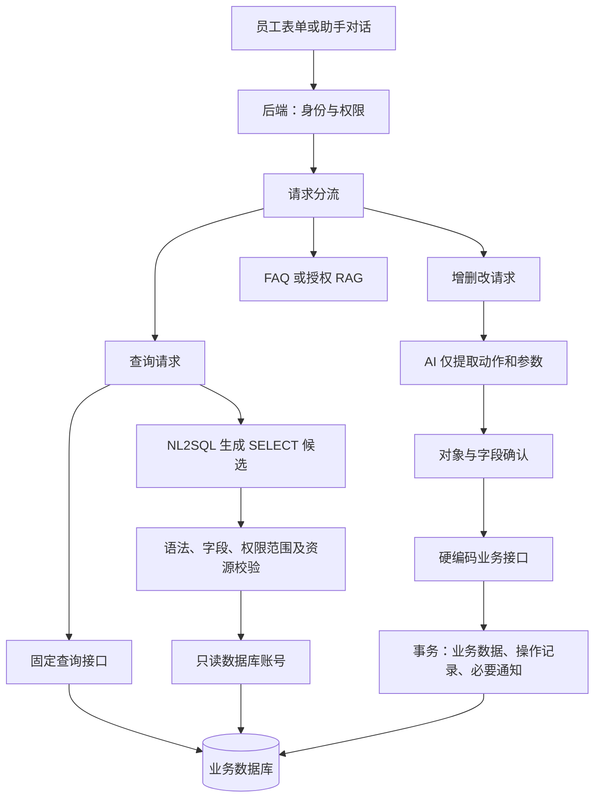

# 企业智能助手：功能与数据库设计方案

> 版本：V2.2（统一实体 ID 与主外键关联）  
> 日期：2026-10-14  
> 范围：企业智能助手及其直接涉及的共享业务数据。  
> 本次仅调整设计文档，不执行真实数据库删表，不编写程序、建表 SQL 或迁移代码。

## 1. 本版设计结论

将上一版 **37 张候选表精简为 14 张必要表**。保留原需求中的客户管理、日报、组织查询、新人指引、成绩、请假、投诉、主动待办及自然语言操作能力。

**NL2SQL 只负责数据库查询。所有新增、修改、删除都由后端硬编码的业务接口或服务执行。**

具体规则：

- 模型可以转写语音、提取字段、识别意图和生成查询候选 SQL。
- 写入场景中，模型只返回业务动作和参数；后端选择预先定义的接口与固定 ORM/参数化 SQL。
- 禁止模型生成或执行 INSERT、UPDATE、DELETE、DDL，以及通过存储过程、任意工具等间接修改数据库。
- 表单、对话、定时任务和外部系统回调使用同一套硬编码业务规则。
- 删除业务数据仍须校验权限、关联和状态；“硬编码”不等于把用户输入拼接到 SQL。
- 仅把功能真正需要持久化的业务数据放入关系库，暂不建设通用工作流、独立命令中心或全套会话日志系统。

## 2. 必要表与功能对应

| 编号 | 必要表 | 中文名称 | 对应功能 | 保留原因 |
|---|---|---|---|---|
| 01 | `org_department` | 部门表 | 组织架构、部门日报和客户范围 | 部门层级与职责需要独立管理 |
| 02 | `employee` | 员工表 | 登录身份、角色、通讯录和操作人 | 合并账号与员工档案，角色采用固定配置 |
| 03 | `customer_profile` | 客户表 | 客户录入、查询、状态更新 | 保存结构化客户信息及当前负责人 |
| 04 | `customer_followup` | 客户跟进表 | 历史跟进查询、跟进提醒 | 一名客户对应多次跟进，不能压成一个文本字段 |
| 05 | `employee_daily_report` | 员工日报表 | 文字/口述日报、管理查阅 | 一天一份日报，仅保存正式提交内容 |
| 06 | `student_profile` | 学生表 | 成绩、请假、投诉的身份关联 | 学生不是客户或员工，需有稳定标识 |
| 07 | `student_staff_binding` | 学生员工关系表 | 班主任、成绩和服务授权 | 学生可能对应多名老师，需要明确业务关系 |
| 08 | `student_score` | 学生成绩表 | 成绩录入、查询和更正 | 保存当前有效成绩 |
| 09 | `student_leave_request` | 学生请假表 | 学生申请、员工审批和结果查询 | 单级审批结果并入申请表 |
| 10 | `service_ticket` | 投诉反馈表 | 投诉分派、处理和结果反馈 | 企业端与学生端共享同一工单 |
| 11 | `service_ticket_record` | 投诉处理记录表 | 多轮跟进、内部备注与学生反馈 | 业务沟通是多条记录，不能与后台审计混为一谈 |
| 12 | `knowledge_entry` | 新人指南与制度知识表 | FAQ、新人指引、制度 RAG | 问答、文档元数据与当前版本合并保存 |
| 13 | `business_notification` | 业务通知表 | 审批/投诉结果通知、待办提醒、失败重试 | 一张表承担业务消息及投递状态 |
| 14 | `operation_log` | 业务操作记录表 | 写入追溯、修订历史、审批历史和请求幂等 | 合并通用变更记录，避免每个功能另建历史表 |

学生、请假、成绩、投诉及通知均与学生助手共用。若项目已存在等价的员工、部门或学生主数据表，直接复用，不重复建同类表。

### 2.1 明确删除或合并的设计

| 原表/原设计 | 本版处理 |
|---|---|
| `app_user` | 员工登录来源、身份键及状态合入 employee；学生身份绑定保留在 student_profile |
| `app_role`、`app_user_role`、`app_role_permission` | 删除独立表；员工保存固定角色代码，角色权限由后端配置 |
| `customer_event` | 客户状态、移交等历史并入 operation_log |
| `daily_report_revision` | 正式提交内容保存在日报表；提交与修订历史并入 operation_log，不持久化编辑草稿 |
| `student_score_revision` | 成绩变更历史并入 operation_log |
| `leave_approval_record` | 当前审批结果并入请假表，转派及历次操作并入 operation_log |
| `service_ticket_event` | 重组为 service_ticket_record，保留必要沟通与处理时间线 |
| `knowledge_document`、`knowledge_document_version` | 合并为 knowledge_entry，仅保存当前内容与发布版本；变更记录并入 operation_log |
| `work_task` | 删除；待办从客户跟进、请假、投诉等业务表直接查询 |
| `event_outbox`、`notification_delivery` | 合并为 business_notification，与业务变更同事务保存 |
| `operation_audit`、`assistant_command` | 合并必要操作回执和变更信息至 operation_log；确认预览使用短期签名凭证 |
| `file_asset` | 删除独立表；需要的受控附件定位存业务表，语音只作临时处理 |
| `external_entity_map` | 客户、学生、员工的外部 ID 放入相应主表；成绩使用学生、课程、学期、考核及次数的组合键定位 |
| `integration_sync_job` | 暂不建设独立同步调度中心；适配器处理同步，写回结果记入 operation_log |
| `assistant_session`、`assistant_message` | 不建立本地消息历史库；使用对话服务及账号绑定的短期上下文 |
| `team_report_snapshot` | 团队查阅/汇总直接读取日报；需保存正式报告时复用报告模块 |
| `onboarding_plan`、`onboarding_step`、`employee_onboarding_step` | 移出本期；新人指引保留知识问答，不扩大为入职流程管理 |
| `student_care_case`、`student_care_event` | 移出本期；心理模块通过其既有接口处理，不在企业助手另建关怀系统 |

不保留上一版的可选增强表清单。本版不包含客户聚类、独立产品销售机会、完整申请流程、薪酬或心理画像的数据设计。

## 3. 查询、增删改与知识问答的分工

| 用户请求 | AI 职责 | 后端执行方式 |
|---|---|---|
| “查张三最近的跟进记录” | 理解查询条件，必要时生成 SELECT 候选 | 固定查询接口或校验后的只读 NL2SQL |
| “录入一个新客户” | 提取姓名、联系方式等字段 | 硬编码客户新增接口 |
| “把客户改为已签约” | 识别动作、目标与参数，生成预览 | 硬编码状态更新接口 |
| “同意这条请假” | 找到具体申请并确认目标 | 硬编码审批接口 |
| “更正这次考试成绩” | 提取成绩、考核与更正原因 | 硬编码成绩更正接口 |
| “作废这次误录成绩” | 识别作废意图和具体成绩记录 | 硬编码作废接口，校验学生、课程及操作权限 |
| “新人报销流程是什么” | 在授权知识中检索并组织答案 | FAQ 或 RAG，不通过模型写入数据库 |

“硬编码”表示动作、表、可写字段、状态规则与 SQL/ORM 操作由开发者预先确定。用户只能提交经过校验的参数，不能传入自由 SQL、任意表名或任意可写字段。

## 4. 权限与主数据约定

### 4.1 固定角色，无独立权限配置表

employee.role_codes 保存受控角色代码数组，权限及数据范围在后端固定配置中定义。JSON 数组只保存角色名称集合，不保存自由权限表达式。

| 角色代码 | 中文角色 | 默认范围 |
|---|---|---|
| employee | 普通员工 | 本人日报 |
| consultant | 客户顾问 | 本人负责客户、相关跟进及本人日报 |
| manager | 部门主管 | 本部门客户与已提交日报；子部门是否包含由固定配置明确 |
| teacher | 班主任/老师 | 有效关系分派的请假、学生及工单 |
| academic | 教务人员 | 授权学生/课程成绩 |
| admin | 管理员 | 员工、部门、知识配置；业务权限需相应角色 |

兼任角色允许数组包含多个代码。每个角色分别计算自己的功能与范围，不能把不同角色的权限、部门范围随意组合。角色调整须由授权管理员通过硬编码接口处理并留记录。

本期不提供自由创建角色、多部门任意授权和动态权限编辑器。身份从认证上下文取得，模型或前端传来的 employee_id、student_id、部门不能替代真实身份。

### 4.2 外部系统

- 员工与部门优先来自通讯录；角色仍由本平台授权维护，不能盲目覆盖。
- 客户已有 CRM 时，CRM 为权威来源，硬编码接口通过适配器写回；得到确认后才更新本地快照。
- 成绩已有教务权威系统时，经教务可写接口修改；只有只读接口时，助手只提供查询。成绩来源由后端统一配置，不在成绩表逐行保存来源；适配器使用学生、课程、学期、考核及次数定位记录。
- 学生助手提交请假和投诉，企业助手审批和跟进，共用同一业务事实。
- 外部请求超时而结果不明时记录“待核实”，不直接显示成功，也不盲目重发可能产生重复业务的请求。
- 员工、客户、学生的外部 ID 单一映射足够支持首期；成绩以组合业务键定位，不保存独立外部成绩 ID。多 CRM、多教务或复杂同步任务不在本次精简范围。

## 5. 字段与数据库公共约定

以下所有表的字段均附中文注释。未标“可空”的字段默认必填，条件必填另见注释。字段类型为 MySQL 风格的设计建议。

员工主键统一为 employee.employee_id，学生主键统一为 student_profile.student_id，客户主键统一为 customer_profile.customer_id。所有关联使用这些内部 ID；工号、业务编号、姓名、手机号和外部系统 ID 不作为本平台表之间的关联键。

每张表的主键在第 6 节逐表明确列出，不再继承一个含义不明的公共 id 字段。主键建议采用 BIGINT 自增，非空且唯一；引用方外键采用与目标主键一致的 BIGINT 类型。

| 公共字段名 | 类型 | 中文注释 | 适用范围 |
|---|---|---|---|
| `created_at` | DATETIME(3) | 本条记录在数据库中的创建时间，按 UTC 保存。 | 所有表 |
| `updated_at` | DATETIME(3) | 本条记录最近一次更新的时间，按 UTC 保存。 | 可变业务表 |
| `row_version` | INT | 并发修改校验版本号，初值 1，每次变更递增。 | 可变业务表 |

创建人、更新人及业务原因统一通过 operation_log 追溯；明确具有业务意义的跟进员工、审批人、处理人仍保留在各业务表。

其他约定：

- 日报 report_date 为机构工作日日期，默认按 Asia/Shanghai 计算；时间瞬间存 UTC。
- 部门、客户、学生、成绩、请假等真实关系使用第 5.2 节明确列出的主外键；通知和操作记录的通用实体引用按第 5.3 节由固定业务服务校验。
- 客户跟进与投诉处理记录按一条业务记录一行保存，不合并成长文本或 JSON 历史数组。
- operation_log 的变更前后数据保存必要历史；成绩统一为数值制，更正时保留得分与满分的完整旧值和新值，个人联系方式脱敏。
- 附件只保存受控对象存储定位，不保存永久公开下载地址，下载前检查对应业务权限。
- 原始语音为临时输入，转写后经员工确认形成业务数据；本期不建设录音归档库。
- 业务删除优先采用作废/停用；允许物理删除的对象及条件在硬编码接口中明确。

### 5.1 各表主键

| 表名 | 主键字段 | 说明 |
|---|---|---|
| `org_department` | `department_id` | BIGINT，非空、唯一，建议自增；业务关联使用此主键。 |
| `employee` | `employee_id` | BIGINT，非空、唯一，建议自增；业务关联使用此主键。 |
| `customer_profile` | `customer_id` | BIGINT，非空、唯一，建议自增；业务关联使用此主键。 |
| `customer_followup` | `followup_id` | BIGINT，非空、唯一，建议自增；业务关联使用此主键。 |
| `employee_daily_report` | `daily_report_id` | BIGINT，非空、唯一，建议自增；业务关联使用此主键。 |
| `student_profile` | `student_id` | BIGINT，非空、唯一，建议自增；业务关联使用此主键。 |
| `student_staff_binding` | `binding_id` | BIGINT，非空、唯一，建议自增；业务关联使用此主键。 |
| `student_score` | `score_id` | BIGINT，非空、唯一，建议自增；业务关联使用此主键。 |
| `student_leave_request` | `leave_request_id` | BIGINT，非空、唯一，建议自增；业务关联使用此主键。 |
| `service_ticket` | `ticket_id` | BIGINT，非空、唯一，建议自增；业务关联使用此主键。 |
| `service_ticket_record` | `ticket_record_id` | BIGINT，非空、唯一，建议自增；业务关联使用此主键。 |
| `knowledge_entry` | `knowledge_id` | BIGINT，非空、唯一，建议自增；业务关联使用此主键。 |
| `business_notification` | `notification_id` | BIGINT，非空、唯一，建议自增；业务关联使用此主键。 |
| `operation_log` | `operation_log_id` | BIGINT，非空、唯一，建议自增；业务关联使用此主键。 |

员工、学生、客户的普通外键分别使用 employee_id、student_id、customer_id。同一张表需要区分多名员工时，使用角色前缀，例如 approver_employee_id、decision_employee_id、reviewer_employee_id；这些字段都引用同一个 employee.employee_id，不是额外的员工编号体系。其余单一员工关系已统一为 employee_id，角色含义通过中文注释说明。

### 5.2 外键关联清单

| 来源表 | 外键字段 | 引用目标主键 | 业务含义 |
|---|---|---|---|
| `org_department` | `parent_department_id` | `org_department.department_id` | 上级部门 |
| `org_department` | `employee_id` | `employee.employee_id` | 部门主管 |
| `employee` | `department_id` | `org_department.department_id` | 员工主部门 |
| `customer_profile` | `employee_id` | `employee.employee_id` | 客户负责人 |
| `customer_profile` | `department_id` | `org_department.department_id` | 客户管理部门 |
| `customer_followup` | `customer_id` | `customer_profile.customer_id` | 跟进所属客户 |
| `customer_followup` | `employee_id` | `employee.employee_id` | 实际跟进员工 |
| `employee_daily_report` | `employee_id` | `employee.employee_id` | 日报所属员工 |
| `employee_daily_report` | `department_id_at_submit` | `org_department.department_id` | 提交时部门 |
| `student_profile` | `customer_id` | `customer_profile.customer_id` | 关联客户 |
| `student_profile` | `department_id` | `org_department.department_id` | 学生归属部门 |
| `student_staff_binding` | `student_id` | `student_profile.student_id` | 授权学生 |
| `student_staff_binding` | `employee_id` | `employee.employee_id` | 授权员工 |
| `student_score` | `student_id` | `student_profile.student_id` | 成绩所属学生 |
| `student_score` | `employee_id` | `employee.employee_id` | 成绩录入或更正员工 |
| `student_leave_request` | `student_id` | `student_profile.student_id` | 请假学生 |
| `student_leave_request` | `approver_employee_id` | `employee.employee_id` | 当前审批员工 |
| `student_leave_request` | `decision_employee_id` | `employee.employee_id` | 实际审批结果员工 |
| `service_ticket` | `student_id` | `student_profile.student_id` | 工单对应学生 |
| `service_ticket` | `employee_id` | `employee.employee_id` | 当前工单处理员工 |
| `service_ticket` | `handling_department_id` | `org_department.department_id` | 当前处理部门 |
| `service_ticket_record` | `ticket_id` | `service_ticket.ticket_id` | 所属工单 |
| `service_ticket_record` | `employee_id` | `employee.employee_id` | 员工操作者 |
| `service_ticket_record` | `student_id` | `student_profile.student_id` | 学生操作者 |
| `knowledge_entry` | `employee_id` | `employee.employee_id` | 知识维护员工 |
| `knowledge_entry` | `reviewer_employee_id` | `employee.employee_id` | 知识审核员工 |
| `knowledge_entry` | `access_department_id` | `org_department.department_id` | 限定访问部门 |
| `business_notification` | `employee_id` | `employee.employee_id` | 员工接收人 |
| `business_notification` | `student_id` | `student_profile.student_id` | 学生接收人 |
| `operation_log` | `employee_id` | `employee.employee_id` | 员工操作者 |
| `operation_log` | `student_id` | `student_profile.student_id` | 学生操作者 |

上述字段按真实主外键约束设计。可空外键只有非空时才引用已有记录；已经形成引用的员工、学生、客户等主记录不允许随意物理删除，默认限制删除，不级联删除业务历史。主键 ID 不因姓名、工号、外部 ID 或负责人变更而改变。

通知接收人的 employee_id 与 student_id 必须二选一。工单处理记录、操作记录中的 employee_id、student_id、service_code 必须三选一；系统任务使用 service_code，员工和学生必须引用实际主表记录。学生反馈工单时，还须验证操作者 student_id 与工单所属学生一致。

### 5.3 通用对象引用与外部标识

business_notification 和 operation_log 的 entity_type + entity_id 用于关联不同类型的业务对象。entity_id 必须取对应表的实际主键，例如客户对象取 customer_id、请假对象取 leave_request_id、工单对象取 ticket_id；由固定业务接口选择类型并校验，不接受任意表名或猜测对象。一个通用字段不能同时对多张表建立数据库外键，因此这里是受控逻辑引用，不作为已建立物理外键的关系列入上表。

employee_no、student_no、customer_no 仅为唯一业务编号；external_employee_id、external_student_id、external_customer_id 仅用于外部系统对接。本平台各表之间只通过内部主键和对应外键关联。

## 6. 必要表字段设计

### 6.1 `org_department`：部门表

| 字段名 | 类型 | 中文注释 |
|---|---|---|
| `department_id` | BIGINT | 部门记录主键 ID，供员工、客户、学生及部门层级引用。 主键（PK）。 |
| `department_code` | VARCHAR(32) | 部门唯一业务编码。 |
| `department_name` | VARCHAR(100) | 部门名称。 |
| `parent_department_id` | BIGINT，可空 | 上级部门 ID，关联本表；顶级部门为空。 外键（FK）关联 org_department.department_id。 |
| `function_description` | TEXT，可空 | 部门职能与职责说明。 |
| `employee_id` | BIGINT，可空 | 部门主管员工 ID，关联 employee。 外键（FK）关联 employee.employee_id。 |
| `status` | VARCHAR(20) | 部门状态：active 启用、disabled 停用。 |

约束与使用说明：department_code 唯一；parent_department_id 建索引。禁止部门层级成环。员工与部门互相引用时先建立无主管的部门，再指定主管。

### 6.2 `employee`：员工表

| 字段名 | 类型 | 中文注释 |
|---|---|---|
| `employee_id` | BIGINT | 员工主键 ID，是所有员工业务关联的内部标识，不使用工号代替。 主键（PK）。 |
| `employee_no` | VARCHAR(32) | 员工唯一工号。 |
| `full_name` | VARCHAR(100) | 员工姓名，允许重名。 |
| `department_id` | BIGINT | 当前主部门 ID，关联 org_department。 外键（FK）关联 org_department.department_id。 |
| `position_title` | VARCHAR(100)，可空 | 员工岗位或职务名称。 |
| `login_provider` | VARCHAR(32) | 登录来源，如企业统一登录。 |
| `login_subject` | VARCHAR(128) | 登录来源提供的不可变账号标识。 |
| `role_codes` | JSON | 受控角色代码数组；权限由后端固定配置解释。 |
| `work_phone_ciphertext` | VARBINARY(512)，可空 | 加密保存的工作联系电话。 |
| `work_email` | VARCHAR(254)，可空 | 工作邮箱。 |
| `status` | VARCHAR(20) | 员工状态：active 启用、disabled 停用、left 离职。 |
| `joined_date` | DATE | 入职日期。 |
| `left_date` | DATE，可空 | 离职日期，未离职时为空。 |
| `external_employee_id` | VARCHAR(128)，可空 | 权威通讯录中的员工 ID。 |

约束与使用说明：employee_no 及 (login_provider, login_subject) 唯一；外部员工 ID 非空时唯一。索引 (department_id, status)。离职停用登录，并处理客户、审批及工单的责任人移交。

### 6.3 `customer_profile`：客户表

| 字段名 | 类型 | 中文注释 |
|---|---|---|
| `customer_id` | BIGINT | 客户主键 ID，是跟进记录及关联学生使用的内部标识。 主键（PK）。 |
| `customer_no` | VARCHAR(32) | 客户唯一业务编号。 |
| `full_name` | VARCHAR(100) | 客户姓名，不作为唯一身份依据。 |
| `phone_ciphertext` | VARBINARY(512)，可空 | 加密保存的客户手机号。 |
| `phone_lookup_token` | CHAR(64)，可空 | 标准化手机号的带密钥匹配标记，用于提示重复候选。 |
| `education_level` | VARCHAR(32)，可空 | 客户学历层次。 |
| `target_country_code` | VARCHAR(8)，可空 | 意向留学国家编码。 |
| `source_channel` | VARCHAR(32) | 客户来源，如人工、客服留资或 CRM。 |
| `source_reference` | VARCHAR(128)，可空 | 来源留资或研判任务引用。 |
| `employee_id` | BIGINT，可空 | 当前顾问员工 ID，未分派时为空。 外键（FK）关联 employee.employee_id。 |
| `department_id` | BIGINT | 当前客户管理部门 ID。 外键（FK）关联 org_department.department_id。 |
| `status` | VARCHAR(20) | 客户状态：new、contacting、qualified、signed、lost。 |
| `status_changed_at` | DATETIME(3) | 当前客户状态开始生效的时间。 |
| `lost_reason` | TEXT，可空 | 流失原因，状态变为 lost 时必须填写。 |
| `last_followup_at` | DATETIME(3)，可空 | 最近一次有效跟进时间，由业务服务维护。 |
| `authority_source` | VARCHAR(20) | 数据权威来源：local 本平台、crm 外部 CRM。 |
| `external_customer_id` | VARCHAR(128)，可空 | CRM 中的客户 ID。 |
| `external_updated_at` | DATETIME(3)，可空 | 最近确认的外部客户更新时间。 |
| `is_archived` | BOOLEAN | 是否已归档，默认 false；保留销售状态和历史，归档后不进入默认客户列表。 |

约束与使用说明：customer_no 唯一，external_customer_id 非空时唯一。索引 (employee_id, status)、(department_id, status)、phone_lookup_token。手机号仅用于重复提示，不按手机号直接合并人员。客户状态和移交历史记录到 operation_log。

### 6.4 `customer_followup`：客户跟进表

| 字段名 | 类型 | 中文注释 |
|---|---|---|
| `followup_id` | BIGINT | 客户跟进记录主键 ID。 主键（PK）。 |
| `customer_id` | BIGINT | 本记录所属客户 ID。 外键（FK）关联 customer_profile.customer_id。 |
| `employee_id` | BIGINT | 实际执行跟进的员工 ID。 外键（FK）关联 employee.employee_id。 |
| `followup_at` | DATETIME(3) | 客户沟通实际发生时间。 |
| `channel` | VARCHAR(32) | 跟进方式，如电话、面谈或线上沟通。 |
| `content` | TEXT | 完整跟进内容。 |
| `summary` | TEXT，可空 | 经员工确认的跟进摘要。 |
| `next_followup_at` | DATETIME(3)，可空 | 计划下一次跟进的时间。 |
| `followup_status` | VARCHAR(20) | 下一次跟进安排状态：none 未安排、pending 待跟进、done 已完成、cancelled 已取消。 |

约束与使用说明：索引 (customer_id, followup_at, followup_id)、(followup_status, next_followup_at, customer_id)。employee_id 始终保留实际跟进人，不因客户移交而改写；后续待办按客户当前 employee_id 分配。完成或取消该安排后不再作为待办；重新约定时间由硬编码接口更新并记录历史。

### 6.5 `employee_daily_report`：员工日报表

| 字段名 | 类型 | 中文注释 |
|---|---|---|
| `daily_report_id` | BIGINT | 员工日报记录主键 ID。 主键（PK）。 |
| `employee_id` | BIGINT | 日报所属员工 ID。 外键（FK）关联 employee.employee_id。 |
| `report_date` | DATE | 日报对应机构工作日日期。 |
| `department_id_at_submit` | BIGINT | 最近提交时的部门快照。 外键（FK）关联 org_department.department_id。 |
| `submitted_content` | TEXT | 最近一次员工确认提交的正式内容，必须填写。 |
| `ai_summary` | TEXT，可空 | 与最近提交内容对应的辅助摘要。 |
| `status` | VARCHAR(20) | 日报状态：submitted 已提交、void 已作废。 |
| `submitted_at` | DATETIME(3) | 最近正式提交时间。 |

约束与使用说明：唯一 (employee_id, report_date)；索引 (department_id_at_submit, report_date, status)。文字输入、语音转写和编辑内容仅临时处理，员工确认后才新增或更新正式日报。修改前的正式内容写入 operation_log；管理层仅查询 status 为 submitted 的记录。

### 6.6 `student_profile`：学生表

| 字段名 | 类型 | 中文注释 |
|---|---|---|
| `student_id` | BIGINT | 学生主键 ID，是成绩、请假、投诉及学生员工关系使用的内部标识。 主键（PK）。 |
| `student_no` | VARCHAR(32) | 学生唯一业务编号。 |
| `full_name` | VARCHAR(100) | 学生姓名，允许重名。 |
| `customer_id` | BIGINT，可空 | 关联客户 ID，不自动授予客户账号访问学生数据的权限。 外键（FK）关联 customer_profile.customer_id。 |
| `department_id` | BIGINT | 学生教务或服务归属部门 ID。 外键（FK）关联 org_department.department_id。 |
| `login_provider` | VARCHAR(32)，可空 | 学生登录来源，尚未开通账号时为空。 |
| `login_subject` | VARCHAR(128)，可空 | 学生登录身份键，与登录来源同时填写。 |
| `status` | VARCHAR(20) | 学生服务或在读状态。 |
| `external_student_id` | VARCHAR(128)，可空 | 教务系统中的学生 ID。 |
| `is_archived` | BOOLEAN | 是否已归档，默认 false；归档不删除已有成绩、请假和投诉关联。 |

约束与使用说明：student_no 唯一；已绑定时 (login_provider, login_subject) 唯一；非空 external_student_id 唯一。学生登录上下文使用学生身份类别，与员工身份明确区分；不信任客户端自行传来的 student_id。

### 6.7 `student_staff_binding`：学生员工关系表

| 字段名 | 类型 | 中文注释 |
|---|---|---|
| `binding_id` | BIGINT | 学生员工关系记录主键 ID。 主键（PK）。 |
| `student_id` | BIGINT | 被服务或管理的学生 ID。 外键（FK）关联 student_profile.student_id。 |
| `employee_id` | BIGINT | 承担对应职责的员工 ID。 外键（FK）关联 employee.employee_id。 |
| `relation_type` | VARCHAR(32) | 关系类型：class_teacher 班主任、score_editor 成绩人员、service_advisor 服务顾问。 |
| `course_scope_code` | VARCHAR(64)，可空 | 成绩权限限定的课程编码，空值需角色允许相应课程范围。 |
| `is_primary` | BOOLEAN | 是否为此业务关系的主要负责人。 |
| `valid_from` | DATETIME(3) | 关系开始生效时间。 |
| `valid_to` | DATETIME(3)，可空 | 关系失效时间，临时代理需要截止时间。 |
| `status` | VARCHAR(20) | 关系状态：active 有效、disabled 停用。 |

约束与使用说明：索引 (employee_id, relation_type, status)、(student_id, relation_type, status)。单级请假同时只能有一名有效主审批老师；分派服务在事务中校验有效期与重复关系。关系记录可结束有效期后追加新行，不能无痕覆盖历史。

### 6.8 `student_score`：学生成绩表

| 字段名 | 类型 | 中文注释 |
|---|---|---|
| `score_id` | BIGINT | 学生成绩记录主键 ID。 主键（PK）。 |
| `student_id` | BIGINT | 成绩所属学生 ID。 外键（FK）关联 student_profile.student_id。 |
| `course_code` | VARCHAR(64) | 受控课程编码。 |
| `term_code` | VARCHAR(32) | 学期编码。 |
| `assessment_code` | VARCHAR(64) | 考试、作业或其他考核项目编码。 |
| `attempt_no` | INT | 考核尝试次数，首次为 1，补考递增。 |
| `score_value` | DECIMAL(8,2) | 学生实际得分，统一采用数值制，必须填写。 |
| `max_score` | DECIMAL(8,2) | 本次考核满分，必须填写且大于零。 |
| `employee_id` | BIGINT | 最近录入或更正成绩的员工 ID。 外键（FK）关联 employee.employee_id。 |
| `status` | VARCHAR(20) | 成绩状态：valid 有效、void 作废。 |

约束与使用说明：唯一 (student_id, course_code, term_code, assessment_code, attempt_no)。成绩统一采用数值制，校验 max_score > 0 且 0 ≤ score_value ≤ max_score；特殊加分先确认规则。课程由 course_code 标识，展示名称从既有教务目录或受控字典获取，不在成绩表重复保存。每次更正须说明原因，得分、满分及其他必要字段的旧值和新值记入 operation_log。

### 6.9 `student_leave_request`：学生请假表

| 字段名 | 类型 | 中文注释 |
|---|---|---|
| `leave_request_id` | BIGINT | 学生请假申请主键 ID。 主键（PK）。 |
| `request_no` | VARCHAR(32) | 请假申请唯一业务编号。 |
| `student_id` | BIGINT | 提交申请的学生 ID。 外键（FK）关联 student_profile.student_id。 |
| `leave_type` | VARCHAR(32) | 请假类型，如病假或事假。 |
| `start_at` | DATETIME(3) | 请假开始时间。 |
| `end_at` | DATETIME(3) | 请假结束时间，必须晚于开始时间。 |
| `reason` | TEXT | 学生填写的请假原因。 |
| `attachment_key` | VARCHAR(512)，可空 | 证明附件的受控对象存储定位。 |
| `approver_employee_id` | BIGINT，可空 | 当前审批员工 ID，分派异常时为空。 外键（FK）关联 employee.employee_id。 |
| `status` | VARCHAR(20) | submitted 待审批、approved 已批准、rejected 已驳回、withdrawn 已撤回。 |
| `submitted_at` | DATETIME(3) | 学生提交申请的时间。 |
| `decision_employee_id` | BIGINT，可空 | 实际批准或驳回申请的员工 ID。 外键（FK）关联 employee.employee_id。 |
| `decision_at` | DATETIME(3)，可空 | 形成审批结果的时间。 |
| `decision_comment` | TEXT，可空 | 审批意见，驳回时必填。 |

约束与使用说明：request_no 唯一。索引 (approver_employee_id, status, submitted_at)、(student_id, start_at)。采用单级审批；转派增加 row_version，当前分派变化及审批历史记入 operation_log，不另设审批表。

### 6.10 `service_ticket`：投诉反馈表

| 字段名 | 类型 | 中文注释 |
|---|---|---|
| `ticket_id` | BIGINT | 投诉反馈工单主键 ID，供处理记录引用。 主键（PK）。 |
| `ticket_no` | VARCHAR(32) | 统一工单业务编号。 |
| `student_id` | BIGINT | 投诉或反馈对应学生 ID。 外键（FK）关联 student_profile.student_id。 |
| `ticket_type` | VARCHAR(20) | complaint 投诉或 suggestion 建议。 |
| `category_code` | VARCHAR(32) | 申请、签证、教学等受控分类编码。 |
| `content` | TEXT | 学生提交的原始内容。 |
| `ai_summary` | TEXT，可空 | 辅助摘要，不覆盖学生原文。 |
| `priority` | VARCHAR(20) | 处理优先级。 |
| `employee_id` | BIGINT，可空 | 当前处理员工 ID，未分派时为空。 外键（FK）关联 employee.employee_id。 |
| `handling_department_id` | BIGINT | 当前处理部门 ID。 外键（FK）关联 org_department.department_id。 |
| `status` | VARCHAR(32) | 工单状态：open 待分派、assigned 已分派、processing 处理中、awaiting_student 待学生确认、closed 已关闭、reopened 已重开。 |
| `first_response_at` | DATETIME(3)，可空 | 首次有效人工回应时间，自动回执不计入。 |
| `response_due_at` | DATETIME(3) | 首次回应截止时间。 |
| `resolution_due_at` | DATETIME(3) | 当前轮次解决截止时间。 |
| `solution` | TEXT，可空 | 当前解决方案，进入待学生确认状态时必填。 |
| `resolved_at` | DATETIME(3)，可空 | 最近给出解决方案的时间。 |
| `closed_at` | DATETIME(3)，可空 | 当前有效关闭时间。 |
| `reopen_count` | INT | 重新打开次数，默认 0。 |
| `satisfaction_score` | TINYINT，可空 | 学生实际评价分数，建议 1—5。 |

约束与使用说明：ticket_no 唯一。索引 (employee_id, status, resolution_due_at)、(student_id, created_at)、(handling_department_id, status)。投诉相关老师不得自动成为被投诉事项的处理人；特殊工单范围由固定权限规则限制。

### 6.11 `service_ticket_record`：投诉处理记录表

| 字段名 | 类型 | 中文注释 |
|---|---|---|
| `ticket_record_id` | BIGINT | 投诉处理记录主键 ID。 主键（PK）。 |
| `ticket_id` | BIGINT | 本条业务记录所属工单 ID。 外键（FK）关联 service_ticket.ticket_id。 |
| `record_type` | VARCHAR(32) | 记录类型：分派、人工回应、备注、解决、确认、重开或升级。 |
| `employee_id` | BIGINT，可空 | 操作员工 ID，外键关联 employee.employee_id；员工操作时填写。 |
| `student_id` | BIGINT，可空 | 操作学生 ID，外键关联 student_profile.student_id；学生反馈时填写。 |
| `service_code` | VARCHAR(64)，可空 | 自动处理的受控服务编码；系统操作时填写，不作为员工或学生 ID。 |
| `content` | TEXT，可空 | 本次沟通、反馈或处理说明。 |
| `visibility` | VARCHAR(20) | internal 内部可见或 student_visible 学生可见。 |
| `to_status` | VARCHAR(32)，可空 | 本次处理后工单状态。 |
| `cycle_no` | INT | 当前处理轮次，初次为 1，重开后递增。 |
| `record_key` | VARCHAR(160) | 唯一业务记录去重键。 |

约束与使用说明：employee_id、student_id、service_code 必须且只能填写一种，分别表示员工、学生或系统操作。record_key 唯一；索引 (ticket_id, created_at, ticket_record_id)。处理记录只保存本次操作后的工单状态；变更前状态通过 operation_log.before_data 追溯。记录追加保存；作废或纠正通过新增说明和 operation_log 追溯。内部备注不会进入学生可见查询或通用 NL2SQL。

### 6.12 `knowledge_entry`：新人指南与制度知识表

| 字段名 | 类型 | 中文注释 |
|---|---|---|
| `knowledge_id` | BIGINT | 知识条目主键 ID。 主键（PK）。 |
| `entry_code` | VARCHAR(64) | 知识条目唯一编码。 |
| `title` | VARCHAR(200) | 知识标题。 |
| `entry_type` | VARCHAR(20) | faq 标准问答或 document 制度文档。 |
| `category_code` | VARCHAR(32) | 入职、制度或业务流程等分类编码。 |
| `question` | TEXT，可空 | FAQ 标准问题，faq 时必填。 |
| `answer` | TEXT，可空 | FAQ 标准答案，faq 时必填。 |
| `content_text` | LONGTEXT，可空 | 文档正文，document 时应有正文或受控来源。 |
| `source_reference` | VARCHAR(512)，可空 | 原文件、章节或受控资料来源定位。 |
| `employee_id` | BIGINT | 知识维护员工 ID。 外键（FK）关联 employee.employee_id。 |
| `access_department_id` | BIGINT，可空 | 限定访问部门；为空表示全体员工可见。 外键（FK）关联 org_department.department_id。 |
| `version_no` | INT | 当前内容版本号，内容变更时递增。 |
| `status` | VARCHAR(20) | draft 草稿、published 已发布、disabled 停用。 |
| `reviewer_employee_id` | BIGINT，可空 | 审核该版本的员工 ID。 外键（FK）关联 employee.employee_id。 |
| `reviewed_at` | DATETIME(3)，可空 | 审核完成时间。 |
| `effective_from` | DATETIME(3)，可空 | 已发布知识开始生效的时间。 |
| `expires_at` | DATETIME(3)，可空 | 知识失效时间。 |
| `index_status` | VARCHAR(20) | 索引状态：pending 待更新、ready 可检索、failed 失败。 |
| `external_document_id` | VARCHAR(128)，可空 | Dify 或外部索引中的文档 ID。 |

约束与使用说明：entry_code 唯一；索引 (status, access_department_id, expires_at)。更新内容时先置为草稿并递增版本，审核及索引就绪后再发布。旧内容必要快照记入 operation_log，历史不作为默认问答依据。

### 6.13 `business_notification`：业务通知表

| 字段名 | 类型 | 中文注释 |
|---|---|---|
| `notification_id` | BIGINT | 业务通知记录主键 ID。 主键（PK）。 |
| `entity_type` | VARCHAR(32) | 关联业务实体类型，如请假、投诉或跟进。 |
| `entity_id` | BIGINT | 关联业务记录 ID，由业务服务按实体类型校验。 |
| `event_code` | VARCHAR(64) | 业务通知原因，如待审批、审批结果或投诉解决。 |
| `employee_id` | BIGINT，可空 | 员工接收人 ID，与学生接收人二选一。 外键（FK）关联 employee.employee_id。 |
| `student_id` | BIGINT，可空 | 学生接收人 ID，与员工接收人二选一。 外键（FK）关联 student_profile.student_id。 |
| `channel` | VARCHAR(20) | 投递渠道，如站内或企业消息。 |
| `title` | VARCHAR(200) | 通知标题，只包含必要信息。 |
| `content` | TEXT | 通知内容，不包含敏感业务原文。 |
| `dedupe_key` | VARCHAR(160) | 包含业务事件、轮次、接收人及渠道的唯一通知键。 |
| `delivery_status` | VARCHAR(20) | pending 待发送、sending 发送中、sent 已发送、failed 失败、dead_letter 终止重试。 |
| `attempt_count` | INT | 已尝试发送次数，初值 0。 |
| `next_retry_at` | DATETIME(3)，可空 | 下一次允许重试时间。 |
| `lease_until` | DATETIME(3)，可空 | 发送任务租约截止时间，用于恢复中断任务。 |
| `sent_at` | DATETIME(3)，可空 | 对应渠道确认接收消息的时间。 |
| `read_at` | DATETIME(3)，可空 | 真实已读时间，不支持回执时为空。 |
| `last_error_code` | VARCHAR(64)，可空 | 最近一次发送失败的脱敏错误码。 |

约束与使用说明：dedupe_key 唯一；接收人必须且只能指定一种。索引 (delivery_status, next_retry_at)、(employee_id, read_at, created_at)、(student_id, read_at, created_at)。业务写入与通知创建同事务；已发送不等于已读。

### 6.14 `operation_log`：业务操作记录表

| 字段名 | 类型 | 中文注释 |
|---|---|---|
| `operation_log_id` | BIGINT | 业务操作记录主键 ID。 主键（PK）。 |
| `operation_key` | CHAR(64) | 操作唯一键，由真实操作者、动作和请求幂等键确定，与新建对象 ID 无关。 |
| `employee_id` | BIGINT，可空 | 真实操作员工 ID，外键关联 employee.employee_id。 |
| `student_id` | BIGINT，可空 | 真实操作学生 ID，外键关联 student_profile.student_id。 |
| `service_code` | VARCHAR(64)，可空 | 执行自动操作的受控服务编码，不伪装成员工或学生身份。 |
| `action_code` | VARCHAR(64) | 预先定义的业务动作编码。 |
| `entity_type` | VARCHAR(32) | 被操作业务实体类型。 |
| `entity_id` | BIGINT，可空 | 关联对象 ID，新建未完成或失败时可为空。 |
| `request_key` | VARCHAR(128) | 逻辑业务请求幂等键，同一提交重试保持不变。 |
| `parameters_hash` | CHAR(64) | 规范化业务参数摘要，用于识别相同幂等键下的参数冲突。 |
| `before_data` | JSON，可空 | 变更前必要业务快照，敏感字段按规则保护。 |
| `after_data` | JSON，可空 | 变更后必要业务快照，保留审批及修订结果。 |
| `change_reason` | TEXT，可空 | 人工更正、移交、驳回、删除等业务原因。 |
| `operation_status` | VARCHAR(32) | 操作状态：processing 处理中、succeeded 成功、failed 失败、pending_external 等待外部结果、unknown_external 外部结果待核实。 |
| `result_reference` | JSON，可空 | 受控操作回执和对象标识，用于重复请求返回原结果。 |
| `external_request_id` | VARCHAR(128)，可空 | 外部系统请求标识，用于查询写回结果和对账。 |
| `error_code` | VARCHAR(64)，可空 | 操作失败、冲突或待核实的脱敏错误码。 |
| `finished_at` | DATETIME(3)，可空 | 操作形成明确成功或失败结果的时间。 |

约束与使用说明：employee_id、student_id、service_code 必须且只能填写一种，真实身份由后端认证上下文确定。operation_key 唯一；索引 (entity_type, entity_id, created_at)、(employee_id, created_at)、(student_id, created_at)、(operation_status, created_at)。角色及资源授权仍在后端执行，不从该表推断授权。已完成操作不允许普通用户编辑或删除。

## 7. 核心业务流程

### 7.1 客户录入与状态更新

1. 文字或语音转写得到业务输入，AI 提取结构化字段。
2. 员工确认姓名、联系方式、来源及目标客户；重名和重复候选需要澄清。
3. 后端调用固定新增/更新接口，校验字段与客户归属。
4. 本地模式在事务内写入客户和 operation_log；CRM 权威模式先获得外部确认再更新本地。
5. 返回实际操作结果，不根据模型回复判断是否已保存。

状态初版支持 new → contacting → qualified → signed，售前各阶段可转 lost；lost 恢复跟进需理由。signed 不直接等同于售前 lost，解约退款另有业务规则。

### 7.2 日报与修订

口述 → 临时转写 → AI 辅助整理 → 员工预览和编辑 → 员工确认 → 硬编码提交接口新增或更新 submitted_content。

管理层只查有效的正式提交内容。确认前的输入、转写和编辑内容不写入日报表；已提交日报的再次编辑也仅临时处理，重新确认时才保存。更新时，将上一份已提交内容和新内容记入 operation_log，再更新日报。历史查看通过固定操作记录接口，不让 NL2SQL 直接读取通用日志。

团队摘要从授权部门日报直接生成；正式报告持久化交给报告模块。缺交提醒仅在工作日与应提交员工范围明确后启用，不额外建立入职或考勤表。

### 7.3 成绩录入与更正

后端同时校验功能角色、student_staff_binding 有效关系与课程范围。所有成绩均为数值制，实际得分和满分必填并校验范围。录入或更正通过固定 ORM/参数化 SQL 执行，旧得分、旧满分与新值完整写入操作记录。成绩作废保留历史，不通过物理删除抹去已发布成绩。

### 7.4 请假审批

学生提交 → 生成请假记录 → 硬编码规则分派老师 → 创建通知 → 老师批准/驳回 → 更新同一请假表 → 通知学生。

- 每次批准或驳回必须验证 submitted 状态、当前 approver_employee_id 和 row_version。
- 审批人变化通过固定转派接口操作并留记录，原审批人不能继续批准。
- 审批结果直接保存在请假表；历史审批和转派查 operation_log。
- 找不到有效审批人时进入待分派异常列表，由授权管理员处理，不随意选老师。
- 学生可撤回尚未审批申请；批准后的取消不在默认流程内。

### 7.5 投诉处理

open → assigned → processing → awaiting_student → closed。学生反馈未解决可进入 reopened。

工单主体保存当前处理状态和解决方案，每次沟通、分派、解决、确认与重开写入 service_ticket_record。内部备注只供有权限的员工查看。重开后 reopen_count 加一，处理记录使用新 cycle_no，保留原轮次时间线。

首次有效人工回应设置 first_response_at；AI 自动回执不计入。SLA 时长由业务方确认，首期按连续时间计算；未确认工作日历前不声称支持工作时间 SLA。

### 7.6 新人指南

标准问答和制度文档统一在 knowledge_entry 中维护。FAQ 优先直接返回审核后的标准答案；文档检索使用已发布、有效、授权的知识。

内容更新时暂时退出发布范围，完成审核和索引后重新发布。检索前限制授权资料，检索后检查条目 ID、version_no、状态和有效期；不能把当前正文冒充历史版本。回答提供来源与版本，无可靠依据时引导人工核实。

## 8. 无独立待办表的主动提醒

待办是业务表的查询结果，不另外保存一份易失真的任务状态。

| 待办类型 | 数据依据 | 当前责任人 |
|---|---|---|
| 客户待跟进 | customer_followup 中 pending 且 next_followup_at 到期的安排 | customer_profile 当前负责人 |
| 请假待审批 | student_leave_request.status = submitted | 当前 approver_employee_id |
| 请假分派异常 | submitted 且审批人为空 | 授权管理员/业务分派负责人 |
| 投诉待处理 | open、assigned、processing、reopened，结合截止时间 | 当前工单处理人或授权分派负责人 |
| 日报缺交 | 明确工作日中应提交员工无已提交日报 | 本人员工，主管按部门查阅 |

定时扫描使用后端固定查询，不调用 NL2SQL。查询发现待办后，按“实体 + 业务版本/轮次 + 接收人 + 提醒时间段”生成稳定 dedupe_key，写入 business_notification。

提醒发出前再次检查当前业务状态和责任人；事项已结束或已移交时跳过旧通知。用户点击消息后重新查询真实业务状态。消息已读不等于业务已完成。

## 9. 通知、幂等与合并记录的边界

### 9.1 通知一表完成

本地业务事务内同时保存业务状态、operation_log 和必要 business_notification。通知发送工作进程直接扫描通知表，通过租约抢占、有限重试和失败状态管理投递。

不再建设 outbox 和 delivery 两张表。站内与外部渠道分别创建通知行，各自保留发送状态。外部网络不确定时仍可能重复投递，不承诺跨系统严格只发送一次。

### 9.2 增删改幂等与并发

- 每个写操作要求稳定 request_key；operation_key 从真实操作者类型及对应 employee_id/student_id（系统操作为 service_code）、action_code 和 request_key 确定，不包含尚未创建的实体 ID。
- 相同 operation_key 先核对 parameters_hash；参数不同返回冲突，相同且已成功则返回原 result_reference。
- 本地操作在同一短事务内占用唯一操作键、执行固定业务变更、保存前后快照和成功回执。唯一键冲突时回滚当前事务并读取原结果，避免重复创建业务行。
- 操作失败时回滚业务写入，必要失败记录在独立事务保存；失败重试规则明确，不能把失败回执当作成功。
- 更新和删除检查 row_version；审核、审批和历史状态变化仍需二次业务校验。
- 自然语言预览使用短期签名凭证，绑定真实账号、动作、目标、参数摘要、对象版本和失效时间，不另建命令表。确认后仍重新鉴权。

### 9.3 操作记录承载历史

客户状态/移交、日报提交/修订、成绩录入/更正、请假审批/转派和知识修改统一记录 operation_log。日志查询使用固定接口及严格权限，按实体、动作、时间筛选。

通用日志无法天然替代所有业务记录：客户跟进和投诉沟通仍独立成表，因为它们是员工直接使用的业务时间线，且投诉存在学生可见与内部可见之分。

本地成功/失败记录形成后不可由普通用户修改；外部处理中记录允许后端将 pending_external/unknown_external 更新为明确结果，保留原 request_key、参数摘要、创建时间及外部请求 ID。精简版不建设独立事件溯源或后台任务调度中心。

### 9.4 外部写回

外部写入同样由硬编码适配器执行，NL2SQL 不参与。

请求前记录 pending_external；成功确认后更新本地快照及回执。结果不明时记 unknown_external，固定查询接口展示“待核实”，由适配器查询外部请求或人工对账。外部不支持幂等时，禁止直接重发新建、审批等请求。

本期不承诺外部与本地事务原子提交、自动解决所有同步冲突或复杂批量断点续传。真实接口需要这些能力时再另行确定集成方案，不提前增加通用表。

## 10. NL2SQL 只读规定

### 10.1 允许范围

只允许针对授权业务视图的 SELECT；按角色提供最少字段。建议视图对应员工通讯录、客户概览、客户跟进、已提交日报、学生成绩、请假列表和工单概览。

视图不属于新增持久化业务表。普通数据库视图不会自动识别登录员工，后端仍需根据真实身份加入受控行级范围。

### 10.2 明确禁止

- INSERT、UPDATE、DELETE、REPLACE，以及建表、删表、改表、授权等语句。
- SELECT INTO 文件、锁定查询、可产生副作用的函数/过程及任意外部工具执行。
- 多语句、用户提供的自由表名/字段名及绕过字段白名单的查询。
- 通过 NL2SQL 查询角色配置、完整个人联系方式、operation_log、通知原始参数、学生内部投诉备注等非公开数据。
- 将模型给出的“查询类型”标签当作安全保证；必须解析实际 SQL。

### 10.3 查询校验

身份与权限 → 提供授权 Schema → 生成 SELECT 候选 → SQL AST 校验 → 附加后端控制的数据范围 → 参数绑定 → 只读数据库账号执行 → 脱敏及结果返回。

首版建议限定单个受控视图，模型不生成 JOIN、子查询、UNION 或 CTE；复杂跨表业务通过预先设计的视图或固定查询接口完成。视图内固定关联由开发者编写并审核。

建议先限制最多返回 200 行、数据库查询超时 3 秒，并根据实际数据量调整。聚合与排序也要限制扫描范围，不能认为加 LIMIT 就解决所有成本问题。

数据库层使用无增删改权限的只读账号；写接口使用独立业务账号和固定代码。NL2SQL 准确率目标按原需求为不低于 90%，权限和只读边界独立验收。

## 11. 硬编码增删改接口规则

| 业务对象 | 新增 | 修改 | 删除/作废规则 |
|---|---|---|---|
| 员工与部门 | 授权管理员或固定同步适配器 | 固定字段白名单、角色与归属校验 | 有业务关联时停用，不直接删历史身份 |
| 客户 | 固定客户新增接口 | 状态、资料和负责人分别校验 | 已有跟进或签约记录时采用业务归档规则 |
| 跟进记录 | 固定追加接口 | 更正需理由与历史记录 | 仅错误记录按确认规则处理，保留审计 |
| 日报 | 本人确认后正式提交 | 本人确认更正，记录原内容 | 正式日报不物理删除；必要时通过固定作废接口处理并留记录 |
| 学生档案 | 指定维护接口/教务同步 | 权威来源与关联校验 | 存在成绩、请假或工单时停用/归档 |
| 学生成绩 | 授权人员录入 | 更正原因、学生及课程权限校验 | 已发布成绩作废，保留前后值 |
| 请假 | 学生本人申请 | 当前授权老师审批，学生撤回 | 已提交申请保留，不用 DELETE 替代撤回 |
| 投诉 | 学生提交工单 | 分派、回应、解决和确认分别实现 | 业务工单保留处理历史，不随意物理删除 |
| 知识 | 维护人员创建草稿 | 审核、发布和版本变更 | 无引用草稿可删除，已发布资料停用 |
| 通知与日志 | 固定服务自动创建 | 服务更新投递/外部执行状态 | 保留期限内不允许员工删除，清理由固定维护任务执行 |

客户和学生归档通过专门接口设置 is_archived，保留原有销售/在读状态；归档记录默认不进入日常列表，也不能继续新建业务安排。删除条件由代码判断，无自由传入表名的“通用删除接口”。

AI 不选择任意 SQL，不直接执行数据库操作；只匹配后端已注册动作，如 create_customer、change_customer_status、submit_daily_report、correct_score、approve_leave、resolve_ticket。

## 12. 关系与实施顺序

### 12.1 主要关联

- 部门 → 员工；部门 → 客户、学生及已提交日报归属。
- 客户 → 多条跟进；客户可关联学生，但不自动产生访问权限。
- 员工 → 日报；员工与学生通过 student_staff_binding 建立具体职责。
- 学生 → 成绩、请假、投诉；投诉 → 多条处理记录。
- 所有员工、学生、客户直接关联分别引用 employee.employee_id、student_profile.student_id、customer_profile.customer_id；完整外键见第 5.2 节。
- 通知与操作记录中的操作者/接收人使用员工或学生外键，通用业务对象引用使用固定服务校验。

### 12.2 分阶段实施

| 阶段 | 交付内容 | 验收重点 |
|---|---|---|
| 第一阶段 | 员工、部门、客户、跟进、文字日报及操作记录 | 身份、部门范围、固定 CRUD、历史与并发 |
| 第二阶段 | 学生归属、成绩、请假、投诉、处理记录和通知 | 两端共用数据、审批闭环、通知重试、权限正确 |
| 第三阶段 | 语音、知识问答、NL2SQL 及自然语言写动作识别 | NL2SQL 只有查询权，写动作仅调用固定接口 |

不单独建设入职任务管理、心理关怀工单、消息历史库及完整同步中心。相关既有模块通过接口衔接，不为了接入就复制它们的数据结构。

## 13. 验收清单

1. 14 张表均能对应原需求或必要业务支持，没有未使用的候选表。
2. 学生与企业端使用同一请假、投诉和成绩数据。
3. NL2SQL 输出非 SELECT 或试图绕过权限时拒绝执行；只读账号不能写入。
4. 所有新增、修改和删除均使用固定业务代码，参数绑定，无模型生成写 SQL。
5. 姓名重名会澄清；审批、更正和删除对具体 ID 及当前版本校验。
6. 同一提交重试不重复新增客户、审批、成绩或投诉记录。
7. 日报确认前的编辑不落库、不影响主管看到的正式内容；旧提交与数值成绩更正可通过操作记录追溯。
8. 待办直接来源于业务状态，提醒已读不等于事项完成。
9. 通知失败独立重试；外部写回不明确时显示待核实。
10. 角色、部门、学生关系及知识权限在后端真实校验，不能靠 Prompt 授权。
11. 表格中每个保留字段都有独立中文注释，每张表主键明确，员工/学生/客户直接关联使用统一 ID 和实际外键。
12. 本版仅修改文档；将来若已有实际数据库，删表/合并需另做数据盘点和迁移。

## 14. 参考资料

- [企业智能助手需求](../02需求文档/企业智能助手.md)
- [学生智能助手需求](../02需求文档/学生智能助手.md)
- [客服 Agent 需求](../02需求文档/客服Agent.md)
- [客户研判需求](../02需求文档/客户研判.md)
- [智能报告需求](../02需求文档/智能报告.md)
- [原数据库设计](数据库设计文档.md)
- [开发文档 msj](../06开发文档/开发文档_msj.md)
- [开发文档 hzl](../06开发文档/开发文档_hzl.md)
- [开发文档 mrz](../06开发文档/开发文档_mrz.md)

本版对企业助手的数据库设计，以用户本次要求为准：**仅保留必要表；NL2SQL 仅查询；增删改全部硬编码。**其他旧方案若仍描述模型生成写 SQL，应在后续实现时按此边界调整。

