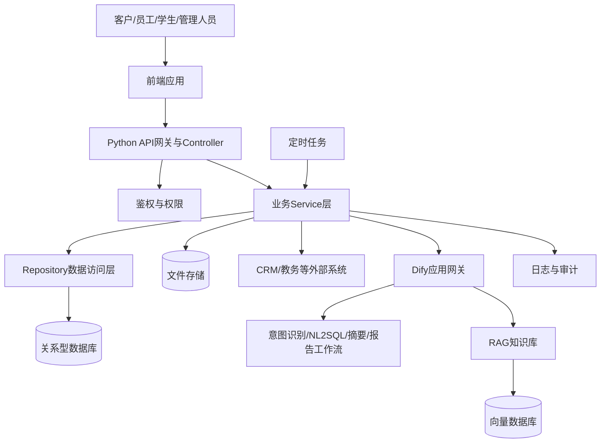

# 留学服务智能助手系统开发文档

> 文档版本：V1.0  
> 编制日期：2026-10-14  
> 适用对象：开发、测试、产品及项目管理人员

## 1. 文档说明

### 1.1 编制依据

本文档仅依据以下五部分现有资料整理，不使用其他开发文档内容：

1. `01需求拆解`
2. `02需求文档`
3. `03开发设计`
4. `04接口设计`
5. `05数据库设计`

### 1.2 建设目标

建设一套覆盖客户筛选、智能客服、企业内部协作、学生服务和经营分析的智能助手系统。系统应满足以下原则：

- AI能力使用Dify实现，包括意图识别、RAG、NL2SQL、内容摘要、风险识别、推荐话术和报告生成。
- 业务功能使用Python后端实现，包括用户鉴权、文件解析、CRUD、规则引擎、流程控制、定时任务和第三方系统对接。
- 提供完整前端，覆盖客户、员工、学生和管理人员所需的操作及数据展示页面。
- 采用企业级工程规范，落实统一响应、统一异常、分层架构、日志审计、参数校验、权限控制和自动化测试。

### 1.3 项目范围

系统包含五个业务模块：

| 模块      | 核心目标                              |
| :------ | :-------------------------------- |
| 客户研判    | 解析文本、PDF和Excel客户资料，按画像规则输出产品匹配结论  |
| 客服Agent | 完成机构咨询、业务查询、政策问答、项目推荐、活动报名、FAQ和闲聊 |
| 企业智能助手  | 管理意向客户、员工日报、组织架构、新人指引及学生业务        |
| 学生智能助手  | 支持行政申请、心理关怀、售后工单、考务、进度、生活问答及增值推荐  |
| 智能报告    | 生成客户经营、员工日报、学生心理和投诉处理等日/周报告       |

CRM、教务系统本身的建设，以及支付、合同签署和薪酬人事系统不在本期范围内；本系统仅通过接口与现有系统对接。

## 2. 总体技术方案

### 2.1 技术架构



### 2.2 推荐技术栈

| 层级       | 推荐技术                                             | 用途                         |
| :------- | :----------------------------------------------- | :------------------------- |
| 前端       | Vue 3、TypeScript、Vite、Element Plus、Pinia、ECharts | 业务页面、状态管理和报表可视化            |
| Python后端 | Python 3.11+、FastAPI、Pydantic、SQLAlchemy、Alembic | REST API、校验、业务逻辑、ORM和数据库迁移 |
| AI编排     | Dify Workflow/Chatflow、知识库、HTTP Request工具        | AI能力编排、RAG和业务接口调用          |
| 关系型数据库   | PostgreSQL或MySQL                                 | 业务数据持久化                    |
| 向量存储     | pgvector或独立向量数据库                                 | 知识库切片与向量检索                 |
| 异步任务     | Celery/APScheduler与Redis                         | 报告生成、提醒、待办推送和耗时文件解析        |
| 测试       | Pytest、HTTPX、Vitest、Playwright                   | 单元、接口、前端和端到端测试             |

具体数据库和中间件可按部署环境调整，但表结构、接口契约和分层职责不得随意改变。

### 2.3 Dify与Python职责边界

| 能力      | Dify职责               | Python职责             |
| :------ | :------------------- | :------------------- |
| 多意图路由   | 识别意图、抽取参数、输出置信度      | 校验权限与参数，调用对应Service  |
| RAG问答   | 文档召回、答案生成、引用来源       | 文档上传、版本管理、元数据维护      |
| NL2SQL  | 将自然语言转换为受控查询意图或SQL草案 | 表白名单、只读校验、参数化执行、结果脱敏 |
| 客户研判    | 非结构化字段抽取和解释生成        | 文件解析、规则执行、结果落库       |
| 心理风险识别  | 情绪标签、风险等级和触发原因识别     | 预警落库、通知老师、人工跟进闭环     |
| 智能摘要/报告 | 摘要、分类、归因和报告文本生成      | 数据聚合、任务调度、报告存储与查询    |
| 指令式业务处理 | 识别动作、对象和目标状态         | 权限检查、二次校验、事务执行和审计    |

任何写库操作不得由模型直接执行。Dify只输出结构化意图，由Python后端完成鉴权、校验、事务和审计后再写入数据库。

## 3. Python后端工程设计

### 3.1 MVC与分层结构

```text
backend/
├─ app/
│  ├─ controllers/        # Controller：接收请求、参数校验、返回响应
│  ├─ services/           # Service：业务编排、事务、Dify和外部系统调用
│  ├─ repositories/       # Repository：数据库访问
│  ├─ models/             # Model：ORM实体
│  ├─ schemas/            # ViewModel/DTO：请求与响应模型
│  ├─ clients/            # Dify、CRM、教务系统客户端
│  ├─ workflows/          # 长流程与任务编排
│  ├─ jobs/               # 定时任务
│  ├─ core/               # 配置、安全、日志、异常、响应封装
│  └─ main.py
├─ migrations/            # 数据库迁移
├─ tests/
└─ requirements.txt
```

分层调用方向固定为 `Controller → Service → Repository → Model`。Controller不得直接操作数据库；Repository不得编写业务判断；Dify调用统一放入Service或Client层。

### 3.2 统一响应

所有接口使用JSON响应：

```json
{
  "code": 0,
  "message": "success",
  "data": {},
  "request_id": "01J...",
  "timestamp": "2026-10-14T10:00:00+08:00"
}
```

| code  | HTTP状态  | 含义            |
| :---- | :------ | :------------ |
| 0     | 200/201 | 成功            |
| 40001 | 400     | 参数错误          |
| 40101 | 401     | 未登录或令牌失效      |
| 40301 | 403     | 无操作权限         |
| 40401 | 404     | 资源不存在         |
| 40901 | 409     | 状态冲突或重复提交     |
| 42201 | 422     | 业务校验失败        |
| 42901 | 429     | 请求过于频繁        |
| 50001 | 500     | 系统内部错误        |
| 50201 | 502     | Dify或外部系统调用失败 |

### 3.3 统一异常处理

- 定义参数、鉴权、权限、资源不存在、业务冲突、外部依赖和系统异常类型。
- 全局异常处理器负责错误码映射和统一响应，禁止向前端返回堆栈、SQL或密钥。
- Dify、CRM、教务接口设置连接和读取超时，并对幂等查询进行有限重试。
- 数据写入失败时回滚事务；异步任务失败进入重试队列或人工处理队列。
- 前端只根据业务错误码展示用户可理解的提示。

### 3.4 日志与审计

- 使用结构化JSON日志，至少包含时间、级别、服务、环境、request_id、user_id、模块、耗时和结果。
- 记录接口访问日志、业务关键节点、Dify调用耗时、外部系统调用结果和异常日志。
- 客户状态更新、请假审批、投诉状态变化、心理预警跟进、NL2SQL执行和活动报名必须记录审计日志。
- 手机号、学生心理数据、原始对话和令牌等敏感内容必须脱敏，密钥不得进入日志。
- `request_id`贯穿前端、Python、Dify和异步任务，便于全链路排查。

### 3.5 安全与权限

- 建议采用JWT/OAuth2登录，按客户、学生、员工、班主任、管理人员、管理员划分RBAC权限。
- 文件上传限制扩展名、MIME、大小和数量；保存时使用随机文件名，防止路径穿越。
- SQL全部参数化；NL2SQL只允许查询白名单表和字段，默认只读，限制返回行数和执行时长。
- 学生心理信息、客户联系方式等敏感数据需传输加密、访问控制和必要脱敏。
- 高危心理风险由系统触发人工预警流程，模型输出仅用于辅助识别，不替代专业判断。
- 业务写操作使用幂等键或版本号，避免重复报名、重复审批和并发覆盖。

## 4. 五大业务模块开发设计

### 4.1 客户研判模块

#### 4.1.1 核心流程

`上传文本/PDF/Excel → 文件安全校验 → Python解析 → Dify字段抽取 → 结构化校验 → 规则匹配 → 结果落库 → 页面展示/人工复核`

#### 4.1.2 开发内容

- 前端提供单条文本录入、PDF/Excel上传、批量任务进度和研判结果页。
- Python负责PDF、Excel和文本解析，保存原始信息与结构化字段。
- 研判规则按产品编码版本化，支持维护两个产品的画像规则。
- Dify负责非结构化信息抽取和研判解释，确定性规则由Python规则引擎执行。
- 输出是否匹配、产品编码、命中/未命中规则及研判原因，并允许人工复核。

#### 4.1.3 验收重点

- 正确解析文本、PDF和Excel，支持批量处理。
- 研判严格依据规则，目标准确率不低于95%。
- 输出字段完整、格式统一，规则更新后可追溯版本。

### 4.2 客服Agent模块

#### 4.2.1 核心流程

`用户消息 → Dify七类意图识别 → RAG/FAQ/业务查询 → 答案生成 → 推荐或报名动作 → Python接口落库`

#### 4.2.2 开发内容

- Dify建立客服Chatflow，覆盖公司信息、公司业务、留学政策、课程推荐、活动报名、FAQ和闲聊七类意图。
- 将《公司信息》《公司业务》《留学政策》切片入库，回答需携带知识来源；低置信度时转人工或提示无法确认。
- FAQ优先命中标准答案；课程推荐根据学历背景和意向国家进行条件匹配。
- Python提供活动查询、报名和FAQ查询接口，报名成功后返回报名编号。
- 前端提供访客聊天页、活动卡片、报名表单和后台知识库管理页。

#### 4.2.3 验收重点

- 七类意图识别准确率不低于90%。
- FAQ常规响应不超过1秒；RAG回答准确率目标不低于95%，且可查看来源。
- 活动查询、确认、报名和结果反馈形成闭环。
- 闲聊语气亲切、自然，业务回答不得使用未经知识库支持的事实。

### 4.3 企业智能助手模块

#### 4.3.1 核心流程

`员工语音/文字输入 → 语音转写/意图识别 → NL2SQL或业务指令 → 权限和参数校验 → CRUD/审批 → 结果与审计记录`

#### 4.3.2 开发内容

- 完成意向客户录入、查询、跟进记录和状态更新。
- 口述日报经语音转写后，由Dify提取进展、产出和风险，再由Python保存。
- 管理人员可按部门和日期查询、汇总员工日报。
- 新人指南采用FAQ与RAG两种方式，支持组织架构、制度和业务流程问答。
- NL2SQL必须经过只读、白名单和权限校验；不展示含敏感字段的SQL结果。
- 指令式处理采用“识别→展示待执行动作→权限校验→执行→审计”的流程。
- 定时任务查询待审批请假和待跟进投诉，并向员工侧推送待办。
- 前端提供客户管理、日报、组织架构、新人问答和待办审批页面。

#### 4.3.3 验收重点

- 客户录入、查询和状态更新完整可追踪。
- 口述内容可转换为结构化日报。
- NL2SQL准确率目标不低于90%，且不能绕过权限或执行写SQL。
- 请假审批、投诉更新等自然语言指令可正确执行并记录审计。

### 4.4 学生智能助手模块

#### 4.4.1 核心流程

`学生输入 → Dify七类意图路由 → 业务查询/申请/RAG → 数据落库 → 班主任处理 → 回调通知学生`

#### 4.4.2 开发内容

- 行政服务实现“学生提交→写入数据表→推送班主任→在线审批→通知学生”的请假闭环。
- 心理关怀由Dify识别情绪标签、风险等级和原因；高危结果立即写入预警表并通知老师跟进。
- 售后反馈由Dify生成投诉摘要，Python创建工单、维护处理状态和解决方案，并通知学生结果。
- 通过Python接口对接教务系统的DDL/考试数据以及CRM的文书、院校和签证进度。
- 海外生活指南和升学项目资料进入Dify知识库，支持生活问答和个性化推荐。
- 前端提供学生聊天、请假、投诉、考务、进度页面，以及老师审批和预警跟进页面。

#### 4.4.3 验收重点

- 七类场景路由准确率不低于90%。
- 请假和投诉均形成完整状态闭环。
- 高危风险及时预警、落库并进入人工跟进流程。
- 考务和申请进度能展示外部系统返回的最新数据。

### 4.5 智能报告模块

#### 4.5.1 报告类型

1. 全域客户经营分析报告。
2. 员工日报汇总报告（日）。
3. 员工日报汇总报告（周）。
4. 学生心理健康周报。
5. 投诉处理周报。

#### 4.5.2 开发内容

- Python按报告配置执行定时任务，聚合经过权限过滤和必要脱敏的数据。
- Dify负责客户画像总结、转化/流失归因、日报摘要、心理态势总结、投诉分类和改进建议生成。
- Python保存报告正文、生成状态、时间、数据时间范围和失败原因。
- 前端提供报告列表、生成状态、详情、趋势图和筛选功能。
- 报告生成失败可重试；同一配置和时间范围不得重复生成。

#### 4.5.3 验收重点

- 五类报告可手动生成并按配置定时生成。
- 报告中的数量和趋势必须来自实际聚合数据，AI只负责解释与总结。
- 报告可查询、追溯和展示失败状态，敏感数据按角色控制。

## 5. Dify应用设计

### 5.1 应用清单

| Dify应用/工作流 | 输入        | 结构化输出          | 调用方            |
| :--------- | :-------- | :------------- | :------------- |
| 客户字段抽取     | 解析后的客户文本  | 客户字段、缺失字段、置信度  | 客户研判Service    |
| 客服Agent    | 用户消息、会话信息 | 意图、回复、来源、待执行动作 | 客服Service      |
| 企业助手路由     | 员工指令、上下文  | 意图、实体、动作、参数    | 企业助手Service    |
| NL2SQL     | 问题、可访问表结构 | SQL草案、参数、说明    | NL2SQL Service |
| 学生助手       | 学生消息、上下文  | 意图、回复、风险、待执行动作 | 学生助手Service    |
| 投诉摘要       | 投诉原文      | 摘要、分类、紧急程度     | 工单Service      |
| 智能报告       | 聚合指标、时间范围 | 摘要、洞察、风险、建议    | 报告Service      |

### 5.2 工作流通用要求

- 输入和输出均定义JSON Schema，禁止依赖无法解析的自由文本。
- Prompt和工作流发布版本需要记录版本号，变更前执行回归评测。
- 知识库按公司信息、公司业务、留学政策、新人指南、海外生活、升学项目分库或分标签管理。
- RAG回答返回文档名称和片段标识；无可靠召回时明确提示信息不足。
- Python保存Dify应用ID、工作流版本、耗时、结果状态和request_id，不记录密钥。
- Dify超时或失败时返回可识别的降级提示；涉及写操作时不得自动猜测参数。

## 6. API设计与实现清单

基础路径为 `/api/v1`，沿用现有接口设计：

| 模块      | 方法   | 路径                                          | 用途       |
| :------ | :--- | :------------------------------------------ | :------- |
| 客户研判    | POST | `/customer/judge`                           | 提交客户信息研判 |
| 客户研判    | GET  | `/customer/judge/{judgement_id}`            | 查询研判结果   |
| 客服Agent | POST | `/agent/chat`                               | 客服对话     |
| 客服Agent | GET  | `/agent/events`                             | 查询活动列表   |
| 客服Agent | POST | `/agent/events/signup`                      | 活动报名     |
| 客服Agent | GET  | `/agent/faq`                                | FAQ查询    |
| 企业助手    | POST | `/enterprise/customer`                      | 录入意向客户   |
| 企业助手    | GET  | `/enterprise/customer/{customer_id}`        | 查询意向客户   |
| 企业助手    | PUT  | `/enterprise/customer/{customer_id}/status` | 更新客户状态   |
| 企业助手    | POST | `/enterprise/daily-report`                  | 提交口述日报   |
| 企业助手    | GET  | `/enterprise/daily-report`                  | 查询管理日报   |
| 企业助手    | POST | `/enterprise/nl2sql`                        | 自然语言查询   |
| 企业助手    | POST | `/enterprise/command`                       | 指令式业务处理  |
| 学生助手    | POST | `/student/leave`                            | 提交请假申请   |
| 学生助手    | GET  | `/student/academic`                         | 查询学业考务   |
| 学生助手    | GET  | `/student/progress`                         | 查询留学进度   |
| 学生助手    | POST | `/student/complaint`                        | 提交投诉     |
| 学生助手    | POST | `/student/mental/monitor`                   | 心理风险识别   |
| 智能报告    | POST | `/report/generate`                          | 生成报告     |
| 智能报告    | GET  | `/report/{report_id}`                       | 查询报告     |
| 智能报告    | GET  | `/report/list`                              | 查询报告列表   |

实现时还应补充登录、用户/角色、文件上传、知识库维护、审批、预警跟进、工单处理、健康检查等支撑接口。新增接口需先更新API文档并通过评审。

## 7. 数据库设计落地

### 7.1 现有业务表

| 模块      | 数据表                                                                                                              |
| :------ | :--------------------------------------------------------------------------------------------------------------- |
| 客户研判    | `customer_info`、`customer_judgement`、`judgement_rule`                                                            |
| 客服Agent | `course_project`、`lecture_event`、`faq`、`event_signup`、`knowledge_vector`                                         |
| 企业助手    | `intention_customer`、`employee_daily_report`、`complaint_feedback`、`student_score`、`onboarding_knowledge`         |
| 学生助手    | `student_admin_service`、`mental_health_profile`、`mental_warning`、`after_sales_ticket`、`student_knowledge_vector` |
| 智能报告    | `report_config`、`report_record`                                                                                  |

### 7.2 数据规范

- 业务表统一增加创建人、更新人、创建时间、更新时间；需要软删除的表增加删除标记。
- 状态字段采用受控枚举，并在代码和数据库迁移中维护同一来源。
- 外键字段建立索引；常用查询条件如学生ID、员工ID、部门、状态和生成时间建立组合索引。
- JSON字段只保存扩展数据；稳定且需要查询的字段应独立建列。
- 向量数据保存文档版本、切片序号、来源和权限标签。
- 数据库变更必须通过Alembic等迁移工具，禁止在共享环境手工修改表结构。

### 7.3 实施前需补充的表

为完成需求闭环，实施阶段需基于现有设计补充：用户、角色、权限、组织架构、课程推荐关系、教务同步记录、CRM进度快照、通知、操作审计、Dify调用记录和文件任务表。补表不得改变已有业务语义，需经数据库设计评审后落地。

## 8. 前端设计

### 8.1 页面清单

| 使用者     | 页面                             |
| :------ | :----------------------------- |
| 公共访客/客户 | 客服聊天、课程/活动、报名、结果确认             |
| 企业员工    | 企业助手、意向客户、日报、新人指引、组织架构、待办      |
| 学生      | 学生助手、请假、投诉、学业考务、申请进度、生活问答      |
| 老师/管理人员 | 审批、心理预警、投诉处理、日报管理、智能报告         |
| 系统管理员   | 用户角色、知识库、规则、Prompt版本、报告配置、日志审计 |

### 8.2 前端工程要求

- 按模块组织页面、组件、API和状态管理；通用表格、表单、聊天框、上传器和状态标签组件化。
- 请求层统一添加令牌、request_id、超时设置和错误处理。
- 路由和按钮同时进行权限控制，但最终权限以服务端判定为准。
- 表单提供必填、格式、长度和文件类型校验；提交按钮防重复点击。
- 聊天页面展示加载、超时、引用来源和人工处理提示。
- 报告使用ECharts展示趋势；图表旁保留可核对的指标值和统计周期。
- 心理预警页面只对授权角色开放，并避免在公共通知中暴露敏感详情。

## 9. 测试与验收

### 9.1 测试层级

| 测试类型         | 最低要求                           |
| :----------- | :----------------------------- |
| 单元测试         | Service规则、参数校验、状态流转、权限和异常分支    |
| Repository测试 | CRUD、事务回滚、索引相关查询和数据库迁移         |
| API测试        | 正常、参数错误、无权限、重复提交、外部依赖失败        |
| Dify评测       | 意图识别、RAG准确性、无召回、Prompt注入、结构化输出 |
| 前端测试         | 组件、表单、权限、错误提示和关键页面流程           |
| 集成测试         | Python与Dify、数据库、CRM、教务和定时任务联调  |
| 端到端测试        | 客户报名、客户研判、请假审批、投诉处理、报告生成等闭环    |
| 非功能测试        | 性能、安全、日志、备份恢复和敏感数据保护           |

### 9.2 关键验收场景

1. 上传文本、PDF、Excel并获得可复核的客户研判结果。
2. 客服对话能根据知识库回答并完成活动报名。
3. 员工通过语音/文字录入客户、提交日报并查询数据。
4. 学生提交请假，班主任审批后学生收到结果。
5. 学生提交投诉，老师处理后状态与解决结果正确回传。
6. 高危心理文本触发预警、写库、通知和人工跟进记录。
7. 定时生成五类报告，指标与数据库聚合结果一致。
8. 未授权用户无法访问客户隐私、心理数据和管理报告。


1. Dify、CRM或教务接口异常时，系统返回统一错误并保留可追踪日志。

### 9.3 测试文档要求

测试阶段单独形成《测试文档》，至少包含测试范围、环境、数据、用例、预期结果、实际结果、缺陷、回归结论和验收签字。所有P0/P1缺陷关闭后方可发布。

## 10. 迭代计划与交付物

### 10.1 建议六周计划

| 周期  | 工作重点                     | 阶段交付             |
| :-- | :----------------------- | :--------------- |
| 第1周 | 需求澄清、原型、架构、数据和API评审      | 需求基线、原型、总体设计评审记录 |
| 第2周 | 工程骨架、统一响应、异常、日志、权限、数据库迁移 | 可运行的基础工程与数据库基线   |
| 第3周 | 客户研判、客服Agent、企业助手开发      | 三个模块的核心流程和联调版本   |
| 第4周 | 学生助手、智能报告、前端整合           | 五大模块端到端集成版本      |
| 第5周 | Dify评测、接口/集成/安全测试、缺陷修复   | 测试报告、评测结果和缺陷闭环   |
| 第6周 | 验收、部署、文档、演示和复盘           | 发布版本、部署资料和验收材料   |

### 10.2 必备项目文档

为满足项目要求，最终仓库至少应包含：

```text
docs/
├─ 需求文档.md
├─ 开发设计文档.md
├─ 数据库设计文档.md
├─ API接口文档.md
├─ 开发文档.md
├─ 测试文档.md
├─ 部署手册.md
└─ 用户操作手册.md
```

需求、开发设计、数据库、API、开发和测试六类核心文档均需随代码同步更新。接口或表结构变更若未更新文档，不允许进入验收。

### 10.3 完成定义（Definition of Done）

一项功能只有同时满足以下条件才算完成：

- 需求和验收条件明确，页面、API、数据表及Dify工作流可追溯。
- 代码通过评审、静态检查和自动化测试。
- 正常流程、异常流程、权限和日志均已验证。
- Dify输出通过结构化校验和回归评测。
- API和数据库变更已形成版本化文档及迁移脚本。
- 前后端联调完成，关键闭环通过端到端测试。
- 部署后可通过健康检查，并具备回滚方案。

## 11. 风险与待确认项

| 风险/待确认项               | 处理建议                      |
| :-------------------- | :------------------------ |
| 《用户画像研判规则》未提供具体内容     | 先完成可配置规则框架，拿到规则后补充字段和阈值   |
| 公司、政策、新人、海外生活等知识库原文未齐 | 建立资料清单、版本和有效期，缺失内容不得由模型编造 |
| CRM和教务接口契约未明确         | 尽早提供Mock接口，确认鉴权、字段、频率和错误码 |
| 现有数据库表不足以覆盖完整闭环       | 按第7.3节补表并完成评审、迁移和回滚脚本     |
| AI准确率受样本影响            | 建立固定评测集，按版本记录准确率和失败案例     |
| 心理预警存在高敏感和误判风险        | 采用最小权限、人工复核、跟进时限和完整审计     |
