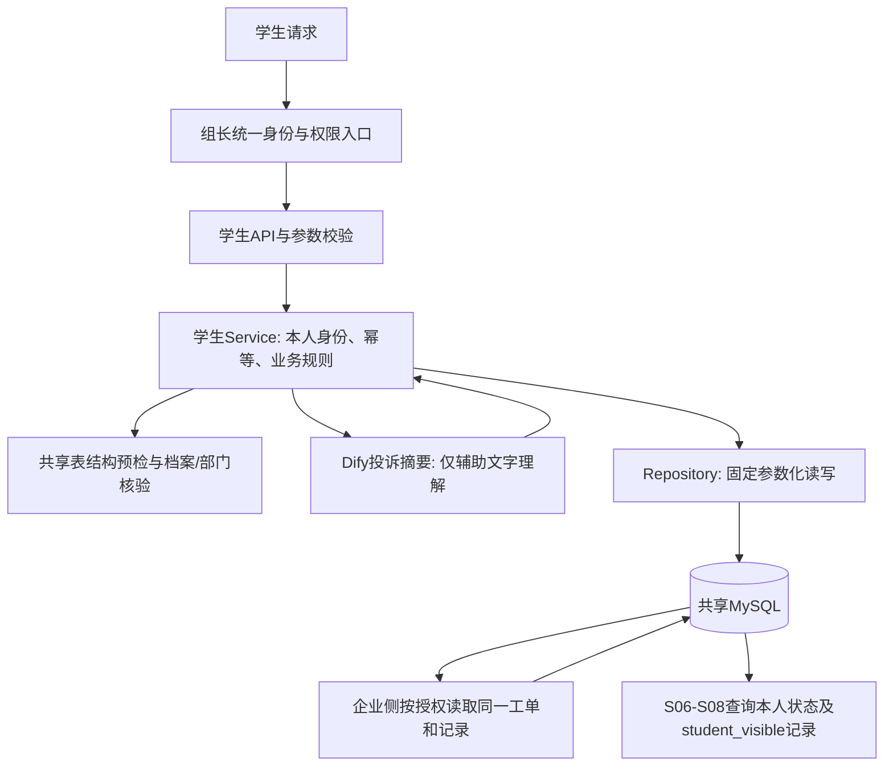

# 学生助手最小运行单元：流程、实现思路与讲解

负责人：蒋立建；日期：2026-10-15；分支：Albert。

## 1. 这次实际完成什么

完成五个学生业务接口：S01请假提交、S05投诉/建议提交、S06本人工单列表、S07本人工单详情、S08本人可见沟通记录。保留现有分层，增加投诉专用Dify工作流、共享表只读检查和增量补表脚本。

S01默认固定代码提交，不依赖模型；请求generate_ai_summary=true时才尝试可选摘要。S05尝试大模型提炼投诉摘要和分类建议。模型暂不可用时仍保存原文，明确返回ai_status=unavailable。S06—S08采用固定查询，不调用模型或NL2SQL。

这份报告描述的是上述最小单元。接口方案里其余29个路由仍是设计，不属于本轮已实现范围。学生网页、老师审批、企业分派/处理、消息实际投递、心理评估、RAG、教务/CRM同步及投诉确认/评价尚未在本轮实现。JWT的签发、验签、登录仍由组长公共模块负责。

## 2. 为什么从这里做：需求到实现的对应

需求来源：`业务文档/02需求文档/学生智能助手.md`。

| 需求位置 | 原需求要解决的问题 | 本轮对应实现 | 尚未形成的完整闭环 |
|---|---|---|---|
| 2.1第1项、3.2.2 | 学生提交请假、推送班主任、在线审批 | S01保存申请，有有效班主任时入队通知；无老师时保留待分派申请 | 企业老师审批、通知实际送达及审批结果反馈 |
| 2.1第3项、3.1售后反馈工单表 | 投诉建议形成工单，能跟踪处理 | S05写共享工单、初始记录和操作回执；S06—S08查询本人状态及可见记录 | 企业分派、回应、解决、学生确认/评价、主动反馈通知 |
| 3.3.2、验收标准10 | 长篇投诉需要自动提炼摘要 | 专用Dify Workflow及严格输出校验，原文和摘要分别存储 | 真实模型的摘要质量与目标Dify实例验收 |
| 第四部分安全性 | 学生只能访问有权查看的数据 | 统一身份入口、本人条件、内部记录过滤、参数化SQL | 公共JWT真实环境端到端验证 |
| 第四部分可用性 | AI异常不应丢失学生诉求 | 预期模型故障降级，原始提交仍可落库 | 后台补摘要、通知任务与运行监控另行建设 |

先选择“投诉摘要”作为主要AI功能，因为需求明确要求它。结构化表单、状态查询、权限和写库规则交给确定的后端代码，便于核对和测试。

## 3. 模块之间是什么关系



Dify不连接数据库，不获取登录JWT，不生成执行SQL，不填写部门或员工ID，也不改变工单/审批状态。学生和企业通过共享表及约定字段协作；企业侧仍须实现自己的身份、权限、处理范围和状态流转。

## 4. 目录结构与每层职责

```text
app/
  api/student_leave.py                  S01 HTTP入口
  api/student_ticket.py                 S05-S08 HTTP入口
  schemas/student_leave.py              请假输入、摘要及回执
  schemas/student_ticket.py             投诉输入、模型输出、查询响应
  services/student_common.py            学生身份、幂等回放、UTC/摘要公共规则
  services/student_leave_service.py     请假业务流程
  services/student_ticket_service.py    投诉提交与本人查询业务流程
  repositories/student_leave_repository.py  公共档案/操作日志及请假固定读写
  repositories/student_ticket_repository.py 部门、工单、可见记录固定读写
  repositories/student_schema.py        只读检查真实表、字段、主键、唯一键和FK
  models/student_leave.py               学生/员工/绑定/请假/通知/日志字段投影
  models/student_ticket.py              企业共享工单/记录字段投影
  clients/student_leave_dify.py         可选请假摘要外部协议
  clients/student_ticket_dify.py        投诉摘要外部协议
  config.py                            学生专用配置追加到现有公共配置文件
  main.py                              挂载现有公共依赖和学生路由
dify/student_ticket/                   可导入投诉工作流及说明
scripts/check_student_shared_schema.py  只读检查，默认使用公共.env
scripts/init_student_minimal_tables.py  只补建缺少的学生行政表
scripts/sql/student/                   增量补表SQL，不含DROP
tests/student_leave_s01/               请假业务验证
tests/student_ticket_s05/              投诉验证及真实MySQL/HTTP演示
```

API理解HTTP，Schema理解数据形状，Service理解业务顺序，Repository理解如何读写表，Client理解如何调用Dify，Model只描述本模块使用的表字段。Service不应该拼HTTP请求，API不应该塞入数据库操作，Dify不应该决定权限。公共业务规则单独提取，请假和投诉服务平级。

字段投影不是完整建表文件：生产启动不调用metadata.create_all。测试投影只用于隔离SQLite；真实MySQL验证使用公共SQL的完整CREATE语句，不能用“SQLite能写入”证明企业真实表完全兼容。

## 5. S05从接口到数据库的逐步调用流程

入口：`POST /api/v1/student/complaint`。

```json
{
  "ticket_type": "complaint",
  "content": "课程安排多次变更，希望老师明确后续安排。",
  "category_code": "teaching"
}
```

请求头Idempotency-Key必须为1—128位ASCII字母数字和._:-，首位为字母或数字。同一次逻辑提交重试保持该键不变；修改内容后重新办理需使用新键。真实登录凭据走公共入口。

| 顺序 | 文件与函数 | 读什么、做什么、交给谁 |
|---|---|---|
| 1 | app/main.py → create_student_ticket_router | 注入require_permission(service_ticket.create)、get_db和专用工作流依赖；挂载/api/v1 |
| 2 | app/schemas/student_ticket.py → ComplaintInput | 类型限制complaint/suggestion，原文1—5000字符，分类受控；拒绝student_id、employee_id、department_id、status等额外字段 |
| 3 | app/api/student_ticket.py → submit_complaint | 取得可信账号、数据库会话及客户端，调用StudentTicketService.submit |
| 4 | app/repositories/student_schema.py → require_student_schema/check_student_schema | 从真实数据库元数据检查所需共享表、字段类型、写入长度/可空性、主键、幂等唯一键及声明外键；不兼容时在业务写入和模型调用前拒绝 |
| 5 | app/services/student_common.py → _student、_replay、digest | 使用account.student_id查询student_profile；检查档案及operation_log；相同参数的成功请求直接返回已保存回执，参数变化报409 |
| 6 | app/services/student_ticket_service.py → _department | 默认取学生服务归属部门，或使用本机配置的受理部门；查询org_department并要求active |
| 7 | app/repositories/student_leave_repository.py → rollback | 结束预检读事务，释放数据库事务后才等待模型 |
| 8 | app/clients/student_ticket_dify.py → summarize | POST到专用Workflow的/workflows/run，发送三项业务输入及后端生成的user标识；blocking模式，专用Key |
| 9 | dify/student_ticket/student_ticket_summary.yml | 开始接收输入→LLM提炼summary及suggested_category→结束节点result引用LLM.text |
| 10 | DifyTicketContent.model_validate、TicketAnalysis | 校验状态、JSON、字段、长度和分类，记录workflow_run_id及后端analysis_version；可预期失败改为摘要不可用 |
| 11 | StudentTicketService.submit | 模型调用后重新检查学生状态/映射和幂等，锁定学生及受理部门；期间归档、停用部门或映射变化时不继续写入 |
| 12 | StudentTicketRepository.create_operation | operation_log先记录处理中动作；学生、动作、请求键决定唯一操作键 |
| 13 | StudentTicketRepository.create_ticket | service_ticket保存原文、可空摘要、学生选择的分类、normal优先级、真实受理部门、open状态；employee_id为空等待企业分派 |
| 14 | StudentTicketRepository.create_record | service_ticket_record写submitted初始记录，学生为操作者，student_visible，轮次1，唯一record_key |
| 15 | complete_operation、commit | 同一事务更新日志为succeeded，保存稳定回执及AI追溯信息；三部分一起提交；发生错误全部rollback |
| 16 | app/api/student_ticket.py、TicketResponse | 返回工单ID/编号、open、部门、版本、时限、ai_status和ai_analysis |

工单初始状态固定open，员工暂空，不自动把班主任当成投诉处理人。模型建议分类只保存在回执/操作日志内，原分类不覆盖。摘要保存在service_ticket.ai_summary，原文始终保存在content。

## 6. S01和三个查询接口怎样工作

S01：`student_leave.py.submit_leave`→`StudentLeaveService.submit`→结构、档案、幂等预检→默认直接执行后续固定逻辑；可选摘要请求先结束预检事务再调用analyze_leave→再次校验→`find_teacher`→保存student_admin_service、必要时business_notification、operation_log→commit。

find_teacher只选择有效class_teacher绑定、active员工、role_codes包含teacher且处于有效期的关系；优先主要绑定，再按绑定ID确定顺序。reviewer_id为空时保留申请，assignment_pending=true，不伪造老师ID，不创建发给不存在老师的通知。本轮没有自动补分派任务。

请假原文存apply_content，开始结束时间统一转成UTC存储，状态为pending。可选AI结果和ai_status存edu_related_data。generate_ai_summary默认false；开启后若工作流失败，申请仍保存、ai_status=unavailable；未开启则not_requested。

| 接口 | Service | Repository | 固定边界 |
|---|---|---|---|
| GET /api/v1/student/tickets | list_own | list_owned | WHERE student_id=当前学生；按工单ID降序；limit默认20、最大100，before_id游标 |
| GET /api/v1/student/tickets/{ticket_id} | detail | get_owned_ticket | WHERE ticket_id=路径ID AND student_id=当前学生；不存在与无权统一404 |
| GET /api/v1/student/tickets/{ticket_id}/records | records→detail | list_visible_records | 先校验工单归属，再只查student_visible；按记录ID升序、after_id游标、最多100条 |

查询响应使用明确的字段模型；不把operation_log、内部记录、员工联系方式等整表数据返回学生。查询从现有共享工单读出状态及solution，因此企业侧后续按约定更新后学生查询可见；本轮没有主动推送“已解决”通知。

## 7. 企业共享表与外键：如何确认，而不是凭名字猜

检查依据包括公共scripts/sql/all.sql、企业接口方案、本地MySQL真实元数据。脚本检查当前连接库中的表和字段、使用字段类型、写表字段长度与可空性、主键、关键唯一键、预期FK及实际FK引用的目标表/列。它不会修改企业表，也不能代替全部CHECK、排序规则、索引性能和未来迁移的审查。

| 子表.字段 | 目标表.字段 | 关系及本轮处理 |
|---|---|---|
| student_profile.department_id | org_department.department_id | 真实FK；投诉据此找到学生服务部门，并查询部门active |
| student_staff_binding.student_id / employee_id | student_profile.student_id / employee.employee_id | 真实FK；请假再验证关系类型、有效期和teacher资格 |
| student_admin_service.student_id | student_profile.student_id | 真实FK；只能写可信账号对应的学生 |
| student_admin_service.reviewer_id | employee.employee_id | 当前公共SQL未声明FK，属于逻辑关联；后端通过有效绑定和员工查询取得，不接收前端ID |
| service_ticket.student_id | student_profile.student_id | 真实FK；工单归属用于所有本人查询 |
| service_ticket.employee_id | employee.employee_id | 真实FK且可空；学生创建时为空，交企业侧分派 |
| service_ticket.handling_department_id | org_department.department_id | 真实FK且不可空；查询确认真实部门及active，不硬编码部门1 |
| service_ticket_record.ticket_id | service_ticket.ticket_id | 真实FK；主工单插入取得ID后再写记录 |
| service_ticket_record.student_id / employee_id | student_profile.student_id / employee.employee_id | 真实FK；本轮初始记录只填学生，符合操作者三选一约束 |
| business_notification.student_id / employee_id | student_profile.student_id / employee.employee_id | 真实FK；收件人二选一，请假只给已核实老师入队 |
| operation_log.student_id / employee_id | student_profile.student_id / employee.employee_id | 真实FK；学生操作只填学生，不把user_id写入学生外键 |
| business_notification、operation_log的entity_type+entity_id | 不同业务表的主键 | 多态逻辑关联，没有一个统一物理外键；由后端固定实体名、同事务取得真实ID |

本地实际结果：127.0.0.1:3307/education_agent初次检查投诉结构兼容，请假缺少student_admin_service。已用本次新增的增量SQL补建该学生表，再检查两组均compatible=true。企业表和既有业务数据未重建；没有运行含DROP的all.sql。

本地旧公共表的若干status字段是VARCHAR(20)，公共新SQL是VARCHAR(32)。本模块只读取这些状态、只比较短固定值，因此检查不因只读字段长度较短而报错；对实际写入表字段仍检查长度。此结论只是本轮使用字段兼容，并不等于两个库的所有字段完全相同。

初始化脚本只处理“唯一差异为缺少student_admin_service”的情况，其他结构差异拒绝自动修复。若已有同名表但不兼容，需要增量迁移评审，不能让CREATE IF NOT EXISTS掩盖问题。

## 8. 为什么此处不接组长NL2SQL

这些查询都是固定业务问题：“我的工单有哪些”“这张工单什么状态”“有哪些学生可见记录”。直接用参数化查询，便于稳定加上student_id条件、限制返回字段、排序和分页。

现有`app/services/nl2sql_service.py.nl2sql_query`是通用自然语言转SQL函数。本轮不接入学生接口：函数本身没有接收学生身份并实施本人行范围，也没有本模块需要的表/列限制与分页契约；仅凭SQL以select开头不足以满足这些要求。这是对当前函数的观察，不代表其他外层安全措施均不存在。

未来若需要“用自然语言查询复杂统计”，再与组长对接统一只读查询服务：身份和范围由后端固定，允许表/列、行数和超时受控，生成SQL另行校验，禁止写操作。组长统一查询服务也可以承载固定查询模板，不必每次都让模型生成SQL。

接口方案中的AI划分：S20多意图/RAG、S12辅助心理评估主要用模型；S05摘要是本轮的AI增强；S01可选摘要。S02—S11中的查询、撤回、补充、确认、评分，以及S13—S19学业/进度/提醒/通知操作，用固定代码执行；S21最终执行仍需固定规则和确认。老师手动处理与来源同步不应依赖模型作出权限或写库决定。后续功能仍需逐项开发，不能由本轮模型客户端代替。

## 9. 手工从零实现时，按什么顺序做

1. 先读需求并圈定一个可验证动作。写清输入、成功结果、当前操作者以及谁负责后续动作。以投诉为例，学生只提交，企业负责分派解决。
2. 查公共SQL和真实数据库。先确定student_id、department_id、ticket_id的主从关系、可空字段、唯一键、状态CHECK；发现目标表缺失先处理结构，不用假ID绕过。
3. 写Schema。先限制类型、长度、枚举和额外字段。身份、部门、处理人和状态由后端取得；不要为了方便在请求体开放这些字段。
4. 写Model投影和Repository。先实现按学生ID查档案、查部门、查幂等回执，再写固定INSERT/SELECT。所有用户文字都是绑定参数，不能拼进SQL。
5. 先不用模型，打通原文→工单→初始记录→回执这条事务链。模拟中间一步失败，检查所有写入是否一起回滚。
6. 在Dify搭开始、LLM、结束。先用合成文本测试：输入三字段，输出只有summary和suggested_category；用结束result暴露LLM文本。
7. 写Client调用已发布Workflow。检查HTTP状态、workflow状态、JSON格式与字段，再附加运行ID。Client不操作业务数据库。
8. 把模型放在业务预检之后、写事务之前。先放掉读事务，调用结束后重验身份、部门和幂等；模型故障只影响摘要，原文仍应提交。
9. 接API。把组长公共权限依赖、数据库会话和Client注入Service；API只处理输入、输出和已知错误。JWT无需再写一套。
10. 写本人查询。每条查询必须含当前学生ID；沟通记录还要过滤visibility。先验证归属，再查子记录。
11. 测正常、重复、篡改、他人数据、模型故障、缺表/缺FK、事务回滚。再用真实MySQL完整建表语句验证外键；用真实HTTP验证路由与数据契约。
12. 更新自己的接口说明、日报和报告。只暂存自己的确定文件，核对没有Key、.env和别人的改动，再推送Albert。正式模型和JWT未测就如实写待联调。

## 10. 关键知识点及容易踩的坑

| 知识点 | 本项目中的含义 | 容易出错的做法 |
|---|---|---|
| 身份与业务权限 | JWT确认谁，权限依赖确认能否操作，Service确认只能操作本人 | 把已登录等同于能看所有工单 |
| 三类ID | user_id是账号，student_id是学生，employee_id是员工 | 数值碰巧相等就混写外键 |
| 物理FK与逻辑关联 | FK约束真实主从；reviewer_id和多态entity_id另有业务校验 | 认为所有带_id字段都已建FK |
| 事务原子性 | 工单、初始记录、操作成功回执一起成功或回滚 | 先commit主表，子表失败后留下半单 |
| 幂等 | 学生+动作+请求键确定operation_key，参数摘要检查内容一致 | 每次重试新造键；或只按请求键全局去重 |
| 并发 | 外部调用后重新检查，行锁和唯一键兜住重复写入 | 只在模型调用前查一次；认为单次顺序重试测试证明所有并发 |
| 外部调用 | Dify在数据库事务/锁之外，设置超时和严格解析 | 持行锁等待模型几十秒；把LLM JSON直接当可信结果 |
| AI增强降级 | 无摘要就是null+unavailable，原文照常保存 | 人工拼一段“AI结果”冒充模型；失败悄悄丢工单 |
| 状态机与责任 | 本轮创建open/pending；企业人工推进处理 | 学生或模型提交closed/approved；自动宣称问题已解决 |
| 消息语义 | notification_queued只表示入队 | 数据库pending就宣称通知已发送 |
| UTC | 接收带时区输入，存UTC；输出带+00:00 | 把本地09:00无转换写成UTC09:00 |
| 字段投影与真实DDL | 投影只覆盖使用字段，DDL还包含FK、CHECK、默认值 | 用SQLite的少字段表验证代替真实MySQL兼容性 |
| 查询分页 | 限制最多100，工单按before_id，记录按after_id | 一次返回全部敏感记录；依赖模型自动加学生过滤 |
| 数据追溯 | 原文在工单，summary独立，run_id/版本在日志回执 | 原文被摘要覆盖，无法核实原始诉求 |

并发首次请求仍可能各调用一次模型，当前保证数据库业务去重，不保证外部模型计费恰好一次。失败摘要没有后台补算；成功回执重试也不会改变原回执。没有实际通知消费者时，通知仍会停留pending。

## 11. 运行命令与实际证据

PowerShell进入项目根目录后执行。以下命令中的--local-instance仅用于本机已有学生专用实例，其凭据文件在项目外，不提交Git。

```powershell
Set-Location -LiteralPath 'D:\GitProject\StuProject'
& 'D:\python\python.exe' -X utf8 -m pytest -q --confcutdir=tests tests/student_leave_s01 tests/student_ticket_s05
& 'D:\python\python.exe' -X utf8 scripts/check_student_shared_schema.py --local-instance
& 'D:\python\python.exe' -X utf8 tests/student_ticket_s05/run_mysql_http_demo.py
```

默认检查正式公共配置：去掉--local-instance；需要完整元数据报告时增加--report和本机输出路径。只有确认缺少学生行政表并且其他依赖通过，才执行`python scripts/init_student_minimal_tables.py`；本机专用实例加--local-instance。该脚本不修改公共.env，不建业务档案或员工。

实际已完成：

- 39项请假验证、25项投诉验证，共64项：包括模型故障、严格输出、幂等、本人隔离、缺表/缺外键、内部记录隐藏及事务回滚。
- 真实本机Uvicorn HTTP+MySQL8.0隔离库：启用外键，使用公共SQL完整CREATE；创建2张工单、3条工单记录（包含一条测试内部记录）、1张请假及3条操作记录，核对后自动清理测试库。
- 重复提交回放同一回执；他人详情/记录404；内部记录过滤；模型未配置仍保存投诉；普通请假不调用模型；无效工单外键被MySQL拒绝。
- 本机education_agent真实共享表检查：补建学生行政表后，请假与投诉两组compatible=true。没有连接组长192.168.5.12。

验证边界：上述模型响应来自httpx.MockTransport，real_dify_verified=false；测试身份是可信夹具注入，group_jwt_verified=false。真实Dify导入/发布、模型摘要质量、公共JWT和完整工程端到端运行仍待联调。

正式main使用app/database.py的get_db→SessionLocal→公共.env配置的MySQL（当前目标127.0.0.1:3306/education_agent）。本轮实际共享结构检查及MySQL隔离验收使用专用3307实例，两者不可混为一谈。公共鉴权当前还依赖pwdlib和AUTH/ACCESS_CONTROL_FILE等配置补齐；本轮没有改写组长鉴权实现。公共异常总处理沿用现状，已知学生业务错误在路由中返回HTTP403/404/409/503，参数错误由FastAPI处理为422；通用未处理错误仍受公共框架包装约定影响，正式联调需统一前端判断方式。

## 12. 向企业侧交付时要讲清楚

企业侧读取service_ticket：content是原文，ai_summary可能为空，category_code是学生选择，初始status=open、priority=normal、employee_id=NULL、handling_department_id为已核验服务部门，row_version=1。response_due_at/resolution_due_at是可配置24/72小时默认值，不把测试默认值当成已确认的正式SLA。

企业侧后续分派/处理应使用真实employee/department，按权限控制数据范围，维护row_version及处理记录；内部材料写internal，学生可见回应写student_visible。学生S06—S08只读这些共享结果。当前submitted初始记录类型无SQL枚举限制，需要企业消费方识别或忽略，不应把它当作首次人工回应。

请假读取student_admin_service，使用reviewer_id而不是另造approver_employee_id。已有老师通知仅pending；实际送达需要公共消费者。部门无效时学生提交返回409；表结构不兼容时503并提示运行只读检查，不向前端泄漏SQL、口令或上游错误。

本轮公共策略只给student补授已定义的service_ticket.create和service_ticket.read_own，保留其他角色原有配置，不新增JWT逻辑；Service仍拒绝customer或employee冒用学生入口。修改仅在Albert，是否进入公共主分支由后续审查决定。

## 13. 介绍项目时怎么讲

### 一分钟版本

我负责学生智能助手模块。本次做了两个可运行的业务切片：学生请假提交，以及带Dify大模型摘要的投诉建议工单。投诉从统一身份入口进入，后端校验学生本人、共享表和受理部门，调用Dify提炼摘要，再把原文、辅助摘要、初始处理记录和幂等回执在一个数据库事务中保存。学生能查询本人工单与对自己可见的记录，企业侧沿用同一套工单表继续分派处理。模型只做文字理解，身份、外键、状态和写入由固定代码控制，模型失败也不会丢失学生原文。目前业务和真实本地MySQL链路验证通过，真实Dify模型及公共JWT仍待联调。

### 展开三分钟时按四件事讲

1. 需求：学生长投诉需要摘要，但提交不能因为AI故障失败；企业还要继续处理，数据需要共用。
2. 实现：API、Schema、Service、Repository、Model、Client分层；专用Dify工作流；共享service_ticket及record，不新建平行投诉表。
3. 难点：账号ID与业务ID区分；部门外键必须存在；模型调用不持数据库锁；幂等重试不能重复建单；内部记录不能泄漏给学生。
4. 证据与边界：64项自动验证、真实HTTP+MySQL外键验证；模型用替身测试协议，真实模型质量和JWT单独验收，不把五个接口说成34个全完成。

### 常见追问

“为什么不用NL2SQL？”——本人状态查询有固定条件，参数化查询更容易限制学生范围与返回字段；复杂自然语言统计再接受控查询服务。

“为什么模型不直接写数据库？”——模型输出可能错误，数据库状态、身份和外键需要确定性规则；摘要与执行分离更方便核实和回滚。

“大模型坏了怎么办？”——原文仍写入工单，摘要为空并标明unavailable，企业仍能受理；当前没有伪造摘要或自动补算任务。

“外键和代码校验有什么区别？”——外键防悬空引用，代码还能检查active、有效期和负责人资格；两层都需要。

“你本人做了什么？”——学生接口及业务实现、投诉工作流和客户端、共享结构核验与本轮补表、本人数据边界、幂等与事务、自动验证及个人文档；JWT和企业处理入口由对应负责人维护。

## 14. 推荐阅读顺序与主要文件

| 阅读顺序 | 文件 | 解决的问题 |
|---|---|---|
| 1 | 业务文档/02需求文档/学生智能助手.md | 理解为什么需要请假、工单及投诉摘要 |
| 2 | 业务文档/06开发文档/接口方案/学生助手/接口方案.md | 区分34个设计接口与本轮五个实现、角色和权限 |
| 3 | scripts/sql/all.sql及scripts/sql/student/20261015_add_student_admin_service.sql | 理解公共数据契约与安全补建范围；不要直接执行all.sql |
| 4 | app/api/student_ticket.py、app/schemas/student_ticket.py | 看输入输出和路由怎样接入公共依赖 |
| 5 | app/services/student_common.py、student_ticket_service.py | 看身份、幂等、模型调用和事务顺序 |
| 6 | app/repositories/student_schema.py、student_ticket_repository.py | 看如何查实际结构以及固定读写本人数据 |
| 7 | app/clients/student_ticket_dify.py、dify/student_ticket/README.md | 理解外部协议、严格输出和降级 |
| 8 | tests/student_ticket_s05/test_ticket.py、run_mysql_http_demo.py | 通过成功与失败场景理解边界如何验证 |
| 9 | 业务文档/06开发文档/接口方案/企业管理/接口方案.md | 理解共享数据交到企业后由谁继续处理 |
| 10 | 业务文档/08日报/1015/蒋立建.md | 查看本人的当日交付、调用链和待联调项目 |

本轮不改组长个人日报和小组日报1015.md；功能名称及说明只更新蒋立建自己的学生助手文件，并只推送Albert分支。
