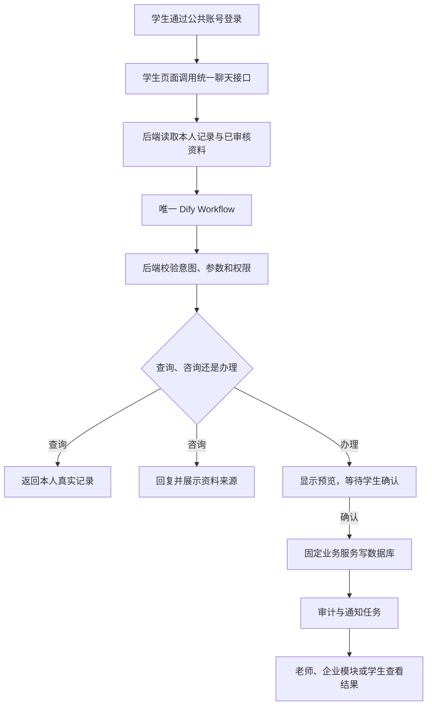

# 学生智能助手：已提交内容、业务必要性与模块对接说明

编制日期：2026-10-16
范围：个人负责的“学生智能助手”，仅一个智能体。
代码依据：Albert 已提交功能版本 `0d8111b`；后续 `3194a27` 仅撤回接口导出文档变更，不撤回功能代码。目录比较基线为此前并入的组长 main `7bec441`，不代表已重新核实当前远端 main 的最新状态。
本文件按指定路径提交；不读取、不引用项目中的其他“业务文档”作为实现依据。结论来自代码、接口、SQL 和 Git 记录。

## 一、实际生活中有没有必要设置这个角色

**有必要提供“学生服务助手”这一入口，但没有必要让七个功能各建一个智能体，也不需要新增一个能自主审批的管理角色。**

这里的“角色”指服务学生的产品入口。实际操作者仍使用公共账号的 student 身份，老师使用 employee 身份；智能体本身不是拥有任意数据库权限的新账号。

| 实际问题              | 学生助手能承担的工作         | 需要保留给其他人的工作       | 必要性判断               |
| ----------------- | ------------------ | ----------------- | ------------------- |
| 学生不知道请假找谁、申请有没有处理 | 收集信息、提交、展示处理状态     | 老师审批与实际考勤安排       | 有明确使用价值             |
| 投诉只停留在聊天中，处理结果难追踪 | 建立工单、查询、补充诉求、确认结果  | 企业人员分派和解决问题       | 有明确使用价值             |
| 考试、材料截止时间分散       | 展示已同步节点，按学生设置提醒    | 教务维护准确节点          | 有真实数据时才有价值          |
| 留学申请进度需要反复问老师     | 展示 CRM 已记录的进度及更新时间 | 申请人员实际推进业务        | 有真实来源时才有价值          |
| 学生需要情绪支持或表达困难     | 提供支持性回复，按规则记录预警    | 负责老师人工跟进；不能代替专业服务 | 可作为辅助能力，不作诊断和自动处分依据 |
| 海外生活问题缺少统一资料入口    | 检索已审核资料并展示来源       | 资料负责人维护当地信息       | 有可靠资料时才有价值          |
| 学生想了解后续升学服务       | 检索机构已上架项目并说明依据     | 顾问确认适配性、费用和后续服务   | 属于条件性功能，不应强行推荐      |

上述必要性是本项目的产品判断，不是对实际使用频率的调查结论。没有真实资料或业务来源时，应保留“暂无记录/无法核实”的反馈，不能用模型补造事实。

## 二、已经上交了什么，哪些还没有形成真实效果

| 内容              | 已提交情况                           | 实际效果边界                        |
| --------------- | ------------------------------- | ----------------------------- |
| 一个统一学生 Workflow | 已提交 YAML、提示词、客户端；已在本地 Dify 导入草稿 | 模型供应商、应用 Key、发布和真实调用尚未完成      |
| 学生页面与公共登录接入     | 已提交页面和学生入口嵌入                    | 本地演示账号已验证；正式账号仍依赖公共身份数据       |
| 请假、投诉及后续办理      | 已提交业务接口和数据库逻辑                   | 本地合成内容已保存、查询；企业处理页面与正式人员流程须对接 |
| 心理辅助评估与人工预警处置   | 已提交规则、表和老师接口                    | 测试覆盖流程；真实模型判断、人工响应机制待联调       |
| 学业、提醒与申请进度      | 已提交查询、同步、版本保护和后台任务              | 真实教务/CRM 来源未配置，不能声称已有真实节点和进度  |
| 生活与升学资料检索       | 已提交检索实现，允许读取上架项目                | 正式知识文件当前为空；项目资料取决于公共目录内容      |
| 通知、幂等、审计、会话隔离   | 已提交                             | 本地站内通知已验证；外部通知渠道未验收           |

此前自动回归记录为 79 项通过，不代表已经完成真实模型或跨系统验收。本文按代码和已有验证记录整理；本次仅提交本文，不追加模型测试或合并功能代码。

## 三、一个智能体怎样连接业务接口



1. 公共登录：`POST /api/v1/auth/login`，获取公共登录 Token。
2. 统一对话：`POST /api/v1/student/chat`。请求包含 message、可选 conversation_token，并携带 Idempotency-Key。
3. 查询直接返回本人数据；办理只返回 pending_action 预览，不立即写入对应业务单据。
4. 学生确认：`POST /api/v1/student/actions/confirm`，提交后端签发的 action_token。后端调用固定服务，确认时不再调用一次模型。
5. 页面也可直接调用下面的业务 HTTP 接口。这些是同一套业务的页面入口，不是另外的智能体。

Dify 内只有“输入 → 一个模型 → 结果”。数据库操作、权限和通知在后端。模型不生成可直接执行的 SQL，也不负责审批、企业分派或修改他人的业务记录。

## 四、功能是否真的需要，以及接口怎样操作数据库

表名统一以“英文实际表名（中文用途注释）”表示。为避免混淆：下列中文名称用于说明表的业务意义；并不意味着所有公共表的数据库 COMMENT 已由本模块新增。

### 4.1 请假：必要的学生事务办理

**实际场景：** 学生提交请假并查看结果，老师处理后通知学生。能减少反复询问，但审批权必须在老师侧。

| 操作    | 接口                                                             | 数据操作与表                                                                                                                          |
| ----- | -------------------------------------------------------------- | ------------------------------------------------------------------------------------------------------------------------------- |
| 提交    | POST /api/v1/student/leave                                     | 新增 student_admin_service（学生行政事务申请表，含请假）；读取 student_profile（学生档案表）、student_staff_binding（学生与服务老师绑定表）、employee（员工/老师表）；记录审计及待投递通知 |
| 列表、详情 | GET /api/v1/student/leave；GET /api/v1/student/leave/{apply_id} | 查询 student_admin_service（学生行政事务申请表），限定本人                                                                                        |
| 撤回    | DELETE /api/v1/student/leave/{apply_id}                        | 校验 expected_version 和状态后更新申请；写 operation_log（业务操作与幂等审计表）                                                                        |
| 老师审批  | POST /api/v1/internal/student/leave/{apply_id}/decision        | 校验负责关系和版本，更新审批状态，写通知和审计                                                                                                         |

提交字段：leave_content、leave_type、leave_start_at、leave_end_at；直接表单另可传 generate_ai_summary。审批字段：expected_version、decision、comment，拒绝时必须给意见。

**形成实际效果的条件：** 学生与负责老师的绑定有效；老师页面读取内部请假接口并提交审批；后台投递结果通知。只有生成申请行、没有老师处理页面与人员安排，业务尚未闭环。本模块不会自动改变外部学校的考勤记录。

### 4.2 投诉与建议：必要的售后追踪

**实际场景：** 学生对服务问题提交诉求，企业人员处理，学生补充信息并确认结果。

| 操作        | 接口                                                                  | 数据操作与表                                                               |
| --------- | ------------------------------------------------------------------- | -------------------------------------------------------------------- |
| 提交投诉或建议   | POST /api/v1/student/complaint                                      | 新增 service_ticket（服务工单表）、service_ticket_record（工单沟通与流转记录表），读取学生和部门归属 |
| 本人工单列表、详情 | GET /api/v1/student/tickets；GET /api/v1/student/tickets/{ticket_id} | 查询 service_ticket（服务工单表）                                             |
| 可见沟通记录    | GET /api/v1/student/tickets/{ticket_id}/records                     | 查询 service_ticket_record（工单沟通与流转记录表），仅返回 student_visible             |
| 补充沟通      | POST /api/v1/student/tickets/{ticket_id}/reply                      | 新增沟通记录并更新工单版本                                                        |
| 确认解决或重开   | POST /api/v1/student/tickets/{ticket_id}/confirm                    | 根据 resolved 更新工单及流转记录，未解决时要求说明原因                                     |
| 评价        | POST /api/v1/student/tickets/{ticket_id}/rating                     | 写入 service_ticket（服务工单表）的满意度字段并记录操作                                  |

直接 HTTP 提交字段为 content、ticket_type、category_code；**智能体内部 ticket.submit 参数是 complaint_content、feedback_type、category_code，名称不同，不能原样混用。** 后续修改通常携带 expected_version，评价分值为 1—5。

**形成实际效果的条件：** 企业模块使用同一套工单主键、状态与记录表完成分派、回应和解决；学生再次查询才能看到变化。当前学生模块没有实现企业分派和解决页面，不能把“学生能提交”算作“企业已处理”。需要对齐现有企业接口，不在这里编造企业接口 URL。

### 4.3 心理关怀：辅助支持与人工预警

**实际场景：** 学生表达压力或困扰，助手给出支持性回复；高风险内容进入人工待处理队列。

| 操作            | 接口或入口                                     | 数据操作与表                                                                  |
| ------------- | ----------------------------------------- | ----------------------------------------------------------------------- |
| 对话中的辅助评估      | POST /api/v1/student/chat 内部执行            | 新增 mental_health_profile（学生心理评估历史表）；高风险新增 mental_warning（学生心理预警及人工处置表）  |
| 单独评估入口        | POST /api/v1/student/mental/monitor       | 输入 chat_content，复用同一个 Dify 应用；写评估及必要预警                                  |
| 老师查询、接手、跟进、关闭 | /api/v1/internal/student/warnings 系列，见第六节 | 查询/更新 mental_warning（学生心理预警及人工处置表），写 operation_log（业务操作与幂等审计表）          |
| 提醒负责老师        | 后台通知任务                                    | 读取 student_staff_binding（学生与服务老师绑定表），写入/投递 business_notification（业务通知表） |

**实际需要的边界：** 是辅助关怀，不是自动医学诊断或自动决策系统。模型风险判断需要真实验收；老师收到通知也不等于已经处理。关闭预警须有接手记录和处理结果。心理原文、风险依据仅供授权处理使用，不应进入普通项目推荐、企业报表或公共查询结果。

### 4.4 学业考务与提醒：有准确节点时才有价值

| 操作       | 接口                                                                           | 数据操作与表                                                                    |
| -------- | ---------------------------------------------------------------------------- | ------------------------------------------------------------------------- |
| 查询考试、DDL | GET /api/v1/student/academic                                                 | 读取 student_academic_event（学生学业截止与考试节点镜像表）                                 |
| 设置提醒     | POST /api/v1/student/reminders                                               | 验证 academic_event_id 属于本人，新增/恢复 student_academic_reminder（学生学业提醒设置与执行状态表） |
| 查看、取消提醒  | GET /api/v1/student/reminders；DELETE /api/v1/student/reminders/{reminder_id} | 查询/更新 student_academic_reminder（学生学业提醒设置与执行状态表）                           |
| 推送教务数据   | POST /api/v1/internal/student/sync/academic                                  | 按来源与外部节点 ID 写入/更新学业节点，必要时重新安排提醒                                           |
| 到点通知     | 后台任务，不是学生另调一个接口                                                              | 检查节点版本和有效性，写入/投递 business_notification（业务通知表）                             |

提醒字段：academic_event_id、lead_minutes。同步记录包含 external_event_id、event_type、title、due_at、source_timezone、event_status、source_updated_at。

**形成实际效果的条件：** 教务提供真实数据、学生外部编号映射正确、后台任务持续运行、学生页面读取通知。没有教务数据只能显示空列表；只启动网页而没有启动后台任务，不会自动按时投递提醒。

### 4.5 申请进度：只展示来源已确认的状态

| 操作        | 接口                                               | 数据操作与表                                           |
| --------- | ------------------------------------------------ | ------------------------------------------------ |
| 本人查询      | GET /api/v1/student/progress                     | 查询 student_application_progress（学生留学申请阶段最新进度镜像表） |
| 推送 CRM 数据 | POST /api/v1/internal/student/sync/progress      | 按学生、来源、外部申请及阶段写入/更新镜像                            |
| 拉取已配置来源   | POST /api/v1/internal/student/sync/progress/pull | 读取学生 crm_student_id，调用 CRM 适配接口后写入镜像             |

阶段为 document_review（文书）、school_application（院校申请）、visa_process（签证流程）；每份申请以 external_application_id 区分。

**形成实际效果的条件：** CRM 人员先维护真实进度，再推送或允许后端拉取；助手展示来源更新时间和同步时间。助手查询不会自动向学校递交材料、改变签证状态或推进申请。

### 4.6 海外生活：需要资料，不需要虚构一个写库接口

统一入口为 `POST /api/v1/student/chat`，intent=life，action=none。后端通过 student_knowledge.py 检索已审核知识文件；当前没有生活资料专用数据库表，也没有独立生活信息写入接口。

真实作用取决于机构维护当地生活指南。资料字段为 id、title、source、content、active；可以通过 STUDENT_KNOWLEDGE_FILE 指向项目外正式资料。缺资料时明确告知无法核实。不能把“能聊天”算作“有可靠当地知识”。

### 4.7 升学推荐：有真实项目时的可选能力

统一入口仍为 `POST /api/v1/student/chat`，intent=upgrade，action=none。

- 读取已审核知识文件；有 course_project.read 权限时，可只读 course_project（机构课程与升学项目目录表）中 status='上架' 的固定字段。
- 不创建新项目、不修改价格、不自动报名、不下单。当前没有推荐专属写表。
- 项目负责人维护名称、适用对象、描述、地区和报名方式；顾问/客服承接进一步咨询。若要做“推荐后生成线索或报名”，需要另行约定接口与确认流程，目前不属于已提交效果。

### 4.8 通知与会话：支撑上述功能的必要能力

| 操作          | 接口或执行方式                                                                                     | 主要表                                                                     |
| ----------- | ------------------------------------------------------------------------------------------- | ----------------------------------------------------------------------- |
| 学生查看通知、标记已读 | GET /api/v1/student/notifications；POST /api/v1/student/notifications/{notification_id}/read | business_notification（业务通知表）                                            |
| 保存对话和防止重复轮次 | /student/chat 内部执行                                                                          | student_assistant_session（学生助手会话表）、student_assistant_turn（学生助手对话轮次与回执表） |
| 防止重复业务写入、留痕 | 写服务内部执行                                                                                     | operation_log（业务操作与幂等审计表）                                               |
| 投递提醒、通知并重试  | scripts/run_student_tasks.py                                                                | 通知表、提醒表、相关业务表                                                           |

会话隔离和幂等是技术支撑，不需要另外建一个“会话智能体”或“通知智能体”。

## 五、数据表清单：英文表名及中文注释

### 5.1 公共表关联范围

公共表由其他模块或公共数据库维护，不属于个人新增表。这里只说明关联范围：学生身份使用 student_profile.student_id，老师身份使用 employee.employee_id，部门归属使用 org_department.department_id；请假、工单、通知和审计继续复用公共表。

公共表只在文末第 9.9 节列出关联外键字段与关联方向，不展开其全部普通字段。

### 5.2 学生专属表

| 实际表名（中文用途注释）                                  | 保存内容                 | 主要关联              |
| --------------------------------------------- | -------------------- | ----------------- |
| mental_health_profile（学生心理评估历史表）              | 每次源消息的辅助评估、版本及运行追溯   | student_id → 学生档案 |
| mental_warning（学生心理预警及人工处置表）                  | 高风险依据、处理人、接手/关闭时间与结果 | 评估、学生、员工          |
| student_academic_event（学生学业截止与考试节点镜像表）        | 截止/考试节点、来源、版本、同步时间   | 学生与外部节点           |
| student_academic_reminder（学生学业提醒设置与执行状态表）     | 提前量、计划通知时间、节点版本、投递状态 | 同一学生的学业节点         |
| student_application_progress（学生留学申请阶段最新进度镜像表） | 每份申请每个阶段的最新进度        | 学生与外部申请           |
| student_assistant_session（学生助手会话表）            | 会话所属学生、并发版本与时间       | 学生                |
| student_assistant_turn（学生助手对话轮次与回执表）          | 消息、响应、请求键摘要与回执       | 会话与学生             |

个人表范围为 **7 张学生专属表（5 张业务表 + 2 张会话表）**；公共表只列关联外键，不作为个人建表数量。本地验证时五张学生专属业务表已存在，仅新增两张会话表。初始化脚本先检查共享表兼容性，不负责重建共享表；正式迁移须由公共数据库负责人统筹。

## 六、完整接口范围与老师侧承接入口

学生端已实现 21 个业务方法，已在第四节逐项覆盖。公共登录不计入这 21 个，老师协作和服务同步另外计数。

### 6.1 老师/员工侧：10 个方法

| 方法与路径                                                              | 老师界面应提供的功能    | 核心表（中文用途注释）                      |
| ------------------------------------------------------------------ | ------------- | -------------------------------- |
| GET /api/v1/internal/student/leave                                 | 负责学生的请假列表     | student_admin_service（学生行政事务申请表） |
| GET /api/v1/internal/student/leave/{apply_id}                      | 查看请假详情        | student_admin_service（学生行政事务申请表） |
| POST /api/v1/internal/student/leave/{apply_id}/decision            | 同意/拒绝，提交版本和意见 | 申请表、通知表、操作审计表                    |
| GET /api/v1/internal/student/notifications                         | 老师站内通知列表      | business_notification（业务通知表）     |
| POST /api/v1/internal/student/notifications/{notification_id}/read | 老师标记已读        | business_notification（业务通知表）     |
| GET /api/v1/internal/student/warnings                              | 负责学生的预警列表     | mental_warning（学生心理预警及人工处置表）     |
| GET /api/v1/internal/student/warnings/{warning_id}                 | 授权查看预警依据      | mental_warning（学生心理预警及人工处置表）     |
| POST /api/v1/internal/student/warnings/{warning_id}/ack            | 接手预警          | 预警表、操作审计表                        |
| POST /api/v1/internal/student/warnings/{warning_id}/follow         | 记录跟进说明        | 预警表、操作审计表                        |
| POST /api/v1/internal/student/warnings/{warning_id}/close          | 记录处置结果并关闭     | 预警表、操作审计表                        |

预警动作正文包含 expected_version、note。老师 Token 来自公共登录，接口仍校验负责关系，不能因 URL 有 internal 就认为可以无鉴权调用。

### 6.2 同步服务：3 个方法

| 方法与路径                                          | 调用方                                | 写入目标                                           |
| ---------------------------------------------- | ---------------------------------- | ---------------------------------------------- |
| POST /api/v1/internal/student/sync/academic    | 可信教务适配服务                           | student_academic_event（学生学业截止与考试节点镜像表）及必要的提醒重排 |
| POST /api/v1/internal/student/sync/progress    | 可信 CRM 适配服务                        | student_application_progress（学生留学申请阶段最新进度镜像表）  |
| POST /api/v1/internal/student/sync/{kind}/pull | 可信服务或后台触发，kind 仅 academic/progress | 从已配置外部来源拉取并写入对应镜像表                             |

使用独立 STUDENT_SYNC_TOKEN，不能交给学生页面。推送正文包含内部 student_id、source_system、records；拉取正文包含内部 student_id，由后端查出外部身份。

## 七、预留侧接接口怎样对应其他模块，才能产生实际效果

| 对接对象      | 现有入口或配置                                           | 对方需要提供/实现什么                                   | 对接成功应看到的效果            | 当前边界               |
| --------- | ------------------------------------------------- | --------------------------------------------- | --------------------- | ------------------ |
| 组长公共认证    | /api/v1/auth/login、公共 JWT 依赖及 access_control.yaml | 有效学生/员工账号、身份关联、必要权限和统一签名配置                    | 学生只见本人数据；老师只处理授权记录    | 代码已接公共依赖，本地账号已验证   |
| 组长查询服务    | 默认 STUDENT_QUERY_BACKEND=local；可切 group           | 若切 group，提供 student-v1 受控查询响应，不是任意自然语言 SQL 接口 | 查询结构、身份和字段与本地一致       | group 模式预留，未验证真实远端 |
| 企业/老师请假模块 | 本文 10 个老师协作接口中的请假入口                               | 页面入口、负责老师绑定、审批操作和状态展示                         | 学生提交 → 老师审批 → 学生看到结果  | 本模块已提供接口，未代做全部企业页面 |
| 企业售后工单模块  | 共用 service_ticket、service_ticket_record           | 对齐已有企业工单接口、分派/处理流程、状态值与版本规则                   | 企业回应后学生可查记录，解决后可确认或重开 | 不编造尚未核实的企业 URL     |
| 教务模块      | 同步推送，或 STUDENT_EDUCATION_URL/TOKEN 拉取             | 真实节点、外部学生编号、节点更新时间和时区                         | 学生可见考试/DDL，改期后提醒相应调整  | 正式来源未配置            |
| CRM/申请模块  | 同步推送，或 STUDENT_CRM_URL/TOKEN 拉取                   | 真实申请编号、阶段、状态与更新时间                             | 展示不同申请的真实进度，不覆盖错人     | 正式来源未配置            |
| 资料维护模块    | STUDENT_KNOWLEDGE_FILE                            | 审核过的生活与升学资料、来源、启停状态                           | 回答有依据并展示来源；撤下资料不再使用   | 当前正式知识集合为空         |
| 项目/客服模块   | course_project 固定只读查询                             | 维护上架项目及报名方式；承接进一步咨询                           | 推荐来自真实项目，学生有真实后续联系渠道  | 未实现自动报名/生成线索       |
| 通知模块/运维   | StudentTasks；可选 STUDENT_NOTIFICATION_URL/TOKEN    | 持续运行任务；站内 UI 查询；如接外部渠道再配置接收适配                 | 到点通知可读，失败重试，不重复发      | 当前真实验证为站内；外部渠道未验收  |
| Dify 平台   | STUDENT_DIFY_BASE/KEY + 唯一 Workflow               | 真实可用模型、发布应用、专用 Key、严格 JSON 输出                 | 聊天返回结构化结果并进入受控业务流程    | 草稿已导入，真实调用后置       |


### 7.1 组长查询模块的精确契约

不能把 STUDENT_NL2SQL_URL 直接填成任意已有 NL2SQL Workflow 地址就认为完成对接。当前适配器发送的是受控请求：

```json
{
  "contract_version": "student-v1",
  "scenario": "progress",
  "subject": {"type": "student", "id": 123},
  "filters": {"entity_id": null},
  "limit": 20,
  "offset": 0
}
```

预期响应外层为 code=0，data 内包含 contract_version、subject_id、scenario、rows、total。每行仍需携带正确 student_id；只接受白名单字段。123 为示意，不代表真实学生。服务之间的身份应由可信后端传递，不能允许学生浏览器直接伪造 subject。

若组长现有服务只接收自然语言并返回 SQL，需要在其服务外增加 student-v1 适配层，或继续使用已实现的 local 固定查询；无需为接入而增加第二个智能体。

### 7.2 教务与 CRM 的编号如何对齐

- student_profile.student_id：系统内部学生主键，业务外键和可信推送使用。
- student_profile.external_student_id：教务外部学生编号，GET 教务来源时传同名查询参数。
- student_profile.crm_student_id：CRM 外部编号，GET CRM 来源时传同名查询参数。
- 拉取响应必须回传相同外部编号，并提供 source_system、records。不能仅把内外部编号字段改名就认为是同一个人。
- source_updated_at 用于拒绝旧更新；synced_at 仅表示最近成功同步时间。时间带时区，不用模型猜学校所在时区。

### 7.3 通知怎样真正送达

站内通知先写入 business_notification（业务通知表），后台任务将其置为成功后，学生/老师的通知接口才展示。页面需要主动刷新或轮询，当前不是已经接通 WebSocket 或手机推送。

代码有 webhook 发送分支，向配置的 URL 发送 notification_id、employee_id、student_id、title、content、event_code，并要求响应 accepted=true。**只填写 URL 不会自动把默认站内通知切到 webhook**，还需要明确渠道选择与接收适配方案。不能声称已完成短信、邮件或企业微信通知。

### 7.4 其他模块对接的最小验收例子

| 闭环   | 操作顺序                             | 最终必须能核实的结果            |
| ---- | -------------------------------- | --------------------- |
| 请假   | 学生提交 → 老师查询 → 老师审批 → 后台通知 → 学生查询 | 同一申请状态改变，有审批意见、通知和审计  |
| 投诉   | 学生建单 → 企业分派/处理 → 学生查看回应 → 确认/评价  | 同一工单记录可见性正确，状态与版本一致   |
| 学业提醒 | 教务同步节点 → 学生设置提醒 → 教务改期 → 后台投递    | 按新时间提醒，旧版本不重复发送       |
| 申请进度 | CRM 更新 → 同步 → 学生查询               | 相同外部申请、正确学生和来源时间      |
| 预警   | 对话产生预警 → 负责老师收到 → 接手/跟进/关闭       | 有人工处理轨迹，通知送达与处理完成分别记录 |
| 资料问答 | 维护真实资料 → 提问 → 展示来源 → 停用资料        | 回答来源可追溯，失效资料不继续参与检索   |

这些是后续验收要求，不表示本次已经逐条完成真实系统联调。

## 八、目录层级文档：文件放哪里、与组长目录相比增加什么

### 8.1 放置原则

沿用组长分层：api 接 HTTP；schemas 定义输入输出；services 执行业务；repositories 保存现有最小单元的数据访问封装；models 定义表映射；clients 连接 Dify；tasks 跑后台任务。当前新增的通用业务服务仍有直接 SQLAlchemy 访问，不应把“推荐分层”写成已经全部迁移到 repository。

不把接口、SQL、页面和提示词混在一个目录，不把密钥、运行数据、日志和缓存作为交付内容。只部署 dify/student 下的统一应用，历史最小单元 DSL 保留参考，不再额外部署成学生智能体。

### 8.2 推荐保留的实际目录层级

下列为本次学生模块相关目录，并非整个仓库的全部文件。[已有] 指组长基线已有；[新增] 指相对 main 7bec441；[本地] 不上交。

```text
StuProject/
├─ app/                                  [已有，继续复用]
│  ├─ main.py                            路由注册、学生页面入口
│  ├─ access_control.yaml                公共角色权限，补充学生/负责老师权限
│  ├─ student_config.py                  [新增文件] 学生独立配置
│  ├─ api/                               [已有目录]
│  │  ├─ auth.py                         复用公共登录
│  │  ├─ student_leave.py                原请假最小单元 HTTP 入口
│  │  ├─ student_ticket.py               [新增文件] 投诉最小单元入口
│  │  └─ student.py                      [新增文件] 其余学生、老师、同步接口
│  ├─ core/                              [已有目录]
│  │  ├─ auth.py、authorization.py        复用身份和公共权限
│  │  └─ student_auth.py                 [新增文件] 学生业务权限、确认凭证、同步身份
│  ├─ clients/                           [已有目录]
│  │  ├─ student_assistant_dify.py        [新增文件] 当前唯一应用客户端
│  │  ├─ student_leave_dify.py            历史最小单元兼容代码
│  │  └─ student_ticket_dify.py           历史最小单元兼容代码
│  ├─ models/                            [已有目录]
│  │  ├─ user_account.py                 复用公共账号模型
│  │  ├─ student_leave.py                公共请假及关联表投影
│  │  ├─ student_ticket.py               [新增文件] 共享工单表投影
│  │  ├─ student_shared.py               [新增文件] 复用共享映射
│  │  ├─ student.py                      [新增文件] 五张学生业务表
│  │  ├─ student_conversation.py         [新增文件] 两张会话表
│  │  └─ student_types.py                [新增文件] 类型与时间工具
│  ├─ schemas/                           [已有目录]
│  │  ├─ student_leave.py                请假最小单元契约
│  │  ├─ student_ticket.py               [新增文件] 投诉最小单元契约
│  │  └─ student.py                      [新增文件] 其余业务、同步及模型输出契约
│  ├─ repositories/                      [已有目录]
│  │  ├─ student_leave_repository.py     复用请假数据访问
│  │  ├─ student_ticket_repository.py    [新增文件] 工单数据访问
│  │  └─ student_schema.py               [新增文件] 最小单元表结构检查
│  ├─ services/                          [已有目录]
│  │  ├─ student_leave_service.py        请假最小单元业务
│  │  ├─ student_ticket_service.py       [新增文件] 投诉最小单元业务
│  │  ├─ student_common.py               [新增文件] 最小单元公共逻辑
│  │  ├─ student_service.py              [新增文件] 学生与老师业务服务
│  │  ├─ student_chat.py                 [新增文件] 单智能体编排及确认执行
│  │  ├─ student_clients.py              [新增文件] 查询、教务/CRM 适配契约
│  │  ├─ student_local_query.py          [新增文件] 本人固定 SQL 查询
│  │  ├─ student_sync.py                 [新增文件] 来源同步与版本保护
│  │  └─ student_knowledge.py            [新增文件] 正式知识及上架项目检索
│  └─ tasks/                             [已有目录，无需再建顶层任务目录]
│     └─ student_tasks.py                [新增文件] 提醒、通知、补分派与重试
├─ dify/                                 [已有目录]
│  ├─ student/                           [新增目录，当前唯一应用]
│  │  ├─ student_assistant.yml           可导入的统一 Workflow
│  │  ├─ assistant_prompt.md             统一提示词
│  │  ├─ knowledge.json                  已审核资料集合，当前为空
│  │  └─ README.md                       配置说明
│  ├─ student_leave/                     已有历史请假 DSL，不额外部署
│  └─ student_ticket/                    [新增目录] 历史投诉 DSL，不额外部署
├─ frontend/                             [已有目录]
│  ├─ student-assistant.html             [新增文件] 独立学生界面
│  └─ js/app.js                          修改原学生入口以嵌入页面
├─ scripts/                              [已有目录]
│  ├─ export_student_workflow.py          [新增文件] 生成统一 DSL
│  ├─ export_student_assistant_api.py     [新增文件] 导出实际接口
│  ├─ check_student_shared_schema.py      [新增文件] 检查共享表
│  ├─ init_student_minimal_tables.py      [新增文件] 原最小单元辅助初始化
│  ├─ init_student_assistant.py           [新增文件] 检查并创建缺失学生专属表
│  ├─ run_student_app.py                 [新增文件] 隔离本地配置启动
│  ├─ run_student_tasks.py               [新增文件] 启动学生后台任务/可选同步
│  ├─ student_local_mysql.py             [新增文件] 管理已有本地开发实例
│  ├─ setup_student_demo_login.py        [新增文件] 仅本地演示账号初始化
│  ├─ student_sql_paths.py               [新增文件] SQL 路径辅助
│  └─ sql/                               [已有目录]
│     ├─ all.sql                         公共数据库基线，归公共维护
│     └─ student/                        [新增目录] 学生增量 SQL
│        ├─ 20261015_add_student_admin_service.sql
│        └─ 20261016_assistant_conversations.sql
├─ tests/                                学生模块测试目录
│  ├─ student_leave_s01/                 [新增目录] 请假最小单元回归
│  ├─ student_ticket_s05/                [新增目录] 工单最小单元回归
│  └─ student_assistant/                 [新增目录] 单智能体和完整业务回归
├─ docs/                                 [本地新增，不上传]
│  └─ student-assistant/                  [本地新增]
│     └─ 学生助手_已提交功能与模块对接说明.md  本文
├─ .env.student.example                  已提交的无密钥配置模板
└─ .env.student.local                    [本地] 实际配置与密钥，禁止上传
```

### 8.3 相对组长层级，真正需要增加的目录

| 目录                                                           | 基线情况      | 是否需要新增               | 原因                   |
| ------------------------------------------------------------ | --------- | -------------------- | -------------------- |
| app/api、clients、core、models、schemas、repositories、services    | 组长已有      | 不新增平行目录，只加学生文件       | 保持工程分层一致             |
| app/tasks                                                    | 组长已有      | 仅增加 student_tasks.py | 复用后台任务位置             |
| dify/student                                                 | 基线没有      | 已新增，必要               | 放唯一统一应用、提示词与资料格式     |
| scripts/sql/student                                          | 基线没有      | 已新增，必要               | 放增量 SQL，与公共基线和历史备份区分 |
| tests/student_leave_s01、student_ticket_s05、student_assistant | 基线未包含这些目录 | 学生测试已新增，需保留          | 分开最小单元和整体业务验证        |
| dify/student_ticket                                          | 基线没有      | 已存在，作为历史参考即可         | 不代表需要第二个学生应用         |
| docs/student-assistant                                       | 本次本地整理目录  | 只在本地增加               | 满足本次文档交付，不改动项目“业务文档” |

不需要为这次学生模块另外创建顶层 agents/、controllers/、dao/，也不需要把现有学生文件全部移动到另一套框架目录。若组长以后统一要求 feature 子目录，再集中迁移并修正 import；本次只给出归位说明，不擅自重构公共工程。

## 九、附录：个人表字段与公共表外键关联

本附录只完整展开个人负责的 **7 张学生专属表（5 张业务表 + 2 张会话表）**。复用的公共表不展开普通字段，只在末尾列出关联外键字段及其指向。字段以当前代码模型为准，不将历史 SQL 中未映射的兼容列算作本次个人字段。中文注释按模型用途整理，不代表本次修改了数据库 COMMENT。

### 9.1 个人表总览

| 实际表名及中文注释                                     | 字段数 | 对应功能             |
| --------------------------------------------- | --- | ---------------- |
| mental_health_profile（学生心理评估历史表）              | 11  | 每轮辅助情绪评估与高风险判断追溯 |
| mental_warning（学生心理预警及人工处置表）                  | 13  | 高风险预警、老师接手、跟进和关闭 |
| student_academic_event（学生学业截止与考试节点镜像表）        | 14  | 教务同步、节点查询与改期处理   |
| student_academic_reminder（学生学业提醒设置与执行状态表）     | 10  | 设置、取消、重排与投递提醒    |
| student_application_progress（学生留学申请阶段最新进度镜像表） | 12  | CRM同步及本人多申请进度查询  |
| student_assistant_session（学生助手会话表）            | 5   | 会话归属与并发版本控制      |
| student_assistant_turn（学生助手对话轮次与回执表）          | 8   | 历史对话、幂等回执及模型结果追溯 |

### 9.2 mental_health_profile（学生心理评估历史表）

对应功能：每轮辅助情绪评估与高风险判断追溯。

| 英文字段名            | 字段中文名      | 类型                                                 | 中文注释                              | 对应功能/用途                                        |
| ---------------- | ---------- | -------------------------------------------------- | --------------------------------- | ---------------------------------------------- |
| id               | 记录主键       | BIGINT                                             | 评估主键ID                            | 本表记录唯一标识                                       |
| student_id       | 所属学生编号     | BIGINT                                             | 学生ID，关联student_profile.student_id | 关联学生，限定本人数据和跨表归属                               |
| emotion_tag      | 情绪标签       | VARCHAR(50)                                        | 本次情绪标签                            | 每轮辅助情绪评估与高风险判断追溯：本次情绪标签                        |
| emotion_score    | 情绪平稳评分     | NUMERIC(5, 2)                                      | 分值0至100，越高表示情绪越平稳；不代表医学诊断         | 每轮辅助情绪评估与高风险判断追溯：分值0至100，越高表示情绪越平稳；不代表医学诊断     |
| history_data     | 历史数据（兼容字段） | JSON                                               | 旧历史JSON兼容字段；新记录保持NULL             | 旧历史 JSON 兼容列；当前实现新记录保持空值，不作为新历史存储              |
| risk_level       | 风险等级       | VARCHAR(20)                                        | 评估风险：low/medium/high/critical     | 每轮辅助情绪评估与高风险判断追溯：评估风险：low/medium/high/critical |
| observed_at      | 消息评估时间     | DATETIME(6)                                        | 源消息发生时间，UTC；区别于入库时间               | 每轮辅助情绪评估与高风险判断追溯：源消息发生时间，UTC；区别于入库时间           |
| source_event_id  | 源消息事件编号    | VARCHAR(128) CHARACTER SET ascii COLLATE ascii_bin | 可信入口生成的源事件ID，重试时复用                | 每轮辅助情绪评估与高风险判断追溯：可信入口生成的源事件ID，重试时复用            |
| workflow_run_id  | 智能体运行编号    | VARCHAR(128) CHARACTER SET ascii COLLATE ascii_bin | Dify工作流运行ID，仅用于追溯                 | 每轮辅助情绪评估与高风险判断追溯：Dify工作流运行ID，仅用于追溯             |
| analysis_version | 评估配置版本     | VARCHAR(64)                                        | 心理分析配置版本，明确分值和风险口径                | 每轮辅助情绪评估与高风险判断追溯：心理分析配置版本，明确分值和风险口径            |
| created_at       | 创建时间       | DATETIME(6)                                        | 创建时间，UTC                          | 记录创建时点，用于排序与追溯                                 |

### 9.3 mental_warning（学生心理预警及人工处置表）

对应功能：高风险预警、老师接手、跟进和关闭。

| 英文字段名           | 字段中文名    | 类型          | 中文注释                                | 对应功能/用途                                              |
| --------------- | -------- | ----------- | ----------------------------------- | ---------------------------------------------------- |
| id              | 记录主键     | BIGINT      | 预警主键ID                              | 本表记录唯一标识                                             |
| student_id      | 所属学生编号   | BIGINT      | 学生ID，关联student_profile.student_id   | 关联学生，限定本人数据和跨表归属                                     |
| profile_id      | 关联评估记录编号 | BIGINT      | 触发评估ID，与student_id组成画像外键            | 高风险预警、老师接手、跟进和关闭：触发评估ID，与student_id组成画像外键            |
| trigger_reason  | 预警触发依据   | TEXT        | 必要的触发依据，仅授权处理人可见                    | 授权老师查看的风险触发依据，不向普通学生查询开放                             |
| risk_level      | 风险等级     | VARCHAR(20) | 预警等级：high/critical                  | 高风险预警、老师接手、跟进和关闭：预警等级：high/critical                  |
| follower_status | 人工处理状态   | VARCHAR(20) | 人工处理状态：pending/processing/closed    | 高风险预警、老师接手、跟进和关闭：人工处理状态：pending/processing/closed    |
| follower_id     | 负责处理老师编号 | BIGINT      | 处理员工ID，关联employee.employee_id；未分派可空 | 高风险预警、老师接手、跟进和关闭：处理员工ID，关联employee.employee_id；未分派可空 |
| acknowledged_at | 人工接手时间   | DATETIME(6) | 真实人工接手时间，UTC                        | 高风险预警、老师接手、跟进和关闭：真实人工接手时间，UTC                        |
| closed_at       | 人工关闭时间   | DATETIME(6) | 人工关闭时间，UTC                          | 高风险预警、老师接手、跟进和关闭：人工关闭时间，UTC                          |
| handling_result | 人工处置结果   | TEXT        | 最终人工处置结果；关闭时不能为空                    | 人工处置结果；关闭预警需有实际处理记录                                  |
| version         | 并发版本号    | INTEGER     | 并发版本，业务更新时条件校验并递增                   | 会话或业务并发版本，防止并发覆盖                                     |
| updated_at      | 最近修改时间   | DATETIME(6) | 最近修改时间，UTC                          | 记录最近修改时点，用于新鲜度与追溯                                    |
| created_at      | 创建时间     | DATETIME(6) | 创建时间，UTC                            | 记录创建时点，用于排序与追溯                                       |


### 9.4 student_academic_event（学生学业截止与考试节点镜像表）

对应功能：教务同步、节点查询与改期处理。

| 英文字段名             | 字段中文名    | 类型                                                | 中文注释                              | 对应功能/用途                                |
| ----------------- | -------- | ------------------------------------------------- | --------------------------------- | -------------------------------------- |
| id                | 记录主键     | BIGINT                                            | 学业节点主键ID                          | 本表记录唯一标识                               |
| student_id        | 所属学生编号   | BIGINT                                            | 学生ID，关联student_profile.student_id | 关联学生，限定本人数据和跨表归属                       |
| source_system     | 来源系统编码   | VARCHAR(32) CHARACTER SET ascii COLLATE ascii_bin | 教务来源编码，如education                 | 教务同步、节点查询与改期处理：教务来源编码，如education       |
| external_event_id | 外部学业节点编号 | VARCHAR(128) COLLATE utf8mb4_bin                  | 源系统节点ID，与学生和来源组成同步唯一键             | 教务同步、节点查询与改期处理：源系统节点ID，与学生和来源组成同步唯一键   |
| event_type        | 学业节点类型   | VARCHAR(20)                                       | 节点类型：ddl截止日期/exam考试               | 教务同步、节点查询与改期处理：节点类型：ddl截止日期/exam考试     |
| title             | 学业节点标题   | VARCHAR(200)                                      | 论文或考试标题                           | 教务同步、节点查询与改期处理：论文或考试标题                 |
| due_at            | 截止或考试时间  | DATETIME(6)                                       | 准确截止或考试时点，UTC                     | 教务同步、节点查询与改期处理：准确截止或考试时点，UTC           |
| source_timezone   | 来源时区     | VARCHAR(64)                                       | 来源IANA时区，如Asia/Shanghai           | 教务同步、节点查询与改期处理：来源IANA时区，如Asia/Shanghai |
| event_status      | 学业节点状态   | VARCHAR(20)                                       | 节点状态：active/cancelled             | 教务同步、节点查询与改期处理：节点状态：active/cancelled   |
| event_version     | 学业节点版本   | INTEGER                                           | 节点时间或有效状态改变时递增的提醒版本               | 教务同步、节点查询与改期处理：节点时间或有效状态改变时递增的提醒版本     |
| source_updated_at | 源系统更新时间  | DATETIME(6)                                       | 源系统更新时间，UTC；防止旧消息覆盖新节点            | 拒绝源系统旧版本覆盖新节点                          |
| synced_at         | 最近成功同步时间 | DATETIME(6)                                       | 最后成功同步时间，UTC；用于展示数据新鲜度            | 展示最近成功同步时间，并据此判断过期                     |
| updated_at        | 最近修改时间   | DATETIME(6)                                       | 最近修改时间，UTC                        | 记录最近修改时点，用于新鲜度与追溯                      |
| created_at        | 创建时间     | DATETIME(6)                                       | 创建时间，UTC                          | 记录创建时点，用于排序与追溯                         |

### 9.5 student_academic_reminder（学生学业提醒设置与执行状态表）

对应功能：设置、取消、重排与投递提醒。

| 英文字段名             | 字段中文名    | 类型          | 中文注释                                      | 对应功能/用途                                         |
| ----------------- | -------- | ----------- | ----------------------------------------- | ----------------------------------------------- |
| id                | 记录主键     | BIGINT      | 提醒主键ID                                    | 本表记录唯一标识                                        |
| student_id        | 所属学生编号   | BIGINT      | 节点所属学生，通过组合外键关联同一学生                       | 关联学生，限定本人数据和跨表归属                                |
| academic_event_id | 关联学业节点编号 | BIGINT      | 学业节点ID，组合关联student_academic_event         | 设置、取消、重排与投递提醒：学业节点ID，组合关联student_academic_event |
| lead_minutes      | 提前提醒分钟数  | INTEGER     | 提前分钟数；1440为一天，0为到点提醒                      | 设置、取消、重排与投递提醒：提前分钟数；1440为一天，0为到点提醒              |
| notify_at         | 计划提醒时间   | DATETIME(6) | 计划提醒时点，UTC；由节点时间减提前量计算                    | 设置、取消、重排与投递提醒：计划提醒时点，UTC；由节点时间减提前量计算            |
| event_version     | 学业节点版本   | INTEGER     | 对应节点版本，发送前须检查仍一致                          | 投递前复核节点版本，避免改期后发送旧提醒                            |
| status            | 提醒执行状态   | VARCHAR(20) | pending待执行/queued已入队/sent已投递/cancelled已取消 | 参与有效性或业务状态判断                                    |
| sent_at           | 成功投递时间   | DATETIME(6) | 当前版本实际成功发送时间，UTC                          | 设置、取消、重排与投递提醒：当前版本实际成功发送时间，UTC                  |
| updated_at        | 最近修改时间   | DATETIME(6) | 最近修改时间，UTC                                | 记录最近修改时点，用于新鲜度与追溯                               |
| created_at        | 创建时间     | DATETIME(6) | 创建时间，UTC                                  | 记录创建时点，用于排序与追溯                                  |

### 9.6 student_application_progress（学生留学申请阶段最新进度镜像表）

对应功能：CRM同步及本人多申请进度查询。

| 英文字段名                   | 字段中文名    | 类型                                                | 中文注释                                                  | 对应功能/用途                                                               |
| ----------------------- | -------- | ------------------------------------------------- | ----------------------------------------------------- | --------------------------------------------------------------------- |
| id                      | 记录主键     | BIGINT                                            | 阶段进度主键ID                                              | 本表记录唯一标识                                                              |
| student_id              | 所属学生编号   | BIGINT                                            | 学生ID，关联student_profile.student_id                     | 关联学生，限定本人数据和跨表归属                                                      |
| source_system           | 来源系统编码   | VARCHAR(32) CHARACTER SET ascii COLLATE ascii_bin | CRM或申请系统来源编码                                          | CRM同步及本人多申请进度查询：CRM或申请系统来源编码                                          |
| external_application_id | 外部申请编号   | VARCHAR(128) COLLATE utf8mb4_bin                  | 源系统申请ID，用于区分不同院校和项目                                   | CRM同步及本人多申请进度查询：源系统申请ID，用于区分不同院校和项目                                   |
| application_name        | 申请项目名称   | VARCHAR(200)                                      | 院校或申请项目展示名称                                           | CRM同步及本人多申请进度查询：院校或申请项目展示名称                                           |
| stage_code              | 申请阶段编码   | VARCHAR(32)                                       | document_review文书/school_application院校/visa_process签证 | CRM同步及本人多申请进度查询：document_review文书/school_application院校/visa_process签证 |
| stage_status            | 申请阶段状态   | VARCHAR(64)                                       | 外部契约映射的阶段状态，不由AI臆造                                    | CRM同步及本人多申请进度查询：外部契约映射的阶段状态，不由AI臆造                                    |
| detail                  | 申请进度说明   | VARCHAR(500)                                      | 必要进度说明，如需补充材料                                         | CRM同步及本人多申请进度查询：必要进度说明，如需补充材料                                         |
| source_updated_at       | 源系统更新时间  | DATETIME(6)                                       | 源系统更新时间，UTC                                           | 防止旧 CRM 记录覆盖更新进度                                                      |
| synced_at               | 最近成功同步时间 | DATETIME(6)                                       | 最后成功同步时间，UTC；失败不刷新                                    | 展示来源同步新鲜度；同步失败不刷新                                                     |
| updated_at              | 最近修改时间   | DATETIME(6)                                       | 最近修改时间，UTC                                            | 记录最近修改时点，用于新鲜度与追溯                                                     |
| created_at              | 创建时间     | DATETIME(6)                                       | 创建时间，UTC                                              | 记录创建时点，用于排序与追溯                                                        |

### 9.7 student_assistant_session（学生助手会话表）

对应功能：会话归属与并发版本控制。

| 英文字段名      | 字段中文名  | 类型          | 中文注释        | 对应功能/用途                 |
| ---------- | ------ | ----------- | ----------- | ----------------------- |
| session_id | 会话编号   | VARCHAR(64) | 会话唯一标识      | 学生会话唯一标识，不等同于公共登录 Token |
| student_id | 所属学生编号 | BIGINT      | 所属学生内部主键    | 关联学生，限定本人数据和跨表归属        |
| version    | 并发版本号  | INTEGER     | 会话并发版本号     | 会话或业务并发版本，防止并发覆盖        |
| created_at | 创建时间   | DATETIME    | 创建时间（UTC）   | 记录创建时点，用于排序与追溯          |
| updated_at | 最近修改时间 | DATETIME    | 最近更新时间（UTC） | 记录最近修改时点，用于新鲜度与追溯       |

### 9.8 student_assistant_turn（学生助手对话轮次与回执表）

对应功能：历史对话、幂等回执及模型结果追溯。

| 英文字段名           | 字段中文名   | 类型           | 中文注释              | 对应功能/用途                       |
| --------------- | ------- | ------------ | ----------------- | ----------------------------- |
| id              | 记录主键    | BIGINT       | 对话轮次主键            | 本表记录唯一标识                      |
| session_id      | 会话编号    | VARCHAR(64)  | 会话唯一标识            | 关联会话，限制历史只在本人会话内读取            |
| student_id      | 所属学生编号  | BIGINT       | 所属学生内部主键          | 关联学生，限定本人数据和跨表归属              |
| request_key     | 请求幂等键摘要 | VARCHAR(128) | 本次请求幂等键摘要         | 当前聊天代码保存原始幂等键的摘要，配合学生 ID 唯一约束 |
| parameters_hash | 请求参数摘要  | VARCHAR(64)  | 规范化请求正文摘要         | 识别相同请求键下的正文冲突                 |
| message         | 学生消息正文  | TEXT         | 学生本轮消息文本          | 作为有界会话历史输入；不应向无关模块公开          |
| result          | 本轮响应与回执 | JSON         | 本轮响应及业务预览回执（JSON） | 保存聊天响应、会话凭证和办理预览等回执，重复请求返回原结果 |
| created_at      | 创建时间    | DATETIME     | 创建时间（UTC）         | 记录创建时点，用于排序与追溯                |

### 9.9 公共表：仅列关联外键字段

#### 个人表指向公共表

| 个人表外键字段                                 | 公共表被关联字段（通常是主键）                   | 中文说明/对应功能     |
| --------------------------------------- | --------------------------------- | ------------- |
| mental_health_profile.student_id        | student_profile.student_id（学生档案表） | 评估属于哪名学生      |
| mental_warning.student_id               | student_profile.student_id（学生档案表） | 预警属于哪名学生      |
| mental_warning.follower_id              | employee.employee_id（员工/老师表）      | 哪位老师负责处理预警    |
| student_academic_event.student_id       | student_profile.student_id（学生档案表） | 考试或截止节点属于哪名学生 |
| student_application_progress.student_id | student_profile.student_id（学生档案表） | 申请进度属于哪名学生    |
| student_assistant_session.student_id    | student_profile.student_id（学生档案表） | 会话归属与隔离       |
| student_assistant_turn.student_id       | student_profile.student_id（学生档案表） | 本轮消息及回执归属     |

student_academic_reminder 不另建直连公共学生表的外键；通过 (academic_event_id, student_id) → student_academic_event.(id, student_id) 组合外键保证节点与学生一致。预警的 (profile_id, student_id) → mental_health_profile.(id, student_id)、对话轮次的 session_id → student_assistant_session.session_id 都属于个人表之间的关联。

#### 复用业务所涉及的公共表关联字段

| 公共表（中文注释）                         | 关联外键字段 → 对应表字段                                                                                                                   | 对应功能                        |
| --------------------------------- | -------------------------------------------------------------------------------------------------------------------------------- | --------------------------- |
| user_account（统一登录账号表）             | student_id → student_profile.student_id；employee_id → employee.employee_id                                                       | 登录身份关联                      |
| student_profile（学生档案表）            | department_id → org_department.department_id                                                                                     | 学生组织归属                      |
| student_staff_binding（学生与服务老师绑定表） | student_id → student_profile.student_id；employee_id → employee.employee_id                                                       | 定位负责老师                      |
| student_admin_service（学生行政事务申请表）  | student_id → student_profile.student_id                                                                                          | 请假归属；reviewer_id 另见下方逻辑关联说明 |
| service_ticket（服务工单表）             | student_id → student_profile.student_id；employee_id → employee.employee_id；handling_department_id → org_department.department_id | 投诉所属学生、处理人和部门               |
| service_ticket_record（工单沟通与流转记录表） | ticket_id → service_ticket.ticket_id；student_id → student_profile.student_id；employee_id → employee.employee_id                  | 沟通对应的工单与操作者                 |
| business_notification（业务通知表）      | student_id → student_profile.student_id；employee_id → employee.employee_id                                                       | 学生/老师通知接收关系                 |
| operation_log（业务操作与幂等审计表）         | student_id → student_profile.student_id；employee_id → employee.employee_id                                                       | 真实操作者归属与审计                  |

逻辑关联说明：student_admin_service.reviewer_id 对应 employee.employee_id，但当前共享模型未声明该字段的数据库外键，因此不把它写成已建外键。course_project（机构课程与升学项目目录表）当前仅按固定字段只读检索，没有与个人表建立外键，本附录不展开其字段。org_department（组织部门表）和 employee（员工/老师表）在上述关系中作为被关联表，不再展开各自普通字段。

本附录合计：个人表 7 张、个人字段 73 个；公共表仅列关联字段，不计入个人建表数量。
