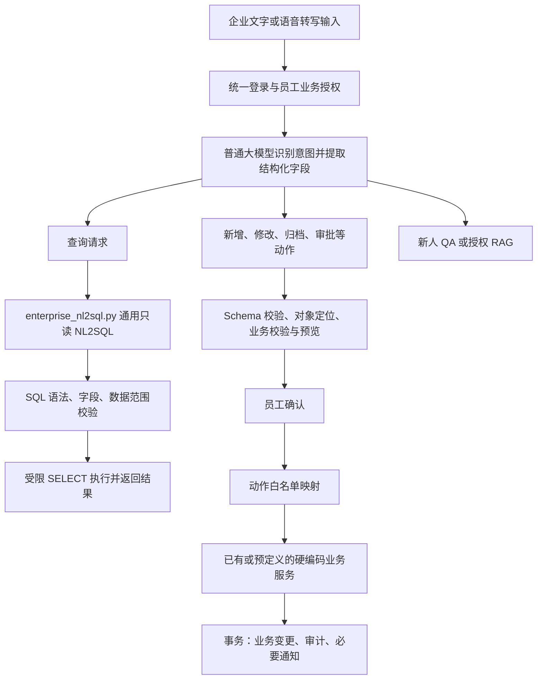
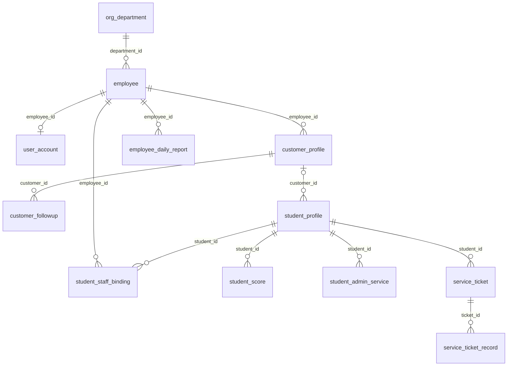

# 马睿智操作文档：公共基础能力与客服、客户研判、报告、企业、学生六模块联动版

主模块：公共登录与权限入口（公共基础能力）  
已合并模块：客服 Agent（对外开放模块）  
已合并模块：客户信息研判（规划中的受保护内部模块）  
已合并模块：智能报告（平台管理员、部门主管可访问；配置仅平台管理员）  
本轮新增模块：企业管理、学生智能助手（开发目标，未联合验收）  
公共模块负责人：马睿智；客服模块负责人：何至朗；智能报告负责人：陈宇林；学生模块负责人：蒋立建；企业模块负责人：莫世杰  
整理日期：2026-10-17  
系统目录：`D:\AI\StuProject`

本文件以 mrz.md 为主体，逐章合并 hzl.md 的功能、接口、字段、约束、文件清单及交付状态，补充公共能力与客服的联动流程。两份源文件保留不变。本次交付为文档，不修改代码、建表或部署；不含实现代码示例。

主要来源为“业务文档/09杂谈/操作文档个人版/”下的 mrz.md、hzl.md。公共账号及关联表的完整字段另据当前 scripts/sql/all.sql 整理，并核对账号 ORM；客服六表字段保留 hzl.md 的设计口径，不能把不同来源的规格直接视为已验证一致。源文档中的运行状态说明作为原有核对记录保留，不代表本次完成全部功能验收。

本次补充参考 allm.md 的实施安排，按当前主文档的职责、完整字段和匿名客服规则校正；不同工作副本的“已实现”状态未直接转为本目录事实。

## 阅读与联动口径

当前阶段仅完善本文档，不应用代码补丁、不改真实.env、SQL、数据库或部署。enterprise_student.py与student_leave_dify.py等规划／历史引用文件在实际开发阶段按职责交付，现阶段忽略其缺失，不列为文档阻塞，也不要求现在补写或补交。报告与学生的模型供应商、模型名称统一使用下文显式占位值，真实值由实际开发时提供，当前不再询问。

当前本地教务/CRM、faster-whisper及个人页站内通知方案见第八章；配置与运行待办统一见末章。此前静态核对记录不代表已完成服务、数据库或真实Dify联调；配置内容只列变量名与状态，不写真实密钥。

本轮权限修订以用户确认和“业务文档/06开发文档/个人开发文档/”九份文件为新增依据。当前目标集中见第二章权限矩阵，来源见第十一章，剩余权限问题见末章。历史来源中的“报告仅admin”不再作为当前授权目标；公共/客服等实现状态仍须独立核验。

第一至第七章保持 mrz.md 的主体结构，每章先写公共模块，再纳入客服对应内容。第八章说明调用、权限、事务和前后端联动；第九章补齐公共账号及其外键依赖表；第十章列出文件、接口和字段完整性核对及待接通项。第十一至第十五章补充基线核对、文件冲突处理、实施验收、条件迁移/回滚及兼容性要求，供后续真实代码合并使用。

客服六个现有接口继续匿名开放，不因合并公共鉴权而新增登录门槛。JWT 与逐接口权限依赖用于明确受保护的接口；公共账号权限不赋予访客客服管理能力。未来若增加客服管理接口，须另定 URL 和权限，本文件不虚构这些接口。


### 上一轮客户研判内容的合并口径（历史范围）

本次以本文件原内容为主体，补充 `业务文档/09杂谈/操作文档个人版/sgtallm.md` 中的客户研判方案。原第一至十五章结构、公共及客服完整字段、文件清单、实现差异和可选联动限制保留；新增研判内容按功能、权限、Dify、目录、联动、字段、实施与回滚归入对应章节，文件末章统一列出剩余冲突与待办。

当前来源记录的公共/客服接口共 9 个；新增规划研判接口 8 个，规划合计 17 个。原 11 张相关表加规划研判 5 表合计 16 张相关表。两个合计都不是已实现、已挂载或已建表的证明。旧来源未列研判负责人姓名；用户现明确研判业务负责人为客户顾问，按对应客户的有效顾问关联定位，不虚构开发人员姓名。

新增文档中的“解决方式”仍需核对可执行性：尤其员工角色权限无法仅靠业务校验跨过现有公共权限依赖，当前公共依赖不展开通配权限；涉及这些问题的新增内容均为提案，以第十八章未决项为约束。

### 上一轮智能报告内容的合并口径（历史范围）

本轮以包含客户研判的现有主文档为主体，合并 `业务文档/09杂谈/操作文档个人版/cyl合并后.md`。原第一至十五章业务内容保留，报告内容归入对应功能、权限、目录、联动、字段、实施和迁移章节；历次问题在文件末章去重归并；按用户后续决定，已解决事项只修改状态并保留原问题，不再移出。

四模块规划包括公共3、客服6、研判8、报告5，共22个预期接口操作；直接相关表范围为原16加报告3，共19张。报告另消费六张只读上游，部分尚未落地；不把这些范围数字当成当前已注册接口或已建表数量。当时报告三表仅有37字段名称；本次已按036补齐类型与约束，并单列目标增量，不能把历史缺失描述当当前设计状态。

历史报告来源曾提出“仅admin”；用户现已确认报告只允许平台管理员和部门主管访问，以第二章当前权限清单为准。普通员工不因employee身份取得报告权限；部门主管仅查看本部门报告，平台管理员可查看/生成全公司及所有部门报告并管理报告配置，精确权限接入和研判上游适配的剩余事项见末章。原有客服匿名及研判受保护边界继续保留。本轮只修改文档，不实施代码、授权、数据库或调度变更。

### 企业管理与学生智能助手（本轮累计合并）

本轮以含公共、客服、客户研判、智能报告的现有主体，合并msj_jlj_原文无损合并.md中的企业和学生两部分。企业／学生与此前各模块的剩余问题在文件末章按主题去重并连续编号。

企业12节正文、15表字段字典及旧请假结构参考、学生8章正文及七表73字段全部按主题纳入原章节。两份相同联合协作契约V1去重后完整保留于第十六章；原章号在标注E（企业）/S（学生）的段内指来源自身章节，不误指本主文档。

原六模块按表名去重的直接相关规划基线为36张；041拟新增report_task后为37张目标表，尚未实施；联合22表/43条物理FK是企业学生子范围。报告研判来源已按037统一为research_result经customer_info关联主档，不再把customer_judgement算作需新建的额外表。原学生21+老师10+服务同步3为34方法，本次049新增2个本人只读目标方法后为36；企业复述的请假/老师方法不重复计数；企业组合接口须按真实方法路径拆分，不宣称全系统已注册总数。

共同目标为公共人员JWT、单请假事实表及唯一固定服务、写动作模型提取与确认、企业NL2SQL只读、学生固定查询、报告只读上游。同步服务凭据是人员认证之外的明确分支；目标权限、物理外键、统一HTTP200及通知代次均未实施，本轮不修改代码/配置/SQL/数据库或启动任务。

### 本轮补充：各模块大模型调用

按操作文档个人版目录中除cyl合并后.md、msj_jlj_原文无损合并.md之外的8份文件补充第五章，集中列业务触发入口、服务/适配器、Dify路径、输入输出、模型/应用Key、DSL与失败处理。模型调用差异与此前问题统一在文件末章归并，不再叠加历史问题数量。新查明企业个人原文负责人为莫世杰。

本轮排除的两份文件只是不作为新增取材，不删除其既有合并内容或原文件。读取源文档不代表复核真实代码/配置/模型，详细来源和未决信息见第五章新总览。

### 同目录解决方案合并口径（2026-10-17）

以本文件为主体，吸收《操作文档_cyl.md》的001—010、《操作文档 msj.md》的031—040及《操作文档sgt.md》的041—050方案；正文按主题归位，末章只保留一套001—074编号。原问题全文保留为历史问题，不因解决而移出或重排；当前执行各项上方的状态和处理方案。

沿用本会话已确认决定：只完善文档；开发实施与验证暂略，文档阶段可暂判已解决；enterprise_student.py、student_leave_dify.py暂缺忽略；报告／学生模型使用假配置；心理跟进及学生会话历史永久保留；本期不提供访客取消。三份参考稿保持原样。本次没有修改代码、真实配置、SQL、数据库或部署，也未把参考稿的静态核对声明当作新运行证据。

参考稿交叉差异以本文合并口径为准：登录不被全局HTTP200规则改变；权限逐项匹配；真人管理员不用service_code；账号属于请求回执命名空间，业务报告按范围复用；模型结果不明不盲目重发；attempt不进业务键；指标按报告命名空间登记；k=5含补集保护；可空valid_to按无截止时间处理。具体见对应正文和原编号条目。

## 一、模块功能以及对应的接口和对应的数据库表

### 公共模块（主体）

本模块提供三个对外 HTTP 接口，以及供每个业务接口复用的 JWT 认证、鉴权中间件、日志、统一返回和本地 Dify HTTP 请求工具。身份认证采用 JWT；每个受保护的业务接口分别声明所需权限并接入公共鉴权中间件，通过后才能执行具体业务。

#### 1. 对外 HTTP 功能接口

| 功能 | 接口 | 调用用户 / 认证要求 | 对应数据库表或资源 | 功能说明 |
| --- | --- | --- | --- | --- |
| JWT 登录 | `POST /api/v1/auth/login` | 允许未登录用户提交账号密码 | `user_account` | 校验用户名及密码哈希，签发有有效期的 JWT；返回 `access_token`、`token_type`、`expires_in` |
| 公开访问清单 | `GET /api/v1/auth/public-access` | 无需 JWT | `app/access_control.yaml` | 返回允许匿名访问的页面和模块信息 |
| 当前用户权限清单 | `GET /api/v1/auth/me/access` | 必须携带有效 Bearer JWT | `user_account`、`app/access_control.yaml` | 通过 JWT 确认当前账号，读取用户表身份并映射权限，返回本人的身份、权限、可访问页面和模块；不代替各业务接口的权限校验 |

#### 2. 供各业务接口调用的公共功能

| 功能 | 公共接口 / 接入方式 | 调用方 | 对应数据库表或资源 | 功能说明 |
| --- | --- | --- | --- | --- |
| JWT 签发和解析 | `create_access_token(account)`、`decode_access_token(token)` | 登录服务、公共认证组件 | 用户主键、`AUTH_SECRET_KEY`、Token 有效期配置 | 签发 JWT；解析时验证签名和有效期，提取用户 ID；无效 Token 不建立有效身份 |
| JWT 身份认证 | `Depends(get_current_account)` | 仅需登录的接口；鉴权中间件内部复用 | `user_account` | 从 `Authorization: Bearer <access_token>` 获取 JWT，验证后查询真实账号及身份；不直接以客户端传入身份判断权限 |
| 逐接口权限鉴权中间件 | `Depends(require_permission("接口权限标识"))` | 每个需要权限控制的业务接口 | `user_account.identity_type`、`app/access_control.yaml` | 接口声明需要的权限；组件先验证 JWT，再按用户表身份映射权限，允许或拒绝调用；未认证按 401、无权限按 403 处理，响应方式见第四节 |
| 权限计算与访问清单 | `permissions_for(identity_type)`、`access_for(identity_type, user_id)` | 公共鉴权组件、当前用户权限接口 | `app/access_control.yaml`；身份由可信用户记录取得 | 计算当前身份的权限和可见页面/模块，不接受前端自报权限作为授权依据 |
| 日志生成 | `init_logger()`、`get_logger(name)` | 应用入口、各业务接口和服务 | 本地 `app/logs/` 或 `LOG_DIR` | 统一初始化日志，记录时间、级别、模块、行号、处理信息及异常堆栈 |
| 统一返回格式 | `success(data)`、`fail(code, message, data)`、`ResponseModel` | 各业务 HTTP 接口 | 无专属表 | 将成功或失败结果组织为 `code/message/data`；Dify 原始结果先由业务适配器解析 |
| 全局异常处理 | `BusinessException`、`register_exception_handlers(app)` | 应用入口、各业务服务 | 日志文件；无专属表 | 收敛业务异常和未处理异常；当前 HTTP/参数校验异常统一范围见第四节 |
| 本地 Dify HTTP 请求 | `DifyHttpClient.post_json_sync(path, api_key=..., payload=...)`、`await client.post_json(path, api_key=..., payload=...)` | 各业务自己的 Dify 应用适配器 | 本地 Dify 地址、各业务应用 API Key；无专属表 | 只封装同步/异步 JSON POST、Bearer 请求头、超时、HTTP 状态检查和 JSON 解析；模型、工作流、请求业务字段和输出校验由各业务负责 |
| 数据库连接和请求级会话 | `engine`、`SessionLocal`、`Base`、`get_db()`、`dispose_db()` | 各业务接口、数据库访问层、应用生命周期 | 公共数据库连接；各业务模型共用 ORM 基类 | 统一连接池、请求会话、异常回滚及资源释放；业务服务负责明确提交事务，不自动建表 |
| 统一配置管理 | `app/config.py` 中的配置对象 | 所有后端公共组件和业务适配器 | 项目根目录 `.env` | 统一读取数据库、日志、JWT 和各业务 Dify 应用配置 |
| 密码哈希与校验 | `hash_password()`、`verify_password()`、`authenticate()` | 账号初始化、登录认证服务 | `user_account.password_hash` | 账号密码以哈希保存，登录验证哈希；Token 签发/解析复用上方 JWT 公共能力 |
| 请求参数校验与公共响应模型 | Pydantic 请求模型、`LoginRequest`、`ResponseModel` | 各业务接口 | 无专属表；参数和结果结构 | 公共层提供登录请求校验和通用响应模型，各业务声明自己的请求字段约束 |

鉴权中间件在当前 FastAPI 项目中通过依赖注入接入，每个受保护接口使用 `Depends(require_permission(...))`，无需新增一个供前端单独请求的“鉴权 HTTP 接口”。公共层验证身份和接口权限，各业务服务继续校验具体记录的数据归属、部门/学生关系、分派和业务状态。

上表中的公共方法不等于已经被所有业务接口接入；各业务需在对应接口中显式声明依赖。JWT、日志、统一返回和 Dify HTTP 请求能力均复用公共组件。

### 客服模块（合并内容）

模块覆盖公司信息咨询、公司业务查询、海外留学政策查询、课程与项目推荐、活动与讲座报名、FAQ 自助解答及日常闲聊七类场景。对外共六个 HTTP 接口，基础前缀为 `/api/v1`，只有客服对话入口涉及 AI 调用，其余接口访问业务数据库。

#### 1. 对外 HTTP 功能接口

| 功能 | 接口 | 调用用户 / 认证要求 | 对应数据库表或资源 | 功能说明 |
| --- | --- | --- | --- | --- |
| 客服对话 | `POST /api/v1/agent/chat` | 所有人，允许匿名，无需 JWT | `chat_session`、`chat_message`；Dify 客服应用 | 接收消息，编排意图识别与回复，保存会话/消息，返回意图、回复及前端动作；模型调用失败提供兜底话术 |
| 活动列表 | `GET /api/v1/agent/events` | 所有人，允许匿名，无需 JWT | `lecture_event` | 查询活动，支持按 status 筛选，例如报名中 |
| 活动详情 | `GET /api/v1/agent/events/{event_id}` | 所有人，允许匿名，无需 JWT | `lecture_event` | 按活动 ID 返回详情；列表字段足够时前端可不额外调用 |
| 活动报名 | `POST /api/v1/agent/events/signup` | 所有人，允许匿名，无需 JWT | `lecture_event`、`event_signup` | 校验活动及有效报名记录，写入报名并更新人数；源文档另要求状态、名额、行锁与事务保护，落实情况见第六章“客服模块”交付核对 |
| 课程列表 | `GET /api/v1/agent/courses` | 所有人，允许匿名，无需 JWT | `course_project` | 仅返回上架课程，支持 category 筛选；为课程推荐动作提供真实课程数据 |
| FAQ 查询 | `GET /api/v1/agent/faq` | 所有人，允许匿名，无需 JWT | `faq` | 关键词模糊匹配，未命中返回第一条；主要问答由 Dify FAQ 知识库承担，此接口为数据库兜底 |

#### 2. 模块内部功能与公共能力接入

| 功能 | 公共方法 / 调用位置 | 调用方 | 对应数据库表或资源 | 功能说明 |
| --- | --- | --- | --- | --- |
| 会话及消息管理 | `run_chat()`、`_ensure_session()` | 客服对话接口 | `chat_session`、`chat_message` | 复用或新建会话，保存用户及助手消息；源文档要求用户消息先提交，避免模型失败丢失记录 |
| Dify 客户端选择 | `get_dify_client()`、MockDifyClient、RealDifyClient | 客服对话服务 | DIFY_CLIENT 等后端配置 | 源文档定义 mock / real 切换；当前 real 实现差异见第六章“客服模块”交付核对 |
| 意图及前端动作 | 客服 Dify 场景客户端 | 对话服务及前端 | intent、reply、need_action、action | 课程推荐引导 show_courses，活动查询引导 show_events；前端再请求课程或活动接口 |
| 报名校验和处理 | `signup()` | 活动报名接口 | `lecture_event`、`event_signup` | 按活动和手机号检查有效报名，执行报名写入；本期不提供访客取消，既有合法取消状态仅按状态式判重规则解释 |
| 参数及结果模型 | `app/schemas/agent.py` | 六个客服接口 | 无专属表 | 定义对话、活动、报名、课程及 FAQ 的请求/响应字段 |
| 数据库会话 | 公共 `get_db` 依赖 | 客服路由和服务 | MySQL；六张客服表 | 复用公共连接和请求级会话，业务服务负责事务写入 |
| 日志及异常 | 公共日志工具、统一异常组件 | 客服业务服务 | 本地运行日志 | 记录 Dify 调用失败等异常，复用公共日志及错误处理 |
| 统一响应 | `success()`、ResponseModel、BusinessException | 客服 HTTP 接口 | 无专属表 | 采用 code、message、data 响应结构 |
| Dify HTTP 传输 | 源文档指定 `DifyHttpClient` | real 客服场景客户端 | 本地 Dify API | 复用公共 JSON POST、Bearer 应用 Key、超时及 HTTP 错误检查；场景输入和输出解析由客服模块负责 |

#### 3. 数据表及用途

| 数据库表 | 功能作用 | 主要数据 |
| --- | --- | --- |
| `course_project` | 课程项目数据源 | 名称、类别、适用人群、简介、地点、报名方式和状态 |
| `lecture_event` | 讲座活动数据源 | 名称、类型、时间地点、名额、已报名人数和状态 |
| `event_signup` | 活动报名记录 | 活动 ID、姓名、手机号、扩展信息、报名时间及有效/取消状态 |
| `faq` | 数据库标准问答及兜底 | 问题、答案和分类 |
| `chat_session` | 客服会话 | 会话 UUID、访客标识和渠道 |
| `chat_message` | 客服对话历史 | 会话 ID、用户/助手角色、意图标签及消息内容 |

报名继续以活动ID、手机号及有效状态进行状态式判重，目标规范不使用活动ID与手机号的永久组合唯一约束。用户已确认本期不向报名访客提供取消能力，不新增访客取消页面／API，也不把人工代办取消作为本期访客服务承诺；取消后重报仅保留为将来显式启用取消能力时的规则或已有合法取消记录的解释，不作为本期产品闭环和验收前置。实际约束、并发保护和代码仍按开发阶段核验。

#### 4. 六张业务表的完整字段

以下字段仅摘录自《客服Agent实现方案.md》第四章，保留字段名称、类型、可空性、默认值、说明及索引/外键约束；未读取其他文件，也未据此核验数据库或代码。默认值中的“—”表示方案未列出默认值，两个单引号表示空字符串，NULL 表示空值。原有用途概述为业务说明，实际字段清单以下表为准。
##### 4.1 课程项目表 `course_project`

存课程/项目（留学申请、背景提升、语言培训三大类），课程推荐分支的数据源。

| 字段 | 类型 | 可空 | 默认值 | 说明 |
|:---|:---|:---:|:---|:---|
| id | BIGINT | 否 | 自增 | 主键 |
| course_name | VARCHAR(128) | 否 | — | 课程名称 |
| category | VARCHAR(32) | 否 | — | 类别：留学申请/背景提升/语言培训 |
| target_audience | VARCHAR(128) | 否 | '' | 适用人群（学历/意向国家等） |
| description | TEXT | 否 | — | 课程简介 |
| location | VARCHAR(128) | 否 | '' | 上课地点 |
| signup_method | VARCHAR(128) | 否 | '' | 报名方式 |
| status | VARCHAR(32) | 否 | '上架' | 状态：上架/下架（仅上架对访客可见） |
| created_at | DATETIME(3) | 否 | 当前时间 | 创建时间 |
| updated_at | DATETIME(3) | 否 | 当前时间，更新时自动刷新 | 更新时间 |

- 索引：`idx_category_status (category, status)`、`idx_status_time (status, created_at)`——支撑按类别筛选 + 仅取上架的查询。

##### 4.2 讲座活动表 `lecture_event`

存近期讲座/分享会/见面会；`quota` 名额上限，`signed_count` 实时已报名人数（报名成功由接口 +1），`status` 控制能否报名。

| 字段 | 类型 | 可空 | 默认值 | 说明 |
|:---|:---|:---:|:---|:---|
| id | BIGINT | 否 | 自增 | 主键 |
| event_name | VARCHAR(128) | 否 | — | 活动名称 |
| event_type | VARCHAR(16) | 否 | — | 线上/线下 |
| start_time | DATETIME | 否 | — | 开始时间 |
| location | VARCHAR(128) | 否 | '' | 地点 |
| signup_method | VARCHAR(128) | 否 | '' | 报名方式 |
| quota | INT | 否 | 0 | 名额（0 表示不限） |
| signed_count | INT | 否 | 0 | 已报名人数 |
| status | VARCHAR(32) | 否 | '报名中' | 状态：报名中/已满/已结束 |
| created_at | DATETIME(3) | 否 | 当前时间 | 创建时间 |
| updated_at | DATETIME(3) | 否 | 当前时间，更新时自动刷新 | 更新时间 |

- 索引：`idx_status_start (status, start_time)`——支撑「报名中 + 按时间排序」的列表查询；`idx_start_time (start_time)`。

##### 4.3 活动报名表 `event_signup`

访客在对话中完成报名的落库记录，是「报名闭环」的凭证。

| 字段 | 类型 | 可空 | 默认值 | 说明 |
|:---|:---|:---:|:---|:---|
| id | BIGINT | 否 | 自增 | 主键 |
| event_id | BIGINT | 否 | — | 活动ID（外键 → `lecture_event.id`） |
| customer_name | VARCHAR(64) | 否 | — | 客户姓名 |
| customer_phone | VARCHAR(32) | 否 | — | 客户手机号（判重依据） |
| customer_info | JSON | 是 | NULL | 客户扩展信息（意向国家、学历等） |
| signup_time | DATETIME | 否 | 当前时间 | 报名时间 |
| source | VARCHAR(32) | 否 | '客服对话' | 来源渠道 |
| status | VARCHAR(32) | 否 | '有效' | 状态：有效/取消 |
| created_at | DATETIME(3) | 否 | 当前时间 | 创建时间 |

- 外键：`fk_signup_event (event_id) → lecture_event(id)`。
- 索引：`idx_event_status (event_id, status)`、`idx_signup_time (signup_time)`。
- **去重策略**：目标采用状态式去重，存在`status=有效`的报名时拒绝重复写入；不将活动与手机号的永久组合唯一作为目标规范。本期不提供访客取消。历史合法`status=取消`记录及将来显式启用取消后的重报按状态解释，不能据此推导本期已有取消入口；现存永久唯一索引与目标规范的对齐留到实际开发。

##### 4.4 FAQ 问答对表 `faq`

存申请流程、费用、退费等高频问题标准答案，供 FAQ 兜底查询（知识库未覆盖时兜底）。

| 字段 | 类型 | 可空 | 默认值 | 说明 |
|:---|:---|:---:|:---|:---|
| id | BIGINT | 否 | 自增 | 主键 |
| question | TEXT | 否 | — | 问题 |
| answer | TEXT | 否 | — | 答案 |
| category | VARCHAR(32) | 否 | '' | 分类 |
| created_at | DATETIME(3) | 否 | 当前时间 | 创建时间 |

- 索引：`idx_category (category)`。

##### 4.5 客服会话表 `chat_session`

一个访客一次进店咨询 = 一条会话；`session_id`（UUID）是贯穿多轮对话的主线，前端首访不带、之后带回即可续上同一会话。

| 字段 | 类型 | 可空 | 默认值 | 说明 |
|:---|:---|:---:|:---|:---|
| id | BIGINT | 否 | 自增 | 主键 |
| session_id | VARCHAR(64) | 否 | — | 会话唯一标识（UUID），**唯一索引 `uk_session_id`** |
| user_id | VARCHAR(64) | 否 | '' | 访客标识（匿名或留资后） |
| channel | VARCHAR(32) | 否 | 'web' | 渠道（web 等） |
| created_at | DATETIME(3) | 否 | 当前时间 | 创建时间 |
| updated_at | DATETIME(3) | 否 | 当前时间，更新时自动刷新 | 更新时间 |

- 索引：`uk_session_id (session_id)` 唯一索引、`idx_user_id (user_id)`、`idx_updated_at (updated_at)`。

##### 4.6 客服消息表 `chat_message`

会话内每一条消息，`intent` 记录 Dify 识别的意图，用于审计、意图分布统计与对话追溯。

| 字段 | 类型 | 可空 | 默认值 | 说明 |
|:---|:---|:---:|:---|:---|
| id | BIGINT | 否 | 自增 | 主键 |
| session_id | VARCHAR(64) | 否 | — | 关联会话（外键 → `chat_session.session_id`） |
| role | VARCHAR(16) | 否 | — | user / assistant |
| intent | VARCHAR(32) | 否 | '' | 意图标签（由 Dify 返回；兜底时为空） |
| content | TEXT | 否 | — | 消息内容 |
| created_at | DATETIME(3) | 否 | 当前时间 | 创建时间 |

- 外键：`fk_message_session (session_id) → chat_session(session_id)`。
- 索引：`idx_session_time (session_id, created_at)`——按会话取历史消息；`idx_intent (intent)`——意图统计。
- **实现注意**：ORM 未声明外键关系，插入时必须保证父行（`chat_session`）先落库——`_ensure_session` 新建会话后立即 `flush`，否则同事务内 INSERT 顺序不定会触发外键违例。

方案另说明：knowledge_vector 知识库向量数据存储在 Dify 侧，后端本期不建该表；方案未提供其字段定义，本文不补写。

### 客户信息研判模块（本次新增，规划口径）

来源：`sgtallm.md` 第一章及第四章 4.1。以下是新增设计，不替代本章既有接口与字段，也不表示已经交付。

| 模块 | 来源 | 接口 | 数据库表 | 鉴权方式 |
| --- | --- | --- | --- | --- |
| 公共基础能力 | 主文档（主体） | `POST /api/v1/auth/login`、`GET /api/v1/auth/public-access`、`GET /api/v1/auth/me/access` | `user_account`、`org_department`、`employee`、`customer_profile`、`student_profile`（及外键依赖） | JWT + `Depends(require_permission(...))` |
| 客服 Agent | 主文档（已合并） | `agent/chat`、`agent/events`、`agent/events/{id}`、`agent/events/signup`、`agent/courses`、`agent/faq` | `course_project`、`lecture_event`、`event_signup`、`faq`、`chat_session`、`chat_message` | 匿名开放，无需 JWT |
| 客户信息研判 | sgt.md（本次合并） | `customer/sources`、`customer/sources/{id}/parse`、`customer/judge`、`customer/judge/batch`、`customer/results/{id}`、`customer/results`、`customer/rules`（GET/PUT） | `customer_source`、`customer_info`、`research_rule`、`product`、`research_result` | JWT + `require_permission(customer.*)` |

客户研判的八个接口为基础前缀 `/api/v1` 下的受保护接口，需登录并具备对应 `customer.*` 权限；不与客服六个匿名接口混用授权规则。客户研判为全新模块（sgt.md 标注「规划中」），本次合并以「新增表 + 新增接口 + 接入公共能力」为主，不改造存量客服与公共契约。

#### 三模块职责与公共能力复用

| 模块 | 核心功能 | 对外接口 | 复用的公共能力 |
| --- | --- | --- | --- |
| 公共基础能力 | 登录认证、逐接口鉴权、日志、统一返回、Dify HTTP、数据库会话、配置 | 3 个 auth 接口 | —（自身提供） |
| 客服 Agent | 咨询、课程/活动查询、报名、FAQ、会话消息 | 6 个 agent 接口（匿名） | get_db、日志、统一返回、Dify HTTP、配置 |
| 客户信息研判 | 信息接入、多格式解析、关键字段提取、画像研判、结果输出、规则维护 | 8 个 customer 接口（受保护） | JWT 鉴权、get_db、日志、统一返回、Dify HTTP（可选）、配置 |

#### 八个研判接口与权限对应关系（规划）

| 方法及完整路径 | 功能 | 声明权限 | 备注 |
| --- | --- | --- | --- |
| `POST /api/v1/customer/sources` | 接入文本、PDF、Excel 来源 | `customer.source.create` | 上传协议、文件限制及返回字段见第十八章第024项 |
| `POST /api/v1/customer/sources/{id}/parse` | 解析来源并提取结构化字段 | `customer.source.parse` | — |
| `POST /api/v1/customer/judge` | 单条研判 | `customer.judge.create` | 命中和未命中均为正常业务结果 |
| `POST /api/v1/customer/judge/batch` | 批量研判 | `customer.judge.batch` | — |
| `GET /api/v1/customer/results/{id}` | 结果详情 | `customer.result.read` | 校验记录访问范围 |
| `GET /api/v1/customer/results` | 结果列表 | `customer.result.read` | 按第二章数据范围读取 |
| `GET /api/v1/customer/rules` | 读取规则 | `customer.rule.read` | — |
| `PUT /api/v1/customer/rules` | 维护规则并生成新版本 | `customer.rule.manage` | 旧版本保留 |

前四个接口的方法及路径、结果详情和规则 GET/PUT 来自新增文档调用流程；结果列表 GET 依据其接口清单及查询语义展开，为待接口负责人确认的契约。源文档八接口与七权限分别计数，不将相同 URL 的 GET/PUT 算为同一个操作。

### 智能报告模块（本轮新增）

来源：`cyl合并后.md` 第一、四章；负责人：陈宇林。报告方案定位为仅平台管理员和部门主管可访问的数据消费模块（按用户本轮确认；历史来源“管理员专属”已被此口径更新），只读上游、计算固定指标、调用报告 Workflow 撰写分析，将正文与指标保存到报告三表。除生成链路外，查询与配置操作不直接调用 Dify。

本轮保留客户研判八接口与五表；报告来源只合并过公共、客服、报告三个模块，不能用其目录或统计覆盖上一轮研判内容。下列均为文档设计或来源状态，未核验代码与运行环境。

#### 报告五接口及权限关系（当前文档目标）

路径与权限名沿用第五章已补充的报告调用契约；访问人群以用户本轮确认为准，配置职责依据《开发文档-Albert2.md》1.4、8.1。下表为开发目标，未修改真实路由、YAML或授权代码。

| 功能 | 方法及路径 | 动作权限 | 允许角色及范围 |
| --- | --- | --- | --- |
| 异步生成报告 | `POST /api/v1/report/generate` | `report.generate` | 仅平台管理员；可生成全公司及各部门报告；部门主管禁止手动生成 |
| 查询单份报告 | `GET /api/v1/report/{report_record_id}` | `report.read` | 平台管理员、部门主管；主管仅本部门授权报告；全公司报告不能仅靠过滤列表后直接读正文 |
| 报告列表 | `GET /api/v1/report/list` | `report.read` | 同详情的数据范围，只给授权元数据，total也受范围约束 |
| 读取报告配置 | `GET /api/v1/report/configs` | `report.config.read` | 平台管理员；部门主管不因可读报告而自动取得配置接口权限 |
| 修改报告配置 | `PUT /api/v1/report/configs/{report_code}` | `report.config.write` | 平台管理员；字段、版本及审计校验仍待实现 |

报告只消费经授权的上游数据。心理周报采用匿名聚合，报告访问权不授予心理原文、个人预警或请假审批能力。用户已明确主管只能查看，平台管理员可执行全部报告操作并访问全公司及所有部门报告。报告范围的文档目标按第006项可信快照方案，具体增量结构见第九章；字段／约束实施仍暂略，权限结论见第二章。

#### 报告五接口完整Schema（035；来源：《操作文档 msj.md》）

以下为冻结的接口目标，依据本地 `app/schemas/report.py`、`app/api/report.py` 补全；本轮只修订文档，不表示代码已实现全部校验或权限。所有时间响应使用带 `Z` 的UTC ISO 8601文本；业务默认时区为北京时间 `Asia/Shanghai`，不能用数据库UTC存储或旧Schema默认UTC替代业务时区。

| 方法及路径 | 请求Schema | 成功时data Schema |
| --- | --- | --- |
| `POST /api/v1/report/generate` | 公共Bearer JWT；必传 `Idempotency-Key` 请求头（8—128位可见ASCII，无首尾空白，重试复用）；JSON包含 `report_code`、可选 `start_time`／`end_time`、可选 `timezone`。`report_code`限五类枚举；时间边界成对提供；`timezone`省略为 `Asia/Shanghai`，本期显式值也仅接受该值。拒绝未知字段，不接收客户端自报指标、操作者、版本、快照或报告正文。 | `{report_record_id:正整数, idempotency_key:字符串, status:四状态枚举, reused:布尔值, start_time:UTC时间, end_time:UTC时间, timezone:"Asia/Shanghai"}`。新建为pending；复用时返回已有真实状态，不强制改为pending。 |
| `GET /api/v1/report/list` | 公共JWT；查询参数 `report_code?:五类枚举`、`status?:四状态枚举`、`page:正整数=1`、`page_size:1..100=20`，拒绝未知查询参数。保持既有page分页契约，不混入企业／学生的limit／offset契约。 | `{total:非负整数,page:正整数,page_size:1..100,items:ReportListItem[]}`；`ReportListItem={report_record_id,report_code,report_name,start_time,end_time,status,generated_at?}`。按 `created_at DESC, report_record_id DESC` 稳定排序；total、items使用相同授权过滤。列表不返回正文、指标、失败详情或幂等请求凭据。 |
| `GET /api/v1/report/{report_record_id}` | 公共JWT；路径ID为正BIGINT范围整数，先校验report.read及当前数据范围。 | `ReportRecordOut={report_record_id,report_code,report_name,idempotency_key,start_time,end_time,timezone,data_snapshot_at?,report_version,source_record_count,status,report_content?,metric_json?,fail_reason?,generated_at?,created_at,updated_at}`。ID／计数为整数；正文为Markdown字符串；metric_json为对象或NULL；fail_reason仅为脱敏说明。内部请求回执、操作者标识和非公开取数清单不进入响应。 |
| `GET /api/v1/report/configs` | 公共JWT，仅平台管理员和report.config.read；无请求体或查询参数。 | `ReportConfigOut[]`，按report_code排序；每项为 `{report_config_id:正整数,report_code:五类枚举,report_name:字符串,report_period:day/week/month,cron_expr:字符串或NULL,enabled:布尔值,row_version:正整数,created_at:UTC时间,updated_at:UTC时间}`。 |
| `PUT /api/v1/report/configs/{report_code}` | 公共JWT，仅平台管理员和report.config.write；路径code限五类枚举。JSON必填 `row_version:整数≥1`、`report_name:去首尾空白后1..128字符`、`enabled:布尔值`；`cron_expr`必填且可为NULL，非空时长度1..64并通过实际调度适配器语法校验。拒绝未知字段，不允许改code／周期／ID。 | 更新后的完整ReportConfigOut；事务内比较row_version，成功后加1；不匹配返回409。cron为NULL仅关闭该类自动调度，不把手动生成权限交给主管；设置enabled或cron不代表任务已经启用。 |

五类code为 `customer_overview`、`daily_report`、`weekly_report`、`mental_weekly`、`complaint_weekly`；四状态为 `pending/running/success/failed`。pending／running时正文、完成时间为NULL；success才返回正式正文；failed返回脱敏fail_reason且不返回半成品正文。metric_json仅返回已发布的指标白名单及非敏感版本元数据，心理输出继续受第045项约束。

报告接口目标采用HTTP 200 + `{code,message,data}` 应用信封：0成功；400非法枚举、时间窗、字段或分页；401无效／缺失JWT；403动作权限不足；404对象不存在或超出对象范围；409版本、幂等或状态冲突；503上游／模型／可信范围依赖未就绪；500未预期内部异常。业务拒绝时data可为NULL，不能泄露跨部门对象是否存在；已受理任务后发生失败，通过记录status=failed展示。应用参数校验、HTTPException适配和代理非200的落实仍归第009项；调用方继续处理网络／代理非200，本文不声称全局错误出口已统一。

路由注册顺序固定为 `/configs`、`/configs/{report_code}`、`/generate`、`/list` 在前，`/{report_record_id}` 在后；动态ID还须做整数校验。验收以完整方法+路径为单位，每个只注册一次，检查 `/list`、`/configs` 不被动态详情捕获。平台管理员可生成／配置／读取；有效manager仅可读本人部门报告，其余拒绝。当前请求Schema不新增部门选择字段，人工生成默认公司范围；部门报告由可信内部调度按第006项生成。任何声明为部门的任务若解析不到合法部门均返回依赖未就绪，不能降级公司范围。范围字段及任务实施仍待开发，不能声称部门生成已可用。

#### 来源合并概览（保留原范围）
| 项目 | 内容 |
| --- | --- |
| 主体 | 公共登录与权限入口（公共基础能力），为所有业务接口提供 JWT、鉴权、日志、统一返回、数据库会话、本地 Dify HTTP 传输 |
| 合并模块 1 | 客服 Agent（对外开放模块）：六个匿名接口，只有对话入口调用 Dify |
| 合并模块 2 | 智能报告（管理层报告模块）：五个接口；访问限平台管理员和部门主管，动作分工见当前权限清单，只有生成链路调用 Dify |
| 统一目录 | `D:\AI\StuProject` |
| 输出 | 合并后的 `马睿智/操作文档.md` + 本 allm.md |

**访问模型对照：** 客服模块「匿名开放」，不接公共 JWT；智能报告「平台管理员和部门主管可访问」，复用公共 JWT、逐动作授权及数据范围校验。报告配置限平台管理员；普通员工、客户、学生与匿名访客不得因公共入口或客服会话取得报告权限。

上表“输出主文档 + 本 allm.md”为报告来源原交付口径，本轮只更新用户指定的主操作文档，`cyl合并后.md` 保留不变，不另建或覆盖 allm.md。

### 企业 E1：业务范围与职责

来源：`msj_jlj_原文无损合并.md` 的企业 E1：业务范围与职责。下列为来源开发目标/历史说明，未核验实现；段内原章号按该来源对应部分理解，附录A并入第九章，附录B统一见第十六章。

项目服务留学咨询与学生服务机构，包含客户研判、客服 Agent、企业智能助手、学生智能助手、智能报告五个模块。企业管理模块面向内部员工，负责把客户跟进、日报、教务和售后处理串联起来。

企业管理对应企业智能助手。用户本轮选择用本项目前端、FastAPI和本地MySQL管理所需教务及CRM数据；当前范围包括课程/成绩/学业节点、客户/跟进/申请进度，不扩展为完整商业CRM、招生收费、财务或人事薪酬平台。历史“不建教务/CRM本体”的外部依赖口径由此更新，已确认的数据权限继续适用。

| 业务 | 企业管理负责的功能 | 与其他模块的边界 |
| --- | --- | --- |
| 意向客户 | 文字/语音录入、档案查询、追加跟进、状态更新、归档及申请进度维护 | 当前采用本地CRM页面及固定后端服务，共用客户主档；客服/研判只按原授权供线索，未来外部CRM适配保留为可选 |
| 员工日报 | 口述/文字提取、本人提交与修订、管理者按部门查阅 | 正式日/周汇总报告交给智能报告模块；不重复建设报告表 |
| 组织查询 | 部门层级、职能、员工工作联系方式 | 复用组织主数据，不承担薪酬、人事流程 |
| 新人指引 | 标准 QA、制度文档 RAG、答案来源及版本 | 资料由企业维护；没有来源不生成确定性制度结论 |
| 学生成绩 | 授权学生/课程的录入、查询、更正、作废 | 复用学生主档；外部教务仅提供只读接口时，不提供本地修改冒充教务成功 |
| 学生请假 | 老师待办、详情、审批结果展示与审批入口 | 统一账号 JWT；学生提交与老师审批共用 `student_admin_service` 和固定业务服务，旧契约适配见第 2、6 节 |
| 投诉反馈 | 工单查询、分派、跟进、给出解决方案 | 学生提交、确认解决、重开及评价由学生模块负责；共用同一工单 |
| 主动待办 | 客户跟进提醒、待审批请假、待处理投诉、站内通知 | 定时任务只生成提醒，不自动代替员工审批或处理业务 |

语音输入先转写成文本，再进入与文字相同的处理链。第一阶段可先接收已有转写文本；真实音频上传与转写适配作为同一需求的后续交付，不把“能提交文字”当作语音功能已经完成。


### 企业 E6：完整接口、权限及固定审批服务契约

来源：`msj_jlj_原文无损合并.md` 的企业 E6：完整接口、权限及固定审批服务契约。下列为来源开发目标/历史说明，未核验实现；段内原章号按该来源对应部分理解，附录A并入第九章，附录B统一见第十六章。

#### 6.1 企业模块拟实现/复用的接口

下表以 `/api/v1/enterprise` 为统一前缀，**路径列均为此前缀后的相对路径**。除明确注明既有登录外，本节为目标接口清单，不代表本地已经全部实现。保留早期企业接口的 `customer`、`daily-report`、`nl2sql`、`command` 命名。

“全体员工”指通过有效状态检查的业务员工；“配置管理员”指员工业务角色 `admin`。客户权限范围见第 5 节，不能因为接口列了主管就读取其他部门。

| 方法 | 相对路径 | 作用/权限标识 | 允许角色与范围 |
| --- | --- | --- | --- |
| GET | `/me/permissions` | 当前权限 `enterprise.access` | 全体员工，本人 |
| GET | `/customer`、`/customer/{customer_id}` | 客户列表/详情 `enterprise.customer.read` | 顾问本人客户；主管本部门客户 |
| POST | `/customer` | 新增 `enterprise.customer.create` | 顾问本人；主管本部门，指定负责人必须是本部门有效顾问 |
| PUT | `/customer/{customer_id}` | 修改普通资料 `enterprise.customer.update` | 顾问本人；主管本部门；不接受角色/归属等越权字段 |
| PUT | `/customer/{customer_id}/status` | 状态更新 `enterprise.customer.status` | 顾问本人；主管本部门 |
| POST | `/customer/{customer_id}/assign` | 转派 `enterprise.customer.assign` | 主管本部门；目标顾问同部门 |
| DELETE | `/customer/{customer_id}` | 归档 `enterprise.customer.archive` | 顾问本人；主管本部门；不是物理删除 |
| GET | `/customer/{customer_id}/followups` | 跟进查询 `enterprise.customer.read` | 可读该客户者 |
| POST | `/customer/{customer_id}/followups` | 追加跟进 `enterprise.customer.followup` | 可写该客户者；记录实际操作者 |
| PUT | `/customer/{customer_id}/followups/{followup_id}/schedule` | 完成/取消下次跟进安排 `enterprise.customer.followup` | 可写该客户者；不覆盖历史沟通原文 |
| POST | `/daily-report` | 提交本人日报 `enterprise.daily.write_own` | 全体员工，仅本人；同一日期不重复新增 |
| GET | `/daily-report`、`/daily-report/{report_id}` | 日报查阅 `enterprise.daily.read` | 本人；主管按提交部门快照读取本部门 |
| PUT | `/daily-report/{report_id}` | 修订 `enterprise.daily.write_own` | 仅原作者，版本校验 |
| DELETE | `/daily-report/{report_id}` | 作废 `enterprise.daily.write_own` | 仅原作者，原因必填，保留历史 |
| POST | `/daily-report/summary` | 部门即时汇总 `enterprise.daily.summary` | 主管本部门；只基于授权已提交内容，不代替正式报告模块 |
| GET | `/organization`、`/employees` | 部门树/通讯录 `enterprise.organization.read` | 全体员工，工作信息白名单 |
| GET | `/students`、`/students/{student_id}` | 学生最小档案 `enterprise.student.read` | 班主任/服务人员按有效关系；教务按成绩关系；配置管理员的维护视图只给必要主档字段 |
| GET | `/scores`、`/scores/{score_id}` | 成绩查询 `enterprise.score.read` | 班主任所负责学生；教务的学生/课程范围 |
| POST | `/scores` | 成绩录入 `enterprise.score.write` | 教务，学生与课程绑定有效 |
| PUT | `/scores/{score_id}` | 更正 `enterprise.score.write` | 教务，范围有效，更正原因必填 |
| DELETE | `/scores/{score_id}` | 作废 `enterprise.score.void` | 教务，范围有效，作废原因必填 |
| GET | `/tickets`、`/tickets/{ticket_id}` | 投诉列表/详情 `enterprise.ticket.read` | 老师本人被分派且关系有效的工单；主管本部门 |
| POST | `/tickets/{ticket_id}/assign` | 分派 `enterprise.ticket.assign` | 主管本部门，目标处理人有效且有学生服务关系 |
| POST | `/tickets/{ticket_id}/followups` | 人工跟进 `enterprise.ticket.handle` | 当前处理老师；主管如需亲自办理先按规则分派给本人并具备所需关系 |
| POST | `/tickets/{ticket_id}/resolve` | 给出方案 `enterprise.ticket.handle` | 当前处理老师；转为 `awaiting_student`，不直接关闭 |
| GET | `/knowledge`、`/knowledge/{knowledge_id}` | 知识查询 `enterprise.knowledge.read` | 全体员工；全员或本人部门可见、已发布且生效 |
| POST | `/onboarding/ask` | QA/RAG `enterprise.knowledge.read` | 全体员工；检索前限定部门和可见版本 |
| GET | `/todos` | 待办聚合 `enterprise.todo.read_own` | 全体员工，仅本人有权处理的事项 |
| GET | `/notifications` | 企业消息 `enterprise.notification.read_own` | 全体员工，仅本人企业模块消息 |
| POST | `/notifications/{notification_id}/read` | 已读 `enterprise.notification.read_own` | 本人接收的消息；不等于业务处理完成 |
| POST | `/nl2sql` | 自然语言只读查询 `enterprise.query` | 全体员工，但具体对象仍需客户/日报/成绩等权限 |
| POST | `/command` | 提取动作并生成预览 `enterprise.command` | 全体员工，按目标业务动作授权；不写库 |
| POST | `/command/confirm` | 确认并调用固定服务 `enterprise.command` + 目标动作权限 | 同一员工，重新校验权限、版本、有效期及参数摘要 |
| POST / PUT / DELETE | `/departments`、`/departments/{department_id}` | 部门新增/修改/停用 `enterprise.organization.manage` | 配置管理员；禁止成环，停用前检查有效员工与业务关联 |
| POST / PUT | `/employees`、`/employees/{employee_id}` | 员工资料维护 `enterprise.employee.manage` | 配置管理员；密码和系统账号由公共认证模块管理 |
| PUT | `/employees/{employee_id}/roles` | 角色配置 `enterprise.role.manage` | 配置管理员，完整审计；普通资料接口不能顺带改角色 |
| POST / PUT / DELETE | `/student-bindings`、`/student-bindings/{binding_id}` | 新增/修改/停用绑定 `enterprise.binding.manage` | 配置管理员；学生/员工存在、课程与关系有效 |
| POST / PUT / DELETE | `/knowledge`、`/knowledge/{knowledge_id}` | 新增/编辑草稿/停用 `enterprise.knowledge.manage` | 配置管理员，版本变化后重新审核与索引 |
| POST | `/knowledge/{knowledge_id}/publish` | 审核发布 `enterprise.knowledge.publish` | 配置管理员，审核信息及索引就绪；不得由模型直接发布 |
| GET | `/operation-logs` | 企业审计 `enterprise.audit.read` | 配置管理员，仅企业事件，敏感快照脱敏，不读取学生心理处置原文 |

组合行中的集合路径用于 POST，`/{id}` 用于 PUT/DELETE，不意味着对每个路径开放所有列出的方法。配置维护接口可后于核心业务交付，角色与数据基础可先由受控初始化数据提供。

#### 6.2 学生协作接口与请假目标契约

以下全部路径由学生模块开发和注册，企业只维护调用方，不另建 `enterprise_student.py` 重复注册。全部为待测试目标，具体字段与权限见附录 B。本轮只改两份协作文档。

| 方法 | 完整路径 | 主体与范围 |
| --- | --- | --- |
| GET | `/api/v1/internal/student/leave` | 统一 JWT + 审批权限 + 有效班主任关系；按当前 `reviewer_id` 查询本人的请假，目标筛选参数为 `approval_status` |
| GET | `/api/v1/internal/student/leave/{apply_id}` | 同上，`apply_id=student_admin_service.id`，返回最新 `row_version` |
| POST | `/api/v1/internal/student/leave/{apply_id}/decision` | 同一指定班主任；请求含 `expected_version`、`decision`、`comment` 与幂等头；调用共享固定审批服务 |
| GET | `/api/v1/internal/student/notifications` | 当前老师的学生模块通知 |
| POST | `/api/v1/internal/student/notifications/{notification_id}/read` | 本人通知已读 |
| GET | `/api/v1/internal/student/warnings` | 授权老师；学生心理协作入口，非通用员工查询 |
| GET | `/api/v1/internal/student/warnings/{warning_id}` | 授权老师与实际负责人 |
| POST | `/api/v1/internal/student/warnings/{warning_id}/ack` | 授权负责老师接手 |
| POST | `/api/v1/internal/student/warnings/{warning_id}/follow` | 授权负责老师人工跟进 |
| POST | `/api/v1/internal/student/warnings/{warning_id}/close` | 授权负责老师填写处理结果后关闭 |
| POST | `/api/v1/internal/student/sync/academic` | Bearer `STUDENT_SYNC_TOKEN`，映射 `service_code=student_sync、scopes=[student:sync]`，不是老师 JWT |
| POST | `/api/v1/internal/student/sync/progress` | 同上 |
| POST | `/api/v1/internal/student/sync/{kind}/pull` | 同上；`kind=academic/progress` |

心理协作与同步由学生开发，企业不重复实现。所有人员业务接口统一公共 JWT；同步接口单独校验服务凭据并映射 scope，不接受个人 JWT。系统 `admin` 不自动视作老师或同步身份，不接受旧学生自签登录令牌。

请假目标契约如下，路径保持上表约定：

- 列表筛选使用 `approval_status=pending/approved/rejected/cancelled`，可省略；仅查询 `apply_type=leave`，分页和 `total` 应用相同授权范围。
- 列表项及详情统一返回 `apply_id、student_id、apply_type、apply_content、approval_status、leave_start_at、leave_end_at、reviewer_id、reviewed_at、approval_comment、row_version、created_at、updated_at`；可额外返回受控的 `leave_type` 展示字段。仅输出这些业务字段，不透传 `edu_related_data` 全量内容、`request_hash` 或其他内部信息。
- `reviewed_at`、`approval_comment` 在未审批时可为 null；`reviewer_id` 未分派时可为 null，但不会出现在任意老师的审批列表，也不能由老师自行指定身份领取。
- 审批 body 为 `expected_version、decision、comment`，`decision` 仅允许 `approved/rejected`；`comment` 最多 2000 字，驳回时必填，批准时可省略。审批人、学生 ID、审批时间、目标表不接受客户端指定。
- 审批成功 `data` 返回 `apply_id、approval_status、row_version、reviewed_at、reviewer_id`。所有学生/老师业务方法统一 HTTP 200 + 第 6.3 节信封，应用产生的鉴权/校验错误同样处理；公共登录维持公共契约。运行行为仍待编码与测试。

学生侧使用 `/api/v1/student/leave` 入口，共用同一事实表和固定服务；以下均为开发与待测试目标：

| 方法 | 完整路径 | 权限与业务条件 |
| --- | --- | --- |
| POST | `/api/v1/student/leave` | 公共 JWT + `student.admin_service.create`，绑定本人 `student_id`，写入 `pending` 并按有效主班主任分派 `reviewer_id` |
| GET | `/api/v1/student/leave` | 目标本人列表；公共 JWT + `student.admin_service.read_own`，固定本人 `student_id` 与 `apply_type=leave` |
| GET | `/api/v1/student/leave/{apply_id}` | 目标本人结果详情；同上，不可查看其他学生；业务字段与老师详情的目标口径一致 |
| DELETE | `/api/v1/student/leave/{apply_id}` | 目标本人撤回；新增明确动作权限 `student.admin_service.withdraw_own`，携带幂等键及 `expected_version`，仅允许本人 `pending → cancelled`，保留申请与审计 |

学生目标撤回权限需由公共 YAML 显式授予学生身份，不能用查询权限隐含授予写权限。撤回与审批共用状态/版本并发控制，一方先完成后另一方返回 409。无班主任时提交记录仍可保留待分派，不自动授权任意老师接管；后续受控分派须检查有效主班主任并留审计。

#### 6.3 请求与响应约定

- 目标所有企业/学生/老师业务接口统一 HTTP 200 + `{code,message,data}`：0 成功，400 参数，401 身份，403 动作权限，404 对象不可见/不存在，409 状态/版本/幂等冲突，500 内部错误，503 依赖不可用；应用校验与鉴权错误同样封装。公共登录维持公共契约，网络/代理非200仍须处理，目标尚待实现与测试。
- 列表统一 `limit=1..100、offset≥0`，返回 `items、total、limit、offset`；统计总数也必须应用相同数据范围。
- 所有企业/学生业务写入、聊天与确认请求使用 `Idempotency-Key`，8～128 位可见 ASCII；同提交重试复用原键，同键不同参数返回 409。修改已有对象需 `expected_version`，通知已读等单调动作例外；提醒代次和会话版本按附录 B。历史校验如有差异，后续按目标契约改造，不在开发阶段保留冲突格式。
- 当前人、部门、操作者从服务端身份取得。客户转派等明确允许的目标人员字段须单独验证；日报不能接收任意 `employee_id` 代写。
- 普通查询返回业务数据和必要来源说明，不默认返回 SQL、异常堆栈、数据库结构或完整敏感字段。

#### 6.4 固定请假审批服务与事务

表单审批与对话中的 `leave.decide` 都调用同一审批函数；自然语言路径先完成预览确认，固定服务不调用 NL2SQL，也不让 Dify 直接写库。

1. 读取统一认证账号，检查员工有效状态、`teacher` 角色及审批动作权限；从账号关联取得真实员工 ID。
2. 仅在有权访问的请假集合内定位 `apply_id`，核验学生有效状态、有效 `class_teacher` 关系和 `reviewer_id=当前员工`。无动作权限为 403；对象不存在或不在授权范围为 404，避免泄露他人申请。
3. 将真实员工、动作、申请 ID、决定、意见、预期版本规范化计算参数摘要；按真实操作者、动作和请求幂等键生成唯一 `operation_key`。同键不同参数为 409；已成功的同参数重试在重验当前身份和范围后回放原回执，不再次审批或入队通知。
4. 对新操作在同一事务中占用幂等键，重新检查相关关系和申请，要求 `apply_type=leave`、`approval_status=pending`、`row_version=expected_version`。使用行锁或等价并发保护，保证审批、撤回和后续可能的分派变更互斥。
5. 固定参数化更新以 `id、apply_type、reviewer_id、approval_status、row_version` 为条件，写入 `approved/rejected`、服务端 `reviewed_at`、意见及 `row_version+1`。受影响行数必须为 1，否则回滚并返回 409；已批准、驳回或撤回的申请不能再次办理。
6. 同事务写成功审批操作记录、必要前后快照和可重放回执；学生结果通知使用 `student.leave.approved` / `student.leave.rejected` 事件，`entity_type=student_admin_service`，对象 ID 为真实 `id`，由学生通知任务按去重键消费。企业页面不重复发送相同结果通知。
7. 任一步失败全部回滚；事务提交成功才返回审批成功。通知投递失败单独重试，不回退已成功审批，也不以“已入队”冒充已送达。

在当前只允许指定老师审批的规则下，`reviewer_id` 与本次实际操作员工相同；实际操作者仍由审计独立保存。若以后新增转派，必须单独记录转派前后老师及原因；不得修改 `reviewer_id` 后再据此改写历史审批人。


### 学生 S一：原21个学生方法及本次新增2个只读方法、10个老师方法、3个同步方法

来源：`msj_jlj_原文无损合并.md` 的学生 S一：21个学生方法、10个老师方法、3个同步方法。下列为来源开发目标/历史说明，未核验实现；段内原章号按该来源对应部分理解，附录A并入第九章，附录B统一见第十六章。

目标为一个统一 Workflow 承接七类业务，数据库操作、权限和通知由后端固定服务执行。原来源规划21个学生端业务方法，本次049新增courses／scores两个本人只读方法，学生端目标23个；老师协作10个、服务同步3个，共36个；这些是开发清单，不代表已注册或可调用。公共登录不计入学生端方法数量。学生模块维护全部学生接口、10 个老师协作接口及 3 个同步接口，企业模块只建设老师页面与调用编排，不重复注册这些路径或复制审批状态机。

#### 1. 学生端 HTTP 功能接口

| 功能 | 接口 | 调用用户 / 认证要求 | 对应数据库表或资源 | 功能说明 |
| --- | --- | --- | --- | --- |
| 提交请假 | `POST /api/v1/student/leave` | 已登录学生，仅本人 | student_admin_service；读取 student_profile、student_staff_binding、employee | 提交本人申请；写审计和通知，老师负责审批 |
| 请假列表 | `GET /api/v1/student/leave` | 已登录学生，仅本人 | student_admin_service | 仅本人申请 |
| 请假详情 | `GET /api/v1/student/leave/{apply_id}` | 已登录学生，仅本人 | student_admin_service | 仅本人详情 |
| 撤回请假 | `DELETE /api/v1/student/leave/{apply_id}` | 已登录学生，仅本人 | student_admin_service、operation_log | 校验版本和状态后撤回 |
| 投诉或建议 | `POST /api/v1/student/complaint` | 已登录学生，仅本人 | service_ticket、service_ticket_record | 保存诉求及初始工单记录 |
| 本人工单列表 | `GET /api/v1/student/tickets` | 已登录学生，仅本人 | service_ticket | 仅本人 |
| 本人工单详情 | `GET /api/v1/student/tickets/{ticket_id}` | 已登录学生，仅本人 | service_ticket | 仅本人 |
| 工单沟通记录 | `GET /api/v1/student/tickets/{ticket_id}/records` | 已登录学生，仅本人 | service_ticket_record | 只返回 student_visible 记录 |
| 补充工单信息 | `POST /api/v1/student/tickets/{ticket_id}/reply` | 已登录学生，仅本人 | service_ticket、service_ticket_record | 追加沟通并更新版本 |
| 确认解决或重开 | `POST /api/v1/student/tickets/{ticket_id}/confirm` | 已登录学生，仅本人 | service_ticket、service_ticket_record | 依据 resolved 流转，未解决需说明原因 |
| 工单评价 | `POST /api/v1/student/tickets/{ticket_id}/rating` | 已登录学生，仅本人 | service_ticket、operation_log | 满意度 1—5，记录操作 |
| 心理辅助评估 | `POST /api/v1/student/mental/monitor` | 已登录学生，仅本人 | mental_health_profile、mental_warning | 输入 chat_content，复用唯一 Dify 应用；必要时写预警 |
| 查询本人课程（049增量） | `GET /api/v1/student/courses` | student.course.read_own；公共JWT，仅本人 | 本地受控课程主数据及本人课程归属 | 固定查询；目标增量，尚未实施 |
| 查询本人成绩（049增量） | `GET /api/v1/student/scores` | student.score.read_own；公共JWT，仅本人 | student_score | 默认仅valid；limit／offset分页，不泄露录入人 |
| 查询学业节点 | `GET /api/v1/student/academic` | 已登录学生，仅本人 | student_academic_event | 展示本人考试及 DDL 镜像 |
| 设置提醒 | `POST /api/v1/student/reminders` | 已登录学生，仅本人 | student_academic_event、student_academic_reminder | 校验本人节点，新增或恢复提醒 |
| 查询提醒 | `GET /api/v1/student/reminders` | 已登录学生，仅本人 | student_academic_reminder | 本人提醒 |
| 取消提醒 | `DELETE /api/v1/student/reminders/{reminder_id}` | 已登录学生，仅本人 | student_academic_reminder | 更新本人提醒状态 |
| 查询申请进度 | `GET /api/v1/student/progress` | 已登录学生，仅本人 | student_application_progress | 按不同申请和阶段展示真实来源状态 |
| 查询通知 | `GET /api/v1/student/notifications` | 已登录学生，仅本人 | business_notification | 仅本人可见通知 |
| 通知已读 | `POST /api/v1/student/notifications/{notification_id}/read` | 已登录学生，仅本人 | business_notification | 标记本人通知已读 |
| 统一智能对话 | `POST /api/v1/student/chat` | 已登录学生，仅本人 | student_assistant_session、student_assistant_turn；按场景查询业务表及知识资料 | 接收 message 和可选 conversation_token；查询返回事实，办理返回预览 |
| 确认 AI 办理 | `POST /api/v1/student/actions/confirm` | 已登录学生，仅本人 | 目标业务表、operation_log | 校验 action_token 后由固定服务执行，不再次调用模型 |

生活支持和升学推荐共用学生对话接口，分别使用 life / upgrade 意图且 action=none，不新增独立智能体或专属写表。生活资料来自已审核文件；升学场景可在具有 course_project.read 权限时只读上架项目，不自动报名、下单或生成线索。

#### 2. 老师协作与服务同步接口

##### 老师/员工侧：10 个方法

| 方法与路径                                                              | 老师界面应提供的功能    | 核心表（中文用途注释）                      |
| ------------------------------------------------------------------ | ------------- | -------------------------------- |
| GET /api/v1/internal/student/leave                                 | 负责学生的请假列表     | student_admin_service（学生行政事务申请表） |
| GET /api/v1/internal/student/leave/{apply_id}                      | 查看请假详情        | student_admin_service（学生行政事务申请表） |
| POST /api/v1/internal/student/leave/{apply_id}/decision            | 同意/拒绝，提交版本和意见 | 申请表、通知表、操作审计表                    |
| GET /api/v1/internal/student/notifications                         | 老师站内通知列表      | business_notification（业务通知表）     |
| POST /api/v1/internal/student/notifications/{notification_id}/read | 老师标记已读        | business_notification（业务通知表）     |
| GET /api/v1/internal/student/warnings                              | 负责学生的预警列表     | mental_warning（学生心理预警及人工处置表）     |
| GET /api/v1/internal/student/warnings/{warning_id}                 | 授权查看预警依据      | mental_warning（学生心理预警及人工处置表）     |
| POST /api/v1/internal/student/warnings/{warning_id}/ack            | 接手预警          | 预警表、操作审计表                        |
| POST /api/v1/internal/student/warnings/{warning_id}/follow         | 记录跟进说明        | 预警表、操作审计表                        |
| POST /api/v1/internal/student/warnings/{warning_id}/close          | 记录处置结果并关闭     | 预警表、操作审计表                        |

预警动作正文包含 `expected_version、note`。老师 JWT 来自公共登录，接口还校验 `teacher` 角色、动作权限、有效 `class_teacher` 关系与实际负责人，不能因 URL 有 internal 就无鉴权调用。预警 API 统一输出 `row_version`，映射到物理列 `mental_warning.version`；请假直接映射 `student_admin_service.row_version`。

##### 同步服务：3 个方法

| 方法与路径                                          | 调用方                                | 写入目标                                           |
| ---------------------------------------------- | ---------------------------------- | ---------------------------------------------- |
| POST /api/v1/internal/student/sync/academic    | 可信教务适配服务                           | student_academic_event（学生学业截止与考试节点镜像表）及必要的提醒重排 |
| POST /api/v1/internal/student/sync/progress    | 可信 CRM 适配服务                        | student_application_progress（学生留学申请阶段最新进度镜像表）  |
| POST /api/v1/internal/student/sync/{kind}/pull | 可信服务或后台触发，kind 仅 academic/progress | 从已配置外部来源拉取并写入对应镜像表                             |

同步接口统一采用服务专用凭据：`Authorization: Bearer <STUDENT_SYNC_TOKEN>`，不是个人 JWT。后端按服务配置安全比较凭据，生成 `service_code=student_sync、scopes=[student:sync]` 的可信服务上下文；错误或缺失为 401，有效身份缺少 scope 为 403。凭据仅从根目录 `.env` 读取，不交给学生页面。推送包含内部 `student_id、source_system、records`；拉取包含内部 `student_id`，由后端读取相应教务/CRM 外部身份。个人登录和服务凭据分支不能互相降级。

#### 3. 数据表与字段范围

学生负责七张专属表的目标设计：mental_health_profile、mental_warning、student_academic_event、student_academic_reminder、student_application_progress、student_assistant_session、student_assistant_turn。其 73 个目标字段见第八节；是否已建表和是否符合目标约束均需后续核验，不宣称其中任一张已通过落地测试。

请假唯一事实表为 `student_admin_service`；投诉共用 `service_ticket、service_ticket_record`；通知用 `business_notification`；幂等和审计用 `operation_log`。公共表完整普通字段由企业侧字段字典与双方附录 B 共同约定，学生侧使用相同表和主键，不再维护替代表。第八节保留专属表字段及公共关联，附录 B 补齐共享主键、物理外键目标和接口映射。


### 企业与学生接口的去重口径

学生来源基线21+10+3共34个方法（方法+路径）；本次049加courses／scores两项为36个目标方法，非已注册数量。企业E6.2复述的13个协作方法和4个学生请假方法都已包含其中，不能再加17；企业E6.1组合行须按其声明拆分集合POST与单对象PUT/DELETE，不能做方法与路径的笛卡尔积。公共登录也不重复计入学生方法。

本轮不公布未经实际路由核验的全系统“已实现接口总数”。原四模块22操作为历史规划小计，企业和学生为新增范围；请假和老师协作全部由学生模块唯一注册，企业仅负责工作台及调用编排。


## 二、用户角色和接口鉴权

### 公共模块（主体）

#### 1. JWT 身份认证与逐接口鉴权

身份认证统一采用 JWT。权限校验由每个受保护接口调用公共鉴权中间件，依据用户表中的身份及对应权限，判断是否允许执行该接口。当前 FastAPI 代码通过 Depends(require_permission(...)) 接入公共鉴权组件，下文统称“鉴权中间件”；它在执行接口业务前完成认证和权限检查。具体流程为：

1. 用户提交账号密码，后端查询 `user_account` 并验证 `password_hash`。
2. 登录成功后签发带有效期的 JWT，返回 access_token、token_type 和 expires_in；后续请求携带 `Authorization: Bearer <access_token>`。
3. 每个受保护接口先调用鉴权中间件；中间件复用公共认证依赖，校验 JWT 签名及有效期，通过 Token 的 sub 取得 user_id，再查询用户表，取得真实 identity_type 和关联业务 ID。JWT 用于确认身份，接口权限以服务端当前用户记录和权限配置为准。
4. 当前实现用用户表中的 `identity_type` 到 `app/access_control.yaml` 查找权限集合。
5. 每个业务接口调用 require_permission(permission)，明确声明自己需要的权限，例如 student.admin_service.create；中间件检查该用户是否具备权限，通过后才执行接口。没有有效 JWT 时按 401 未认证处理；已认证但没有所需权限时按 403 禁止访问处理。响应信封及 HTTP 状态按第四节约定处理。
6. 业务模块继续检查本人/部门/学生关系、当前分派和状态等业务条件，限制可操作的具体记录。

**当前实现说明：** `user_account` 保存身份和关联 ID，没有独立的 `permissions` 字段，也没有在当前公共鉴权中查询独立用户权限关系表。因此准确口径是“用户表确定身份，权限配置确定该身份可以调用哪些接口”。若后续改为每个账号单独分配接口权限，需要增加相应数据模型和查询逻辑，不能描述成当前已经支持。

权限由服务端用户记录和配置决定，不接受前端自报身份。前端隐藏菜单仅用于展示；直接请求业务 API 时仍须鉴权。接口注册和调用由业务模块负责，公共鉴权负责允许或拒绝访问。

#### 2. 当前用户身份及权限

| 用户身份 | 用户表取值 | 当前 YAML 权限 | 范围说明 |
| --- | --- | --- | --- |
| 管理员 | `admin` | `admin.dashboard` | 当前只有管理员看板权限，不自动拥有全部业务接口权限 |
| 员工 | `employee` | `dashboard.employee`、`student.profile.read`、`student.admin_service.review`、`service_ticket.read`、`service_ticket.handle`、`report.read` | 业务仍须检查员工角色、部门、学生关系和分派范围；这些标识不表示所有接口都已接入校验 |
| 客户 | `customer` | `dashboard.customer`、`course_project.read`、`event_signup.create`、`service_ticket.create`、`service_ticket.read_own` | 客户本人的业务范围；不等同于学生身份 |
| 学生 | `student` | `dashboard.student`、`student.profile.read_own`、`student.admin_service.create`、`student.admin_service.read_own`、`student.notification.read_own` | 本人学生业务范围，不能审批请假或查看其他学生数据 |
| 匿名用户 | 无有效登录身份 | 无登录权限集合 | 仅公开清单、登录和业务明确公开的接口 |

以上保留旧配置事实，当前文档目标按下方用户确认后的权限清单实施对齐。尤其customer旧service_ticket.create/read_own与“仅学生客户提交本人投诉”冲突，不能据快照继续授非学生客户建单或代理读取学生工单；本轮尚未修改YAML。现有 `employee` 下的 `report.read` 与报告方案“仅管理层访问”的要求存在差异，需按最终业务授权调整。员工业务角色中的顾问、主管、老师、教务等不能仅凭统一 `employee` 身份区分，需由业务服务结合员工角色和关系校验。

#### 3. 公共接口访问权限

| 接口 | 允许用户 | 操作说明 |
| --- | --- | --- |
| `GET /api/v1/auth/public-access` | 所有用户，含未登录用户 | 获取公开页面/模块信息 |
| `POST /api/v1/auth/login` | 所有用户提交凭据 | 有效账号密码才能取得 Token |
| `GET /api/v1/auth/me/access` | 已通过认证且身份已配置的用户 | 仅返回当前账号权限，不允许指定其他用户查询 |

#### 4. 每个接口接入鉴权中间件的方式
 
各接口分别声明所需权限，不复用一个“登录成功即可访问所有业务”的规则。登录和公开清单等明确公开的接口无需挂载受保护接口的权限依赖。业务需要新增权限时，由负责人提供权限标识、允许角色和数据范围，公共模块统一维护权限映射；业务负责人将鉴权依赖接入每个对应接口。

关联表：本模块直接使用 `user_account`；其中 `employee_id`、`customer_id`、`student_id` 分别关联 `employee`、`customer_profile`、`student_profile`。业务表的维护归各业务模块。

### 客服模块（合并内容）

#### 1. 匿名开放原则

客服模块不建立独立用户体系，不接入平台 JWT 身份认证，也不为六个接口设置按角色划分的权限。访客打开网页即可咨询和报名；其他已登录身份访问时行为相同。

这里沿用源总览的最终开放规则，不沿用旧版客服鉴权方案中的 visitor Token 或身份权限目标态。公共模块中为受保护业务提供的逐接口鉴权组件，不作为客服六个公开接口的必需依赖。

#### 2. 用户与可访问功能

| 用户 / 身份 | 可访问接口 | 访问范围及说明 |
| --- | --- | --- |
| 匿名访客、潜在客户 | 全部六个客服接口 | 无需登录、无需 Token，可咨询、查课程/活动、报名及查询 FAQ |
| 已登录客户 | 全部六个客服接口 | 与匿名访问规则相同，不增加管理功能 |
| 员工、学生、管理员及其他身份 | 全部六个客服接口 | 本模块不按身份分配不同权限；平台身份不增加客服维护或私密数据访问能力 |

会话请求中的 user_id 是可选访客标识，不是经 JWT 验证的平台身份；session_id 用于会话关联，也不等同于接口授权凭据。现有清单没有任意会话历史查询、报名名单导出、课程维护或活动维护接口。

#### 3. 对外访问防护

| 功能接口 | 源文档中的防护要求 |
| --- | --- |
| 客服对话 | IP 限流，避免刷模型调用成本 |
| 活动报名 | 更严格的 IP 限流、状态式防重、手机号格式校验，可按需使用验证码；响应仅返回报名标识，不回传手机号明文 |
| 活动、课程、FAQ 查询 | 公开信息查询的常规限流 |

这些是源文档描述的运维及数据保护要求，不是角色权限。手机号加密属于后续可选增强；未核验限流和验证码已部署，不把这些要求写作当前已完成能力。对话也会写入消息，报名是采集姓名和手机号的业务写入入口。

### 客户研判权限方案（用户确认后的文档目标）

本轮用户明确：研判人员负责资料接入、解析、单条及批量执行；复核人员可读取规则；研判结果供客户顾问及其本部门读取，业务负责人为客户顾问。沿用员工角色代码analyst、reviewer、consultant及现有七项精确权限，不新增user_account.identity_type，不把customer身份当客户顾问。

| 主体 | 目标权限/职责 | 数据范围及限制 |
| --- | --- | --- |
| 研判人员analyst | customer.source.create、customer.source.parse、customer.judge.create、customer.judge.batch | 处理已授权、与负责顾问/部门对应的来源及任务；执行权不自动带来全公司结果读取权 |
| 复核人员reviewer | customer.rule.read；结果复核/查询使用customer.result.read并受下述部门范围约束 | 可读取适用规则，单凭reviewer不授rule.manage或跨部门结果读取权；不虚构结果修改/审批接口 |
| 客户顾问consultant（业务负责人） | 研判业务负责人；customer.result.read | 本人负责客户的结果；负责人从可信客户归属/顾问关联定位，不接受前端自报任意顾问 |
| 顾问所在部门的有效员工 | customer.result.read | 该负责顾问所属部门的研判结果；账号及部门须有效，不自动包含其他部门或子部门 |
| 平台管理员 | customer.rule.read、customer.rule.manage，负责规则配置及版本维护 | 沿用指定开发来源的配置职责；本轮“平台管理员都可以”针对报告，不扩展为所有研判业务操作或跨部门结果全读 |
| 客户customer、学生student、匿名访客 | 不授内部研判权限 | 可用公开客服，不因留资、报名或主档关联获得内部结果 |

客户顾问是员工consultant，平台客户customer不属于这个角色。研判结果读权限按负责顾问及其本部门计算；analyst/reviewer如需读结果也在此范围内，不借执行/复核身份跨部门读取。多角色按当前动作逐一求取有效范围，不将某角色的部门与另一角色的能力任意拼接。

当前五表字段未完整表达顾问/部门范围，后续必须由可信客户主档及顾问关联或经审查的任务归属方案闭合。来源未关联客户、顾问或部门缺失时不得默认全员可见；暂不擅加字段或外键。顾问/部门变更后的权限需重新计算；历史归属及数据留痕仍由后续结构/审计方案落实。

八个研判接口继续复用公共JWT及逐动作鉴权；公共依赖必须允许已授角色动作到达业务范围校验，不能只按employee统一放行或拒绝。精确权限仍为customer.source.create、customer.source.parse、customer.judge.create、customer.judge.batch、customer.result.read、customer.rule.read、customer.rule.manage，不依赖未经验证的通配。客服六接口继续匿名开放。

本节为明确的业务目标；真实角色配置、接口依赖和顾问/部门范围仍需接入与验证。

### 智能报告授权方案（用户确认后的文档目标）

当前授权依据：用户明确“报告访问人群只能管理员和部门主管用”；管理员沿用本次对话中的平台管理员 `identity_type=admin`，部门主管为有效员工且 `employee.role_codes` 含 `manager`。员工配置管理员 `role_codes=admin` 不等于平台管理员，单凭该角色不能访问报告。既有配置快照保留用于后续比对，不代表已经变更。

| 对象 | 当前文档目标 | 数据范围及条件 |
| --- | --- | --- |
| 平台管理员 | 查看、手动生成、读取/修改报告配置 | 全公司汇总及所有部门报告；报告内心理数据仍为匿名聚合，不授心理原文 |
| 部门主管 | 仅report.read：查看报告详情和列表 | 仅本人有效主部门；不生成、不读取/修改报告配置，不自动包含子部门或全公司报告 |
| 普通员工及其他员工角色 | 单凭employee、consultant、teacher、academic、analyst、reviewer或员工admin不授报告权限 | 兼任有效manager时，只按manager对应动作和范围计算 |
| 客户、学生、匿名访客 | 不授报告权限 | 不因主档关联、客服留资或公开页面获得访问权 |

精确权限为 `report.generate`、`report.read`、`report.config.read`、`report.config.write`；`report.mental_detail.read`继续默认不授。不依赖未验证的 `report.*` 通配，不把 `report.read` 放到全体employee的身份级授权中直接放行所有员工。

报告每个接口复用公共JWT账号上下文，再检查允许的人群、具体动作和数据范围。平台管理员分支与employee+manager分支均需可到达；不得先强制identity_type=admin将主管拒绝，也不得只检查employee将其他员工放行。角色、有效部门及数据范围由服务端读取，不信任前端或模型传入的角色/部门。`app/core/report_auth.py`如采用，必须复用公共认证，不建立第二套JWT。

部门过滤发生在取数、聚合和模型输入前，并延续到生成任务、报告存储、详情、列表、缓存及回放；仅过滤列表不能防止直接猜ID读取跨部门报告。报告三表37字段基线已补齐；范围按第006项目标增量承载，尚未实施，不把部门过滤写为已实现。来源《开发文档_msj.md》1.1、3.3、3.5及《开发文档-Albert2.md》1.4、4.5、8.1支持按部门/敏感级别授权和系统管理员管理报告配置。

### 按个人开发文档修订的权限清单（本轮当前口径）

新增取材范围为 `业务文档/06开发文档/个人开发文档/` 的9份文件；逐份权限依据见第十一章，剩余接入事项见末章。用户直接确认优先，其次采用本轮指定来源的明确业务规则；来源只有功能描述时不推导为所有员工拥有该功能。既有更细的有效绑定、当前负责人、版本及状态限制继续保留，除非与本轮明确结论冲突。以下均为文档开发目标，不代表已配置/已实现。

| 主体/角色 | 允许的动作 | 数据范围和必要条件 | 依据/当前状态 |
| --- | --- | --- | --- |
| 匿名访客、已登录客户及其他身份 | 客服对话、课程/活动公开查询、报名、FAQ六接口 | 仅公开信息；报名返回受控回执，不授任意报名记录或会话读取权 | Albert2 1.4、msj 1.1；沿用既有匿名契约 |
| 有效普通员工employee | 本人日报提交/修订、组织查询、新人知识问答、本人待办/通知 | 本人内容及有权访问的内部组织资料/知识；只给受控工作联系方式 | msj 3.3、Albert2 1.4；具体权限名沿用企业接口表 |
| 客户顾问consultant | 客户新增/查询/修改/状态/跟进/归档；作为研判业务负责人读取结果 | 本人负责客户；研判结果同时供负责顾问所在部门的有效员工读取，范围由后端确定；客户分派仍非顾问默认权 | 开发来源及企业E5/E7；研判结果范围与业务负责人已由用户确认 |
| 部门主管manager | 部门客户查询/管理/分派、部门日报查阅/汇总、部门工单分派/督办 | 当前主部门；日报按提交部门快照；主管身份不授成绩写入或请假审批 | msj 1.1、3.3、Albert2 1.4；具体动作及有效关系沿用企业契约 |
| 班主任/服务老师teacher | 负责学生的最小档案、班主任成绩只读、请假审批、工单处理、预警跟进 | 有效学生关系；请假需class_teacher且当前reviewer_id本人；工单/预警还需当前处理人；每次动作重验 | msj 3.3/3.4、Albert2 1.4；细分绑定沿用联合契约 |
| 教务academic | 成绩查询、录入、更正、作废 | 有效score_editor绑定的学生和显式课程；外部来源只读时拒绝本地写入 | 开发来源支持受控成绩办理；专用角色及绑定细则沿用企业E5，不推定全部员工可写成绩 |
| 企业配置管理员（员工admin） | 企业部门/员工配置、受控角色分配、学生员工关系；兼任知识/FAQ/课程/活动及版本内容运营 | 限企业配置及授权内容资源；不自动取得平台账号管理、报告配置/生成/读取、心理原文或老师审批 | 原企业E5 + 用户确认内容运营兼任，不新增角色代码 |
| 平台管理员identity_type=admin | 系统用户、角色、权限、规则、知识/Prompt版本、报告配置、参数及脱敏日志审计管理 | 高敏感数据仍需专门授权；不能以管理员身份冒充老师或服务任务 | Albert2 1.4、8.1明确；已有URL才映射接口，不虚构管理路由 |
| 研判人员analyst | customer.source.create、customer.source.parse、customer.judge.create、customer.judge.batch | 资料接入、解析及单条/批量执行；结果读取另按负责顾问及本部门范围，不自动全读 | 用户已确认；八接口及范围接入待实现验证 |
| 研判规则维护/复核人员 | 平台管理员customer.rule.read/manage；复核人员reviewer有customer.rule.read | reviewer可读适用规则，不自动维护；普通analyst不因执行权自动获得规则读取/维护 | 用户确认reviewer读取；系统管理员维护沿用指定开发来源 |
| 学生student | 本人请假提交/查询/撤回、投诉工单、心理关怀、学业/提醒、申请进度、生活问答、项目推荐、本人通知/会话/确认 | student_id从公共登录绑定；只读本人student_visible沟通；无审批/他人数据/内部预警权限；沿用第十六章精确权限 | msj 1.1、3.4、Albert2 1.4及开发流程学生闭环 |
| 非学生客户customer的售后工单 | 不授提交、代理学生提交或读取学生工单的权限 | 只有经公共登录绑定student_id的学生客户可提交本人投诉；不能因客户/学生主档关联直接授customer权限 | 用户已确认仅学生客户提交；旧customer工单权限为待移除/对齐配置快照 |
| 部门主管与平台管理员的报告功能 | 详情/列表；生成与配置按前述报告五接口表 | 主管限本部门；心理周报匿名聚合；报告权限不授个人预警及原文 | 用户确认 + msj 1.1/3.5、Albert2 1.4/4.5/8.1 |
| 内容运营（由企业配置管理员员工admin兼任） | 维护知识、FAQ、课程/活动及有效期，内容评测、审核与版本发布 | 使用既有企业配置管理员角色，不新设运营角色；维护不修改业务办理结果，模型不得直接发布；缺管理接口时仍为开发目标 | 用户已确认兼任；已有知识维护/发布权限沿用enterprise.knowledge.manage/publish |
| 系统任务/同步服务 | 提醒、报告生成、预警推送、教务/CRM同步 | 独立最小服务上下文；报告任务仅执行授权配置/范围；同步仍用STUDENT_SYNC_TOKEN和student:sync | msj 1.1、Albert2 4.5；不新增service人员登录身份 |

通用约束：公共JWT确定真实账号；员工按每个动作取得role_codes和范围；本人/客户归属/部门/学生关系及状态在业务服务重验。NL2SQL只读且仅访问白名单和授权行列，写操作由固定服务确认、事务及审计执行；模型既不能授权，也不能直接审批或执行写SQL。该口径依据msj 2、3.3、6及Albert2 1.4.1、3.5，保留主文档原有固定服务边界。

### 企业 E5：统一身份、员工角色与数据范围

来源：`msj_jlj_原文无损合并.md` 的企业 E5：统一身份、员工角色与数据范围。下列为来源开发目标/历史说明，未核验实现；段内原章号按该来源对应部分理解，附录A并入第九章，附录B统一见第十六章。

#### 5.1 复用统一身份

统一登录使用已有 `POST /api/v1/auth/login`；后续请求携带 `Authorization: Bearer <access_token>`，由 `get_current_account` 查询真实账号。不得默认 `user_id = employee_id`。

所有需要登录的学生、企业业务接口统一经过这一 JWT 认证入口，登录及明确公开的接口例外。当前 FastAPI 项目以公共 `get_current_account` 依赖挂载到受保护路由，接口再通过权限依赖取得同一账号上下文；这里的“统一鉴权中间层”不要求每个接口自行解析 JWT，也不新增学生侧校验器。同进程不为验票反复 HTTP 调用登录接口。若公共基础设施后续改为真正的 JWT 中间件，则由它提供同一当前账号上下文，业务层继续复用，避免中间件和依赖各维护一套校验。

| 层次 | 负责内容 | 请假审批必须满足的条件 |
| --- | --- | --- |
| 公共 JWT 认证 | 按公共配置验证令牌、查询真实账号及身份关联 | 取得真实 `user_id` 与 `employee_id`，不信任客户端提交的身份字段 |
| 接口动作授权 | 员工状态、角色、动作权限 | 有效员工、`teacher` 角色及 `student.admin_service.review` 权限 |
| 固定业务授权 | 对象归属、有效绑定、指定审批人、申请状态与版本 | 有效 `class_teacher` 关系、`reviewer_id=当前员工`、`apply_type=leave`、状态 `pending` 且版本匹配 |

学生提交或查询结果时，同样先通过公共 JWT，再在服务中限定 `student_id=当前账号.student_id`。JWT 有效不意味着能读取他人申请或审批任意学生。角色、绑定和申请状态必须在实际写入时重新核验。

| 统一身份 | 企业模块入口 |
| --- | --- |
| `employee` | 经员工状态、业务角色和数据范围检查后访问 |
| `admin` | 当前是系统管理身份，不绑定员工；不自动取得全部客户、成绩、投诉和审批权限。系统账号管理由公共模块负责 |
| `student` | 使用学生自助接口；不能访问企业员工接口 |
| `customer` | 使用客户/客服相关接口；不能访问企业员工接口 |
| 系统任务 | 使用受控服务上下文；当前账号结构未定义 `service` 登录身份，不通过新增伪员工绕过授权 |

员工必须处于 `active`、所属部门有效。企业业务角色来自 `employee.role_codes`，不是请求体或 Dify 返回值。每次实际执行业务前重新读取有效状态与关系。

#### 5.2 员工业务角色

沿用现有候选角色，不新增一整套角色关系表。所有有效业务员工享有普通员工基础能力，兼任角色按每个动作分别计算数据范围。

| 角色代码 | 中文角色 | 可调用的功能组 | 数据权限范围 |
| --- | --- | --- | --- |
| `employee` | 普通员工 | 本人日报、通讯录、新人指引、本人待办/通知、授权内自然语言查询 | 本人日报与通知；公开于内部的组织资料；已发布且有权访问的知识 |
| `consultant` | 客户顾问 | 基础能力 + 客户新增/查询/修改/状态/跟进/归档 | `customer_profile.employee_id = 当前员工`；新增负责人和部门由后端绑定为本人及本人部门 |
| `manager` | 部门主管 | 基础能力 + 部门客户管理/分派、部门日报查阅/即时汇总、部门投诉分派与处理督办 | 仅本人当前主部门；本期默认不自动包含子部门；日报以提交时部门快照过滤 |
| `teacher` | 班主任/学生服务人员 | 基础能力 + 学生最小档案、成绩只读、本人负责请假审批、授权工单跟进 | 有效 `class_teacher` 或 `service_advisor` 绑定；请假还需本人为当前审批人，工单还需本人为当前处理人 |
| `academic` | 教务人员 | 基础能力 + 成绩查询、录入、更正、作废 | 有效 `score_editor` 绑定的学生和课程；不因同部门自动拥有全体学生成绩修改权 |
| `admin`（员工角色） | 企业配置管理员 | 基础能力 + 部门/员工配置、受控角色分配、知识维护、学生员工关系维护、企业操作审计；兼任FAQ/课程/活动与内容版本运营 | 配置资源；业务敏感数据需额外业务角色。与不绑定员工的统一身份 `admin` 区分 |

补充规则：

- `manager` 本身不授予请假审批或成绩修改；主管兼班主任/教务时，分别按绑定范围检查对应动作。
- `teacher` 的成绩只读使用班主任绑定；成绩写入必须具备 `academic` 与对应 `score_editor`。课程为空不视为自动全课程，本期需显式授权课程。
- 工单处理可以由具有 `teacher` 角色且有 `service_advisor` 绑定的员工承担；分派后仍需检查当前负责人，不能仅凭任意学生关系处理任意工单。
- 权限集合不能与另一角色的范围随意交叉组合。例如“主管部门范围 + 教务修改能力”不能推导为修改全部门成绩。
- 联系方式仅返回受控工作联系方式，默认脱敏；不返回密文字段、个人登录身份键或密码哈希。

#### 5.3 授权落点

复用公共登录后，在 `app/core/enterprise_authorization.py` 增加企业授权依赖，得到 `employee_id、department_id、role_codes、动作对应的数据范围`。现有 YAML 继续管理公共身份、页面和模块入口；企业细粒度策略由该层解释，不能假定现有 `require_permission()` 已支持这些业务角色。

新增企业权限查询接口 `GET /api/v1/enterprise/me/permissions` 返回有效功能与范围摘要，供前端展示。后端每个列表、详情、导出、自然语言查询和写操作仍独立检查权限。查询范围应在数据库读取前约束，不能先取全库结果再由模型过滤。


### 学生 S二：业务范围、确认、版本与幂等

来源：`msj_jlj_原文无损合并.md` 的学生 S二：业务范围、确认、版本与幂等。下列为来源开发目标/历史说明，未核验实现；段内原章号按该来源对应部分理解，附录A并入第九章，附录B统一见第十六章。

#### 1. 公共 JWT 认证与业务范围校验

学生与老师使用公共账号登录接口取得 JWT，业务复用公共认证及权限依赖，按服务端真实身份、必要权限、本人归属或有效负责关系校验。internal 路径也必须认证，不能作为匿名内部接口。智能体本身不是额外拥有数据库权限的账号。

| 用户角色 / 调用主体 | 可用功能 | 权限与数据范围 |
| --- | --- | --- |
| 学生 student | 原21个＋049新增2个，共23个学生端目标方法 | 仅本人记录及会话；办理先预览、再确认；不能审批或修改他人数据 |
| 老师 / 员工 employee | 10 个老师协作方法 | 需满足公共权限和负责关系；请假校验版本和审批关系；心理原文及风险依据仅授权处理人可读 |
| 可信教务 / CRM 同步服务 | 3 个同步方法 | 使用独立 STUDENT_SYNC_TOKEN，限定 academic / progress；凭据不得交给学生页面 |
| 公共管理员及其他身份 | 不默认授予学生/老师业务权限 | 必须按权限、角色和有效关系授权，不凭管理员身份查看全部心理原文或代审批 |
| 匿名用户 | 公共登录入口 | 不提供学生个人数据查询或办理授权 |

企业确认凭证与学生action_token文档有效期均为5分钟；签名绑定及成功回执查询按第010项。

目标权限包在附录 B 逐组列出，并由公共 `access_control.yaml` 显式授予身份；角色、绑定和负责人校验继续由固定服务执行。`course_project.read` 只用于上架项目读取，不授予报名或订单权限。同步使用服务凭据和 `student:sync`，不使用学生或老师 JWT。

#### 2. 确认、版本与幂等

所有业务写入、聊天和办理确认请求携带 `Idempotency-Key`，8～128 位可见 ASCII；相同提交重试复用原键，同键不同参数返回 409。办理返回 `pending_action`；确认时提交后端签发的 `action_token`，固定服务重验身份、参数摘要、状态、版本和范围后执行，不再次调用模型。修改现有对象须传 `expected_version`；仅通知已读这种单调动作可以例外。会话并发、节点提醒代次及物理版本映射按附录 B 执行。


### 公共鉴权接入定位

当前业务权限目标见本章矩阵及第十六章B.4；公共授权接入、角色计算和服务身份的剩余事项统一见第十八章。

### 公共权限、开通与服务身份的合并方案（001—005）

**第001项（来源：《操作文档_cyl.md》；已按本文件交叉口径整理）**

按第二章矩阵逐项配置精确权限，公共JWT认证→动作权限→对象范围依次执行；权限计算同时使用identity_type与受控role_codes。平台admin具有report.generate、report.read、report.config.read、report.config.write；有效manager仅有本部门report.read；普通employee不再普遍拥有report.read。研判权限按analyst／reviewer／负责顾问矩阵授予，平台admin不隐含全部customer动作。撤销非学生customer的service_ticket.create／read_own，学生专用动作见第003项。页面能力清单与接口授权使用同一服务端规则，验证平台admin、manager、普通员工及匿名的正反分支。

**第002项（来源：《操作文档_cyl.md》；已按本文件交叉口径整理）**

企业employee、consultant、manager、teacher、academic、员工admin及研判analyst、reviewer统一注册在受控角色字典，不以新增列表覆盖旧角色。兼任按每个动作分别计算范围，禁止拼接其他角色的范围和写能力。analyst获customer.source.create／parse及customer.judge.create／batch；reviewer仅获customer.rule.read；平台admin获customer.rule.read／manage；结果读取按负责顾问及其所在部门有效员工范围。平台admin、员工admin、manager分别校验，角色／部门变化在下次请求实时生效，不依赖重新签发JWT。

**第003项（来源：《操作文档_cyl.md》；已按本文件交叉口径整理）**

按第十六章B.4逐项显式授予学生权限，不将student.admin_service.*当通配符，也不把心理／聊天动作误放进请假命名空间。请假为student.admin_service.create／read_own／withdraw_own；工单为service_ticket.create／read_own及student.ticket.reply_own／confirm_own／rate_own；心理、学业、提醒、进度、通知、聊天、确认分别沿用B.4精确标识；上架项目只读使用course_project.read。后端从公共JWT取得本人student_id并校验对象归属，不接受客户端替换。非学生customer不得提交或代理读取学生工单；老师处理权限仍按有效绑定及负责人检查。六个匿名客服接口及其公开课程契约保持原约定。

**第004项（来源：《操作文档_cyl.md》；已按本文件交叉口径整理）**

未来启用同步时，单一STUDENT_SYNC_TOKEN从根.env经app/config.py加载，Bearer凭据作安全比较，成功后生成service_code=student_sync、scopes=[student:sync]的可信上下文。缺失／错误凭据为业务401，有效身份缺scope为403，实际HTTP按该路由信封。academic／progress／CRM共用凭据，端点区分方法，payload.source_system必须与后端允许的来源、外部身份映射及学生范围核对；不能凭该字段自行扩大范围，也不声称一个共享Token能证明三个独立调用者身份。凭据整体替换并登记轮换日期，不交给前端；未来如需来源级认证再拆分凭据。个人JWT与服务凭据不互代、不在失败后降级；当前本地员工维护仍用人员授权，外部同步暂不启用。

**第005项（来源：《操作文档_cyl.md》；已按本文件交叉口径整理）**

开通按主档→账号→角色／关系→授权入口执行，无公开注册。员工／客户由受权CRM负责人、学生由受权教务负责人维护主档；平台管理员经管理功能或受控初始化开通登录账号与角色，员工admin不因此自动获得平台账号管理权。账号关联真实employee_id／student_id等业务主键；顾问、部门、班主任关系由授权服务配置，前端不得自报身份主键。各步创建及修改写共享operation_log，真人管理员采用第007项真实账号actor；历史缺失关系明确待补，不推断身份或负责人。

## 三、日志生成与业务操作记录

### 公共模块（主体）

各业务获取公共日志工具，按需记录启动、处理结果、外部调用失败和异常信息。

日志默认输出到控制台和 app/logs/ 下的日期命名日志文件，路径及等级由 LOG_DIR、LOG_LEVEL 配置。格式包含时间、级别、模块名称、行号和消息。当前日志文件名按进程加载时的日期确定。

公共模块提供日志工具，各业务负责调用工具记录具体业务事件。文本运行日志与数据库 `operation_log` 中的业务审计不同；账号密码、Token、Dify API Key 不写入日志，业务原文按需脱敏。

### 客服模块（合并内容）

#### 1. 咨询、推荐和报名流程

1. 访客提交 message，可携带 session_id 复用会话；user_id 为可选访客标识。
2. 后端建立或复用会话并保存用户消息，调用客服场景客户端得到意图和回复；调用失败记录异常并返回兜底话术。
3. 后端保存助手消息，返回 session_id、intent、reply、need_action、action。
4. 前端根据动作类型请求课程或活动接口，展示数据库中的真实列表；不直接连接 Dify。
5. 访客选择活动后提交报名，后端校验并写入报名记录，返回报名标识。

#### 2. 日志及记录分工

客服服务复用公共日志工具记录模型失败等运行异常。会话和消息保存在 chat_session、chat_message，报名保存在 event_signup；业务记录与运行日志分别管理。公共模块负责日志工具，客服模块负责具体调用位置及业务处理信息，不把手机号明文和应用 API Key写入运行日志。

### 报告运行日志与审计边界

报告复用公共运行日志记录取数、指标、模型及异步任务失败；fail_reason 不保存连接信息、Key、个人SQL参数或原始异常。运行日志不能代替业务审计。

### 学生 S三：业务操作、字段映射与审计

来源：`msj_jlj_原文无损合并.md` 的学生 S三：业务操作、字段映射与审计。下列为来源开发目标/历史说明，未核验实现；段内原章号按该来源对应部分理解，附录A并入第九章，附录B统一见第十六章。

#### 1. 常用操作流程

| 业务 | 操作顺序 | 闭环结果 |
| --- | --- | --- |
| 请假 | 学生提交 → 老师查询及审批 → 后台通知 → 学生查询 | 同一申请状态改变，保留审批意见、通知和审计 |
| 投诉 | 学生建单 → 企业分派和处理 → 学生查看回应 → 确认或重开 → 评价 | 状态、版本及可见沟通记录一致 |
| 心理预警 | 辅助评估 → 负责老师收到预警 → 接手、跟进、关闭 | 人工处理轨迹明确，通知送达不等于处理完成 |
| 学业提醒 | 教务同步 → 学生设置提醒 → 节点改期 → 后台投递 | 按最新版本及新时间提醒，避免重复投递 |
| 申请进度 | CRM 更新 → 同步镜像 → 学生查询 | 学生、外部申请、阶段和更新时间匹配 |
| 资料问答 | 维护资料 → 学生提问 → 展示来源 → 停用失效资料 | 有依据且来源可追溯，失效资料退出检索 |

#### 2. 请求字段与业务记录

请假提交使用 `leave_content、leave_type、leave_start_at、leave_end_at`，可传 `generate_ai_summary`；`leave_content` 由服务映射到 `apply_content`，`leave_type` 写入 `edu_related_data.leave_type`，时间统一 UTC。审批使用 `expected_version、decision、comment`，`decision=approved/rejected`，驳回意见必填且不超过 2000 字。API `apply_id` 始终对应 `student_admin_service.id`，详情字段与企业老师侧完全一致，见附录 B。

投诉 HTTP 提交字段为 content、ticket_type、category_code，智能体内部 ticket.submit 参数为 complaint_content、feedback_type、category_code，不能直接混用。提醒使用 academic_event_id、lead_minutes。

`operation_log` 保存真实操作者、业务变更与幂等审计；`student_assistant_turn` 保存聊天响应、请求键摘要和回执；`service_ticket_record` 保存沟通与流转。业务更改、成功审计、必要通知和幂等回执同事务完成，运行日志不能代替数据库审计。学生与企业各自只调用所负责的固定写入服务，不用模型生成的 SQL 改库。

心理关怀仅为支持性辅助，不是自动诊断或自动处分依据；人工关闭需接手及处置结果。心理原文和风险依据不用于普通项目推荐、企业报表或公共查询。


### 心理处置历史、源事件与保留边界

心理预警ack／follow／close的note继续遵守第十六章B.5的必填与2000字上限。每次成功动作在同事务追加一条operation_log：entity_type=mental_warning、entity_id为预警ID，employee_id取真实操作员工，action_code区分动作，change_reason保存必要人工备注，before_data／after_data仅保存必要状态、负责人及版本变化。handling_result只承载当前最终处置摘要，不覆盖追加式历史。复用现有共用审计，不以student_service_action旧表另建一套事实来源，不把完整心理原文复制进运行日志或回执快照。

处理历史只允许具备心理处置权限且该记录仍在其授权学生／负责人范围内的员工读取；学生普通查询、通用NL2SQL、普通企业管理、报告生成和仅具平台admin身份的账号均不因此获得备注或心理原文。审计通用查询也须执行相同字段与对象范围控制，不能通过operation_log绕过心理模块授权。

聊天入口以可信会话及请求幂等键形成稳定源事件；直接monitor入口以认证学生和请求幂等键形成稳定源事件。由后端加入口命名空间生成source_event_id，规范化请求摘要用于识别同键不同内容；模型不得生成或覆盖该ID。一次相同逻辑事件采用(student_id,source_event_id)唯一约束，正常重试返回既有已完成评估；同一评估的预警按profile_id唯一，避免重复预警。workflow_run_id来自真实Dify响应，仅作追溯，不代替源事件幂等键；analysis_version由后端冻结。显式重新评估须另建可信事件并审计关联原事件，不静默覆盖旧评估。history_data不是新历史的存储入口。

用户已确认：心理跟进记录和学生会话历史永久保留，包括追加式人工处置备注及对应审计、学生会话和对话轮次历史；不按固定天数自动删除、不覆盖历史。归档及备份轮换须保持历史可追溯和可恢复，不能造成唯一历史副本丢失。永久保留不扩大读取权限，仍按心理／学生业务范围授权并保护敏感字段，不将历史原文写入普通运行日志。该决定仅覆盖上述业务记录，不将临时上传音频或其他原件一并改为永久留存。本轮仅修改文档，实际存储、备份与读取验证留到开发阶段；第061项的保留期限选择已解决。

### 报告触发者与会话审计的合并方案（007—008）

**第007项（来源：《操作文档_cyl.md》；已按本文件交叉口径整理）**

采用真实账号独立actor分支，消除来源中的二选一：operation_log目标增量增加actor_account_id BIGINT NULL，物理FK指向user_account.user_id；员工employee_id、学生student_id、真实自动任务service_code、无员工绑定的真人平台admin之actor_account_id四者恰有一个非空。真人admin分支验证identity_type=admin，不能用service_code冒充。服务编码仅允许student_sync／report_scheduler等受控真实任务。研判customer_source／research_rule／research_result的created_by对新人员记录非空并FK指向真实user_account，更新／删除RESTRICT；账号及业务记录停用或受控归档，不删除历史引用。现阶段不启用服务自动创建研判三表记录，不伪造服务账号填created_by；未来扩展再明确独立服务actor字段。存量未知操作者不得补假人，隔离核实后才收紧约束。报告目标增加triggered_by审计引用，关联operation_log.operation_log_id，分别追溯人工及调度来源；普通运行日志不代替审计。以上是文档目标增量，不代表现库已有这些字段。

**第008项（来源：《操作文档_cyl.md》；已按本文件交叉口径整理）**

字符串会话ID不强转为operation_log.entity_id的BIGINT。学生会话使用真实student_id操作者，字符串会话关联放受控result_reference；必要业务动作以已有整数业务实体记账。匿名客服审计增强本期不启用，不伪装访客为人员或服务，也不为可选增强改共享表。未来启用时须另定义整数代理实体映射及真实访客审计通道；当前只保留条件设计，不宣称该通道已交付。

## 四、统一返回格式及异常处理

### 公共模块（主体）

各业务 HTTP 接口通过统一返回工具组织响应，固定包含 code、message、data 三个字段。

`code` 为业务状态码，`message` 为说明，`data` 为结果数据；成功为 0，常用失败码包括 400 参数错误、401 未登录、403 无权限、404 不存在、409 冲突、500 内部错误。

应用入口注册全局异常处理后，业务异常被转换为统一信封；未处理异常记录日志并返回通用内部错误。当前业务异常及未处理异常使用 HTTP 200 搭配业务码；HTTPException、参数校验异常仅企业路径进行了统一信封处理，其他路径仍可能返回框架格式，部分业务也显式使用实际 HTTP 错误状态。因此各模块“所有响应都统一”目前尚未完全落实，需要进一步统一异常出口和协议约定。

本地 Dify 原始响应先交由业务适配器解析，再由业务接口调用 `success()` 返回；公共 HTTP 工具不直接把模型响应变成业务成功结果。

### 客服模块（合并内容）

六个接口使用 code、message、data 三字段返回。code 为 0 表示成功，非 0 表示业务错误；业务错误按源总览约定使用 HTTP 200 搭配业务码。接口参数校验、框架 HTTP 异常的全局统一范围仍取决于公共异常组件，不能仅凭业务约定认定全部错误出口都已统一。

| 功能 | data 主要内容 / 行为 |
| --- | --- |
| 对话 | session_id、intent、reply、need_action、action |
| 活动列表 / 详情 | 活动信息；列表可按状态筛选 |
| 活动报名 | signup_id；不回传手机号明文 |
| 课程列表 | 上架课程信息；可按类别筛选 |
| FAQ | 匹配的标准问答；关键词未命中时返回第一条 |

模型异常由客服服务记录并转换为兜底回复；HTTP 请求成功不自动代表 Dify 工作流执行成功，real 客户端应检查业务状态和输出。参数、活动不存在、报名重复及名额不足等错误由对应业务层校验后交统一响应组件处理。

### 报告异步状态与错误返回

来源约定：同幂等键同口径返回已有记录，同键不同口径按 409 冲突处理；生成受理后立即返回 report_record_id，任务状态从 pending 转为 success 或 failed，并记录 fail_reason。报告“已受理”不表示已生成成功，查询接口应根据保存状态返回。

报告五接口的请求／响应Schema及目标HTTP／业务码已明确于第一章“报告五接口完整Schema”：采用HTTP200应用信封，400参数、401身份、403动作、404对象、409冲突、503依赖、500内部错误。已受理后的生成失败通过记录status=failed及脱敏fail_reason读取；实际异常适配和鉴权接入仍需按第009／035项核验，不把目标协议写成现有运行保证。

### 学生 S四：统一返回目标与异常处理

来源：`msj_jlj_原文无损合并.md` 的学生 S四：统一返回目标与异常处理。下列为来源开发目标/历史说明，未核验实现；段内原章号按该来源对应部分理解，附录A并入第九章，附录B统一见第十六章。

目标统一为 HTTP 200 + `{code,message,data}` 信封，与企业协作接口一致：`code=0` 成功，400 参数错误、401 凭据错误、403 动作无权限、404 对象不可见/不存在、409 版本/状态/幂等冲突、500 内部错误、503 依赖不可用。应用产生的校验、身份及业务错误均按此返回；网络、代理和其他非应用异常仍可能是非 200，调用方必须同时处理。公共登录接口维持公共模块契约；本方案不以历史接口状态推断现有行为已经统一。

| 场景 | 响应内容 / 处理要求 |
| --- | --- |
| 对话查询 | 返回本人真实记录，不由模型编造节点、申请进度或业务事实 |
| 对话办理 | 返回 pending_action 预览及确认凭证，未经确认不写对应单据 |
| 确认执行 | 返回固定业务服务形成的结果，重复请求复用幂等回执 |
| 资料不足或未接来源 | 明确暂无记录或无法核实，不用模型补造 |
| 来源同步 | 以 source_updated_at 防止旧数据覆盖；synced_at 仅表示最近成功同步，失败不刷新 |
| 通知 | 写入后经后台任务成功投递才对相应收件人展示；通知已读不等于事项已处理 |


### 企业学生错误协议适用范围

企业E6.3、学生S四与契约B.4采用HTTP200加业务code；范围内错误出口的接入和验证统一见第十八章第009项。

### 按业务范围统一错误出口（009）

**第009项（来源：《操作文档_cyl.md》；已按本文件交叉口径整理）**

采用按路由范围适配的统一异常出口：企业／学生新业务路由为HTTP200＋{code,message,data}，覆盖业务异常、HTTPException、Pydantic参数校验、鉴权、依赖与内部异常。业务码0／400／401／403／404／409／500／503分别表示成功、参数、身份、权限、对象、冲突、内部与依赖错误。公共登录沿用公共约定，不因复用全局异常组件改成HTTP200；匿名客服及研判既有协议不自动切换。报告五接口按第035项明确采用同一目标应用信封，单独交付适配。网络／代理仍可能非200，前端必须处理；不能以统一工具推定所有模块已统一，也不能把业务401／403／409直接当实际HTTP状态。

## 五、调用本地 Dify 大模型

### 六模块大模型调用总览（本轮按个人原文补充）

本节取材于操作文档个人版目录的8份文件：mrz.md、hzl.md、sgt.md、msj.md、jlj.md、cyl.md、allm.md、sgtallm.md；本轮不读取cyl合并后.md和msj_jlj_原文无损合并.md作为新增依据。此前业务内容继续保留，剩余问题统一见末章；排除新增取材不表示删除来源文件。

本节集中列业务入口、服务/适配器、公共传输及固定业务处理。精确字段仅保留来源已明确内容，不补造调用协议；运行状态仍需单独验证。

#### 1. 六模块调用关系总表

| 模块 / 负责人 | 触发模型的业务入口 | 服务和适配器 | Dify应用 / DSL | 模型负责的输出 | 固定代码和数据边界 |
| --- | --- | --- | --- | --- | --- |
| 公共基础 / 马睿智 | 无独立业务模型入口；供各业务复用 | app/core/dify.py：DifyHttpClient | 不维护统一业务模型或Prompt | 返回Dify原始JSON | 同步/异步JSON POST、Bearer Key、超时和HTTP检查；不解析全部业务结果 |
| 客服 / 何至朗 | POST /api/v1/agent/chat；仅real走真实模型 | run_chat → get_dify_client → RealDifyClient → 公共HTTP | dify/客服Agent-Chatflow.yml，实际约定为Workflow | intent、reply；业务适配器映射前端动作 | 会话消息、课程活动事实及报名由后端维护；另五客服接口不调模型 |
| 客户研判 / 业务负责人：客户顾问 | POST /api/v1/customer/sources/{id}/parse中的可选语义字段提取 | parser → extractor / extract_fields → clients/extract_dify.py → 公共HTTP | dify/customer-extract.yml为sgtallm列出的可选/待交付资产 | 研判所需结构化客户字段 | judge_service按版本规则确定是否命中；单条/批量判定不依赖模型自由裁决 |
| 企业 / 莫世杰 | command、nl2sql、onboarding/ask、daily-report/summary；真实语音入口待交付 | enterprise_command / enterprise_nl2sql及固定服务 → 对应Dify适配器 → 公共HTTP；语音先经faster-whisper本地适配器 | dify/enterprise下的提取、只读SQL、QA/RAG及摘要方案；语音DSL仅历史参考 | 受控动作字段、SQL候选、有来源回答、摘要或转写文本 | 确认后只调用固定写服务；受限SQL经AST校验再只读执行；表单不强制模型调用 |
| 学生 / 蒋立建 | POST /api/v1/student/chat、POST /api/v1/student/mental/monitor；请假表单可选AI摘要 | student_chat / 学生服务 → clients/student_assistant_dify.py → 公共HTTP目标 | dify/student/student_assistant.yml：一个统一Workflow | 查询/咨询回复、受控意图参数、pending_action预览；心理辅助结果 | 本人数据固定查询、确认Token和版本校验、固定落库/审计/通知；确认接口不再次调模型 |
| 智能报告 / 陈宇林 | POST /api/v1/report/generate的后台生成链路；定时生成复用同一链路 | report_service → 固定指标取数 → ReportDifyClient.generate_report → 公共HTTP | dify/report/report.yml：智能报告生成 | data.outputs.report_text，Markdown报告正文 | 固定SQL算真实指标、幂等和任务状态、指标快照与正文落库；其他四接口不调AI |

公共认证凭据、Dify应用Key、确认Token及同步服务Token用途不同；浏览器调用业务后端，后端才调用Dify，不能将应用Key交给前端。公共工具不是一个面向浏览器的统一“模型HTTP接口”。

#### 2. 公共模块：唯一HTTP调用层

依据：mrz.md第五章；msj.md第五章公共传输说明。

1. 业务适配器从app/config.py取得DIFY_API_BASE、DIFY_API_TIMEOUT_SECONDS和本业务应用Key，选择已确认的Dify路径并组装请求。
2. 同步路径调用DifyHttpClient.post_json_sync(path, api_key=..., payload=...)；异步路径调用await client.post_json(...)，由业务选择匹配的服务执行方式。
3. 基础地址默认值的来源记录为http://127.0.0.1/v1，接口路径例如/workflows/run；基址已含/v1时不再次重复拼接。实际部署地址由后端配置确认。
4. 公共层完成JSON POST、Authorization Bearer应用Key、超时、HTTP状态检查与JSON对象解析，随后把原始结果交还适配器。
5. 适配器继续检查工作流业务状态、输出路径及字段类型，转换成业务结果；HTTP200不等于Workflow成功。日志、响应与数据库提交仍各有职责。

公共层没有默认业务模型名称、统一Prompt或跨模块通用输出schema。来源明确尚不提供文件上传、SSE、自动重试、长期连接池复用和熔断，真实语音等需求须按公共能力扩展，不私建一套HTTP调用。

#### 3. 客服模块：一个对话入口调用Workflow

依据：hzl.md第五、六章；allm.md第四章只作为另一工作副本的流程/状态来源。

| 项目 | 调用约定 |
| --- | --- |
| 业务HTTP | POST /api/v1/agent/chat；匿名开放，不要求先登录 |
| 后端链路 | agent路由 → run_chat → get_dify_client().chat → RealDifyClient → DifyHttpClient.post_json_sync |
| Dify请求 | POST {DIFY_API_BASE}/workflows/run；inputs.query为用户消息；response_mode=blocking；user为visitor-加会话ID |
| Dify结果 | 从data.outputs读取intent、reply；清理不应展示的推理内容、验证字段后构造need_action/action |
| 前端动作 | show_courses / show_events提示前端再查真实课程/活动列表，模型不填造课程、名额或报名结果 |
| 应用配置 | DIFY_CLIENT=mock/real、DIFY_AGENT_API_KEY，加公共地址/超时；mock为关键词模拟，不能算真实模型调用 |
| DSL与知识 | 客服Agent-Chatflow.yml虽以Chatflow命名，来源约定调用Workflow；四知识库为公司信息、公司业务、留学政策、FAQ |
| 模型/供应商 | 来源没有明确具体模型名称；由目标Dify应用绑定，不自行指定 |
| 异常与记录 | 目标为用户消息保留、失败日志及兜底话术、助手消息保存；事务/兜底实现差异仍待核验 |

不调模型的客服操作为活动列表、活动详情、活动报名、课程列表和FAQ数据库兜底；课程推荐、活动推荐等七类咨询在同一对话工作流内处理，不因此新增七个后端模型入口。

状态差异必须保留：allm.md称real链路已实现，hzl.md却记录RealDifyClient初始化未实现、路由/配置/资产未接通；本次只提炼共同调用设计，不任选一方“已实现”为当前系统事实。

#### 4. 客户信息研判：可选模型抽取，固定规则裁决

依据：sgt.md第一、五章及附录；sgtallm.md目录与客户研判主线。

```text
来源接入 → text/pdf/excel解析器归一化文本
        → extract_fields（可选：extract_dify → 公共HTTP → 独立抽取应用）
        → 校验结构化字段并写customer_info
        → judge(customer_fields, rule_version)按产品规则比对
        → build_result → research_result（命中/未命中均正常返回）
```

| 项目 | 已明确调用内容 |
| --- | --- |
| 需要语义理解的场景 | PDF简历、非结构化文本中的姓名、学历、专业、工作年限、行业、城市、收入、意向产品、联系方式等字段提取 |
| 模型输入 | 归一化文本及抽取所需字段约束 |
| 模型输出 | 结构化字段，校验后才可写customer_info |
| 模型与Key | 独立应用Key，具体环境变量名和模型名称来源未给出；复用DIFY_API_BASE/超时，不借用客服或报告Key |
| 后端判定 | 两个产品的画像规则按research_rule版本执行，模型不得自行改变规则、补造关键事实或决定审批/业务写入 |
| 无模型路径 | 文本/表格等可由确定性解析提取；无模型仍可执行已具备字段的规则判定；不能把模型不可用时静默猜值称为降级成功 |

来源“准确率不低于95%”是需求目标，需明确规则真值样本与测试口径后验证，不能当成本次准确率结论。解析与规则缺失是错误，未命中产品画像是正常结果。

单条使用 customer.judge.create，批量使用 customer.judge.batch；按第二章权限矩阵接入并分别验证。

#### 5. 企业模块：按场景拆分调用，确认后走固定服务

依据：msj.md第三、五章。企业负责人在个人原文明确为莫世杰；其应用均为拟交付方案，不代表已运行。

| 场景 | 业务入口 / 触发点 | 适配器及DSL | 输入、输出与后续处理 |
| --- | --- | --- | --- |
| 写动作提取 | POST /api/v1/enterprise/command | enterprise_dify；enterprise_extract.yml | inputs采用text、action_catalog、field_schema、context、contract_version；输出结构化result，内含intent/action/target/fields/missing_fields/needs_clarification；只形成预览 |
| 通用自然语言只读查询 | POST /api/v1/enterprise/nl2sql | enterprise_nl2sql → enterprise_nl2sql_dify；enterprise_nl2sql_readonly.yml | question、schema_context、dialect、query_constraints、bound_filters、schema_version → query_result中的SQL模板/参数引用/引用清单；后端独立校验再执行 |
| 新人标准QA | POST /api/v1/enterprise/onboarding/ask的QA分支 | enterprise_dify；enterprise_onboarding_qa.yml | 已授权QA候选与问题 → 有来源回答；未命中不编造 |
| 制度RAG | 同一onboarding/ask的RAG分支 | enterprise_dify；enterprise_onboarding_rag.yml | 已限定部门/版本的资料 → 引用来源的回答；检索前过滤权限 |
| 日报即时摘要 | POST /api/v1/enterprise/daily-report/summary | enterprise_dify；enterprise_daily_summary.yml | 仅授权已提交日报 → 核心进展/产出/风险摘要；不自行读取全团队，不冒充正式日周报告 |
| 本地语音转写 | 登录后的音频上传/录入入口 | faster-whisper本地适配器；不调用enterprise_voice_transcribe.yml | 音频校验 → 本地转写 → 用户核对文本 → 既有动作/日报提取与确认；无需语音Dify应用Key |


写入链路：公共身份与企业授权 → 模型提取 → Schema与候选对象校验 → 返回预览和短期确认凭证 → 同一员工POST /api/v1/enterprise/command/confirm → 重验参数摘要、范围、状态与版本 → 动作白名单映射 → 固定服务事务（业务/审计/必要通知/幂等回执）。确认阶段不再次调用模型或NL2SQL；客户、成绩、请假、工单和日报规则由固定服务决定。

只读SQL链路：后端先构造授权schema和受限关系 → 独立生成应用 → AST核验单语句、逻辑关系/列/函数、绑定参数 → 查询成本与行数限制 → 只读账号执行。模型引用清单仅作参考，params只引用已核验的后端值。禁止回查物理基表、写SQL、任意执行或失败后退回不受控旧查询器；不将密码/心理表等纳入通用schema。

普通表单列表/详情与明确字段的写表单直接使用固定服务，不为每次打开页面或确认再消费模型；客户转派、教务成绩、请假审批仍在实际写入时检查角色、绑定与当前状态。

#### 6. 学生模块：统一Workflow覆盖七类业务

依据：jlj.md第一、三、五、六章。该个人原文与现有联合契约存在配置和状态差异，以下调用设计与差异同时保留。

| 业务场景 | 调用模型的用途 | 模型调用后的固定业务处理 |
| --- | --- | --- |
| 请假 | 聊天理解办理意图并提取申请信息；直接表单可选generate_ai_summary | 先预览，确认后StudentLeaveService写student_admin_service；老师审批不让模型代决策 |
| 投诉建议 | 聊天提取ticket.submit所需complaint_content/feedback_type/category_code | 映射content/ticket_type等固定字段并确认执行，后续由企业处理、学生确认/重开/评价 |
| 心理辅助关怀 | POST /student/mental/monitor及聊天相关路径用统一应用生成辅助评估 | 校验emotion/risk等结果后写评估/必要预警，通知授权老师人工处理；不作为医学诊断或自动处分 |
| 学业节点/提醒 | 理解问题，结合本人真实节点形成回复或提醒预览 | 本人固定查询或受控student-v1响应；设置提醒由固定服务按节点/设置代次执行 |
| 申请进度 | 结合本人CRM镜像解释当前阶段 | 真实进度来自student_application_progress，AI不自行推进阶段或伪造同步结果 |
| 生活咨询 | 统一聊天life意图 | 检索审核资料并展示来源，action=none；正式知识为空时明确无法核实 |
| 升学推荐 | 统一聊天upgrade意图 | 基于审核资料/真实上架项目提供建议，action=none；不自动报名、下单或创建客户线索 |

调用链：学生页面 → POST /api/v1/student/chat（message、可选conversation_token、幂等键）→ 公共JWT和本人范围 → 固定查询本人记录/审核资料 → student_assistant_dify → 公共HTTP目标 → 单一学生Workflow → 校验结构化输出 → 查询返回真实事实，办理返回pending_action及后端签发action_token → POST /api/v1/student/actions/confirm → 固定服务执行。确认过程不再次调模型。

生活咨询使用 life、升学推荐使用 upgrade，二者 action=none；直接心理评估请求使用 chat_content。模型输出经固定服务校验，不直接写入业务事实。

目标资产为dify/student/student_assistant.yml、assistant_prompt.md、knowledge.json、README.md；历史student_leave/student_ticket客户端和DSL保留参考，不额外部署多个学生智能体。老师审批、人工预警处置、固定列表/详情、同步写镜像及通知任务本身不靠模型决定业务事实；表单可选摘要是否触发统一应用需逐路径验证。

旧来源jlj.md列student_config.py/.env.student.local/STUDENT_DIFY_BASE等；统一目标仍是根.env经app/config.py读取DIFY_API_BASE/DIFY_API_TIMEOUT_SECONDS/STUDENT_DIFY_KEY。此前静态核对记录：Settings与StudentLeaveDifySettings均位于app/config.py并读取同一根.env，旧请假使用STUDENT_DIFY_LEAVE_KEY/TIMEOUT/VERSION，另有STUDENT_SCORE_DIFY_BASE/KEY声明；统一STUDENT_DIFY_KEY及学生同步/动作签名配置尚未声明。不能把旧请假Key或成绩Key直接当统一学生应用Key；见第十八章第017项。

状态也分开：jlj.md声称Workflow草稿导入、本地账号/站内通知及79项回归等提交记录，同时明确真实模型、供应商绑定、应用Key/发布和正式来源未接通；现有联合方案则统一按开发待测试管理。保留原记录，但本次没有复跑或验证，草稿导入与mock均不算真实模型验收。

#### 7. 智能报告：固定指标输入，模型只写分析

依据：cyl.md第三、四、六、八、九章。原始个人文档较前次合并说明提供更完整契约，以下补充不等于部署已核验。

| 项目 | 调用约定 |
| --- | --- |
| 唯一对外生成触发 | POST /api/v1/report/generate；后台生成，立即返回report_record_id及pending |
| 生成参数 | 必填Idempotency-Key及report_code，可选成对start_time/end_time；timezone默认北京时间Asia/Shanghai且本期仅接受该值；省略窗口取上一完整自然日／自然周，按038转UTC存储；17:00只是触发时刻 |
| 固定取数 | _fetch_metrics固定参数化SQL；目标可拆到report_metrics，先计算真实指标、应用心理聚合范围后再传模型 |
| 场景客户端 | app/clients/report_dify.py中的ReportDifyClient.generate_report()；经公共DifyHttpClient调用 |
| 工作流 | dify/report/report.yml，智能报告生成；来源节点为“用户输入 → LLM → 输出” |
| 输入与输出 | 输入report_code及metrics（已计算指标的JSON文本）；输出data.outputs.report_text |
| 模型标识 | 文档占位：供应商`__PLACEHOLDER_REPORT_PROVIDER__`，模型`__PLACEHOLDER_REPORT_MODEL__`；非真实配置，实际开发时替换并绑定 |
| 正文职责 | 用Markdown组织摘要、趋势、归因、建议；只引用输入已有数字，不编造/估算缺失指标 |
| 保存与失败 | 固定服务清理推理内容、核对正文数字，保存report_content/metric_json与report_metric；失败记录failed/fail_reason，不编造成功报告 |
| 定时生成 | 用户确认Asia/Shanghai：daily_report每天17:00；其余四类周报每周五17:00。调度仍待实现，复用授权生成服务；配置示例不启动任务 |

来源报告状态包含pending/running/success/failed；running的持久化、执行租约和检查点恢复按041方案，实际实施验证暂略。本轮静态核对实际配置/客户端，报告Key名已明确为REPORT_DIFY_API_KEY，输出键由REPORT_DIFY_OUTPUT_KEY配置，地址取REPORT_DIFY_API_BASE或回退公共DIFY_API_BASE；当前根.env已配置报告Key与输出键，但未验证Key有效性、Dify发布状态或调用成功。请求封装见下文及第十八章第018项，不再将变量名列为未知。

五类报告的模型输入均来自各自固定指标：customer_overview为客户状态/新增/跟进/流失等；daily_report与weekly_report为正式日报数量指标；mental_weekly为匿名评估/风险分布/预警及趋势；complaint_weekly为投诉状态/分类/时效/满意度。风险识别归学生、日报内容级摘要归企业；报告不再建重复识别/摘要智能体。研判统一通过research_result→customer_info关联主档，按037选择与去重；本期排除没有权威来源的成交金额，不由模型填补。

原始cyl.md已明确其他四个接口及权限，补齐前次合并说明的信息空缺：

| 方法及路径 | 目标权限 | 是否直接调用模型 |
| --- | --- | --- |
| POST /api/v1/report/generate | report.generate | 是，后台链路调用 |
| GET /api/v1/report/{report_record_id} | report.read | 否，读已存正文/指标 |
| GET /api/v1/report/list | report.read | 否，仅读元数据 |
| GET /api/v1/report/configs | report.config.read | 否，读配置 |
| PUT /api/v1/report/configs/{report_code} | report.config.write | 否，固定字段/row_version校验 |

report.mental_detail.read在来源中为默认不授的额外权限，本轮不创建个人明细接口或改变默认心理匿名聚合。报告访问人群现已由用户明确为平台管理员和部门主管，逐动作分工见第二章；全体employee旧report.read与目标仍需实施对齐，精确权限说明不代表已修改YAML或路由鉴权。

#### 8. 应用Key、DSL与模型配置汇总

所有Key只列已明确的变量名，不记录真实值；根配置入口不因场景拆分而改变。

| 用途 | Key / 其他调用配置 | 资产及协议状态 |
| --- | --- | --- |
| 公共地址/超时 | DIFY_API_BASE、DIFY_API_TIMEOUT_SECONDS | 公共JSON POST；业务Key由各自配置传入 |
| 客服 | DIFY_AGENT_API_KEY；DIFY_CLIENT=mock/real | 客服Agent-Chatflow.yml，约定/workflows/run、blocking |
| 企业动作提取 | ENTERPRISE_EXTRACT_DIFY_API_KEY | enterprise_extract.yml；/workflows/run；结构化result |
| 企业只读SQL | ENTERPRISE_NL2SQL_DIFY_API_KEY | enterprise_nl2sql_readonly.yml；/workflows/run；结构化query_result |
| 企业QA/RAG | ENTERPRISE_KNOWLEDGE_DIFY_API_KEY | 用户确认一个发布应用内QA/RAG分支；共享一份应用Key，原两份DSL作为分支来源整合，不部署为两个应用；当前未发布 |
| 企业日报摘要 | ENTERPRISE_SUMMARY_DIFY_API_KEY | enterprise_daily_summary.yml |
| 本地语音 | faster-whisper；ASR_BACKEND/MODEL_SIZE/DEVICE/COMPUTE_TYPE/MODEL_PATH为新增规划配置 | 当前不需要ENTERPRISE_VOICE_DIFY_API_KEY；后端本地推理，模型准备、安装及音频入口尚未实现 |
| 学生统一应用 | 目标STUDENT_DIFY_KEY；旧文写STUDENT_DIFY_BASE/KEY并独立加载 | student/student_assistant.yml；实际协议/完整Schema待核对 |
| 智能报告 | REPORT_DIFY_API_KEY、REPORT_DIFY_OUTPUT_KEY；REPORT_DIFY_API_BASE为空则回退DIFY_API_BASE | 实际客户端/workflows/run，blocking；inputs.report_code及JSON文本metrics→data.outputs的配置键；Key已配置但发布/模型绑定未验证，见第十八章第018项 |

ENTERPRISE_CONFIRM_SECRET、STUDENT_ACTION_SECRET是业务凭证签名用途，AUTH_SECRET_KEY是平台JWT用途，STUDENT_SYNC_TOKEN是受控同步身份用途，它们都不是Dify应用Key。模型供应商Key、具体模型绑定在Dify环境维护，不与应用调用Key混用。

#### 9. 调用失败与验收依据

客服失败按其目标兜底并保留消息；字段提取缺失/非法时澄清或报错，不能猜字段；企业确认失败不写业务；只读SQL校验失败不降级到不受控执行；学生查询缺来源明确无法核实、确认失败保留幂等一致性；报告模型失败转failed且正文不冒充成功。已有固定业务提交后发生通知失败，仅重试投递，不重放模型或业务写入。

各应用后续至少需提供：真实DSL版本与供应商绑定、输入输出样例、专用应用Key配置名、一次成功调用及超时/工作流失败/非法输出验证、与业务事实及权限范围对照结果。这个清单是调用验收目标，本轮只更新文档，不启动服务、访问模型、提交业务或验证来源测试数量。

#### 10. 本轮取材文件与定位

| 文件 | 对本轮调用说明的贡献 |
| --- | --- |
| mrz.md | 第五章公共HTTP边界、同步/异步方法、地址/超时与应用Key职责 |
| hzl.md | 第五章客服Workflow参数/输出与mock-real；第六章实现差异 |
| sgt.md | 第一/五章可选抽取与规则判定边界、精确接口权限、95%需求目标 |
| msj.md | 第三/五章动作/确认、独立只读SQL、六类DSL、企业Key配置；明确负责人莫世杰 |
| jlj.md | 第一/五/六章学生统一Workflow、入口/确认与旧独立配置、草稿/真实模型差异 |
| cyl.md | 第三/四/六章报告精确路由/权限、模型标识、客户端方法、输入输出及固定指标；第五章状态等辅助口径 |
| allm.md | 第四章另一副本的客服real链路/兜底描述，状态与hzl并列保留 |
| sgtallm.md | 可选customer-extract.yml、extract_dify路径、研判主线与独立应用；批量权限的另一口径 |

以下为各场景已有设计说明，调用状态需实际验证；当前实施事项统一见第十八章。


### 公共模块（主体）

各业务都有自己的 Dify 应用及模型能力。本模块只提供从后端到本地 Dify 的 HTTP 请求封装。各业务负责人负责自己的模型选择、Prompt、工作流/对话应用、知识库、业务输入和结果解释。

| 分工 | 公共模块负责 | 业务模块负责人负责 |
| --- | --- | --- |
| 地址与连接 | 接收 Dify API 基础地址，拼接请求路径 | 确认使用的本地 Dify 服务和应用类型 |
| 应用凭据 | 使用传入的应用 Key 设置 `Authorization: Bearer ...` | 为业务应用配置独立 Key，交由服务端配置读取 |
| HTTP 请求 | 同步/异步 JSON POST、超时、HTTP 错误检查、JSON 对象解析 | 选择 `/workflows/run` 或 `/chat-messages`，组装对应请求体 |
| 模型能力 | 提供 HTTP 传输工具 | 模型、工作流、Prompt、知识库及业务策略 |
| 返回结果 | 返回 Dify 原始 JSON 对象，底层异常交调用方处理 | 检查工作流业务状态，提取输出、校验结构，并转换成业务结果 |
| 后续动作 | 不承担各业务的数据写入或审批判断 | 调用业务服务执行落库、审批、通知和状态变更 |

#### 调用方式

本地 Dify 基础地址默认从 `DIFY_API_BASE` 读取，当前默认值为 `http://127.0.0.1/v1`。各应用使用各自的 API Key；调用地址为后端可访问的 Dify 地址，模型供应商的配置由各业务在 Dify 中维护。

同步业务调用同步 HTTP 方法，异步业务调用异步 HTTP 方法。应用 Key 从后端配置读取，不由浏览器提交，也不写入文档。具体输入和输出字段由各业务定义，调用用户标识由可信认证上下文生成。

当前工具只封装 JSON POST；SSE 流式输出、文件上传、自动重试、连接池长期复用、熔断和 HTTP 失败到业务错误码的统一映射尚未提供。各业务如需要这些能力，应明确需求后扩展；工作流返回 HTTP 200 仍可能执行失败，必须由业务适配器检查，不能只依据 HTTP 成功判断模型调用成功。

### 客服模块（合并内容）

#### 1. 调用入口与职责

只有客服对话接口调用 Dify。源总览指定后端调用本地 Workflow：基础地址默认 http://127.0.0.1/v1，路径为 /workflows/run。输入字段为 inputs.query，输出从 data.outputs 中读取 intent 和 reply；响应模式为 blocking，调用用户标识采用 visitor- 加会话 ID。文件名虽含 Chatflow，源总览明确实际为 Workflow 模式。

| 分工 | 公共模块负责 | 客服模块负责 |
| --- | --- | --- |
| HTTP 连接 | JSON POST、应用 Key 请求头、超时及 HTTP 状态检查 | 选择客服应用地址及 Workflow 路径，组装客服请求 |
| 模型与知识 | 提供通用传输组件 | 客服模型、Prompt、意图路由、知识库和话术生成 |
| 结果解析 | 返回 Dify 原始 JSON 对象 | 校验工作流状态，提取意图和回复；源总览要求清理推理内容、映射前端动作 |
| 业务数据 | 提供公共数据库会话及响应工具 | 查询活动/课程、提交报名、保存会话/消息；Dify 不直接连接或写入业务数据库 |
| 失败处理 | 提供底层异常及日志能力 | 记录错误、返回客服兜底话术 |

#### 2. mock / real 配置

源总览通过 DIFY_CLIENT 选择 mock 或 real：mock 用关键词模拟七类场景，无外部模型依赖；real 使用 DIFY_AGENT_API_KEY 调用发布后的客服工作流。DIFY_API_BASE 指定本地服务地址，DIFY_API_TIMEOUT_SECONDS 指定超时。各项由服务端环境配置读取，文档不记录真实密钥。

源总览描述缺少 Key 时走兜底、不改变前端接口；当前目录的 real 实现仍需按第六节核实，不能把配置 real 等同于已经可用。

#### 3. 四类知识库与工作流资产

| 资产 | 功能范围 |
| --- | --- |
| 公司信息知识库 | 机构概况、联系方式、业务板块及部门架构 |
| 公司业务知识库 | 德国双元制、新加坡本硕升学等项目资料 |
| 留学政策知识库 | 德国/新加坡签证、学费、奖学金及就业移民资料 |
| FAQ 知识库 | 源总览列出的 36 条标准问答，区别于关系库 FAQ 兜底表 |
| 客服 Workflow DSL | 源总览描述 20 节点：意图分类、四类知识检索、七类话术分支及结束输出；导入后需绑定模型和知识库 |

#### 4. 客服real目标协议的统一

本期文档目标按现有第五章客服调用表统一为Workflow：POST /workflows/run，blocking，inputs.query为用户文本，user为后端构造的visitor-加会话ID。只在data.status=succeeded时读取data.outputs.intent与reply，reply必须为非空字符串，intent落在后端场景白名单内；前端动作只允许后端认可的show_courses／show_events，不执行模型任意动作。未知或非法输出走固定安全兜底，不能伪称报名成功、课程存在或有剩余名额。

历史文件名中的Chatflow及客户端/chat-messages注释不作为本期协议选择依据；实际开发时修正适配器与注释并交付Workflow DSL。DIFY_CLIENT／DIFY_AGENT_API_KEY由公共Settings声明并加载，mock只作明确的开发模拟；real必须经公共DifyHttpClient调用独立已发布应用。生产应用或Key未就绪时明确依赖不可用／兜底，不把mock当真实模型调用。当前不补客户端、不要求规划文件存在、不生成真实Key，路由、应用发布与失败测试均后置到开发阶段。

### 客户研判的大模型辅助抽取（可选新增）

来源：`sgtallm.md` 2.1、4.3、5.4。客户研判的最终判定以甲方《用户画像研判规则》及规则引擎为准，Dify 仅可辅助非结构化信息提取，不替代规则裁决。

调用目标为 `parser → extractor → clients/extract_dify.py → 公共 DifyHttpClient`；可选资产为 `dify/customer-extract.yml`。抽取应用使用独立应用及 Key，校验工作流业务状态与输出结构，不仅检查 HTTP 200。

新增文档没有给出抽取应用 Key、规则配置的确切环境变量名、请求字段、输出模型、文件传输方式、超时及失败回退契约，均待负责人补齐；不借用客服 Key，不把新增目录树当作已经运行的客户端。

### 智能报告 Workflow 调用与边界

来源：`cyl合并后.md` 4.2、4.4 与目录树。目标调用链为 `report_service → report_metrics 固定取数/指标计算 → clients/report_dify.py → 公共 DifyHttpClient → 智能报告 Workflow`；传入 report_code 与 metrics，读取 report_text，剥离 `<think>` 推理内容后保存正文和指标快照。

资产为 `dify/report/report.yml`、`dify/report/README.md`。此前静态核对记录涉及app/clients/report_dify.py与app/config.py：REPORT_DIFY_API_KEY独立配置，地址取REPORT_DIFY_API_BASE或DIFY_API_BASE，共用DIFY_API_TIMEOUT_SECONDS；POST /workflows/run，response_mode=blocking，inputs含report_code及json.dumps后的metrics，输出读取data.outputs[REPORT_DIFY_OUTPUT_KEY]（默认report_text），并检查data.status=succeeded。变量名、路径和编码已有代码依据；部署Dify版本、模型/知识库绑定、真实成功及失败/重试策略仍待验证，不以HTTP200或去think代替事实正确及脱敏。

“只有生成入口调用 Dify”指生成业务链路；若启用定时生成，调度任务也会复用该链路，而非另一个对外公开模型入口。报告采用固定 SQL 和固定指标口径，NL2SQL 切换为未来待办，不把报告生成解释为可让模型任意执行 SQL。

### 企业 E9：Dify公共HTTP、全部配置与YAML交付

来源：`msj_jlj_原文无损合并.md` 的企业 E9：Dify公共HTTP、全部配置与YAML交付。下列为来源开发目标/历史说明，未核验实现；段内原章号按该来源对应部分理解，附录A并入第九章，附录B统一见第十六章。

#### 9.1 所有 Dify HTTP 统一使用公共文件

固定使用 `app/core/dify.py` 的 `DifyHttpClient`。业务适配器调用其 `post_json_sync()` 或 `post_json()`，不得另起一套 `requests`/`httpx` 调用 Dify。

| 层 | 负责什么 |
| --- | --- |
| `app/core/dify.py` | POST JSON、Bearer API Key、超时、HTTP 状态、JSON 对象返回 |
| `app/clients/enterprise_dify.py` | 普通模型提取、QA/RAG、语音等 Dify 应用的请求与结果映射 |
| `app/clients/enterprise_nl2sql_dify.py` | 独立的通用只读 NL2SQL 请求/结果映射，供通用服务注入调用 |
| `app/services/enterprise_command.py` | 业务意图、预览、确认和固定服务分发，不自行 HTTP 调模型 |
| `app/services/enterprise_nl2sql.py` | schema 组装、生成器编排、只读策略和查询协调 |

普通模型提取采用 Workflow：后端通过公共传输层请求 `/workflows/run`，输入为 `text、action_catalog、field_schema、context、contract_version`，输出为结构化 `result`。适配器同时检查 Workflow 成功状态、结果类型、契约版本及字段白名单；HTTP 200 不等于 Workflow 业务成功。

通用 NL2SQL Workflow 采用独立应用和第 8 节输入，输出结构化 `query_result`，不把字段改名后又套回旧的 question-only 适配器。Dify 外层协议仍可复用 `/workflows/run`，复用 HTTP 协议不等于复用旧业务契约。

#### 9.2 `.env` 配置

**API Key、数据库密码、JWT 密钥及本模块签名/加密密钥统一从 `StuProject/.env` 经 `app/config.py` 读取。**下表为配置方案，本轮未写入或修改 `.env`，也未复制其中任何真实值。

| 变量 | 状态/用途 |
| --- | --- |
| `DIFY_API_BASE` | 已有公共 Dify 地址，包含基础 API 路径；所有企业 Workflow 共用 |
| `DIFY_API_TIMEOUT_SECONDS` | 已有配置字段，Dify 请求超时 |
| `ENTERPRISE_EXTRACT_DIFY_API_KEY` | 拟新增，普通模型字段提取应用 Key |
| `ENTERPRISE_NL2SQL_DIFY_API_KEY` | 拟新增，独立通用只读 SQL 生成应用 Key，不回退到旧通用 Key |
| `ENTERPRISE_KNOWLEDGE_DIFY_API_KEY` | 拟新增，新人QA/RAG单一应用Key；两分支由同一发布应用处理，当前使用明确占位值 |
| `ENTERPRISE_SUMMARY_DIFY_API_KEY` | 拟新增，授权日报即时摘要应用 Key |
| `ENTERPRISE_VOICE_DIFY_API_KEY` | 历史语音Dify方案变量；用户已改选faster-whisper，本期不要求、不启用、不在示例中保留假Key |
| `ENTERPRISE_DIFY_CONTRACT_VERSION` | 拟新增，企业提取/查询结果版本标识 |
| `AUTH_SECRET_KEY` | 公共登录 JWT 密钥，由公共设置统一读取；是否配置正确待后续验证，不在此声明已核验实际值 |
| `STUDENT_DIFY_KEY` / `STUDENT_SYNC_TOKEN` / `STUDENT_ACTION_SECRET` | 学生应用、服务同步与业务凭证专用；均从根 `.env` 经 `app/config.py` 读取，与学生文档一致 |
| `ENTERPRISE_CONFIRM_SECRET` | 拟新增，业务确认凭证签名；不与登录 JWT 或 Dify Key 混用 |
| `ENTERPRISE_PHONE_ENCRYPTION_KEY` | 拟新增，电话字段加密 |
| `ENTERPRISE_PHONE_LOOKUP_SECRET` | 拟新增，标准化电话匹配 token 的 HMAC 密钥 |
| `ENTERPRISE_READ_DB_USER` / `ENTERPRISE_READ_DB_PASSWORD` | 拟新增，只读查询连接凭据；地址/库名沿用公共数据库配置 |
| `DB_*` | 已有公共写库配置，硬编码业务服务使用 |
| `ENTERPRISE_SCORE_AUTHORITY` | 已有配置字段：`local` / `external_readonly`，决定成绩是否允许本地写入 |

供应商模型名称、供应商绑定在实际 Dify 环境中配置；StuProject `.env` 的应用 Key 用于调用已发布应用，不会自动变成 Dify 工作区的模型供应商 Key。若部署还需要供应商密钥，应由部署配置受控映射，不能将真实值写入 YAML、提示词或前端。

配置交付使用已建立的纯占位.env.example；根.gitignore忽略真实.env并保留示例。此交付项不再列为配置问题；真实密钥与运行.env不变。启动时按启用功能校验必要变量，缺 Key 返回依赖不可用，不静默使用其他模块的 Key；不独立加载 `.env.student.local` 或 `STUDENT_DIFY_BASE`。

#### 9.3 Dify YAML 放置位置与节点职责

所有拟生成的 Dify DSL `.yml` 置于根目录 `dify/enterprise/`，不放入 `app/` 或业务文档目录。

| 拟交付文件 | 工作流及节点 |
| --- | --- |
| `enterprise_extract.yml` | Start → 普通 LLM 提取动作/字段 → 结构化结果校验 → End；不生成 SQL，不请求写库接口 |
| `enterprise_nl2sql_readonly.yml` | Start（独立 schema 契约）→ 只读 SQL 生成 → 输出 SQL 模板及参数引用 → End；最终安全校验在 Python 后端 |
| `enterprise_onboarding_qa.yml` | 已授权 QA 候选 → 标准问答匹配 → 带来源答案；无匹配不编造 |
| `enterprise_onboarding_rag.yml` | 已限定可访问资料 → 检索 → 基于来源回答 → 引用/无依据说明；权限过滤在检索前完成 |
| `enterprise_daily_summary.yml` | 仅接收后端已筛选的日报 → 提炼进展/产出/风险 → 即时摘要；不自行查询全团队 |
| `enterprise_voice_transcribe.yml` | 语音交付阶段的转写应用；文件上传/转写协议按实际 Dify 部署核验，通过公共客户端适配 |
| `README.md` | 导入步骤、部署版本、模型绑定、知识库绑定、输入输出契约、环境变量名和联调说明 |

普通模型用支持结构化输出的常规模型完成提取即可，不需要用 NL2SQL 替代字段提取。提取模型与 SQL 模型可以不同，但后端输出契约保持稳定。首期 QA 与 RAG 两条路径均给出方案，资料不足时优先使用已审核 QA，不默认两套知识内容已经备齐。

真实 YAML 生成后还需要在目标 Dify 实例导入并发布、绑定模型及知识库、取得各自应用 Key，再写入服务端 `.env`。仅生成文件不等于工作流已可用，本轮也未生成 YAML。


### 学生 S五：唯一学生Workflow

来源：`msj_jlj_原文无损合并.md` 的学生 S五：唯一学生Workflow。下列为来源开发目标/历史说明，未核验实现；段内原章号按该来源对应部分理解，附录A并入第九章，附录B统一见第十六章。

学生页面调用统一聊天接口，后端先读取本人记录和已审核资料，再调用唯一 Dify Workflow；模型返回后由后端校验意图、参数和权限。查询返回事实，咨询展示来源，办理形成确认预览。

| 分工 | 公共模块 / 外部依赖 | 学生模块负责 |
| --- | --- | --- |
| 身份与权限 | 公共账号、JWT 和公共权限配置 | 学生归属、老师负责关系、业务状态及确认凭证校验 |
| Dify 连接 | 唯一公共传输 `app/core/dify.py` 的 `DifyHttpClient` | `student_assistant_dify` 只适配应用契约；地址读 `DIFY_API_BASE`，应用 Key 读 `STUDENT_DIFY_KEY` |
| 模型能力 | 模型供应商需真实可用 | 唯一统一 Workflow、提示词、结构化输出契约 |
| 数据查询 | 本地固定查询，或组长 student-v1 适配服务 | 本人范围与字段白名单，不接受模型生成的可执行 SQL |
| 业务执行 | 共用业务数据库及公共事务能力 | 固定服务落库、审计及通知，确认时不再次调用模型 |
| 知识与项目 | 资料负责人维护真实来源，项目模块维护上架项目 | 检索已审核资料、展示依据；缺资料时明确无法核实 |

学生侧只规划部署 `dify/student/` 下的统一应用；企业侧独立应用位于 `dify/enterprise/`，应用数量不同不影响协作。历史最小单元仅作参考。模型供应商、DSL 导入、应用发布、密钥和真实调用均需后续验证，本文件不宣称已导入或通过真实模型验收。


### 普通模型写动作、只读NL2SQL与语音传输的边界

企业写入由普通模型提取字段，服务端预览确认后调用固定业务服务；学生确认同样不再次调用模型。企业enterprise_nl2sql为独立schema契约，不强制所有业务统一切换；报告继续固定SQL，学生默认local固定查询，group模式另需student-v1业务响应适配。

DifyHttpClient目前仅JSON POST。当前语音改为faster-whisper本地库调用，音频上传在受保护业务入口处理，不为本地ASR另建Dify客户端，也不要求扩展公共Dify传输上传音频；若未来改为远程ASR再独立冻结适配协议。文本提取/问答等Dify调用仍用唯一公共HTTP工具，不能把文本输入当作语音已实现。


### 2026-10-17现存Dify协议与配置修复口径

报告与学生模型仅作方案占位，不选定真实供应商或型号；供应商名称和模型名称不是Dify应用Key，也不据此新增运行环境变量。

| 业务 | 模型供应商（假配置） | 模型名称（假配置） | 使用边界 |
| --- | --- | --- | --- |
| 智能报告 | `__PLACEHOLDER_REPORT_PROVIDER__` | `__PLACEHOLDER_REPORT_MODEL__` | 仅供文档示例；实际开发时提供真实值并在Dify绑定 |
| 学生统一Workflow及历史S01示例 | `__PLACEHOLDER_STUDENT_PROVIDER__` | `__PLACEHOLDER_STUDENT_MODEL__` | 仅供文档示例；不要求现在选择、注册或发布真实模型 |

这些值没有实际服务或推理能力，不用于验收成功调用；本轮只改文档，不把占位值写入真实.env或源DSL。报告和学生最终供应商／模型由实际开发阶段提供，当前文档完整性不以这些真实值为前提。

本轮从实际配置、客户端和两份现存DSL确定下列边界；这里只冻结已能对照的协议，不把草稿或变量声明当成应用发布。

| 场景 | 已对照的输入／输出与传输 | 当前状态 |
| --- | --- | --- |
| 报告 | POST /workflows/run，blocking；inputs.report_code为字符串，inputs.metrics为JSON编码字符串；读取data.status=succeeded及data.outputs.report_text（或REPORT_DIFY_OUTPUT_KEY映射） | 现存report.yml为workflow，DSL格式0.5.0；本文模型配置使用上表报告占位值，源DSL历史模型值本轮不改。运行与绑定在实际开发阶段验收 |
| 历史S01请假 | Workflow输入leave_content、leave_type、leave_start_at、leave_end_at；时间传带时区ISO 8601字符串；data.outputs.result为文本，解析为仅含summary及review_points的JSON对象 | 现存student_leave_submit.yml为workflow，DSL格式0.3.0；本文模型配置使用上表学生占位值。专用客户端的阶段性缺失现予忽略，现存DSL仍不等于统一学生应用 |
| 旧NL2SQL | POST /workflows/run，blocking；inputs.question；读取配置输出键中的非空SQL字符串 | 客户端已有契约，但读取的两个专用Settings属性未声明；企业独立NL2SQL继续使用自己的Schema契约 |
| 企业知识 | 一个应用内处理QA／RAG，使用ENTERPRISE_KNOWLEDGE_DIFY_API_KEY | dify/enterprise目标目录及相关DSL尚未交付，分支输入、输出Schema和知识绑定不能据文档目录当已存在 |
| 统一学生／研判抽取 | 学生沿用单一Workflow目标；研判抽取为可选独立适配 | dify/student及研判抽取目标资产未交付，不能用S01请假DSL或报告输出冒充其完整协议 |

S01输出校验按现有Pydantic模型：summary为1—200字符，review_points最多3条、每条1—100字符，拒绝额外字段。workflow_run_id来自可信Dify响应，analysis_version来自后端配置，不由模型指定；身份、学生ID、审批人与审批状态不交给模型决定。该契约用于修复已有最小单元，不改变只部署一个统一学生应用的最终目标。

配置修复口径已可直接确定：

1. 在Settings声明DIFY_NL2SQL_API_KEY和DIFY_NL2SQL_OUTPUT_KEY，默认空字符串；继续分别回退DIFY_API_KEY和DIFY_SQL_OUTPUT_KEY，避免未声明属性先抛AttributeError。不把企业独立NL2SQL切到旧Key。
2. AUTH_SECRET_KEY仅在本机、准备启动登录能力时生成独立随机值（至少32字节）；已有值不覆盖，默认有效期120分钟不变。不需要用户在聊天提供真实密钥，不用公开占位值签发JWT。此前核对时.env及检查进程未设置此值；本次未重新读取或改写真实配置。
3. 统一学生应用、动作确认、未来同步和企业确认凭据分字段声明：STUDENT_DIFY_KEY、STUDENT_ACTION_SECRET、STUDENT_SYNC_TOKEN、ENTERPRISE_CONFIRM_SECRET；声明默认空、不自动启用功能。调用对应功能前检查所需项，未启用未来同步不要求凭据。旧请假／成绩Key保持历史兼容，不复制成统一应用Key。
4. DB_PASSWORD移除硬编码密码默认值；声明ENTERPRISE_READ_DB_USER/PASSWORD并建立独立受限读取路径，读取配置缺失时拒绝相关查询，不回退写库连接。仅声明两项不等于隔离完成，报告记录写入仍走写连接，固定指标读取与企业查询分别走受限读取连接。
5. 此前核对时DB_*连接具有全局SELECT、INSERT、UPDATE、DELETE及CREATE／DROP／ALTER等权限；报告_fetch_metrics仍使用该默认Session。需为读取路径使用独立最小授权账号，按启用上游授SELECT，避开账号密码、个人心理原文等无关字段；心理报告若需聚合，采用固定聚合关系／查询，不将原始心理表授权给通用NL2SQL。

部署版本与DSL格式版本分别管理：用户指定本地Dify 1.11.4仍是文档目标；实际docker-compose.yaml中API／worker／worker_beat／web镜像标签为1.12.1，此前核对时Docker Desktop Linux引擎管道不存在，无法核实运行镜像。不能从目录名或DSL 0.3.0／0.5.0推断正在运行的服务版本，也不在本轮升级、降级、启动容器或验证模型可用性。

### 当前配置示例与分类调度目标

本轮新增项目根.env.example（纯占位）和“业务文档/09杂谈/马睿智/配置示例/”下的report-schedule.example.json、integrations.example.json，并更新.gitignore忽略真实.env、保留.env.example。未改动现有.env、app/config.py、SQL、数据库、Dify或部署服务；没有启动任务。

占位Key以app-PLACEHOLDER_开头，不是有效Dify Key；JWT/业务签名/同步Token等运行凭据保持空值并注明部署时生成，不使用公开假密钥签发可用身份。模板中当前未声明的企业/学生字段单列为规划项，不能认为复制示例即可运行；集成JSON是接口接入清单，不是当前已有加载器。外部地址使用.invalid域名占位，不指向真实第三方。

| report_code | 分类周期 | 北京时间生成时间 | 时区 |
| --- | --- | --- | --- |
| daily_report | day | 每天17:00 | Asia/Shanghai |
| customer_overview | week | 每周五17:00 | Asia/Shanghai |
| weekly_report | week | 每周五17:00 | Asia/Shanghai |
| mental_weekly | week | 每周五17:00 | Asia/Shanghai |
| complaint_weekly | week | 每周五17:00 | Asia/Shanghai |

分类来自cyl.md报告列表及all.sql现有种子（本轮只读），不是把全域客户经营报告自行改为日报。report-schedule.example.json用period/local_time/weekday表达目标，避免未经验证的cron方言：all.sql旧种子是含秒的六字段，周五数字约定与调度库须适配核对；不把POSIX五字段或另一调度库表达式直接当现有可运行配置。

调度JSON保留target_enabled=true、execution_enabled=false：前者表示用户要求交付并启用定时能力，后者只表示当前示例不执行。完成应用发布、实际上游/指标、权限/审计和幂等调度后，由系统管理员按授权配置启用；不存在已接通上游时不定时生成伪造报告。真实生成窗口继续与触发时间分开定义，不因周五17:00执行就推断周五之后的数据已经完整。

本轮后续选择已更新为本地教务/CRM、faster-whisper及个人页通知，当前无需外部系统地址、云ASR Key、webhook或群机器人。示例已同步移除这些外部占位项；实际实现仍需后续按范围落地，密钥只在本机配置。

## 六、通用功能复用、职责及交付核对

### 公共模块（主体）

数据库会话、统一配置、密码与 Token 管理、请求参数校验与公共响应模型均纳入本模块公共能力，已同步列入第一节功能接口表。

| 通用功能 | 当前情况 | 使用方式 / 分工 |
| --- | --- | --- |
| 数据库连接和请求级会话 | 已有 `engine`、`SessionLocal`、`Base`、`get_db()`、`dispose_db()` | 各业务共用连接池和 ORM 基类；请求异常回滚并关闭会话，提交事务仍由业务服务明确执行；不自动建表 |
| 统一配置管理 | 已有 `app/config.py` | 从项目根目录 `.env` 读取数据库、日志、认证和 Dify 配置；各业务新增配置项时统一声明，不复制配置文件 |
| 密码哈希与 Token 管理 | 已有密码哈希、校验和 JWT 签发/解析 | 账号创建时复用 `hash_password()`；受保护接口复用认证依赖；当前未提供独立注册、找回密码、刷新 Token 或退出登录接口 |
| Pydantic 请求校验与公共响应模型 | 已有基础设施 | 各业务在 schemas 定义自身字段，公共层提供 ResponseModel 和统一错误出口；全路径校验错误格式仍待补齐 |

NL2SQL 可作为跨模块复用的业务服务，但它包含 SQL 生成、查询执行及权限范围策略，不属于“只发送 HTTP”的 Dify 公共传输层。通知、工单审计、幂等和业务状态机也需业务规则，不将其自动纳入本人的已完成公共功能。

### 客服模块（合并内容）

#### 1. 复用公共能力

| 通用功能 | 客服模块使用方式 | 分工 |
| --- | --- | --- |
| 数据库连接和请求级会话 | 复用 get_db、ORM 基类及连接池 | 公共层维护连接，客服服务维护业务事务 |
| 统一配置管理 | 读取 Dify 模式、应用 Key、地址、超时及数据库配置 | 配置字段由后端统一声明，各业务维护自己的应用值 |
| 日志及统一异常处理 | 记录模型失败，处理业务错误 | 复用公共工具，客服负责业务错误及兜底策略 |
| 参数校验与公共响应模型 | 客服 schema 校验请求并定义响应，复用统一返回格式 | 各接口字段由客服模块维护 |
| Dify HTTP 请求 | real 场景客户端按源总览设计复用 DifyHttpClient | HTTP 工具由公共模块维护，客服负责应用及结果解析 |

#### 2. 交付状态入口

客服路由、real客户端、消息事务、报名并发及资产的差异与剩余交付事项统一见第十八章。

### 客户研判的公共能力复用与交付状态

客户研判复用 JWT、权限依赖、get_db、日志、统一响应、配置，以及可选的 Dify HTTP 工具。客户研判负责人维护来源接入、文件解析、字段提取、规则引擎、八接口与五表；公共负责人维护公共组件，数据库负责人审核增量结构。

`sgtallm.md` 将客户研判标为“规划中”，且声明未读取实际目录。本次未启动服务、访问模型或数据库；所有研判文件、接口、表、规则及 DSL 均为方案/待核验，不认定已存在或可用。公共响应仍存在原文记载的异常出口差异，新增模块需接入最终约定，不能直接宣称三模块所有响应已经统一。

### 报告公共能力复用与业务责任

来源：`cyl合并后.md` 4.1、4.4。公共模块维护认证、鉴权、配置、会话、日志、响应与 HTTP 工具；陈宇林负责报告配置、指标口径、异步生成、场景适配、心理周报脱敏、定时生成和报告三表。

边界继续保留：

- 日报「内容级摘要」属企业模块，报告只做数量级指标或复用 `employee_daily_report.ai_summary`。
- 心理「风险识别」属学生模块，报告只读 `mental_health_profile` / `mental_warning` 做聚合。
- NL2SQL 切换为未来待办，当前取数用固定 SQL。

报告只读上游业务表、不回写其状态；是否持有 ORM 与是否具备数据库写权限是两件事，应另行验证只读策略。报告不重新实现客户研判规则引擎、心理风险识别、员工日报内容级摘要或客服获客逻辑。心理取数/脱敏、投诉指标口径、路由鉴权及调度等均为来源列出的待办或待核验项。

### 学生 S六：公共能力复用、对接与开发边界

来源：`msj_jlj_原文无损合并.md` 的学生 S六：公共能力复用、对接与开发边界。下列为来源开发目标/历史说明，未核验实现；段内原章号按该来源对应部分理解，附录A并入第九章，附录B统一见第十六章。

#### 1. 公共能力分工

| 通用功能 | 学生模块使用方式 | 说明 |
| --- | --- | --- |
| 公共登录与权限 | 复用 auth、authorization、access_control | 业务身份由公共账号关联，不能凭前端传入 student_id 冒充他人 |
| 配置管理 | 根目录 `.env` 经 `app/config.py` 统一读取 | 学生专用变量也声明在公共设置入口，不再独立加载 `.env.student.local` 或 `STUDENT_DIFY_BASE` |
| 数据库与数据访问 | 目标 API→Service→Repository/Model 分层 | 共享表只保留一套元数据；写入经固定服务和参数化仓储，结构仍待实现与测试 |
| 参数契约 | schemas 定义学生、老师、同步及模型输出 | 业务参数与智能体动作参数分别校验 |
| 后台任务 | StudentTasks 与 run_student_tasks | 提醒、通知、补分派及失败重试，需持续运行 |
| 幂等、审计和会话隔离 | 固定业务服务及对应持久化表 | 均为开发及待验证目标，不引用历史回归数证明落地 |

#### 2. 对接对象、职责及当前边界

| 对接对象      | 现有入口或配置                                           | 对方需要提供/实现什么                                   | 对接成功应看到的效果            | 当前边界               |
| --------- | ------------------------------------------------- | --------------------------------------------- | --------------------- | ------------------ |
| 组长公共认证 | `/api/v1/auth/login`、公共 JWT 依赖与权限配置 | 配置有效账号、身份外键和目标权限 | 学生只见本人，老师只处理授权记录 | 开发中，待身份及越权测试 |
| 组长查询服务    | 默认 STUDENT_QUERY_BACKEND=local；可切 group           | 若切 group，提供 student-v1 受控查询响应，不是任意自然语言 SQL 接口 | 查询结构、身份和字段与本地一致       | group 模式预留，未验证真实远端 |
| 企业/老师请假模块 | 学生模块维护的 10 个老师协作接口 | 企业开发页面和调用编排；学生开发唯一请假审批与预警固定服务 | 学生提交→老师审批→学生结果 | 双方开发中，未完成联合测试；企业不新增重复老师路由 |
| 企业售后工单模块  | 共用 service_ticket、service_ticket_record           | 对齐已有企业工单接口、分派/处理流程、状态值与版本规则                   | 企业回应后学生可查记录，解决后可确认或重开 | 不编造尚未核实的企业 URL     |
| 本地教务模块 | 本项目教务页面→公共JWT→教务固定服务；现有成绩local模式 | 学生/课程/成绩/考试/DDL的授权维护与版本审计，不默认依赖外部URL | 学生仅见本人数据，节点改期更新提醒 | 页面、完整维护接口和结构仍待实现 |
| 本地CRM/申请模块 | 本项目客户/跟进/申请进度页面→固定服务 | 顾问维护本人客户和申请进度，主管本部门；客户学生关联受控确认 | 学生查看本人授权进度及更新时间，模型不推进状态 | 本地权威来源及字段语义待实现 |
| 资料维护模块 | STUDENT_KNOWLEDGE_FILE | 提供审核过的生活/升学资料、来源和启停状态 | 有依据，撤下资料不再使用 | 待提供正式资料并测试 |
| 项目/客服模块   | course_project 固定只读查询                             | 维护上架项目及报名方式；承接进一步咨询                           | 推荐来自真实项目，学生有真实后续联系渠道  | 未实现自动报名/生成线索       |
| 个人页站内通知 | StudentTasks/EnterpriseTasks及本人消息列表/已读接口 | 按event_code前缀领取、事务入队、去重及发布为可读；不接群机器人或外部推送 | 学生个人页收结果，员工个人页收待办；只能读本人通知 | 消息页/任务/收件人鉴权仍待实现验证 |
| Dify 平台 | `DIFY_API_BASE` + `STUDENT_DIFY_KEY` + 统一 Workflow | 提供可用模型、发布应用、严格 JSON 输出 | 结构化结果进入固定业务链 | 待真实模型与完整业务测试 |

#### 3. 查询、同步及通知契约

组长查询默认使用 local，可切 group。group 请求使用 student-v1，包含 contract_version、scenario、subject、filters、limit、offset；响应要求 code=0，data 包含 contract_version、subject_id、scenario、rows、total。每行携带正确 student_id，字段必须在白名单中。现有服务若只接自然语言并返回 SQL，需增加适配层或继续使用本地固定查询，不能直接把任意 NL2SQL Workflow 地址当作完成接入。

student_profile.student_id 是内部主键；external_student_id 为教务外部编号，crm_student_id 为 CRM 外部编号。来源响应必须回传同一外部编号并提供 source_system、records。时间带时区，来源更新时间用于版本保护，不能只改字段名就假定是同一个学生。

当前通知仅写business_notification并发布到本人站内消息页，页面刷新或轮询读取，channel采用站内渠道目标in_app。学生接收本人审批/工单/提醒结果；员工接收本人待办及分派通知。不再配置外部webhook、短信、邮件、企业微信或飞书群机器人；旧外部适配规则仅保留未来参考。消息可读、已读及业务已处理分别记状态，不能因页面已读就批准请假或关闭工单。

#### 4. 开发与验证边界

本文件列出的是目标设计及分工，不保留“已提交完整功能”“79 项通过”“本地账号或站内通知已验证”等作为本次结论。两个模块均未完成落地测试，需要按附录 B 的共同验收清单逐项取得证据。

是否已具备真实模型、正式教务/CRM 来源、制度资料、通知渠道和可用页面均待核验。文档中所有接口、字段、约束和流程均不表示数据库或服务已经部署。本轮不运行业务测试或迁移。


### 新增模块的职责与服务唯一性

企业负责客户/跟进、日报、组织/知识、成绩受控维护、企业工单动作与工作台；学生负责学生入口、唯一StudentLeaveService、老师协作、心理/节点/进度/会话及学生任务。投诉共用一张service_ticket及过程记录，企业不能代学生确认关闭、重开或评价；其他模块也不得复制审批状态机。

学生文档明确负责人蒋立建；企业来源未给负责人姓名，保留企业模块负责方而不根据文件简称猜测。共享Table/ORM不能在同一元数据重复声明，公共连接/异常处理不替业务服务自动提交事务。


## 七、架构目录（文件名及功能作用）

### 公共模块（主体）

以下列出公共模块涉及的目录、主要文件及作用。目录树为文件索引，不包含实现代码。各业务的模型配置、工作流及业务适配逻辑仍由对应负责人维护。

```text
D:/AI/StuProject/
├── .env                         项目配置：数据库、日志、JWT 密钥及各业务 Dify 应用凭据
├── environment.yml              项目运行环境及依赖声明
├── app/
│   ├── main.py                  FastAPI 入口：路由挂载、日志初始化、异常处理及生命周期
│   ├── config.py                统一配置：读取 .env 并提供配置对象
│   ├── database.py              数据库连接池、ORM 基类、请求级会话及连接释放
│   ├── access_control.yaml      用户身份到权限的映射、页面及模块访问策略
│   ├── api/
│   │   └── auth.py              登录、公开访问清单、当前用户权限清单 HTTP 接口
│   ├── core/
│   │   ├── auth.py              JWT 身份认证依赖：校验 Token、查询当前账号
│   │   ├── authorization.py     公共鉴权组件：逐接口检查权限并计算访问清单
│   │   ├── logger.py            日志初始化、日志对象获取及控制台/文件输出
│   │   ├── response.py          统一响应模型、成功/失败返回及全局异常处理
│   │   └── dify.py              本地 Dify 通用同步/异步 JSON HTTP 请求封装
│   ├── services/
│   │   └── auth_service.py      账号密码校验、密码哈希、JWT 签发及解析
│   ├── models/
│   │   └── user_account.py      user_account 用户表 ORM 映射及身份关联
│   ├── schemas/
│   │   └── auth.py              登录请求字段及参数约束
│   ├── clients/                 各业务应用适配器；复用公共 HTTP 工具
│   │   ├── nl2sql_dify.py       NL2SQL 应用输入构造及输出解析，属于场景适配
│   │   └── report_dify.py       报告应用输入构造及输出解析，属于场景适配
│   └── logs/                    默认运行日志输出目录
└── scripts/
    └── sql/
        └── all.sql              统一数据库建表脚本，包含 user_account 及关联表
```

各 Python 包内的 __init__.py 为包初始化文件，目录树省略重复列举。clients/ 中的业务适配器用于说明公共 HTTP 工具的调用位置，不表示其模型配置和业务解析也由本模块负责人承担。数据库建表脚本由团队统一维护，公共账号模型与其保持一致。

各业务接入时，先为接口声明 JWT 认证和权限依赖，再按需使用公共配置、数据库会话、参数校验和日志工具；模型调用复用 Dify HTTP 封装，业务结果通过统一返回工具输出。

### 客服模块（合并内容）

#### 1. 当前可见的主要文件

```text
D:/AI/StuProject/
├── .env                              服务端环境配置；不在文档中披露真实值
├── app/
│   ├── main.py                       FastAPI 应用入口；客服路由挂载现状见第六章“客服模块”交付核对
│   ├── config.py                     统一配置入口；客服专用配置声明待核对补齐
│   ├── database.py                   MySQL 引擎、会话、ORM 基类及 get_db 依赖
│   ├── api/
│   │   └── agent.py                  六个客服 HTTP 接口、参数依赖及返回组织
│   ├── services/
│   │   ├── agent_service.py          对话编排、会话消息、活动报名、课程及 FAQ 业务
│   │   └── dify_client.py            客服 mock / real 客户端及切换入口
│   ├── schemas/
│   │   └── agent.py                  客服请求和响应字段、Pydantic 校验模型
│   ├── models/
│   │   └── agent.py                  六张客服业务表的 SQLAlchemy ORM 映射
│   └── core/
│       ├── dify.py                   公共 Dify HTTP 请求工具
│       ├── logger.py                 公共日志工具
│       └── response.py               统一返回模型、业务异常及全局异常处理
├── scripts/
│   └── sql/
│       ├── all.sql                   统一建表脚本，包含客服六张表

```

#### 2. 源总览列出的其他资产（当前目录未发现，待交付核实）

| 文件路径（相对系统根目录） | 源总览中的功能作用 |
| --- | --- |
| `dify/客服Agent-Chatflow.yml` | 客服 Workflow DSL，导入 Dify 后绑定模型和知识库 |
| `dify/README.md` | DSL 导入、字段对齐、版本兼容和知识库维护说明 |
| `dify/knowledge/README.md` | 四类知识库的作用、内容范围和维护流程 |
| `dify/knowledge/公司信息.md` | 公司信息知识库源资料 |
| `dify/knowledge/公司业务.md` | 公司业务知识库源资料 |
| `dify/knowledge/留学政策.md` | 留学政策知识库源资料 |
| `dify/knowledge/FAQ.md` | FAQ 知识库源资料，源总览描述为 36 条问答 |
| `dify/knowledge/dataset_ids.json` | 知识库 dataset_id / document_id 映射及 DSL 绑定依据 |
| `scripts/sql/agent_seed.sql` | 源总览描述的 7 门课程、4 个活动、8 条 FAQ 种子数据 |
| `scripts/reupload_dify_kb.py` | 按空行分段重新上传四类知识库；源总览说明会删除旧文档 |
| `scripts/test_dify_kb.py` | 四类知识库检索命中验证 |
| `scripts/test_workflow_run.py` | 七类场景直接调用 Workflow 的联调验证 |
| `业务文档/03开发设计/客服Agent-Dify-Chatflow搭建方案.md` | 工作流节点、输入输出契约及后端对接说明，源总览所列关联文档 |

目录和文件清单用于定位职责，不含实现代码。客服模块维护自己的场景业务和 Dify 应用，公共模块提供数据库会话、日志、响应及 HTTP 传输组件；模型生成话术，后端作为业务落库入口，前端根据动作请求真实业务数据。

### 三模块统一目录索引（新增方案，不替代前述状态）

来源：`sgtallm.md` 2.1。以下保留完整统一目录树，已存在、待交付与可选状态仍需逐项核验。

目录名与文件名沿用源文档原文（客服资产、客户研判文件均按 sgt.md/主文档列出的名字），未读取实际目录。括号标注主责模块：〔公共〕〔客服〕〔客户研判〕〔待交付/可选〕。

```text
D:/AI/StuProject/
├── .env                               项目配置：数据库、日志、JWT 及各业务 Dify 凭据〔公共+客服+客户研判合并，真实值不入文档〕
├── environment.yml                    项目运行环境及依赖声明〔公共，合并三方依赖〕
├── dify/                              Dify 应用与知识库资产
│   ├── 客服Agent-Chatflow.yml         客服 Workflow DSL〔客服，待交付〕
│   ├── customer-extract.yml           客户研判字段抽取 Workflow DSL〔客户研判，可选/待交付〕
│   ├── README.md                      Dify 资产导入与维护说明〔待交付〕
│   └── knowledge/
│       ├── README.md                  知识库维护流程〔待交付〕
│       ├── 公司信息.md                 公司信息知识库〔客服〕
│       ├── 公司业务.md                 公司业务知识库〔客服〕
│       ├── 留学政策.md                 留学政策知识库〔客服〕
│       ├── FAQ.md                     FAQ 知识库〔客服〕
│       ├── 客户画像研判规则.md          《用户画像研判规则》源文件〔客户研判，依据甲方文件〕
│       └── dataset_ids.json           知识库 dataset_id/document_id 映射〔客服〕
├── app/
│   ├── main.py                        FastAPI 入口：挂载 auth、agent、customer 路由〔公共，合并三方挂载〕
│   ├── config.py                      统一配置：公共 + 客服 + 客户研判配置项〔公共〕
│   ├── database.py                    数据库连接池、ORM 基类、请求级会话及释放〔公共〕
│   ├── access_control.yaml            身份权限映射：公共 + 客户研判 customer.* 权限〔公共〕
│   ├── api/
│   │   ├── auth.py                    登录、公开清单、当前用户权限清单〔公共〕
│   │   ├── agent.py                   客服六个 HTTP 接口〔客服〕
│   │   └── customer.py                客户研判八个 HTTP 接口〔客户研判〕
│   ├── core/
│   │   ├── auth.py                    JWT 身份认证依赖〔公共〕
│   │   ├── authorization.py           逐接口权限鉴权组件〔公共〕
│   │   ├── logger.py                  日志初始化与获取〔公共〕
│   │   ├── response.py                统一返回模型、业务异常及全局异常处理〔公共〕
│   │   └── dify.py                    本地 Dify 同步/异步 JSON HTTP 请求封装〔公共〕
│   ├── services/
│   │   ├── auth_service.py            账号密码校验、密码哈希、JWT 签发/解析〔公共〕
│   │   ├── agent_service.py           客服对话、报名、课程、FAQ 业务〔客服〕
│   │   ├── dify_client.py             客服 mock / real 客户端及切换〔客服〕
│   │   ├── customer_service.py        客户研判接入、解析调度、结果组装〔客户研判〕
│   │   ├── parser.py                  多格式解析：文本、PDF、Excel 分派与归一化〔客户研判〕
│   │   ├── extractor.py               关键字段提取逻辑〔客户研判〕
│   │   └── judge_service.py           画像研判规则引擎：加载规则、逐条比对〔客户研判〕
│   ├── models/
│   │   ├── user_account.py            公共账号 ORM〔公共〕
│   │   ├── agent.py                   客服六表 ORM〔客服〕
│   │   ├── customer_source.py         客户信息来源表 ORM〔客户研判〕
│   │   ├── customer_info.py           客户关键字段表 ORM〔客户研判〕
│   │   ├── research_rule.py           研判规则表 ORM〔客户研判〕
│   │   ├── product.py                 甲方产品表 ORM〔客户研判〕
│   │   └── research_result.py         研判结果表 ORM〔客户研判〕
│   ├── schemas/
│   │   ├── auth.py                    登录请求字段及参数约束〔公共〕
│   │   ├── agent.py                   客服请求/响应字段〔客服〕
│   │   └── customer.py                客户研判请求/响应字段〔客户研判〕
│   ├── clients/                       各业务 Dify 适配器，复用公共 HTTP 工具
│   │   ├── nl2sql_dify.py             NL2SQL 场景适配〔公共，场景负责人维护〕
│   │   ├── report_dify.py             报告场景适配〔公共，场景负责人维护〕
│   │   └── extract_dify.py            客户研判字段抽取适配〔客户研判〕
│   └── logs/                          默认运行日志输出目录〔公共〕
└── scripts/
    ├── sql/
    │   ├── all.sql                    统一建表脚本：公共 + 客服 + 客户研判〔公共/数据库负责人〕
    │   └── agent_seed.sql             客服种子数据〔客服，待交付〕
    ├── reupload_dify_kb.py            知识库重传脚本〔客服，待交付〕
    ├── test_dify_kb.py                知识库检索验证〔客服，待交付〕
    └── test_workflow_run.py           客服工作流联调〔客服，待交付〕
```

各 Python 包内的 `__init__.py` 省略。`clients/` 中三个适配器只说明公共 HTTP 工具的调用位置，模型配置、Prompt、知识库与输出解析归各场景负责人。客户研判的 `extract_dify.py` 仅在启用大模型辅助解析时使用；规则判定不依赖它。

目录中 `nl2sql_dify.py`、`report_dify.py` 的“公共”仅指复用公共传输能力，业务适配器仍归各自场景负责人，并非本次新增公共基础能力；不能据此把其他场景纳入已完成交付。

### 四模块统一目录增补（保留研判模块）

以 `cyl合并后.md` 2.1 的完整目录为底稿，补入上一轮研判路径。此前“公共/客服”“公共/客服/研判”的目录仍为对应范围的历史索引，本节用于本轮四模块导航。所有“新建”“已含”“DDL 一致”均为源方案标注，本次未读取实际目录或实现，不等于资产已交付。

```text
D:/AI/StuProject/
├── .env                               服务端配置（数据库、日志、JWT、各业务 Dify Key）
├── environment.yml                    依赖与环境
├── .gitignore                         忽略规则（.env、日志、缓存、本地运行数据）
├── app/
│   ├── main.py                        FastAPI 入口：按交付状态挂载 auth / agent / customer / report 路由
│   ├── config.py                      统一配置
│   ├── database.py                    连接池、ORM 基类、get_db 会话
│   ├── access_control.yaml            身份→权限映射（含 report.* 收敛）
│   ├── api/
│   │   ├── auth.py                    公共：登录、公开清单、当前权限（3 个接口）
│   │   ├── agent.py                   客服：对话、活动、报名、课程、FAQ（6 个接口）
│   │   ├── customer.py                客户研判八接口（规划）
│   │   └── report.py                  报告：生成、查单份、列表、查/改配置（5 个接口）
│   ├── core/
│   │   ├── auth.py                    JWT 身份认证
│   │   ├── authorization.py           逐接口鉴权
│   │   ├── logger.py                  日志
│   │   ├── response.py                统一返回与异常
│   │   ├── dify.py                    本地 Dify HTTP 传输（同步/异步）
│   │   └── report_auth.py             报告管理员鉴权依赖（新建）
│   ├── services/
│   │   ├── auth_service.py            公共账号与 JWT
│   │   ├── agent_service.py           客服业务编排
│   │   ├── dify_client.py             客服 mock/real 客户端
│   │   ├── customer_service.py        客户研判编排（规划）
│   │   ├── parser.py                  text/pdf/excel 解析（规划）
│   │   ├── extractor.py               字段提取（规划）
│   │   ├── judge_service.py           研判规则引擎（规划）
│   │   ├── report_service.py          报告配置读写 + 异步生成
│   │   ├── report_metrics.py          报告取数与固定指标（新建）
│   │   └── report_anonymizer.py       心理周报脱敏（新建）
│   ├── models/
│   │   ├── user_account.py            公共账号
│   │   ├── agent.py                   客服六表 ORM
│   │   ├── customer_source.py / customer_info.py  研判来源与结构化信息（规划）
│   │   ├── research_rule.py / product.py / research_result.py  研判规则、产品与结果（规划）
│   │   └── report.py                  报告三表 ORM
│   ├── schemas/
│   │   ├── auth.py / agent.py / customer.py / report.py
│   ├── clients/
│   │   ├── nl2sql_dify.py             NL2SQL 场景适配
│   │   ├── extract_dify.py            客户研判可选抽取适配（规划）
│   │   └── report_dify.py             报告 Workflow 适配
│   ├── tasks/
│   │   └── report_tasks.py            报告定时生成（新建）
│   └── logs/                          运行日志
├── dify/
│   ├── 客服Agent-Chatflow.yml          客服 Workflow DSL（待交付核实）
│   ├── README.md / knowledge/          客服知识库资产（待交付核实）
│   ├── customer-extract.yml           客户研判抽取 Workflow（可选/待交付）
│   ├── knowledge/客户画像研判规则.md   客户研判规则源资料（待核验）
│   └── report/
│       ├── report.yml                  智能报告生成 Workflow DSL
│       └── README.md                  报告 Workflow 说明
└── scripts/
    ├── init_report_tables.py          报告三表初始化
    ├── run_report_tasks.py            报告调度进程（新建）
    ├── reupload_dify_kb.py / test_dify_kb.py / test_workflow_run.py   客服联调（待交付核实）
    └── sql/
        ├── all.sql                     统一建表脚本（含全部表）
        ├── agent_seed.sql              客服种子（待交付核实）
        └── bk/智能报告/
            └── report_module_ddl.sql   报告三表 DDL（与 all.sql 一致）
```

`scripts/init_report_tables.py` 与报告 DDL 是初始化/结构资产，不能据文件名认定在有数据环境下可安全执行；`run_report_tasks.py` 是规划的调度入口，本次没有启动。四模块共用一份 main/config/database/core 实现，不因目录并列复制公共代码。


### 报告来源的路径统一

| 冲突点 | 处理方式 |
| --- | --- |
| `D:\AI\StuProject`（主体口径） vs `C:\Users\Windows\PycharmProjects\project_1\StuProject`（另一工作副本） | 文档统一采用主体的 `D:\AI\StuProject`；另一副本仅作为工作副本线索保留，不作为合并基座 |
| 各模块文档使用相对路径（`app/`、`dify/`、`scripts/`） | 均按统一系统目录拼成全路径，相对层级不变 |
| `客户需求表.xlsx` 等桌面路径 | 属个人本地参考，不入统一目录树 |

另一工作副本路径仅是来源线索，不改变用户指定的系统目录或自动决定代码合并基座。个人桌面的《客户需求表.xlsx》本次未读取，不因文档提及而纳入系统交付。

### 企业 E10：完整规划目录与文件职责

来源：`msj_jlj_原文无损合并.md` 的企业 E10：完整规划目录与文件职责。下列为来源开发目标/历史说明，未核验实现；段内原章号按该来源对应部分理解，附录A并入第九章，附录B统一见第十六章。

下列是后续实施目录，不在本轮创建代码文件；优先复用已有等价文件，避免覆盖其他模块。

```text
StuProject/
├── app/
│   ├── api/
│   │   ├── enterprise.py                  # 企业 HTTP、Schema、权限依赖、结果信封
│   │   ├── student_leave.py               # 学生维护四个请假入口，复用公共 JWT
│   │   └── student.py                     # 学生维护其余业务、老师协作与同步入口；企业不重复注册
│   ├── schemas/
│   │   ├── enterprise.py                  # 请求、模型结果、预览、查询契约
│   │   └── student_leave.py               # 扩展老师查询/审批结果，统一 apply_id 与状态
│   ├── models/
│   │   ├── user_account.py                # 已有公共账号；不重复定义
│   │   ├── student_leave.py               # 复用共享 Table，补齐审批结果字段投影
│   │   └── enterprise.py                  # 未映射的企业/共享表，复用已有元数据
│   ├── core/
│   │   ├── dify.py                        # 已有唯一 Dify HTTP 入口
│   │   ├── auth.py                        # 已有统一登录依赖
│   │   ├── authorization.py               # 已有公共身份权限
│   │   ├── enterprise_authorization.py    # 员工角色与动作数据范围
│   │   └── enterprise_sql_guard.py        # SQL AST 白名单与只读校验
│   ├── clients/
│   │   ├── enterprise_dify.py             # 普通模型、知识、摘要等应用适配
│   │   └── enterprise_nl2sql_dify.py       # 新通用只读查询生成适配
│   ├── services/
│   │   ├── enterprise_command.py          # 提取、预览、确认、动作分发
│   │   ├── enterprise_nl2sql.py           # 仅通用只读 NL2SQL
│   │   ├── enterprise_customer.py         # 客户硬编码功能
│   │   ├── enterprise_daily_report.py     # 日报硬编码功能
│   │   ├── enterprise_score.py            # 成绩硬编码功能
│   │   ├── enterprise_ticket.py           # 工单硬编码功能
│   │   ├── student_leave_service.py       # 学生维护唯一请假服务，企业表单与对话只委托
│   │   ├── enterprise_knowledge.py        # 知识、组织维护协调
│   │   └── enterprise_notification.py     # 待办、站内通知与去重
│   ├── repositories/
│   │   ├── enterprise_repository.py       # 参数化读写、受限查询关系、事务内数据访问
│   │   └── student_leave_repository.py    # 扩展已有请假仓储，条件更新、版本与事务
│   ├── tasks/
│   │   └── enterprise_tasks.py            # 企业提醒扫描、通知投递/重试
│   ├── config.py                         # 追加 .env 字段声明
│   ├── access_control.yaml               # 公共入口策略，企业业务角色由专用层解释
│   └── main.py                           # 核对并挂载已补齐路由，统一公共身份依赖
├── dify/
│   └── enterprise/                       # 本模块所有 DSL 与导入说明
├── frontend/
│   ├── enterprise.html                   # 后续企业工作台
│   ├── js/enterprise.js                  # 页面、预览与确认交互
│   ├── js/api.js                         # 复用客户端，后续补 Bearer/幂等/所需方法
│   └── css/enterprise.css                # 企业页面样式
├── scripts/
│   ├── sql/enterprise/                   # 经差异核对后的增量迁移/种子数据，不放运行时代码
│   ├── run_enterprise_tasks.py            # 独立任务入口
│   └── check_enterprise_contracts.py      # 权限、SQL约束、幂等与状态联调检查
├── .env                                  # 所有本服务密钥，本轮不改
└── 业务文档/
    ├── 04接口设计/                         # 后续更新学生企业侧对接、OpenAPI、请求集合
    └── 06开发文档/接口方案/企业管理/
        └── 企业管理_实施方案说明.md         # 原总体方案位置；本轮只改09杂谈下jlj.md和msj.md
```

`api → service → repository/model` 保持单向依赖；外部应用由 `clients` 适配，公共传输放 `core`；YAML 放 `dify`，初始化/任务启动脚本放 `scripts`。共享表若已由其他 ORM/Table 映射，不在同一元数据中重复声明，也不让本模块启动时自动建表。

上表学生相关文件由学生模块维护，企业不修改出第二套审批服务或重复路由。共享表、Table 和仓储按附录 B 协同设计；学生投递 `student.` 消息，企业投递 `enterprise.` 消息，审批结果由唯一服务生产，不通过企业页面再次生成。

公共重建脚本不作为日常升级入口。后续先核对实际结构和孤儿数据，再按附录 B 生成有明确顺序的增量迁移、索引与外键；本轮未连接数据库。共享表迁移由双方统一交付，不能各自自动重建同一表。


### 学生 S七：完整规划目录与文件职责

来源：`msj_jlj_原文无损合并.md` 的学生 S七：完整规划目录与文件职责。下列为来源开发目标/历史说明，未核验实现；段内原章号按该来源对应部分理解，附录A并入第九章，附录B统一见第十六章。

以下为目标目录分工，不是当前已完成文件清单。已有可复用实现后续核验后接入；所有 `[新增文件]` 表示规划职责。本轮不创建这些代码文件。请假与心理老师接口只由 `app/api/student.py` 维护，禁止在企业模块重复注册。

```text
StuProject/
├─ app/                                  [已有，继续复用]
│  ├─ main.py                            路由与页面入口，每个方法/路径仅挂载一次
│  ├─ access_control.yaml                公共角色权限，补充学生/负责老师权限
│  ├─ config.py                          公共配置入口，包含学生专用设置
│  ├─ api/                               [已有目录]
│  │  ├─ auth.py                         复用公共登录
│  │  ├─ student_leave.py                学生请假入口，禁止重复注册到 student.py
│  │  ├─ student_ticket.py               [新增文件] 投诉最小单元入口
│  │  └─ student.py                      [新增文件] 其余学生、老师、同步接口
│  ├─ core/                              [已有目录]
│  │  ├─ auth.py、authorization.py        复用身份和公共权限
│  │  └─ student_auth.py                 [新增文件] 学生业务权限、确认凭证、同步身份
│  ├─ clients/                           [已有目录]
│  │  ├─ student_assistant_dify.py        [新增文件] 当前唯一应用客户端
│  │  ├─ student_leave_dify.py            历史最小单元兼容代码
│  │  └─ student_ticket_dify.py           历史最小单元兼容代码
│  ├─ models/                            [已有目录]
│  │  ├─ user_account.py                 复用公共账号模型
│  │  ├─ student_leave.py                公共请假及关联表投影
│  │  ├─ student_ticket.py               [新增文件] 共享工单表投影
│  │  ├─ student_shared.py               [新增文件] 复用共享映射
│  │  ├─ student.py                      [新增文件] 五张学生业务表
│  │  ├─ student_conversation.py         [新增文件] 两张会话表
│  │  └─ student_types.py                [新增文件] 类型与时间工具
│  ├─ schemas/                           [已有目录]
│  │  ├─ student_leave.py                请假最小单元契约
│  │  ├─ student_ticket.py               [新增文件] 投诉最小单元契约
│  │  └─ student.py                      [新增文件] 其余业务、同步及模型输出契约
│  ├─ repositories/                      [已有目录]
│  │  ├─ student_leave_repository.py     复用请假数据访问
│  │  ├─ student_ticket_repository.py    [新增文件] 工单数据访问
│  │  └─ student_schema.py               [新增文件] 最小单元表结构检查
│  ├─ services/                          [已有目录]
│  │  ├─ student_leave_service.py        唯一共享请假服务：学生提交/撤回/查询、老师审批
│  │  ├─ student_ticket_service.py       [新增文件] 投诉最小单元业务
│  │  ├─ student_common.py               [新增文件] 最小单元公共逻辑
│  │  ├─ student_service.py              [新增文件] 其他学生/预警服务；请假只委托唯一请假服务
│  │  ├─ student_chat.py                 [新增文件] 单智能体编排及确认执行
│  │  ├─ student_clients.py              [新增文件] 查询、教务/CRM 适配契约
│  │  ├─ student_local_query.py          [新增文件] 本人固定 SQL 查询
│  │  ├─ student_sync.py                 [新增文件] 来源同步与版本保护
│  │  └─ student_knowledge.py            [新增文件] 正式知识及上架项目检索
│  └─ tasks/                             [已有目录，无需再建顶层任务目录]
│     └─ student_tasks.py                [新增文件] 提醒、通知、补分派与重试
├─ dify/                                 [已有目录]
│  ├─ student/                           [新增目录，当前唯一应用]
│  │  ├─ student_assistant.yml           可导入的统一 Workflow
│  │  ├─ assistant_prompt.md             统一提示词
│  │  ├─ knowledge.json                  已审核资料集合，当前为空
│  │  └─ README.md                       配置说明
│  ├─ student_leave/                     已有历史请假 DSL，不额外部署
│  └─ student_ticket/                    [新增目录] 历史投诉 DSL，不额外部署
├─ frontend/                             [已有目录]
│  ├─ student-assistant.html             [新增文件] 独立学生界面
│  └─ js/app.js                          修改原学生入口以嵌入页面
├─ scripts/                              [已有目录]
│  ├─ export_student_workflow.py          [新增文件] 生成统一 DSL
│  ├─ export_student_assistant_api.py     [新增文件] 导出实际接口
│  ├─ check_student_shared_schema.py      [新增文件] 检查共享表
│  ├─ init_student_minimal_tables.py      [新增文件] 原最小单元辅助初始化
│  ├─ init_student_assistant.py           [新增文件] 检查并创建缺失学生专属表
│  ├─ run_student_app.py                 [新增文件] 读取根 .env 的学生开发入口
│  ├─ run_student_tasks.py               [新增文件] 启动学生后台任务/可选同步
│  ├─ student_local_mysql.py             [新增文件] 管理已有本地开发实例
│  ├─ setup_student_demo_login.py        [新增文件] 仅本地演示账号初始化
│  ├─ student_sql_paths.py               [新增文件] SQL 路径辅助
│  └─ sql/                               [已有目录]
│     ├─ all.sql                         公共数据库基线，归公共维护
│     └─ student/                        [新增目录] 学生增量 SQL
│        ├─ 20261015_add_student_admin_service.sql
│        └─ 20261016_assistant_conversations.sql
├─ tests/                                学生模块测试目录
│  ├─ student_leave_s01/                 [新增目录] 请假最小单元回归
│  ├─ student_ticket_s05/                [新增目录] 工单最小单元回归
│  └─ student_assistant/                 [新增目录] 单智能体和完整业务回归
├─ docs/                                 [本地新增，不上传]
│  └─ student-assistant/                  开发笔记，不作为已验收证据
├─ .env.example                          统一无密钥配置模板，含学生专用变量
└─ .env                                  唯一运行配置来源，实际密钥禁止上传
```

沿用 api、schemas、services、repositories、models、clients 和 tasks 分层；统一应用使用 dify/student，增量 SQL 使用 scripts/sql/student，测试分别保留最小单元与整体回归目录。不另建平行框架目录；真实密钥、运行数据、日志和缓存不作为交付资产。


### 六个模块的累计目录关系

保留前述auth、agent、customer、report目录，同时按交付状态增补enterprise、student_leave、student_ticket、student路由及相应services/repositories/models/schemas/clients/tasks/frontend。企业E10与学生S七只描述新增两模块，不能替代此前四模块目录。

student_auth只负责业务确认/会话凭证及服务身份分支，人员认证继续复用core/auth；不得误当第二套学生JWT。历史student_leave/student_ticket Dify客户端和DSL仅留参考，学生当前目标只部署dify/student一个应用。公共main/config/access_control/.env.example保持唯一；run_student_app是开发入口，不据其存在创建独立配置加载或重复注册路由。


## 八、各模块调用、事务与联动流程

### 1. 接口、调用组件及持久化关系

| 入口 / 场景 | 认证与权限处理 | 后端调用关系 | 数据与返回 |
| --- | --- | --- | --- |
| POST /api/v1/auth/login | 公开接收凭据，验证账号密码 | auth 路由 → auth_service → 用户表 → JWT 签发 | user_account；统一返回 access_token、token_type、expires_in |
| GET /api/v1/auth/public-access | 公开访问 | auth 路由 → public_access → YAML | 公开页面/模块元数据，不等于自动挂载业务路由 |
| GET /api/v1/auth/me/access | 校验 JWT 后读取当前用户 | get_current_account → user_account → access_for → YAML | 当前身份权限与可见页面/模块，不返回其他用户权限 |
| POST /api/v1/agent/chat | 匿名公开，不调用 JWT 权限依赖 | agent 路由 → run_chat → 客服场景客户端；real 目标链路继续调用公共 DifyHttpClient | chat_session、chat_message；返回 intent/reply/action；real 链路尚待落实 |
| GET /api/v1/agent/courses | 匿名公开 | agent 路由 → list_courses → 公共数据库会话 | course_project，只返回上架课程；用于 show_courses 动作 |
| GET /api/v1/agent/events | 匿名公开 | agent 路由 → list_events → 公共数据库会话 | lecture_event，可按 status 筛选；用于 show_events 动作 |
| GET /api/v1/agent/events/{event_id} | 匿名公开 | agent 路由 → get_event → 公共数据库会话 | lecture_event，展示选择的活动 |
| POST /api/v1/agent/events/signup | 匿名公开；执行活动、名额及有效报名校验 | agent 路由 → signup → 公共数据库会话和业务事务 | 读 lecture_event，写 event_signup 并增加报名数；返回 signup_id 及约定结果 |
| GET /api/v1/agent/faq | 匿名公开 | agent 路由 → search_faq → 公共数据库会话 | faq；作为标准问答兜底 |
| 其他明确受保护的业务接口 | 每个接口声明 require_permission，内部复用 JWT 认证 | 接口 → 公共鉴权 → 对应业务服务 | 先认证和检查权限，再验证业务数据归属；未认证/无权限按公共错误约定返回 |

### 2. 一次客服咨询到报名的联动

1. 浏览器调用客服对话接口，可携带已有 session_id；不要求先登录公共账号。
2. 后端利用公共数据库会话建立或复用客服会话，保存访客消息。用户消息提前提交、失败仍保留消息为客服源文档目标，现有实现差异继续见第六章。
3. 客服场景客户端根据 mock / real 配置执行。real 的目标方式为调用公共 HTTP 工具，请求本地 Dify Workflow；应用 Key 来自后端配置。公共工具只处理传输，客服适配器校验工作流输出并清理不应展示的推理内容。
4. 后端保存助手消息并用公共响应工具返回；失败时的日志与兜底由客服业务层负责，不能把底层 HTTP 200 等同于模型业务成功。
5. 前端看到 show_courses 或 show_events 后，分别请求课程或活动列表。模型只生成话术和动作，列表及名额以数据库返回为准。
6. 访客选择活动后提交报名。固定业务服务校验活动状态、名额和有效报名记录；目标是在锁住活动行的同一事务中写报名并更新人数，失败一起回滚。现有代码未实现的并发保护不得写成已完成。
7. 后端统一返回报名结果，运行异常记录公共日志。浏览器不直连 Dify，不取得 Dify Key，不直接写数据库。

#### 客服消息持久化与模型调用的事务顺序

先在短事务中建立或取得chat_session，必要时flush确保父会话已落库，再保存用户消息并提交；父会话并发创建冲突按唯一session_id重新取得已有记录。第一段提交失败时不调用Dify，不对外声称消息已保存。

在该事务之外调用模型，避免持有数据库事务／行锁等待外部HTTP。模型超时、异常或非法输出时生成固定兜底并记录脱敏错误；随后用新的短事务保存助手回复或兜底。第二段写入失败不能回滚已提交的用户消息，也不能声称助手回复已落库，按原信封返回明确失败。运行日志不写消息全文、手机号或Key。客服六个匿名接口不新增JWT、必填幂等键或业务确认门槛；浏览器重试下的严格消息只一次不作为现有匿名契约的承诺。

#### 客服报名、取消与名额事务

所有报名写入入口使用同一固定服务，并先锁定活动父记录，再检查活动开放条件、按现有quota约定检查容量及查询同手机号的有效报名；之后写报名并更新signed_count，一次提交。重复有效报名只返回明确重复结果，不再加人数；并发报名竞争最后名额时只有一个事务成功，异常整体回滚。不能仅在锁外查重后各自加人数，也不能让其他写入入口绕过父活动锁。

静态核对发现all.sql仍有永久UNIQUE uk_event_phone(event_id,customer_phone)，与文档保留的状态式判重目标规范不一致，且将来启用取消后会阻止重新报名。当前不提供访客取消，不把取消／重报流程作为本期前置；实际开发按冻结目标统一所有写入口的锁顺序和判重策略，受控核对索引差异。将来启用取消前必须一并解决永久唯一限制，不能仅在业务查询增加有效状态条件。本文不执行删索引或改数据库。

第067项用户已确认本期不向报名访客提供取消能力，不增加访客自助取消或人工代办取消的产品承诺；原六个客服接口保持原有报名范围。取消处理权限、页面／API及名额回退功能均不因本条被默认新增。若未来另行纳入取消，再按活动→报名锁顺序、有效转取消只回退一次人数、重复取消不重复减数及操作者／归属核验实施；释放名额不重新开放已结束或停办活动。已有合法取消状态保留，但不作为证明本期有取消办理流程的依据。

### 学生会话创建、并发占位与成功回放

同一学生的聊天请求以(student_id,request_key摘要)识别，parameters_hash包含规范化消息、实际会话、预期版本及影响结果的业务参数。创建首次会话与登记该逻辑请求在同一短事务中完成；幂等唯一键冲突时回读已绑定会话，不能重建另一会话。校验账号、本人范围、conversation_token与session.version后才受理；同键不同参数返回冲突。

复用operation_log的唯一操作键与状态登记持久化执行占位，由可信学生身份记账；会话和请求关联可由受控result_reference承载，不在字符串session_id上伪造BIGINT entity_id。请求仅有一个有效执行者，同会话已有进行中轮次时拒绝／明确处理中，不并发消耗同一会话版本。模型调用在数据库短事务之外；成功后条件匹配操作版本及会话版本，将轮次结果、回执、业务预览和会话版本推进一致提交。

同键已成功时重验当前身份／可读范围，返回原成功结果，不再次调用模型或执行写动作；processing返回处理中，不另发模型请求。确定尚未发出模型调用的失败可在同一逻辑请求下受控恢复；已经发出但响应或本地持久化结果不明时标unknown_external并停止自动重发，优先按可获得的workflow_run_id核对。没有可核对回执时明确结果未定，不宣称跨Dify与本地数据库恰好一次，也不靠租约超时自动再调用。执行所有权／版本栅栏及恢复任务在开发阶段落地，过期执行者不得覆盖已完成结果。客服匿名会话继续采用自身契约。

### 3. 身份、会话与两类 Bearer 凭据

| 标识 / 凭据 | 用途 | 关联限制 |
| --- | --- | --- |
| 公共 access_token（JWT） | 浏览器访问需要登录/权限的后端接口 | 由公共认证验证签名及有效期，经 user_id 查询 user_account，再映射权限 |
| Dify 应用 API Key | 后端请求本地 Dify 应用的 Bearer 凭据 | 仅服务端使用；不作为平台用户 JWT，也不授予用户业务权限 |
| user_account.user_id | 平台账号内部主键 | 不是客服访客会话 ID |
| chat_session.session_id | 关联多轮客服消息 | 是会话关联标识，不是已认证账号或权限凭证 |
| chat_session.user_id | 字符串访客标识，可匿名或留资后关联 | 不等同于 user_account.user_id，也不能直接信任为平台登录身份 |
| event_signup.customer_phone | 报名联系及有效状态判重 | 不自动创建登录账号，不直接映射 customer_profile 主键 |

当前合并范围没有客服访客自动转为统一账号、客户档案或销售线索的已确定流程，不能仅凭手机号或同名字段自动关联。若后续需要，须约定确认、去重和归属后再扩展业务服务。

### 4. 共用组件与事务边界

公共模块维护 config、database、logger、response、auth、authorization 及 Dify HTTP 工具。客服模块维护六个 API、请求/响应 schema、六表 ORM、对话与报名服务、场景客户端及模型/知识库。

数据库 get_db 提供会话及异常回滚/关闭，业务服务负责事务提交；统一响应不提交数据库，日志不代替持久化业务事实。API 权限和数据校验先于业务写入；Dify 不连接业务库、不自动执行 SQL 或报名。工作流异常、数据库异常、参数校验异常和权限异常需要最终进入约定错误出口，当前尚未完全统一的部分保留第六章中的差异说明。

### 5. 配置接通关系

| 配置组 | 主要配置 | 使用者及约束 |
| --- | --- | --- |
| 认证与权限 | AUTH_SECRET_KEY、AUTH_TOKEN_EXPIRE_MINUTES、ACCESS_CONTROL_FILE | 公共 JWT 服务、认证及权限组件 |
| 数据库 | DB_HOST、DB_PORT、DB_USER、DB_PASSWORD、DB_NAME、DB_ECHO | 公共数据库层，客服复用同一会话入口 |
| 日志 | LOG_LEVEL、LOG_DIR | 公共日志工具，客服按处理位置调用 |
| Dify 传输 | DIFY_API_BASE、DIFY_API_TIMEOUT_SECONDS | 公共 HTTP 层与场景适配器使用 |
| 客服应用 | DIFY_CLIENT、DIFY_AGENT_API_KEY | 客服场景客户端使用；源文档描述与当前配置声明的差异见第六章 |

真实值放服务端环境配置，本文只记录配置名。未配置 real 所需项不能宣称真实模型已接通；当前 real 初始化即失败的事实也不能只靠配置切换解决。

### 客户研判主线调用流程（规划）

```text
前端/业务 ──POST /api/v1/customer/sources──▶ 鉴权(customer.source.create)
                                              └▶ customer_service 写入 customer_source(status=pending)
                                                  └▶ 返回 source_id
前端/业务 ──POST /api/v1/customer/sources/{id}/parse──▶ 鉴权(customer.source.parse)
                                                        └▶ parser 按 source_type 分派(text/pdf/excel) → 归一化文本
                                                           └▶ extractor 提取关键字段（可选走 clients/extract_dify.py → 公共 DifyHttpClient）
                                                              └▶ 写入 customer_info，回写 customer_source(status=parsed)
                                                                 └▶ 返回关键字段
前端/业务 ──POST /api/v1/customer/judge──▶ 鉴权(customer.judge.create)
                                          └▶ judge_service 加载 research_rule(该产品 is_active 生效版本)
                                             └▶ 逐条规则比对 customer_info 关键字段
                                                └▶ 按 product 分别产出 matched/matched_fields/unmatched_reasons
                                                   └▶ 写入 research_result（每客户×每产品一条）
                                                      └▶ 返回命中结论（命中/未命中均为正常结果，不走异常分支）
前端/业务 ──GET /api/v1/customer/results/{id}──▶ 鉴权(customer.result.read) └▶ 返回结构化结论
```

批量研判 `customer/judge/batch` 按来源范围批量执行，逐条走单条研判逻辑并汇总成功/失败数。规则维护 `GET/PUT /api/v1/customer/rules` 由 `customer.rule.read` / `customer.rule.manage` 控制，更新走新版本号、旧版本保留，满足可维护性。


#### 研判引用一致性与主档归并（031—034冻结规则）

**同源引用。** `customer_info` 增加目标唯一键 `uq_info_id_source(id,source_id)`；`research_result` 增加同序索引 `idx_result_info_source(customer_info_id,source_id)` 和组合外键 `fk_result_info_source(customer_info_id,source_id) → customer_info(id,source_id)`，更新／删除均RESTRICT。结果的source_id从已授权的customer_info读取，不相信客户端单独传入值；若请求同时给出且不一致，返回400且不写结果。单条、批量、重试统一调用同一固定服务并在事务内检查；只保留两个独立FK不能作为同源保证。迁移前先查找来源错配，隔离并人工核实，不静默改指向；本规则不决定第030项的历史追加方式或结果幂等模型。

**产品编码。** `product.product_code` 与 `customer_info.target_product_code` 统一为 `VARCHAR(32) CHARACTER SET utf8mb4 COLLATE utf8mb4_bin`，严格区分大小写；code去除首尾空白后须为1—32字符，创建后禁止改名。customer_info可为NULL，增加 `idx_info_target_product(target_product_code)` 及物理外键 `fk_info_target_product(target_product_code) → product(product_code)`，更新／删除均RESTRICT。未提供意向则保存NULL；未知编码返回400，不自动创建产品、不悄悄变NULL；新录入或改选disabled产品返回409。产品停用保留既有意向、规则及结果，只停止新选用和正常研判；本期产品不物理删除，仅停用，历史查询仍可解释旧code。意向不等于规则命中，也不自动映射客服课程。

**来源引用。** `customer_profile.source_reference` 保持 `VARCHAR(128)`，作为后端生成的类型化逻辑引用：`customer_info:<正整数id>`、`research_result:<正整数id>`、`event_signup:<正整数id>`；只允许这三种前缀，ASCII小写、无空白、ID无前导零。不得放文件路径、手机号、任意URL或同名的知识库source_reference。常规研判归并优先用customer_info引用；明确从某条结果发起时使用research_result引用并核对同源关系；公开报名的event_signup引用仅用于当前关闭的可选转线索能力。关联的真实实体必须存在且操作者可读，引用生成后不随重试改变，不伪装成跨表物理FK。

| 主档字段 | 来源与写入规则 |
| --- | --- |
| customer_id／customer_no | 数据库／固定主档服务生成，不使用来源ID、姓名或手机号替代主键／业务编号。 |
| full_name | customer_info.full_name或经确认的报名姓名；新建必须非空，缺失则补充确认，不虚构匿名姓名。 |
| phone_ciphertext／phone_lookup_token | 按公共同套加密／检索方案写入；token仅查询候选，不证明同一人，不自动合并。报名明文电话只在授权服务内转换，不进入日志。 |
| education_level | 仅从customer_info.education_level按受控枚举映射；不合法则要求更正，不从模型猜测。 |
| target_country_code | customer_info没有对应物理列；仅接受raw_fields白名单内经确认的合法国家码，否则NULL，不把产品code填入国家字段。 |
| source_channel／source_reference | 服务端分别写 `research`／类型化研判引用，或在未来授权启用时写 `agent_signup`／报名引用；两者不得由匿名请求任意指定。 |
| department_id／employee_id | 前者由合法归属流程确定且必填，后者为有效顾问或NULL；不以analyst提交人冒充顾问。第025项未提供可信归属时停止归并，不凭默认部门建档。 |
| status／authority_source／is_archived | 新建固定new／local／false，status_changed_at取真实建档时刻；外部ID和外部更新时间保持NULL。其他必填项及版本／时间由固定主档服务生成。 |

归并只允许有相应客户动作权限和对象范围的内部人员，通过预览→候选核对→确认执行：锁定customer_info及候选主档，检查expected_version；新建或显式关联主档后，同事务回填 `customer_info.customer_id` 并递增版本，写必要审计和成功回执。已有customer_id相同则幂等返回；不同则409，禁止静默换绑。选用research_result引用也回填它真实关联的customer_info，不在结果表另造customer_id。同键不同参数409；操作键绑定真实操作者、动作及请求键，业务去重锚点为customer_info.id（报名转线索则为event_signup.id），避免从不同结果重复建档。多次来源关联的历史记录写受控审计，主档source_reference仅保留首次创建来源，不用后续来源覆盖。既有主档字段默认不覆盖；更正需独立授权动作和版本校验，不把归并当批量更新接口。审计操作者与幂等回执实际承载仍依第007／010项，未就绪不得执行。

raw_fields本期仅允许 `target_country_code`、`language_level_code`、`intended_enrollment_year`：国家码及语言级别从后端受控字典核验；入学年份为四位整数且范围为1900—2199。均为可选字段，不为其新增物理列；拒绝未知key、任意嵌套对象／数组和非预期类型。仅target_country_code可按上表进入主档，其他仅为经审核的研判扩展输入，不自动赋予规则用途。姓名、电话、邮箱走专用保护字段；完整原文、地址、证件、心理资料和自由备注均不进raw_fields。原件、contact_email的保护及保留期限仍由第022项确定，本轮不把白名单视为该项已完成。

**可选联动开关。** 本期客服报名／留资自动转线索、自动接入研判、研判自动建主档、私有结论反哺匿名客服均关闭，不启动相关后台消费者或新增公开写入口。仅上段“授权内部人员预览确认后的研判主档归并”作为受控人工流程，且需满足归属、权限、审计等依赖；不能由访客标识触发。未来启用自动联动必须另行冻结收集用途、可信人员／服务身份、负责人及范围、确认、字段白名单、稳定事件去重和对账。公开披露白名单只包含原已公开的上架课程、活动、FAQ及其公开字段，不含客户关联、研判是否命中、评分、规则理由或个人信息；即使内部自动化获准启用，也不默认放开私有结果向匿名会话披露。product与course_project映射仍依第023项，不因启用联动自动建立外键。

#### 报告可信范围快照（006）

**第006项（来源：《操作文档_cyl.md》；已按本文件交叉口径整理）**

报告在生成时冻结scope_type=company／department、department_id_snapshot（company时NULL，department时为可信有效部门ID）、触发来源／真实操作者引用及UTC统计窗口，作为report_record目标增量字段；历史部门归属不随人员调部门重写。平台admin可读公司及所有部门报告；manager只能读当前授权部门与报告快照部门匹配的记录，调部门后不得继续凭旧ID读原部门。各部门调度由同一report_config按有效部门展开，不建立平行配置。人工生成暂不新增客户端部门字段，默认公司范围；内部调度按服务端可信部门生成。请求回执含账号／动作及范围，业务报告键与缓存键含可信范围、窗口及版本；相同范围获授权账号可复用，同一账号也不能跨范围复用。过滤从取数前贯穿聚合、模型输入、任务、存储、列表、详情与回放，不能事后裁剪公司正文冒充部门报告。

### 四模块调用边界与报告生成流程

来源 `cyl合并后.md` 4.1 的示意图把匿名客服也画在公共 JWT 后方，并将其他受保护业务标成管理员；本节按已有匿名规则及逐接口授权口径修正。

```text
浏览器/前端
  ├─ 明确公开接口 → 客服 Agent（无需JWT）→ 客服 Workflow / 业务数据库
  └─ 受保护接口 → 公共 JWT 认证与逐接口鉴权
                    ├─ 报告管理员策略 + 报告权限 → 固定SQL/指标 → 报告Workflow → 报告三表
                    ├─ 客户研判权限 + 员工角色/数据范围 → 来源/提取/规则 → 研判五表
                    └─ 其他业务自己的角色与权限 → 各业务范围校验
```

- **公共模块**：提供 JWT 签发/解析、`get_current_account`、`require_permission`、日志、统一返回、数据库会话、Dify HTTP 传输；只负责「允许/拒绝」与基础设施，不承担业务规则。
- **客服模块**：匿名开放，不接 JWT；对话编排、活动/课程/FAQ 查询、报名落库；Dify 只生成话术与动作，后端以数据库事实为准。
- **报告模块**：平台管理员和部门主管可访问，复用公共JWT、精确report权限与数据范围；配置和手动生成均限平台管理员，主管仅查看；作为数据消费末端只读上游、算指标、调Dify写分析、落库。

#### 报告生成主线（035—040冻结目标）

1. 平台管理员用公共JWT及 `Idempotency-Key` 提交五类report_code、可选成对时间窗；业务默认北京时间Asia/Shanghai。服务端先确认动作和可信公司／部门范围，不能用模型或未校验参数决定范围。
2. 按第一章Schema校验，按本章指标字典解析统计窗口，冻结配置版本、指标版本、模板版本和生成修订号；先检查请求回执，再由业务生成键竞争唯一报告记录。
3. 新记录及请求映射提交成功后返回pending；相同请求／业务键返回已有ID和真实状态，不重复入队。后台任务持久化、租约和恢复按第041项及本章合并方案，开发实施暂略。
4. 任务使用独立会话，在同一只读一致性事务内完成授权过滤、上游读取及固定指标计算；把可复算聚合输入和元数据冻结到metric_json后结束取数事务，不跨Dify调用持有读事务。
5. 仅把获准指标白名单交给报告Workflow，核对返回正文数字并按统一发布事务保存正式指标／正文；模型失败保留冻结输入，不返回伪造成功。跨JSON、明细及正文的完整发布保障仍依第044／046项。
6. 平台管理员或有效主管通过详情／列表查询授权记录；每次读取和幂等回放重新检查当前身份及范围。不得以复用同一报告为由允许跨部门读取。

#### 报告上游消费契约（037）

只读上游以当前业务表为准：原 `customer_judgement` 只是历史名称，报告不为此新建同义表；研判统一消费 `research_result → customer_info → customer_profile`，并校验结果与信息同源。customer_profile及必要employee／student_profile仅用于主档关联、范围核验，查询输出不直接暴露其敏感字段。

| 真实来源 | 必需字段／状态 | 取数时间、粒度及可用条件 |
| --- | --- | --- |
| customer_profile | customer_id、department_id、status(new/contacting/qualified/signed/lost)、status_changed_at、is_archived、created_at、row_version；lost_reason仅授权内部分类，模型不接收原文 | 新增按created_at；存量／状态按取数快照；期间流失需真实状态变更事件，只有当前status_changed_at不能完整重建期间历史。 |
| customer_followup | followup_id、customer_id、employee_id、followup_at、followup_status(none/pending/done/cancelled)、row_version | 跟进发生量按followup_at及followup_id计数；followup_status是后续安排状态，不用它否定已发生的跟进事实。 |
| research_result＋customer_info | 结果id、source_id、customer_info_id、product_id、rule_version、matched、created_at；信息id、source_id、customer_id | 仅正常完成且关联可信主档的结果进入客户指标。按窗口内created_at筛选，同一customer_id×product_id取created_at最大、再id最大的一条；不同来源也不重复计入该对。未归并资料不进入客户比例，独立标记excluded_unlinked_count（内部质量统计）。 |
| employee_daily_report | daily_report_id、employee_id、report_date、department_id_at_submit、status(submitted/void)、submitted_at、row_version | report_date按北京时间业务日期筛选，计数粒度为日报ID，修订不新增提交次数；部门按提交快照，不以员工当前部门代替。历史修订归属仍依第056项，无法还原时不发布历史部门指标。 |
| mental_health_profile | id、student_id、risk_level(low/medium/high/critical)、observed_at、source_event_id、analysis_version | observed_at决定评估窗口，按可信源事件去重；取数前检查同一分析版本及本人学生的可信部门关系，汇总后才进入模型；源事件去重的真实落地依第061项。 |
| mental_warning | id、student_id、risk_level(high/critical)、follower_status(pending/processing/closed)、created_at、version | created_at决定新增预警；处置状态为快照现状；按id去重。学生明细、原因及个人情绪值不交模型。 |
| service_ticket＋必要service_ticket_record | ticket_id、ticket_type(complaint/suggestion)、handling_department_id、status(open/assigned/processing/awaiting_student/closed/reopened)、category_code、first_response_at、created_at、resolved_at、closed_at、satisfaction_score、row_version；记录ticket_record_id、cycle_no、record_type、to_status、created_at | 只取complaint；新增按created_at，给方案／关闭等事件按相应历史事件时间；每轮以(ticket_id,cycle_no)唯一。不从被重开清空的当前字段猜测旧轮次。 |

上表是逐表最低消费字段和授权要求，不宣称均已部署；取数前核验表／列、枚举和版本可用。研判规则与输入历史依第026／030项；缺合法主档关联、无有效规则版本或必要历史时，相关指标为unavailable，不将解析失败视为正常未命中。单客户多产品可以分别计产品命中，但客户覆盖人数按customer_id去重；客户命中人数为至少一个被选结果matched=true的客户，不能累加各产品人数。

本期排除营收、成交金额、客单价及金额转化率，不新增 `customer_profile.deal_amount` 或货币字段，也不从研判评分估算金额。以后启用须先有权威金额事实、币种、精度、退款及折算规则并升级指标版本；当前不向模型提供伪造金额或0金额。

#### 五类报告指标字典V1及时间窗（038）

统一业务时区为北京时间 `Asia/Shanghai`；按北京时间解析自然周期后转为UTC存储和比较。默认日窗口为上一完整自然日00:00至本日00:00；默认周窗口为上周一00:00至本周一00:00，不采用最近24小时／7天滚动窗口。每天或周五17:00只决定触发时间，不改变统计窗：2026-10-17触发日报默认统计北京时间10-16 00:00至10-17 00:00；2026-10-16周五触发周报默认统计10-05周一00:00至10-12周一00:00。四类周报共用此规则，不把当周未结束的数据当完整周。

显式start_time／end_time必须同时提供、均带时区偏移，先转换UTC再比较，要求start<end、end不晚于受理时刻、跨度不超过366个北京时间自然日。report_date类指标要求两端换算为北京时间后均为00:00；含时分秒的窗口只允许不含日报日期指标的报告。存储边界精确到毫秒；超过3位的小数秒仅在多余位全0时可接受，否则400，禁止悄悄截断导致幂等碰撞。timezone省略为Asia/Shanghai，本期显式其他时区返回400。边界统一 `[start,end)`，end事件归下一期。查询当前快照与事件期间量在指标名称中区分，显式历史窗口不能伪称重建当年期末状态。

字典版本固定 `metrics-v1`。下表为启用指标集合；状态／等级／类别后缀为受控枚举且展开后各metric_code唯一、长度≤64；单位count为条／人、rate为百分比、duration为小时。计数保存整数语义，比例及均值四舍五入保留4位小数，计算用未舍入的基础计数／时长总和。

| 报告 | metric_code | 来源／筛选、公式与分母 |
| --- | --- | --- |
| customer_overview | customer_total、customer_state_{status}、customer_archived_count | 授权customer_profile在取数快照的distinct customer_id总量及按status分类；已归档数单列，不因归档抹去已有销售状态；明确为“取数时现状”，不套期间新增口径。 |
| customer_overview | customer_new_count | created_at在窗口内的distinct customer_id；包含后来归档的真实新增，仍遵守范围。 |
| customer_overview | followup_count、followup_customer_count | followup_at在窗口内的distinct followup_id／distinct customer_id，关联授权客户；不按下一次跟进安排状态过滤已发生的沟通。 |
| customer_overview | customer_lost_event_count | 窗口内真实转入lost的客户状态事件数，按稳定事件ID去重；历史事件缺失则unavailable，不用当前lost数冒充期间流失量，也不计算未定义基数的流失率。 |
| customer_overview | research_customer_count、research_matched_customer_count、research_match_rate | 使用037的客户×产品选取集；分母为distinct已研判客户数，分子为至少一个产品matched=true的distinct客户数；rate=分子/分母×100。无研判上游为unavailable，空集计数0但比例not_computable。 |
| customer_overview | research_product_{id}_count、research_product_{id}_matched_count | 同一授权窗口及快照按product_id计选取结果数／命中数；不跨产品相加当客户人数，产品ID不作为外部客户身份。 |
| daily_report／weekly_report | daily_submitted_count、daily_void_count、daily_author_count | report_date在北京时间日期窗口内；分别为快照status=submitted／void的distinct日报ID数；作者数仅对submitted去重employee_id。修订同ID只计一次；作废不计有效提交和作者。日／周只改变窗口，不另改公式。 |
| mental_weekly | mental_assessment_count、mental_risk_{level}_count | observed_at在窗口内，按可信源事件去重；分别为评估总数及risk_level分类数。使用同一analysis_version，版本不兼容不得直接混算；评估次数不称学生人数。 |
| mental_weekly | mental_warning_count、mental_warning_{state}_count | created_at在窗口内的distinct预警ID总量及取数快照follower_status分类；状态分类和新增量使用同一创建队列。仅允许经过第045项匿名保护的聚合输出。 |
| mental_weekly | mental_assessment_change_rate、mental_warning_change_rate | 与前一个等长且同边界口径窗口比较：(本期量−上期量)/上期量×100；上期0为not_computable，上期缺依赖或版本不同为unavailable。不默认输出个人情绪评分或细粒度趋势。 |
| complaint_weekly | complaint_new_count、complaint_new_state_{status}_count、complaint_category_{code}_count | ticket_type=complaint且created_at在窗口内；按ticket_id计新增工单及其取数快照状态／受控分类，明确不是期末历史状态。suggestion不混入投诉。 |
| complaint_weekly | complaint_open_count | 取数快照所有授权投诉中status≠closed的distinct ticket_id；awaiting_student仍为未最终关闭，不限本期新建。 |
| complaint_weekly | complaint_first_response_hours | 以窗口内真实首次有效人工回应事件为队列，Σ(first_response_at−created_at小时)/有完整有效时间的工单数；自动回执／内部备注排除，另保存valid_count及missing_count。 |
| complaint_weekly | complaint_cycle_solution_hours、complaint_solved_cycle_count | 以本窗口给方案的(ticket_id,cycle_no)为队列；每轮起点为初次created_at或该轮reopened事件，均值=有效轮次总时长/有效轮次数，给方案量按轮次去重；历史缺失的轮次标缺失，不从最近resolved_at回推。 |
| complaint_weekly | complaint_closed_count、complaint_close_hours | 窗口内历史确认关闭事件按(ticket_id,cycle_no)去重计关闭次数；关闭时长为该轮起点至关闭事件的有效总时长/有效关闭轮次数。曾关闭后重开仍保留旧关闭事件，但当前未结量以当前status计算；不把关闭次数称当前已关闭工单数。 |
| complaint_weekly | complaint_satisfaction_avg、complaint_satisfaction_rate | 按“新建于窗口且快照仍closed”的投诉队列，仅纳入学生实际1—5分有效评价，每ticket_id取当前最终有效评价；平均分=分数和/有效评价数；满意率=评分≥4的评价数/有效评价数×100。未评价不当0、不进入分母。无历史评价事件时不宣称统计的是期间评价发生量。 |
| complaint_weekly | complaint_response_overdue_count、complaint_resolution_overdue_count | 快照仍待回应／尚未给方案且超过对应合法due_at的工单数；生成截止时间及重开计时依第054项。该政策未就绪则unavailable，不能由报告自己补造期限。 |

每个指标同时保存 `{value,unit,availability,reason,numerator?,denominator?,valid_count?,missing_count?,metric_version}`。availability为available／not_computable／unavailable：上游齐全且确无记录的count才是0；分母0为value=NULL及not_computable；缺表／列、授权范围、状态历史、版本或匿名保护为value=NULL及unavailable。缺部分历史的均值仅在明确标出valid_count／missing_count时可作为“可核验样本均值”，不能冒称全量均值；没有有效样本则not_computable。report_metric的空值指标用metric_value=NULL及metric_text保存不可计算原因，满足现有非全空CHECK，不以0占位。

必须的主来源不可读（客户经营的主档／跟进、日报的日报表、心理的评估／预警、投诉的工单表）时任务失败并给出脱敏依赖原因，不生成“全零成功报告”；可选研判、事件历史或政策性指标缺失时保留可用主指标并清楚标注报告覆盖范围。心理匿名保护未就绪时按第045项阻止发布。迟到／修订数据不覆盖已冻结报告，需新生成修订号；跨周期比较必须同指标版本、范围、时区、窗口类型、源分析版本和隐私规则，不可比则unavailable。第055／056／061项仍负责相关业务历史和去重的真实实现，本字典不把它们标为已完成。

#### 多源一致性快照与复算边界（039）

本期报告取数限定同一MySQL实例、InnoDB业务表；取数任务建立独立、REPEATABLE READ、READ ONLY的显式一致性快照事务，所有表、关联及前期比较窗口必须复用该连接／事务，禁止各指标各开连接。不得以读副本混用、普通自动提交SELECT或跨库多次“当前时间”拼成一致快照；发现非事务表、外部接口或不可保证同步截点的副本时停止对应报告并报依赖未就绪。

固定数据库UTC时钟读数记录为data_snapshot_at，说明其只是快照建立时刻的审计标签，不能凭此时间戳重新打开当时MVCC视图。事务第一次一致性读取固定可见数据集；期间新提交、修改或删除不进入该次取数，业务事件还需满足各自[start,end)。只读事务内不调用Dify、不写报告状态；读取并计算完成后提交，再以独立写事务保存冻结输入。记录source_counts_by_table（按各表真实主键去重）、各指标基础计数／分母／时长和、源版本、窗口、范围摘要、query_version、metric_version及聚合输入校验摘要；source_record_count等于参与取数的各表去重行数之和，明确不是“客户数／学生数”，不含未读表和被拒绝行，不把连接放大行数直接求和。

冻结输入复用metric_json的服务端保留区 `_manifest`／`_calculation_inputs`，不为保留区本身加列；范围及操作者等目标增量仍按第九章单列，元数据允许初始化时存在而正文仍为NULL。保留区仅存授权聚合基础量、配置／规则／指标版本和摘要，不存个人心理原文、个人ID列表、邮箱或手机号，也不把幂等请求映射放入模型输入。对外详情需由Schema适配器投影公开字段，Dify只接获准指标，不直接透传整个metric_json。

复算承诺限于：用冻结聚合基础输入、公式版本和版本元数据重算既有指标并核对摘要；不承诺仅靠当前业务表和data_snapshot_at完整重建旧业务记录、旧输入文本或模型的同字正文。需要审计原业务版本时依赖各业务历史及保留政策，缺失则明确不可重建。快照后迟到记录／修订只进入以后新修订报告，原报告保持不变。取数失败且尚未冻结完整输入可重新建立一致快照；已冻结后重试只复用该输入，不悄悄重新取数混入新数据。

#### 请求幂等与业务报告复用（040）

1. **请求键与参数摘要。** 前端生成 `Idempotency-Key`，同提交／超时重试保持原键，受理后不再按“当前日期”重算省略的默认窗口。请求命名空间为可信账号user_id＋动作report.generate；调度为可信service_code＋稳定计划触发标识，不伪造员工。第一次请求先持久化原始规范化参数摘要（包括时间是否省略）、解析后的窗口、可信scope_key和冻结版本。后续同键同参数先读取该回执，即使已跨日／配置后来更新也回放原ID；同键不同参数409。当前已失权或范围变化时禁止回放，不把同一个请求键作为新的请求重新解释。
2. **持久化回执契约。** 请求回执必须原子持久化 `request_namespace、request_key_hash、parameters_hash、resolved_window、scope_key、version_bundle、report_record_id`，对(namespace,key_hash)唯一；不直接将客户端请求键写进report_record.idempotency_key。实现复用共享受控幂等回执机制，操作者／物理承载按第007／010项落实；本轮不新增平行账号或假服务审计。该依赖未就绪不得用进程内字典替代持久化保证，也不得启用生成接口。回执对外只返回受控报告ID，不暴露其他账号请求数据。
3. **业务生成键。** 服务端对固定字段顺序、UTF-8、无多余空白的规范JSON作SHA-256：`{key_version:"report-key-v1",report_code,scope_key,start_utc_ms,end_utc_ms,timezone:"Asia/Shanghai",metric_version,report_version,config_id,config_row_version,template_version,privacy_policy_version,generation_revision}`；时间采用完整UTC毫秒时间，不能只格式化为日期。摘要64位十六进制存report_record.idempotency_key，沿用uq_report_record_idempotency。scope_key是公司／部门范围的可信、稳定标识（第006项），缺失则503，不回退全公司；配置／隐私版本的完整历史承载依第043／045项，未知不能以空串拼键。账号纳入请求命名空间，不纳入业务键：多个管理员仅在获准相同范围时可复用同一业务报告。
4. **并发。** 在同一写事务中竞争请求回执唯一约束与报告业务键唯一约束；先获业务键者创建pending记录并关联回执，其他请求在唯一冲突后回滚／重开事务、校验完整版本及范围后关联已有记录，不靠“先查询再插入”防并发。记录、请求映射及可靠任务交付按第041项形成一致受理；未提交不返回成功受理。复用pending／running不再派任务，复用success直接读已有报告，始终重验当前权限。
5. **失败与新修订。** 相同请求键对failed记录只回放该失败，换一个请求键但业务键相同仍复用同一failed，不偷偷重新调用模型。可恢复执行重试由第041项受控恢复同一报告ID和冻结输入，不增加业务报告；用户明确要求重新取数／重新生成时，平台管理员使用新的请求键，后台经审计分配新的generation_revision，按新业务键创建记录。当前五接口不增加force／retry字段或新重试端点，人工重建修订的控制入口仍须受控交付后才能使用；无该能力时明确不能重建，不靠改配置版本绕过失败。

验收重点：同请求键跨日重试不换窗口；同键换参数409；同日不同毫秒窗口键不同；公司与部门键不同；同范围同版本并发只建一条报告；不同账号不能回放他人请求；管理员或主管失权后不能凭旧ID／回执读取；取数期间业务修改不混入旧快照；模型失败重试不重新取数。本轮只冻结上述语义，未完成第006／007／010／041／043—046等依赖的运行核验，不把它们计为本轮已解决。

#### 报告执行、调度、发布与隐私的合并方案（041—047）

**第041项（来源：《操作文档sgt.md》；已按本文件交叉口径整理）**

采纳独立report_task持久化队列方案，报告原三表继续保留；report_record.status仍为对外四状态投影，执行所有权以任务为准，不能因“结果表”称谓删除公开状态。report_record、请求回执及唯一任务在同事务受理后才返回pending。worker用独立数据库会话、row_version与lease_owner原子领取pending→running，最终success／failed；租约默认5分钟、按需续租，每次写回须验证所有权和版本栅栏，旧执行者不能覆盖新结果。恢复前先检查模型调用检查点：确定未发起调用才可安全重排，复用已有冻结输入；已经取得结果则复用受控结果回执完成发布；请求已发出但结果不明时置failed并标MODEL_OUTCOME_UNKNOWN，停止自动重发，按可信workflow_run_id／调用回执核对。不能用租约过期保证Dify恰好调用一次。可安全重试最多3次，attempt_count只是执行计数；重试不改变业务幂等键，不新增成功报告。启动／心跳扫描须按上述阶段恢复，不无限pending／running；last_error与fail_reason脱敏。

**第042项（来源：《操作文档sgt.md》；已按本文件交叉口径整理）**

daily_report每天17:00，其余customer_overview／weekly_report／mental_weekly／complaint_weekly每周五17:00，时区Asia/Shanghai。沿用含秒六字段逻辑cron方言；适配器显式转换目标库字段数及weekday编码，不能直接把SQL中的5交给不同周编号库。定时与补偿以report_code＋可信scope＋完整窗口＋版本＋generation_revision形成同一稳定业务键，attempt不得参与调度／报告业务键；通过唯一任务与租约防多进程重复。心跳仅扫描应触发且缺失的窗口，failed／unknown不能因补偿扫描被当作“缺失”重发模型。旧18:30／09:00种子受控增量UPDATE至17:00并按配置版本规则递增row_version，保留五类code，不DROP重建。target_enabled=true仅为交付目标；execution_enabled=false仍不执行。上游、指标、范围授权、审计、任务与已发布应用就绪后，平台管理员才受控启用。

**第043项（来源：《操作文档sgt.md》；已按本文件交叉口径整理）**

report_code创建后不可变且唯一非空；配置只修改名称、cron、enabled等允许项并递增row_version，不换编码、不覆盖旧报告。report_record保留report_config_id物理FK及冗余report_code，受理时核验两者一致。report_version保持原VARCHAR(32)类型，以cfg-<配置row_version十进制>保存受理时版本，不能直接改成整数字段；完整配置内容、指标／模板／隐私版本与可信scope冻结于metric_json._manifest，任务不得运行时重读当前配置代替快照。已受理版本及已生成正文／指标只读，配置变化仅影响新任务。被引用配置仅enabled=false逻辑停用；无任何任务／报告引用时才可受控物理删除。

**第044项（来源：《操作文档sgt.md》；已按本文件交叉口径整理）**

metric_json中的已发布指标为权威，report_metric为同一冻结输入的逐条投影。metrics-v1沿用第038项代码；代码在report_code命名空间内受控，不对不同报告复用的daily_submitted_count等建立全局单列唯一。report_metric目标新增UNIQUE(report_record_id,metric_code)，数值沿用DECIMAL(20,4)，保存unit／calc_rule／period_type及availability等必要说明；不可计算保持NULL并用metric_text解释。取数完成先保存受控冻结输入及_manifest，pending／failed不对外发布半成品。最终发布在同一事务写正式metric_json、全部明细、正文、generated_at与任务／报告success状态；失败回滚发布事务，已冻结输入仍可用于诊断／恢复。正文中的数字必须映射到受控指标、必要单位／日期／版本白名单，不能只抽取所有数字逐字相等；新增数字、错单位、错分母或舍入不符均失败。任何重试不得生成矛盾的JSON、明细和正文。

**第045项（来源：《操作文档sgt.md》；已按本文件交叉口径整理）**

仅允许获准自然周期及达到门槛的部门聚合，禁止班级、老师、个人维度下钻。门槛k=5按分组不同学生人数核验，不能按评估次数凑数；公司总量不足5同样抑制。小组不直接展示，其“其他”合并也须在相同授权范围内达到5且不能由总量减公开项反推出小组，否则连相关总量／补集一起抑制或标样本不足，不能向其他部门借人数。白名单为评估次数、风险等级分布、预警及处置状态计数、获准周期趋势；ID、姓名、联系信息、聊天原文、个人情绪值、预警原因不进入冻结报告输入、Dify、正文、列表或日志。内部固定授权查询可为去重和k核验处理必要学生ID，但聚合后立即排除，不持久化个人名单。全部链路使用同一privacy_policy_version，报告历史只保留获准聚合结果及版本，不新增个人明细副本。读取仍限平台admin或当前部门manager；第061项原业务记录永久保留的决定不扩大报告原文访问权。

**第046项（来源：《操作文档sgt.md》；已按本文件交叉口径整理）**

真实目标为POST /workflows/run、blocking，inputs含report_code及metrics的JSON文本，经公共DifyHttpClient并使用公共超时；只在data.status=succeeded时读取data.outputs[REPORT_DIFY_OUTPUT_KEY]（默认report_text）的非空字符串。HTTP失败、超时、失败状态、缺输出、类型错误及应解析内容不合法均记failed／脱敏原因；不把正常Markdown正文误当必须JSON解析。输入与正文按044对账，Prompt不作为正确性证明。执行恢复必须服从041检查点，已经发出且结果不明不能自动重新调用。验收需实际发布应用、真实模型绑定及真实成功／失败样本；目前报告供应商与模型继续使用显式假配置，真实调用留开发阶段。

**第047项（来源：《操作文档sgt.md》；已按本文件交叉口径整理）**

企业daily-report摘要使用ENTERPRISE_SUMMARY_DIFY_API_KEY／enterprise_daily_summary.yml，仅处理提交者本人已提交日报，将内容级摘要写employee_daily_report.ai_summary，不读他人或未提交草稿。正式daily_report／weekly_report由报告固定SQL计算数量指标，可受控消费已授权ai_summary，不再重复摘要或建平行正式报告表。人工／定时生成使用同一固定服务、幂等、范围和审计，调度只改变可信触发来源；场景客户端由对应业务负责人维护。两链路分别验证，不以即时摘要证明正式报告已完成。

#### 客服既有流程（报告来源复述）

访客对话（匿名）→ 建/复会话并保存消息 → 客服场景客户端（mock/real）返回意图与动作 → 前端按 `show_courses` / `show_events` 请求真实列表 → 报名校验（状态式去重、名额、事务）→ 写 `event_signup` 并更新 `signed_count`。

既有客服会话提交、失败兜底和报名行锁的实际差异仍以原章节记录为准；报告接入不关闭这些待办。


### 企业 E2：请假统一、历史事实与字段状态转换

来源：`msj_jlj_原文无损合并.md` 的企业 E2：请假统一、历史事实与字段状态转换。下列为来源开发目标/历史说明，未核验实现；段内原章号按该来源对应部分理解，附录A并入第九章，附录B统一见第十六章。

#### 2.1 主要依据

原方案参考下列业务资料。本次只基于本文件与同目录 `jlj.md` 对齐开发契约，未重新核验代码、SQL、配置、真实数据库或部署环境。历史引用不是已完成测试的证据。

| 依据 | 本方案的使用方式 |
| --- | --- |
| [总需求](../../01需求拆解/总需求.txt)、[企业需求拆解](../../01需求拆解/企业智能助手.txt)、[企业需求文档](../../02需求文档/企业智能助手.md) | 确认功能范围、业务背景及跨模块协作 |
| [开发设计文档](../../03开发设计/开发设计文档.md)、[通用接口设计](../../04接口设计/接口设计文档.txt)、[数据库设计文档](../../05数据库设计/数据库设计文档.md) | 获取原始分层和接口意图；早期简化字段不直接覆盖公共 SQL |
| [公共建表脚本](../../../scripts/sql/all.sql) | 本地字段字典的主要依据；读取脚本不代表已核验真实数据库 |
| [历史企业设计](../../../scripts/sql/bk/企业智能助手/企业智能助手_功能与数据库设计方案.md) | 参考精简后的表、角色与只读 NL2SQL 边界；统一账号以当前代码为准 |
| [学生企业侧对接](../../04接口设计/学生助手_企业侧对接.md)、[企业侧 OpenAPI](../../04接口设计/学生助手_企业侧_OpenAPI.json) | 确认学生侧公布的 13 个协作接口及交接约定 |
| `app/core/dify.py`、`app/core/auth.py`、`app/core/authorization.py`、`app/access_control.yaml`、`app/models/user_account.py`、`app/config.py` | 复用 HTTP、登录、权限及配置入口，区分现状与待实现能力 |

本文所有“拟新增”“建议”“目标态”均为后续实施方案，不表示相关文件、接口已经实现。

#### 2.2 学生请假统一开发边界

双方均处于开发阶段，取消“学生接口已可用”与“企业需补齐同一接口”的并行假设。下表为唯一目标分工，不依据历史提交或某个文件是否缺少认定已完成状态。

| 项目 | 统一约定 | 负责方 |
| --- | --- | --- |
| 事实表/主键 | `student_admin_service.id` 对外为 `apply_id`，只处理 `apply_type=leave` | 公共表结构双方共同维护 |
| 学生接口 | 提交、列表、详情、撤回四种方法，只访问本人 | 学生模块，`app/api/student_leave.py` |
| 老师接口 | 请假查询/审批、心理预警/处置、学生通知共 10 种方法 | 学生模块，`app/api/student.py`；企业不重复注册 |
| 唯一请假服务 | `StudentLeaveService` 实现提交、查询、撤回及老师审批 | 学生维护，其他学生/企业服务只委托 |
| 老师工作台 | 授权待办、详情、审批确认和结果展示 | 企业开发页面及调用编排 |
| 工单协作 | 学生提交/补充/确认/重开/评价，企业分派/处理/给方案 | 按动作拆分，字段和事务见附录 B |
| 当前交付状态 | 均按开发和待测试目标管理 | 双方按联合验收清单举证 |

**统一公共账号 JWT 与 `student_admin_service`，不建设企业请假替代表或双写。**开发阶段直接使用附录 B，不默认建设历史兼容层；只有核实存在旧调用方或真实历史数据时才另行制定适配/迁移。本轮不操作数据库。

表清单、API 字段与学生文档统一。历史 `student_leave_request` 只在 A.16 作为停用结构说明，不进入当前建表或路由清单。

#### 2.3 其他需要区分的现状

- 早期文档的 `intention_customer` 对应目前的 `customer_profile` 与 `customer_followup`；`complaint_feedback` / `after_sales_ticket` 对应共享的 `service_ticket` 与 `service_ticket_record`。不重复建设同义事实表。
- 当前统一登录身份有 `admin`、`employee`、`customer`、`student`；`consultant`、`manager`、`teacher` 等属于员工业务角色，不能直接当作新的 `identity_type`。
- 公共权限依赖负责身份级动作授权，业务授权层检查角色、归属、绑定及负责人，不能只改菜单可见性。
- 企业 NL2SQL 采用 schema 和受控只读契约；学生固定查询独立维护，不把企业 SQL 生成响应当作学生查询结果。
- 代码是否可复用需后续核验；缺失功能由所属模块按固定规则实现。学生维护唯一请假服务，企业不得按文件名另起同一审批逻辑。

#### 2.4 请假统一落地方案

**一张事实表、一套业务服务、一套登录身份。**学生提交、老师列表/详情、老师审批和学生结果查询都定位 `student_admin_service` 同一条记录，并强制 `apply_type=leave`，不能把考务申请当作请假处理。

| 事项 | 已选设计 |
| --- | --- |
| 登录身份 | `JWT.sub → user_account.user_id → student_id / employee_id`，复用公共认证，不再单独签发学生模块的 `actor_type/actor_id` 登录令牌 |
| 唯一事实表 | `student_admin_service`；数据库主键为 `id`，API 对外统一称 `apply_id` |
| 固定业务服务 | 学生维护唯一 `StudentLeaveService` 与 `student_leave_repository.py`，统一提交/查询/撤回/审批；企业只调用 |
| 当前审批人 | 可空 BIGINT 物理外键 `reviewer_id → employee.employee_id`；未分派为 NULL，审批时等于真实当前员工 |
| 实际操作人 | 审批事务在 `operation_log.employee_id` 保存实际审批员工；快照保留审批前后的指定审批人、状态、意见与版本，不将旧的两个员工字段机械合并 |
| 审批结果 | 目标字段为 `approval_status、reviewed_at、approval_comment、row_version`，双方映射相同列；现有结构待核对，不新增同义列 |
| 状态 | `pending → approved/rejected`；学生撤回为 `pending → cancelled`；批准、驳回、撤回后不能再次审批 |
| 通知与审计 | 审批结果、操作记录、学生结果通知和幂等回执同事务提交；企业端不重复更新或重复入队 |

旧契约字段与目标模型的转换仅发生在接口边界：

| 旧交接字段/状态 | 目标字段/状态 | 转换要求 |
| --- | --- | --- |
| `leave_request_id` / `apply_id` | `apply_id`，对应 `student_admin_service.id` | 仅同一对象的命名映射；旧表历史 ID 不保证等于新表 ID，迁移时须独立建立映射 |
| `reason` | `apply_content` | 请假理由原文，不用 AI 摘要替换 |
| `start_at` / `end_at` | `leave_start_at` / `leave_end_at` | 统一 UTC，接口时间包含偏移 |
| `submitted` / `withdrawn` | `pending` / `cancelled` | 旧兼容入口入站转换；旧响应如需保留契约再反向转换；标准接口只使用目标状态 |
| `approved` / `rejected` | 同名状态 | 保持含义 |
| `approver_employee_id` | `reviewer_id` | 指定审批老师，不代表任何历史实际决策者 |
| `decision_employee_id` | 成功审批审计中的 `operation_log.employee_id` | 从对应成功审批事件读取，不能仅凭当前 `reviewer_id` 推断历史操作者；历史缺失时明确缺失 |
| `decision_at` / `decision_comment` | `reviewed_at` / `approval_comment` | 审批形成结果后写入 |
| `leave_type` | `edu_related_data.leave_type` | 与当前提交服务一致，仅暴露受控扩展键，不透传内部 AI 分析结果 |
| `request_no` / `attachment_key` | 本地无直接等价列 | 标准契约不承诺原样返回；兼容调用方确有需要时另定可追溯来源或字段扩展，不编造值或默默丢弃附件 |

开发交付直接按附录 B 更新 Schema、接口导出和前端，不混合两套状态。只有核实存在旧调用方时才另定明确版本的适配入口；本期不默认实施兼容。适配也只能委托同一固定服务，不访问另一张请假表或新增登录校验器。

如果目标环境已有 `student_leave_request` 历史数据，后续先备份、核对记录数与关联，再单独制定一次性迁移：建立旧 ID 到目标 ID 的映射，转换状态，保留指定/实际审批人及时间、意见，重映射相关通知与审计引用，完成抽样核对后切换写入口。两张表均有数据时不能简单按姓名合并或直接复用旧主键；迁移完成后停止旧表写入，旧数据按留存要求处理。没有旧数据则无需迁移，本轮不操作数据库。


### 企业 E3：查询、动作提取与固定写入分层

来源：`msj_jlj_原文无损合并.md` 的企业 E3：查询、动作提取与固定写入分层。下列为来源开发目标/历史说明，未核验实现；段内原章号按该来源对应部分理解，附录A并入第九章，附录B统一见第十六章。



关键约定：

1. **只读查询**可以走固定列表/详情接口，也可以由 `enterprise_nl2sql.py` 将自然语言与 schema 转成受限 `SELECT`。
2. **增删改**由普通模型返回 `action + target + fields + missing_fields`，后端映射到已经编写好的函数。提取“SQL 所需关键字”指业务字段和值，不要求模型输出 SQL 文本、表名、列名或 SQL 片段。
3. 客户状态、成绩、审批、投诉等业务规则由硬编码服务决定；普通模型不能通过 `action` 任意调用模块函数。
4. Dify 和模型不直连业务库，不拿业务库账号，不负责鉴权、提交事务、计算真实操作者或发送业务成功回执。
5. 同进程优先直接调用公共服务，不为复用自己应用里的函数再发 HTTP；跨服务才通过专用客户端调用公开契约。


### 企业 E7：受控动作、预览确认、业务状态与外部系统

来源：`msj_jlj_原文无损合并.md` 的企业 E7：受控动作、预览确认、业务状态与外部系统。下列为来源开发目标/历史说明，未核验实现；段内原章号按该来源对应部分理解，附录A并入第九章，附录B统一见第十六章。

#### 7.1 普通模型的输入与输出

后端提供当前允许的动作、字段定义及必要上下文，模型只做结构化提取。原始输入、历史对话、知识文档均不能改变动作白名单。

输入例：“把 C20260018 改为已流失，原因是预算不足。”模型返回的业务结构示例：

```json
{
  "intent": "write",
  "action": "customer.change_status",
  "target": {"customer_no": "C20260018"},
  "fields": {"status": "lost", "lost_reason": "预算不足"},
  "missing_fields": [],
  "needs_clarification": false
}
```

其中不含 SQL。客户编号先在当前员工有权访问的数据内解析为内部 `customer_id`。重名、编号不明确、缺少流失原因等情况返回待补充字段，不猜测目标，不执行。

#### 7.2 动作到固定功能的映射

下列是目标服务职责名，不声称当前分支已有所有同名函数。实施时绑定到实际已有函数；缺失功能先按固定业务规则补齐。

| 受控动作 | 模型允许提取的主要字段 | 后端固定功能 |
| --- | --- | --- |
| `customer.create` | 姓名、电话、学历、国家、来源、首次跟进 | 客户创建服务：编号、密文、匹配 token、归属、去重候选、审计 |
| `customer.update` | 客户定位、允许修改的普通资料 | 客户资料更新服务；不修改身份角色或随意转派 |
| `customer.change_status` | 客户定位、目标状态、流失/回退原因 | 客户状态机服务，更新状态时间，保留历史 |
| `customer.assign` | 客户定位、目标顾问、原因 | 主管转派服务，校验部门和目标顾问 |
| `customer.add_followup` | 客户定位、内容、渠道、发生时间、下次时间 | 追加跟进服务，同时维护最近跟进时间 |
| `customer.archive` | 客户定位、原因 | 客户归档服务，设置 `is_archived` |
| `daily_report.submit/update/void` | 日期、正式内容、修订或作废原因 | 本人日报固定服务，唯一键与版本校验 |
| `score.create/update/void` | 学生、课程、学期、考核、次数、得分、满分、原因 | 成绩固定服务，权限范围、数值及唯一键校验 |
| `leave.decide` | 申请定位、同意/驳回、意见 | 调用统一 `StudentLeaveService` 固定审批能力，按 `student_admin_service` 更新；审批事务、权限与幂等见第 6.4 节 |
| `ticket.assign/follow/resolve` | 工单定位、处理人、内容、可见性、方案 | 企业工单固定服务，更新状态、处理记录与必要通知 |

配置角色、账号和授权关系通过专门维护入口处理，首期不放入普通对话动作白名单。

#### 7.3 预览、确认、执行

1. `POST /command` 鉴权后调用提取 Workflow，严格校验动作和字段类型，只查询本人有权访问的候选对象。
2. 生成业务预览：目标编号、当前值、将变更的字段、必要原因、当前版本及缺失字段。查询/预览阶段不写业务表。
3. 字段完整时返回短期签名确认凭证，文档目标为 5 分钟有效，绑定当前账号、员工、动作、内部对象 ID、已规范化字段、版本、过期时间及随机请求标识。不把敏感明文放进可解码凭证；凭证保存规范化参数摘要。
4. `POST /command/confirm` 由同一员工提交相同规范化参数及凭证，后端验证摘要、有效期与归属，再检查最新角色、对象状态、绑定与版本；参数变化必须重新预览。
5. 按动作白名单调用固定服务。**确认阶段不再次要求模型解释命令，也不调用 `enterprise_nl2sql.py`。**
6. 本地事务内占用唯一幂等键，执行业务、记录前后快照、入队必要通知、保存回执；失败回滚。同键同参数回放已完成结果时仍检查当前权限。

表单直填接口提交的是已经明确的业务字段，可以直接调用同一固定服务，不为表单强制增加一次模型调用。自然语言与表单不能各自维护一份状态规则。

#### 7.4 业务状态与跨系统边界

- 客户默认 `new → contacting → qualified → signed`，签约前可转 `lost`，原因必填；从 `lost` 恢复为 `contacting` 或更正已签约状态只允许主管并说明原因。归档与客户状态分开。
- 日报 `submitted → void`；正式内容由员工确认后提交，AI 摘要不能替代正式内容。作废后重新启用需明确恢复动作，不用新增记录绕过唯一键。
- 成绩 `valid → void`；更正和作废均保留旧得分、旧满分、新值及原因。教务配置为 `external_readonly` 时拒绝所有写入。
- 工单 `open/reopened → assigned → processing → awaiting_student`；学生确认后才 `closed`，未解决由学生重开。企业不能直接设置学生满意度或代替学生确认关闭。
- 学生请假统一为 `pending → approved/rejected/cancelled`，其中 `cancelled` 仅由学生本人撤回；企业老师只能审批 `pending`。服务只操作 `student_admin_service`，旧状态只在明确版本的兼容边界转换，不进入主业务模型。
- 外部 CRM/教务写回不能与本地事务假装原子提交：先生成稳定外部请求 ID，保存待处理状态，由适配器核实后完成本地快照与回执。外部超时结果不明时记为 `unknown_external`，不自动重发非幂等业务，也不返回已成功。
- Dify 调用在数据库写事务之前完成，不持有业务行锁等待模型响应。


### 企业 E8：独立通用只读NL2SQL契约及执行校验

来源：`msj_jlj_原文无损合并.md` 的企业 E8：独立通用只读NL2SQL契约及执行校验。下列为来源开发目标/历史说明，未核验实现；段内原章号按该来源对应部分理解，附录A并入第九章，附录B统一见第十六章。

#### 8.1 职责与独立契约

拟放置在 `app/services/enterprise_nl2sql.py`，作为“自然语言 + schema + 方言 + 查询限制 → SQL 候选”的通用查询编排服务。通过注入查询生成适配器支持替换模型，不复用 `app/clients/nl2sql_dify.py` 的旧 `generate_sql(question)` 契约，也不调用旧查询执行入口。

| 输入 | 来源/意义 |
| --- | --- |
| `question` | 查询语义，可保留自然语言问题，但不是只有一个 question 的旧接口 |
| `schema_context` | 后端提供允许的表/视图、字段、关系、注释、枚举；不传完整库表结构 |
| `dialect` | 本期固定 `mysql`，由后端提供 |
| `query_constraints` | 允许 SELECT、最大行数、允许聚合/排序及可用查询域 |
| `bound_filters` | 后端解析的查询条件与占位参数，日期等采用规范化值 |
| `schema_version` | 字段和查询契约版本，用于追溯 |

输出候选为 `sql_template + params + referenced_tables + referenced_columns + schema_version`。后两项只作为校验参考，实际引用必须从 SQL AST 再解析；不相信模型自报的引用清单。

这属于通用 NL2SQL 能力：生成器理解 schema 与查询约束，不内置“某一句客户话术对应某条 SQL”的硬编码模板。**只读是执行权限边界，不影响通用自然语言查询能力。**

#### 8.2 查询域与数据授权

| 查询域 | 允许内容 | 强制范围 |
| --- | --- | --- |
| 客户与跟进 | 客户编号、姓名、学历、国家、状态、授权跟进内容、日期 | 顾问本人；主管本部门；跟进通过客户主键继承范围 |
| 日报 | 日期、正式内容、摘要、提交时间 | 本人或主管本部门的已提交日报 |
| 学生成绩 | 最小学生标识、课程、学期、考核、得分、满分 | 班主任所负责学生；教务所授权学生及课程 |
| 投诉 | 工单编号、分类、状态、期限和有权查看的处理内容 | 当前负责老师，或主管本部门；内部与学生可见内容按调用端区分 |
| 组织与知识 | 部门职能、员工工作信息、已发布制度元数据 | 工作字段白名单；知识按全员/本部门、生效期筛选 |

账号表、密码哈希、手机号密文、登录身份键、操作审计原始快照、心理表、系统配置不开放给通用 NL2SQL。

实施建议：由仓储层构造请求级受限 CTE/派生关系，向生成器只暴露查询域的逻辑关系；业务字段取显式列，全部行提前应用真实员工/部门/学生课程范围。模型 SQL 的表引用必须全部落在这些受限关系上，禁止回查物理基表。每个 JOIN、子查询、聚合都基于这些受限关系，不能仅给最外层拼一条 WHERE。

#### 8.3 执行前校验

使用项目依赖中已有的 SQL 解析器能力，例如 `sqlglot`，按 MySQL 方言解析 AST；具体实现与该版本 API 在编码时核验。

1. 只接受一个查询语句；逐节点校验只读查询及其子查询，不仅检查字符串是否以 `SELECT` 开头。
2. 拒绝 INSERT、UPDATE、DELETE、DDL、CALL、SELECT INTO、锁定读取、系统 schema、跨库对象、任意文件/网络访问、危险函数、用户变量与递归查询等超出白名单的语法。
3. 所有逻辑表、列、函数、JOIN 关系均须在该请求的允许集合中；禁止 `SELECT *`，避免 schema 扩展后意外暴露字段。
4. 模型没有参数值决定权：占位符必须与已规范化条件一一对应，用户字符串使用绑定参数，不拼接进 SQL。
5. 真实授权范围由后端构造，不接受模型输出的 `employee_id/department_id` 作为权限依据；查询条件只能缩小当前授权集合。
6. 默认返回不超过 100 行；分页与总数查询均受限，限制执行时间、查询复杂度及 join 数；禁止用“返回行数少”代替扫描成本控制。
7. 执行使用只有受控查询权限的只读连接/数据库账号作为第二道保护；客户端不接收 SQL，不提供自由 SQL 调试执行接口。
8. SQL 校验失败、依赖不可用、查询歧义均返回明确失败/待澄清；不降级为旧的不受控查询服务。

具体表单列表、审批待办等规则固定的查询优先使用已有仓储查询，不为每次打开列表消耗模型。


#### 8.4 参数引用与绑定的明确契约

企业NL2SQL候选中的params表示参数引用映射，不表示模型可填写新值。例如占位符p_status只能引用后端已校验的bound_filters.status；实际值和数据库类型由后端保存并绑定。授权员工／部门／学生范围由后端构造受限关系，不从params读取授权身份。

后端解析AST后核对模板参数、params引用及已规范化条件一一对应；缺少、额外、重复冲突、未知引用或类型不匹配均拒绝。日期／枚举／标识先在后端规范化并做范围校验，不能用模型新造值扩充原条件。表名、列名、排序方向不能作为普通值参数插入，应经过标识符白名单选择；LIMIT等受控常量取query_constraints，不接受任意模型字面值。禁止把参数值拼接回SQL字符串。

学生默认保持local固定仓储查询，group不作为本期依赖，也不回退到企业SQL候选执行器。未来显式启用group前单独交付student-v1提供方：可信服务身份、contract_version／scenario／subject／filters／limit／offset请求，以及code=0且data内contract_version／subject_id／scenario／rows／total响应。后端逐行复核student_id及字段白名单、分页上限和总数范围；契约、身份、范围不符或依赖失败明确拒绝，不拿SQL字符串当rows。未来服务URL、scope与实际实现届时登记，当前不虚构接口或配置。

### 确认凭证与安全回放的合并方案（010）

**第010项（来源：《操作文档_cyl.md》；已按本文件交叉口径整理）**

企业／学生业务写入、聊天、确认使用8—128位可见ASCII的Idempotency-Key；同键同参数经当前身份／范围复核后回放原回执，不同参数409。修改数值版本对象传expected_version，提醒及会话使用B.4／B.7专门版本契约，通知已读等单调动作例外。企业确认凭证与学生action_token文档有效期统一5分钟，绑定可信账号、动作、内部对象、规范化参数摘要、版本、范围及过期时间，不放可解码敏感明文。凭证过期后只能经重新鉴权安全查询既有成功回执，不能凭过期凭证再执行。执行与回放都核验当前身份及范围；新确认执行额外检查对象状态／版本，成功回执查询不以执行前的旧版本再次写入，也不重复推理。匿名客服不追溯新增该契约。

### 企业 E11：待办聚合与通知分工

来源：`msj_jlj_原文无损合并.md` 的企业 E11：待办聚合与通知分工。下列为来源开发目标/历史说明，未核验实现；段内原章号按该来源对应部分理解，附录A并入第九章，附录B统一见第十六章。

待办从业务事实查询，不新增通用待办主表：客户取尚未完成且到期的跟进安排；请假取 `student_admin_service` 中 `apply_type=leave、approval_status=pending、reviewer_id=当前老师` 且班主任关系有效的记录；投诉取分派给本人且未解决/已超时的工单。

定时任务按受控系统身份扫描，真实处理时员工仍须重新鉴权。提醒采用 `enterprise.` 事件前缀，通知键包含业务对象、事件、处理轮次、接收人和渠道；与学生模块的 `student.` 消息分开领取，避免重复消费。

请假审批结果属于 `student.` 事件，统一由第 6.4 节的共享审批服务入队、学生通知任务消费。企业待办可以直接聚合请假事实，不能因为企业页面展示了结果就再次生产一条相同学生通知。

业务变更和通知入队同事务；站内发布任务按租约领取，失败退避重试，达到上限进入dead_letter。成功将通知发布为对应个人页面可查询时才记sent，不要求浏览器在线或已打开；read_at另记。已读不自动关闭工单或批准请假。本期没有短信、邮件、企业微信或群机器人投递。


### 内容维护、发布与消费端一致性

内容运营继续由employee.role_codes中的admin承担；按知识、FAQ、课程／活动、学生审核资料分别维护固定功能，不因为同一人运营而混合内部员工、部门、学生及匿名访客的可见范围。维护草稿、审核和发布均由受控后台动作完成，模型仅辅助提取或编写候选文本，不自行审核、发布或改变有效期。

内容采用可追溯版本：编辑形成待审核版本，保存审核人及结果；生效前核对受众、部门、有效期、来源和相应结构化字段。knowledge_entry／关系库业务表作为其对象的权威来源，Dify知识索引和student knowledge.json是受控发布副本；学生资料若尚无业务表，则由运营受控版本文件及发布清单管理，不私加重复内容事实表。发布清单逻辑记录内容ID／版本、受众／部门、来源、有效期、目标副本和校验值，具体承载在开发阶段落实。

跨数据库和Dify／文件发布不宣称单事务完成。先审核并准备副本，待目标索引／文件构建校验通过后才切换可服务版本；传播失败保留明确未就绪状态并重试，不能把仅保存草稿当已发布。查询和检索只使用各受众已生效版本，不因新版本准备失败删除仍有效旧版本。

停用、到期或撤回时，关系库入口立即排除相应内容，并暂停／排除相关消费端旧版本后再清理副本。Dify检索须采用按受众／部门隔离的知识资产或后端先行授权过滤；失效私密内容仍可能被索引召回时，对应分支先停止服务，不能仅在生成后过滤引用掩盖模型已读到越权内容。无有效知识时明确无法核实，不编造制度。发布、停用和传播结果均保留审计与版本关联；具体维护接口、发布任务及正式资料交付属于开发阶段工作。

### 与研判、报告、客服的新增联动限制

1. 本期客服自动转线索、自动研判及自动建主档关闭；仅授权内部人员可按033预览确认流程归并研判资料，且必须满足可信归属、审计及幂等依赖，不能仅凭同号自动合并。电话加密／token沿用公共同套密钥，不能直接切换新密钥。
2. 企业日报、学生心理及工单提供报告只读上游，真实落地仍需核验；研判来源统一research_result→customer_info，金额指标本期排除。报告按037—039取数聚合，不能读取心理原文作推荐或通用经营分析。
3. 老师工作台通知必须按事件归属调用学生或企业通知入口：student.ticket.*即使由企业服务生产也由StudentTasks投递，事件生产者与投递者不是一回事。以第十六章B.7具体表为目标，不按页面所属模块重复发通知。
4. 固定写服务与模型抽取职责分开，Dify不持有数据库写权限、不替服务生成操作者；查询生成候选SQL只有通过受控关系及AST校验才可执行。


### 当前本地教务/CRM、语音与个人页通知方案

教务与CRM采用本地页面，语音采用faster-whisper；学生结果及员工待办分别进入本人的个人页面，不接群机器人。本项目当前以本地页面、FastAPI固定服务和MySQL提供所需数据闭环，不要求先购买或提供外部教务/CRM系统。

#### 本地页面与数据职责

| 页面/功能 | 当前目标 | 授权与数据边界 |
| --- | --- | --- |
| 教务管理页 | 维护学生课程/成绩及考试、DDL等学业节点，节点改期联动提醒 | 现有academic/score_editor处理授权学生和课程成绩；班主任只读负责学生。学业节点维护按048有效教务／学生授权及版本校验，不向全体employee开放 |
| CRM管理页 | 维护客户、顾问归属、跟进、状态及学生申请进度 | 顾问本人客户、主管本部门；转派、归并及学生关联遵循既有确认/审计规则；申请进度由可信负责人维护，不由模型推进 |
| 学生个人页 | 查询本人课程/成绩/学业节点/申请进度、查看本人结果通知及未读数 | 公共JWT绑定student_id，本人范围；页面不直连MySQL，不接收他人敏感记录 |
| 员工个人页 | 查询本人待办、分派/审批提醒及站内通知，支持已读 | 公共JWT绑定employee_id；待办按实际可处理业务事实计算，通知按收件人计算；查看和办理分别鉴权 |

调用链为本地前端→公共登录/JWT→逐动作与对象范围校验→固定业务服务/仓储→MySQL。复用现有frontend与后端结构，不另建平行账号、重复客户/学生主档或请假事实表。原有employee/customer/student/admin与已确认权限矩阵继续适用；本地CRM页面不等于给平台customer账号授员工能力。

当前只实现本项目所需教务/CRM子集，不推定包含招生收费、支付、合同、人事薪酬等完整产品功能。源设计的学业/进度表原按外部镜像描述，转为本地权威维护时需复核必填字段、主键/唯一性、source_system/外部ID语义及审计；不得伪造第三方外部ID、把演示数据当真实同步或未经评审新增重复表。既有student-v1/group查询、服务同步Token和外部unknown_external均保留未来可选分支，当前页面不依赖它们。

#### 本地维护、学生课程成绩查询与写授权（048—050）

**第048项（来源：《操作文档sgt.md》；已按本文件交叉口径整理）**

本地教务／CRM为当前权威，source_system使用local，source_updated_at为真实本地修改时间，synced_at本地不适用时为NULL，不造第三方ID。课程及本人课程归属由受控本地课程主数据服务提供，course_code为稳定编码；存储载体和仓储在开发阶段交付，缺失时503，不把招生course_project或单纯“有成绩的课程”当全部选课事实。成绩沿用企业POST /scores、PUT／DELETE /scores/{score_id}（DELETE软作废为void），校验原因、版本和050授权。学业节点按exam／ddl提供受控新增／修改／停用动作，student_id、来源、标题、时点、状态及event_version由固定Schema校验；academic需有效授权学生绑定，不能因同部门维护所有学生，改期／停用递增event_version并重排提醒。申请进度由有该客户／学生范围的顾问／主管维护stage_code、status、source_updated_at与版本，不让模型推进阶段。本地接口实际路径及细粒度权限登记在开发阶段补齐，不能据此称已挂载。闭合改期→本人academic查询→提醒重排、维护阶段→本人progress查询；未来外部同步不作为本地前置。

**第049项（来源：《操作文档sgt.md》；已按本文件交叉口径整理）**

目标新增GET /api/v1/student/courses与GET /api/v1/student/scores，仅公共JWT绑定的本人student_id；分别使用student.course.read_own、student.score.read_own精确权限。课程返回本人有效课程的course_code、course_name、term_code及有效状态，成绩另含assessment_code／attempt_no、score_value、max_score、status；两者分别用固定查询，不把课程与成绩混成同一列表。按B.4采用limit=1..100、offset≥0及items／total／limit／offset；以term_code、course_code及相应稳定主键排序。默认只展示valid成绩，void不入默认结果，历史更正仍供受权审计；不返回内部employee_id。课程主数据与本人课程归属须经048本地固定服务取得，缺权威来源明确依赖未就绪，不虚构选课或用招生项目替代。聊天复用同一本人查询，不调用老师写接口或模型SQL。两项是目标增量：学生由21变23方法，联合来源34加2为36方法，并非实际已注册数量。

**第050项（来源：《操作文档sgt.md》；已按本文件交叉口径整理）**

成绩create／update／void逐次重验有效academic角色及score_editor绑定，要求status=active、valid_from≤now且(valid_to为空或now<valid_to)，并覆盖目标student_id与显式course_code。NULL course_scope_code不推定全部课程，本期拒绝；不启用隐式全课程配置。external_readonly全部拒写；跨学生、跨课程、过期／尚未生效绑定、空课程均拒绝。核对唯一键(student_id,course_code,term_code,assessment_code,attempt_no)，max_score>0且0≤score_value≤max_score；更正／作废保留版本、原因和审计。验收含上述四类负例及有效绑定正例，不能把可空valid_to误判为一律无效。

#### faster-whisper本地语音

本地音频上传→格式/大小/时长和当前账号校验→faster-whisper适配器→转写文本展示核对→既有Dify业务字段提取或固定表单服务→预览/确认后写入。faster-whisper负责转文字，不能决定业务权限、直接审批或直接写库；确认阶段不重复推理。

使用faster-whisper的本地Python调用，不需要ENTERPRISE_VOICE_DIFY_API_KEY、云ASR供应商凭据或专用语音Dify应用。源enterprise_voice_transcribe.yml仅保留历史资产参考，不部署为当前必需应用；其他Dify场景继续走公共DifyHttpClient，不为ASR复制HTTP栈。

模板中的ASR_BACKEND=faster_whisper、ASR_MODEL_SIZE=small、ASR_DEVICE=cpu、ASR_COMPUTE_TYPE=int8、ASR_MODEL_PATH为新增规划变量，尚未加入Settings/加载器。small+CPU/int8仅作开发初始配置，后续按本机资源和中文音频实测调整，不承诺当前速度/准确率。正式离线使用需预先准备本地模型目录；本轮没有安装依赖、下载模型或启动推理。依据：[faster-whisper官方项目](https://github.com/SYSTRAN/faster-whisper)。

#### 本地音频入口的初始约束

语音入口复用人员JWT及对应业务权限，不设匿名通用上传。开发初始建议只接收经实际解码确认的WAV／MP3／M4A，每文件不超过20MiB、解码后时长不超过5分钟、每请求一段音频；扩展名和MIME不能替代真实解码／时长检查。这些是可调整的本地部署初值，不承诺当前依赖或硬件已经支持／达标。

采用随机文件名和受控临时目录，不接受前端路径或任意远程URL；限制解码资源和执行时间。单机默认一个有效转写执行者，由统一执行入口协调，不让每个Web进程各加载模型并无界排队；资源满时明确服务忙，失败不转为无授权云服务或旧语音Dify应用。时间、内存和限流参数在部署时按本机测试落实。

转写文本先展示给用户核对，再进入原有动作提取／预览确认链路，置信不足或失败时允许改用文本输入，不把识别文字视为已批准业务。临时音频处理结束或失败后清理，断开请求的遗留任务由清理机制回收；默认不长期保留音频或记入运行日志，若未来要留存原音另行确定用途、授权与期限。确认写入不重复调用ASR。模型文件准备、适配器、Settings和中文音频验证均在实际开发阶段完成。

#### 个人页站内通知与待办

仅采用站内渠道目标in_app，不需要短信、邮件、企业微信/飞书机器人或外部webhook。学生通知发到本人个人页；员工待办/通知发到本人工作台。消息列表、未读数、详情和已读接口均从当前登录账号取得收件人，不能由前端传任意收件人ID查询。

沿用business_notification、StudentTasks/EnterpriseTasks、按event_code前缀消费及通知去重；业务变更与消息入队同事务。发布任务将合法收件人消息成功发布为个人页可查时记sent；页面可轮询或刷新，不要求用户在线才算发布成功。read_at仅表示已读，待办是否完成仍看业务状态；失败重试不能重复审批/处理，通知正文仍按最小必要字段输出。

目标只保留一份共用通知表及原业务任务分工，不新建两套消息系统。员工消息不等于全部门消息，部门主管身份也不能读其他员工的个人消息；跨角色兼任仍按当前身份及数据范围验证。

#### 本轮文件与后续实施边界

主文档、.env.example与配置示例/integrations.example.json已同步为本地方案：移除当前语音Dify Key、外部教务/CRM/通知URL及Token占位；保留STUDENT_SYNC_TOKEN为仅未来外部同步可选字段；增加明确标为规划的本地ASR配置。Dify仍按用户确认1.11.4、应用未发布；QA/RAG单应用；日报每日17:00、四类周报周五17:00，Asia/Shanghai，均不改变。

本轮完成方案和示例调整；本地页面、完整教务/申请维护接口、数据结构适配、ASR安装/模型、站内任务和报告调度尚未实现或验收。未修改真实.env、应用代码/SQL/数据库、Dify或部署服务，不将配置示例当已可运行的系统。此前要求提供外部供应商的问项不再作为当前前置条件；本地节点维护权限/完整API、统计口径及原数据保护/并发待办仍须在实施中补齐。

### 本轮业务问题的直接补齐口径

以下仅依据本文已有字段、状态和范围做简单文档对齐，尚未修改代码或验证运行；落实工作移入第十八章研发待办，不重复列为待用户决定的问题。

1. 规则生效：判定时产品必须启用，规则is_active=true，且effective_from为空或不晚于判定时刻、effective_to为空或晚于判定时刻；采用左闭右开[from,to)。起止均有值时必须from<to，空边界为无界。无有效规则或出现多条有效版本时停止该产品正常研判并提示配置未就绪/冲突，不把异常当未命中。
2. 字段映射：以本文逐字段表为准，不因概述补“意向国家”等物理列。raw_fields仅保存必要、受控白名单且脱敏的业务扩展；不保存完整简历/原文件、明文电话/邮箱或心理原文，不用于绕过原文保护。原件保留与期限仍待第十八章第022项。
3. 缺失与停用：关键字段缺失时返回缺失清单，进入补资料/人工复核，不强行记不匹配；无有效规则、产品停用或规则格式错误时不生成正常命中/未命中结果。具体产品准入与评分阈值仍待第十八章第028项；不新增未经审核的数据库状态枚举。
4. 工单指标：首次回应取first_response_at-created_at，自动回执/内部备注不计；每轮给方案与最终关闭分别统计。每轮起点为首次created_at或该轮重开事件，终点为同cycle_no给方案记录；最终关闭只有当前closed且存在closed_at才计入。重开清空当前solution/resolved_at/closed_at不抹去历史轮次；无法从记录还原时标不可计算，不填0或猜测。
5. 心理报告：原始取数→聚合metrics→Dify输入→正文/列表→日志全链路使用汇总白名单。只提供评估次数、风险等级分布、预警总数/处置状态及按获准周期汇总的趋势；评估次数不冒充去重学生人数。学生ID、姓名、联系方式、聊天原文、个人情绪值/预警原因及个人可追踪标识不进入报告链路。部门／时间及k=5小样本、补集保护按第045项；未满足前不发布相应聚合或开放下钻。
6. 通用统计：先按权限和时间窗过滤，再按业务主键/事件去重；事件时间列依本文各对象定义，业务时区Asia/Shanghai、存储沿用UTC目标。查询窗口统一[start,end)，结束时点不重复计入下期。分母0、缺上游或缺历史时返回不可计算/依赖未就绪及说明，不把缺失当0；跨周期比较使用同一指标版本。指标、分母和默认窗口已按第038项冻结：默认北京时间上一完整自然日／自然周，不用滚动窗口，字典及缺失值规则见第八章。

联系方式与心理资料的原始文件/文本如确需保留，须在受控存储保护并按授权访问，运行日志不输出完整原文；心理跟进记录与学生会话历史按用户决定永久保留；其他原件期限仍由022确定，不能扩大适用；报告匿名阈值采用045的k=5及补集保护。以上没有改变既定报告角色、北京时间17:00的日报/周报生成计划或个人页通知方式。

## 九、公共与各业务表字段、关联和设计差异

客服六张表的完整 47 个字段、默认值、索引和外键已保留在第一章“客服模块”的字段小节。本章补充 user_account，以及其关联所需的 employee、customer_profile、student_profile、org_department 四张共享表，避免只有表名而缺少字段定义。

本章字段和约束从本次读取的 scripts/sql/all.sql 提取，未执行数据库迁移。共享表由相应模块维护，不因文档合并转为客服模块负责；operation_log 在源文档中用于区分业务审计，并非本次客服功能新增审计表。

### user_account（9 个字段）

| 字段 | 类型 | 可空 | 默认值 | 说明 |
| --- | --- | --- | --- | --- |
| user_id | BIGINT | 否 | 自增 | 统一用户主键 ID。 |
| username | VARCHAR(64) COLLATE utf8mb4_bin | 否 | 未声明 | 登录用户名，唯一。 |
| password_hash | VARCHAR(255) COLLATE utf8mb4_bin | 否 | 未声明 | 密码哈希，不得存储明文密码。 |
| identity_type | VARCHAR(20) COLLATE utf8mb4_bin | 否 | 未声明 | 用户身份：employee 员工、customer 客户、student 学生。 |
| employee_id | BIGINT | 是 | NULL | 对应员工表 employee.employee_id；非员工身份时为空。 |
| customer_id | BIGINT | 是 | NULL | 对应客户表 customer_profile.customer_id；非客户身份时为空。 |
| student_id | BIGINT | 是 | NULL | 对应学生表 student_profile.student_id；非学生身份时为空。 |
| created_at | DATETIME(3) | 否 | CURRENT_TIMESTAMP(3) | 用户记录创建时间（UTC）。 |
| updated_at | DATETIME(3) | 否 | CURRENT_TIMESTAMP(3)；更新时自动刷新 | 用户记录最近更新时间（UTC）。 |

**关联、索引与约束：**

- PRIMARY KEY (user_id)
- UNIQUE KEY uq_user_username (username)
- UNIQUE KEY uq_user_employee (employee_id)
- UNIQUE KEY uq_user_customer (customer_id)
- UNIQUE KEY uq_user_student (student_id)
- CONSTRAINT fk_user_employee FOREIGN KEY (employee_id) REFERENCES employee (employee_id) ON DELETE RESTRICT ON UPDATE RESTRICT
- CONSTRAINT fk_user_customer FOREIGN KEY (customer_id) REFERENCES customer_profile (customer_id) ON DELETE RESTRICT ON UPDATE RESTRICT
- CONSTRAINT fk_user_student FOREIGN KEY (student_id) REFERENCES student_profile (student_id) ON DELETE RESTRICT ON UPDATE RESTRICT
- CONSTRAINT ck_user_identity_link CHECK ((identity_type = 'admin' AND employee_id IS NULL AND customer_id IS NULL AND student_id IS NULL) OR (identity_type = 'employee' AND employee_id IS NOT NULL AND customer_id IS NULL AND student_id IS NULL) OR (identity_type = 'customer' AND employee_id IS NULL AND customer_id IS NOT NULL AND student_id IS NULL) OR (identity_type = 'student' AND employee_id IS NULL AND customer_id IS NULL AND student_id IS NOT NULL))

### org_department（10 个字段）

| 字段 | 类型 | 可空 | 默认值 | 说明 |
| --- | --- | --- | --- | --- |
| department_id | BIGINT | 否 | 自增 | 部门记录主键 ID，供员工、客户、学生及部门层级引用。 主键（PK）。 |
| department_code | VARCHAR(32) COLLATE utf8mb4_bin | 否 | 未声明 | 部门唯一业务编码。 |
| department_name | VARCHAR(100) | 否 | 未声明 | 部门名称。 |
| parent_department_id | BIGINT | 是 | NULL | 上级部门 ID，关联本表；顶级部门为空。 外键（FK）关联 org_department.department_id。 |
| function_description | TEXT | 是 | NULL | 部门职能与职责说明。 |
| employee_id | BIGINT | 是 | NULL | 部门主管员工 ID，关联 employee。 外键（FK）关联 employee.employee_id。 |
| status | VARCHAR(32) COLLATE utf8mb4_bin | 否 | 'active' | 部门状态：active 启用、disabled 停用。 |
| created_at | DATETIME(3) | 否 | CURRENT_TIMESTAMP(3) | 记录创建时间，UTC；连接必须设置 time_zone 为 +00:00 |
| updated_at | DATETIME(3) | 否 | CURRENT_TIMESTAMP(3)；更新时自动刷新 | 记录最近更新时间，UTC |
| row_version | INT | 否 | 1 | 并发版本号；每次业务修改由硬编码后端递增 |

**关联、索引与约束：**

- PRIMARY KEY (department_id)
- UNIQUE KEY uq_department_code (department_code)
- KEY idx_department_parent (parent_department_id)
- KEY idx_department_manager (employee_id)
- CONSTRAINT fk_org_department_parent_department_id FOREIGN KEY (parent_department_id) REFERENCES org_department (department_id) ON DELETE RESTRICT ON UPDATE RESTRICT
- CONSTRAINT ck_department_status CHECK (status IN ('active','disabled'))
- CONSTRAINT ck_org_department_row_version CHECK (row_version >= 1)

### employee（17 个字段）

| 字段 | 类型 | 可空 | 默认值 | 说明 |
| --- | --- | --- | --- | --- |
| employee_id | BIGINT | 否 | 自增 | 员工主键 ID，是所有员工业务关联的内部标识，不使用工号代替。 主键（PK）。 |
| employee_no | VARCHAR(32) | 否 | 未声明 | 员工唯一工号。 |
| full_name | VARCHAR(100) | 否 | 未声明 | 员工姓名，允许重名。 |
| department_id | BIGINT | 否 | 未声明 | 当前主部门 ID，关联 org_department。 外键（FK）关联 org_department.department_id。 |
| position_title | VARCHAR(100) | 是 | NULL | 员工岗位或职务名称。 |
| login_provider | VARCHAR(32) COLLATE utf8mb4_bin | 否 | 未声明 | 登录来源，如企业统一登录。 |
| login_subject | VARCHAR(128) COLLATE utf8mb4_bin | 否 | 未声明 | 登录来源提供的不可变账号标识。 |
| role_codes | JSON | 否 | 未声明 | 受控角色代码数组；权限由后端固定配置解释。 |
| work_phone_ciphertext | VARBINARY(512) | 是 | NULL | 加密保存的工作联系电话。 |
| work_email | VARCHAR(254) | 是 | NULL | 工作邮箱。 |
| status | VARCHAR(32) COLLATE utf8mb4_bin | 否 | 'active' | 员工状态：active 启用、disabled 停用、left 离职。 |
| joined_date | DATE | 否 | 未声明 | 入职日期。 |
| left_date | DATE | 是 | NULL | 离职日期，未离职时为空。 |
| external_employee_id | VARCHAR(128) COLLATE utf8mb4_bin | 是 | NULL | 权威通讯录中的员工 ID。 |
| created_at | DATETIME(3) | 否 | CURRENT_TIMESTAMP(3) | 记录创建时间，UTC；连接必须设置 time_zone 为 +00:00 |
| updated_at | DATETIME(3) | 否 | CURRENT_TIMESTAMP(3)；更新时自动刷新 | 记录最近更新时间，UTC |
| row_version | INT | 否 | 1 | 并发版本号；每次业务修改由硬编码后端递增 |

**关联、索引与约束：**

- PRIMARY KEY (employee_id)
- UNIQUE KEY uq_employee_no (employee_no)
- UNIQUE KEY uq_employee_login (login_provider, login_subject)
- UNIQUE KEY uq_employee_external (external_employee_id)
- KEY idx_employee_department_status (department_id, status)
- CONSTRAINT fk_employee_department_id FOREIGN KEY (department_id) REFERENCES org_department (department_id) ON DELETE RESTRICT ON UPDATE RESTRICT
- CONSTRAINT ck_employee_status CHECK (status IN ('active','disabled','left'))
- CONSTRAINT ck_employee_roles CHECK (JSON_TYPE(role_codes) = 'ARRAY' AND JSON_LENGTH(role_codes) > 0)
- CONSTRAINT ck_employee_dates CHECK (left_date IS NULL OR left_date >= joined_date)
- CONSTRAINT ck_employee_row_version CHECK (row_version >= 1)

### customer_profile（22 个字段）

| 字段 | 类型 | 可空 | 默认值 | 说明 |
| --- | --- | --- | --- | --- |
| customer_id | BIGINT | 否 | 自增 | 客户主键 ID，是跟进记录及关联学生使用的内部标识。 主键（PK）。 |
| customer_no | VARCHAR(32) | 否 | 未声明 | 客户唯一业务编号。 |
| full_name | VARCHAR(100) | 否 | 未声明 | 客户姓名，不作为唯一身份依据。 |
| phone_ciphertext | VARBINARY(512) | 是 | NULL | 加密保存的客户手机号。 |
| phone_lookup_token | CHAR(64) COLLATE utf8mb4_bin | 是 | NULL | 标准化手机号的带密钥匹配标记，用于提示重复候选。 |
| education_level | VARCHAR(32) | 是 | NULL | 客户学历层次。 |
| target_country_code | VARCHAR(8) COLLATE utf8mb4_bin | 是 | NULL | 意向留学国家编码。 |
| source_channel | VARCHAR(32) | 否 | 未声明 | 客户来源，如人工、客服留资或 CRM。 |
| source_reference | VARCHAR(128) | 是 | NULL | 后端类型化逻辑引用：`customer_info:<id>`／`research_result:<id>`／`event_signup:<id>`；保留首次建档来源，按第八章033核验实体、权限和幂等；报名自动转线索当前关闭。 |
| employee_id | BIGINT | 是 | NULL | 当前顾问员工 ID，未分派时为空。 外键（FK）关联 employee.employee_id。 |
| department_id | BIGINT | 否 | 未声明 | 当前客户管理部门 ID。 外键（FK）关联 org_department.department_id。 |
| status | VARCHAR(32) COLLATE utf8mb4_bin | 否 | 'new' | 客户状态：new、contacting、qualified、signed、lost。 |
| status_changed_at | DATETIME(3) | 否 | CURRENT_TIMESTAMP(3) | 当前客户状态开始生效的时间。 |
| lost_reason | TEXT | 是 | NULL | 流失原因，状态变为 lost 时必须填写。 |
| last_followup_at | DATETIME(3) | 是 | NULL | 最近一次有效跟进时间，由业务服务维护。 |
| authority_source | VARCHAR(20) | 否 | 'local' | 数据权威来源：local 本平台、crm 外部 CRM。 |
| external_customer_id | VARCHAR(128) COLLATE utf8mb4_bin | 是 | NULL | CRM 中的客户 ID。 |
| external_updated_at | DATETIME(3) | 是 | NULL | 最近确认的外部客户更新时间。 |
| is_archived | BOOLEAN | 否 | 0 | 是否已归档，默认 false；保留销售状态和历史，归档后不进入默认客户列表。 |
| created_at | DATETIME(3) | 否 | CURRENT_TIMESTAMP(3) | 记录创建时间，UTC；连接必须设置 time_zone 为 +00:00 |
| updated_at | DATETIME(3) | 否 | CURRENT_TIMESTAMP(3)；更新时自动刷新 | 记录最近更新时间，UTC |
| row_version | INT | 否 | 1 | 并发版本号；每次业务修改由硬编码后端递增 |

**关联、索引与约束：**

- PRIMARY KEY (customer_id)
- UNIQUE KEY uq_customer_no (customer_no)
- UNIQUE KEY uq_customer_external (external_customer_id)
- KEY idx_customer_employee_status (employee_id, status)
- KEY idx_customer_department_status (department_id, status)
- KEY idx_customer_phone_token (phone_lookup_token)
- CONSTRAINT fk_customer_profile_employee_id FOREIGN KEY (employee_id) REFERENCES employee (employee_id) ON DELETE RESTRICT ON UPDATE RESTRICT
- CONSTRAINT fk_customer_profile_department_id FOREIGN KEY (department_id) REFERENCES org_department (department_id) ON DELETE RESTRICT ON UPDATE RESTRICT
- CONSTRAINT ck_customer_status CHECK (status IN ('new','contacting','qualified','signed','lost'))
- CONSTRAINT ck_customer_authority CHECK (authority_source IN ('local','crm'))
- CONSTRAINT ck_customer_lost_reason CHECK (status <> 'lost' OR (lost_reason IS NOT NULL AND CHAR_LENGTH(TRIM(lost_reason)) > 0))
- CONSTRAINT ck_customer_archived CHECK (is_archived IN (0,1))
- CONSTRAINT ck_customer_profile_row_version CHECK (row_version >= 1)

### student_profile（15 个字段）

| 字段 | 类型 | 可空 | 默认值 | 说明 |
| --- | --- | --- | --- | --- |
| student_id | BIGINT | 否 | 自增 | 学生主键 ID，是成绩、请假、投诉及学生员工关系使用的内部标识。 主键（PK）。 |
| student_no | VARCHAR(32) | 否 | 未声明 | 学生唯一业务编号。 |
| full_name | VARCHAR(100) | 否 | 未声明 | 学生姓名，允许重名。 |
| phone_ciphertext | VARBINARY(512) | 是 | NULL | 加密保存的学生手机号。 |
| customer_id | BIGINT | 是 | NULL | 关联客户 ID，不自动授予客户账号访问学生数据的权限。 外键（FK）关联 customer_profile.customer_id。 |
| department_id | BIGINT | 否 | 未声明 | 学生教务或服务归属部门 ID。 外键（FK）关联 org_department.department_id。 |
| login_provider | VARCHAR(32) COLLATE utf8mb4_bin | 是 | NULL | 学生登录来源，尚未开通账号时为空。 |
| login_subject | VARCHAR(128) COLLATE utf8mb4_bin | 是 | NULL | 学生登录身份键，与登录来源同时填写。 |
| status | VARCHAR(32) COLLATE utf8mb4_bin | 否 | 未声明 | 学生服务或在读状态。 |
| external_student_id | VARCHAR(128) COLLATE utf8mb4_bin | 是 | NULL | 教务系统中的学生 ID。 |
| is_archived | BOOLEAN | 否 | 0 | 是否已归档，默认 false；归档不删除已有成绩、请假和投诉关联。 |
| created_at | DATETIME(3) | 否 | CURRENT_TIMESTAMP(3) | 记录创建时间，UTC；连接必须设置 time_zone 为 +00:00 |
| updated_at | DATETIME(3) | 否 | CURRENT_TIMESTAMP(3)；更新时自动刷新 | 记录最近更新时间，UTC |
| row_version | INT | 否 | 1 | 并发版本号；每次业务修改由硬编码后端递增 |
| crm_student_id | VARCHAR(128) COLLATE utf8mb4_bin | 是 | NULL | CRM 系统中的学生 ID；脚本末尾 ALTER 增加 |

**关联、索引与约束：**

- PRIMARY KEY (student_id)
- UNIQUE KEY uq_student_no (student_no)
- UNIQUE KEY uq_student_login (login_provider, login_subject)
- UNIQUE KEY uq_student_external (external_student_id)
- KEY idx_student_department_status (department_id, status)
- KEY idx_student_customer (customer_id)
- CONSTRAINT fk_student_profile_customer_id FOREIGN KEY (customer_id) REFERENCES customer_profile (customer_id) ON DELETE RESTRICT ON UPDATE RESTRICT
- CONSTRAINT fk_student_profile_department_id FOREIGN KEY (department_id) REFERENCES org_department (department_id) ON DELETE RESTRICT ON UPDATE RESTRICT
- CONSTRAINT ck_student_login_pair CHECK ((login_provider IS NULL AND login_subject IS NULL) OR (login_provider IS NOT NULL AND login_subject IS NOT NULL))
- CONSTRAINT ck_student_archived CHECK (is_archived IN (0,1))
- CONSTRAINT ck_student_profile_row_version CHECK (row_version >= 1)
- UNIQUE KEY uq_student_crm (crm_student_id)；由脚本末尾 ALTER 增加

### 公共关联说明

账号username及业务关联ID的唯一键、外键和身份CHECK见上方字段表。customer_profile、employee、student_profile的部门与负责人由org_department、employee承接；客服报名event_id指向lecture_event.id，消息session_id指向chat_session.session_id，访客user_id不自动关联统一账号。知识向量由Dify承载，不虚构统一向量物理字段。字段与实现的剩余差异统一见第十八章。

### 客户研判五表设计与合并后的相关表范围

来源：`sgtallm.md` 第三章。本章前述五张公共表及第一章六张客服表完整保留。新增五表为设计草案；“16 张”是本次三模块相关表的规划总数，不是当前实际建表数量或全项目表数。

合并后共三类、16 张相关表：

| 类别 | 表名 | 归属 | 说明 |
| --- | --- | --- | --- |
| 公共账号及依赖 | `user_account`、`org_department`、`employee`、`customer_profile`、`student_profile` | 公共 | 主文档第九章已列全字段、索引、外键、CHECK，本次不改动 |
| 客服业务 | `course_project`、`lecture_event`、`event_signup`、`faq`、`chat_session`、`chat_message` | 客服 | 主文档第一章已列完整 47 字段，本次不改动 |
| 客户研判 | `customer_source`、`customer_info`、`research_rule`、`product`、`research_result` | 客户研判 | 新增，字段见本章新增客户研判五表 |

客户研判五表为新增，与既有 11 表不存在同名表冲突。存量 `course_project`、`customer_profile` 等表保持原结构，不因本次合并增删字段。

#### 新增五表字段、索引与关联（字段设计口径）

以下字段依据 sgt.md 及《客户研判需求文档》整理，为设计口径；具体类型、默认值、索引、外键与 CHECK 待甲方《用户画像研判规则》和团队 DDL 约定确定后再冻结。时间字段沿用既有表 `DATETIME(3) UTC` 与 `row_version` 并发约定。

#### 甲方产品表 `product`

存甲方对外产品线（本次需求为两个产品），是画像研判的判定对象与规则归属。

| 字段 | 类型 | 可空 | 默认值 | 说明 |
| --- | --- | --- | --- | --- |
| id | BIGINT | 否 | 自增 | 主键 |
| product_code | VARCHAR(32) CHARACTER SET utf8mb4 COLLATE utf8mb4_bin | 否 | — | 产品唯一编码，唯一键；创建后不可修改，产品仅停用不物理删除 |
| product_name | VARCHAR(100) | 否 | — | 产品名称 |
| description | TEXT | 是 | NULL | 产品说明 |
| target_profile_summary | TEXT | 是 | NULL | 目标客户画像摘要（规则判定口径的说明） |
| status | VARCHAR(32) | 否 | 'active' | 状态：active 启用 / disabled 停用 |
| created_at | DATETIME(3) | 否 | 当前时间 | 创建时间（UTC） |
| updated_at | DATETIME(3) | 否 | 当前时间，更新时自动刷新 | 更新时间（UTC） |
| row_version | INT | 否 | 1 | 并发版本号 |

- 唯一键 `uq_product_code(product_code)`；索引 `idx_product_status(status)`。

#### 客户信息来源表 `customer_source`

一次接入（一份文本、一份 PDF、一个 Excel 文件）对应一条来源记录；一个 Excel 文件可解析出多条客户。

| 字段 | 类型 | 可空 | 默认值 | 说明 |
| --- | --- | --- | --- | --- |
| id | BIGINT | 否 | 自增 | 主键 |
| source_type | VARCHAR(16) | 否 | — | 来源类型：text / pdf / excel |
| raw_content | LONGTEXT | 是 | NULL | 归一化后的原始文本；文本类直接存，文件类存解析结果 |
| file_name | VARCHAR(255) | 是 | NULL | 原始文件名 |
| file_path | VARCHAR(255) | 是 | NULL | 文件存放路径（文件类来源） |
| status | VARCHAR(32) | 否 | 'pending' | 状态：pending 待解析 / parsed 已解析 / failed 解析失败 |
| created_by | BIGINT | 否（目标） | 无；历史缺失先核实 | 真实提交账号，FK到user_account.user_id，RESTRICT；按007 |
| created_at | DATETIME(3) | 否 | 当前时间 | 创建时间（UTC） |
| updated_at | DATETIME(3) | 否 | 当前时间，更新时自动刷新 | 更新时间（UTC） |

- 索引 `idx_source_type_status(source_type, status)`；`created_by`目标必填物理FK `fk_customer_source_creator → user_account(user_id)`，更新／删除RESTRICT；新增前核实历史，具体按007，不代表已安装。

#### 客户关键字段表 `customer_info`

解析后的结构化客户字段，是画像研判的输入；一条来源可产生多条客户记录。

| 字段 | 类型 | 可空 | 默认值 | 说明 |
| --- | --- | --- | --- | --- |
| id | BIGINT | 否 | 自增 | 主键 |
| source_id | BIGINT | 否 | — | 关联来源（外键 → `customer_source.id`） |
| customer_id | BIGINT | 是 | NULL | 归并后关联平台客户主档（外键 → `customer_profile.customer_id`），未归并时为空 |
| full_name | VARCHAR(100) | 是 | NULL | 姓名 |
| gender | VARCHAR(16) | 是 | NULL | 性别 |
| age | INT | 是 | NULL | 年龄 |
| education_level | VARCHAR(32) | 是 | NULL | 学历层次 |
| major | VARCHAR(100) | 是 | NULL | 专业 |
| work_years | INT | 是 | NULL | 工作年限 |
| industry | VARCHAR(64) | 是 | NULL | 行业 |
| position_title | VARCHAR(100) | 是 | NULL | 职位 |
| city | VARCHAR(64) | 是 | NULL | 所在城市 |
| income_level | VARCHAR(32) | 是 | NULL | 收入/薪资层级 |
| target_product_code | VARCHAR(32) CHARACTER SET utf8mb4 COLLATE utf8mb4_bin | 是 | NULL | 意向产品编码；目标物理FK关联product.product_code，更新／删除RESTRICT；停用产品历史引用保留 |
| phone_ciphertext | VARBINARY(512) | 是 | NULL | 加密保存的联系电话（沿用 customer_profile 加密约定） |
| phone_lookup_token | CHAR(64) | 是 | NULL | 标准化手机号的匹配标记，用于受控归并/判重 |
| contact_email | VARCHAR(254) | 是 | NULL | 联系邮箱 |
| raw_fields | JSON | 是 | NULL | 必要的白名单业务扩展字段，按保护规则脱敏；不存完整原文或明文联系方式 |
| created_at | DATETIME(3) | 否 | 当前时间 | 创建时间（UTC） |
| updated_at | DATETIME(3) | 否 | 当前时间，更新时自动刷新 | 更新时间（UTC） |
| row_version | INT | 否 | 1 | 并发版本号 |

- 外键：`fk_customer_info_source(source_id) → customer_source(id)`；`fk_customer_info_customer(customer_id) → customer_profile(customer_id)`（可选，归并后回填）。
- 索引：`idx_info_source(source_id)`、`idx_info_phone_token(phone_lookup_token)`、`idx_info_customer(customer_id)`；031／032目标新增 `uq_info_id_source(id,source_id)` 唯一键及 `idx_info_target_product(target_product_code)`。
- 032目标物理外键：`fk_info_target_product(target_product_code) → product(product_code)`，ON UPDATE RESTRICT／ON DELETE RESTRICT；未提供为NULL，未知编码拒绝，新选停用产品拒绝。以上为文档目标，未安装真实约束。

**字段命名与加密约定**：联系方式不存明文；`phone_ciphertext` 与 `phone_lookup_token` 与 `customer_profile` 同套加密/匹配方案，保证后续归并可复用同一 token，避免两套去重混用（见本章“字段与表关联冲突”）。

#### 研判规则表 `research_rule`

存《用户画像研判规则》各版本，支持更新与可维护性要求；按产品归属规则。

| 字段 | 类型 | 可空 | 默认值 | 说明 |
| --- | --- | --- | --- | --- |
| id | BIGINT | 否 | 自增 | 主键 |
| product_id | BIGINT | 否 | — | 关联产品（外键 → `product.id`） |
| rule_version | VARCHAR(32) | 否 | — | 规则版本号 |
| rule_content | JSON | 否 | — | 结构化规则内容（命中/未命中条件） |
| rule_description | TEXT | 是 | NULL | 规则说明 |
| is_active | BOOLEAN | 否 | 0 | 是否生效；同产品仅一条生效版本由业务保证 |
| effective_from | DATETIME | 是 | NULL | 生效开始时间 |
| effective_to | DATETIME | 是 | NULL | 生效结束时间（可空） |
| created_by | BIGINT | 否（目标） | 无；历史缺失先核实 | 真实维护账号，FK到user_account.user_id，RESTRICT；按007 |
| created_at | DATETIME(3) | 否 | 当前时间 | 创建时间（UTC） |
| updated_at | DATETIME(3) | 否 | 当前时间，更新时自动刷新 | 更新时间（UTC） |
| row_version | INT | 否 | 1 | 并发版本号 |

- 外键：`fk_research_rule_product(product_id) → product(id)`。
- 索引：`idx_rule_product_active(product_id, is_active)`、`idx_rule_version(product_id, rule_version)`。
- 生效版本唯一性（同一 product 仅一条 active）建议由业务服务保证，是否加数据库唯一索引由数据库负责人确认。

#### 研判结果表 `research_result`

每条客户 × 每个产品一条结论，命中/未命中均落库，供复核与后续业务使用。

| 字段 | 类型 | 可空 | 默认值 | 说明 |
| --- | --- | --- | --- | --- |
| id | BIGINT | 否 | 自增 | 主键 |
| source_id | BIGINT | 否 | — | 关联来源（外键 → `customer_source.id`） |
| customer_info_id | BIGINT | 否 | — | 关联客户关键字段（外键 → `customer_info.id`） |
| product_id | BIGINT | 否 | — | 关联产品（外键 → `product.id`） |
| rule_version | VARCHAR(32) | 否 | — | 判定所用规则版本 |
| matched | BOOLEAN | 否 | — | 是否命中该产品目标画像 |
| matched_fields | JSON | 是 | NULL | 命中依据字段 |
| unmatched_reasons | JSON | 是 | NULL | 未命中原因 |
| score | DECIMAL(5,2) | 是 | NULL | 规则评分（若规则含评分） |
| created_by | BIGINT | 否（目标） | 无；历史缺失先核实 | 真实研判账号，FK到user_account.user_id，RESTRICT；按007 |
| created_at | DATETIME(3) | 否 | 当前时间 | 研判时间（UTC） |

- 外键：`fk_result_source(source_id) → customer_source(id)`、`fk_result_info(customer_info_id) → customer_info(id)`、`fk_result_product(product_id) → product(id)`。
- 索引：`idx_result_info(customer_info_id)`、`idx_result_product(product_id)`、`idx_result_matched(product_id, matched)`、`idx_result_source(source_id)`。
- 031目标新增：同序索引 `idx_result_info_source(customer_info_id,source_id)` 和组合外键 `fk_result_info_source(customer_info_id,source_id) → customer_info(id,source_id)`，更新／删除RESTRICT；引用侧唯一键见customer_info。独立source／info外键可保留，但不能代替组合约束；真实迁移先核对错配数据。

字段定位：结果信息索引采用`idx_result_info(customer_info_id)`。逐表时间／版本与数据保护的剩余事项统一见末章。


### 客户研判与跨模块ER关系

customer_info是一份来源的结构化快照，customer_profile是统一客户主档；类型化来源引用、字段映射、确认归并及默认关闭的自动联动见第八章031—034规则。研判角色使用employee.role_codes，不新增identity_type；产品和课程默认独立。其余未闭合事项仍见第十八章原编号。

#### 三模块表间关系（方案）

```text
user_account ──1:N── customer_source (created_by，目标必填FK；历史先核实)
user_account ──1:N── research_rule (created_by，目标必填FK；历史先核实)
user_account ──1:N── research_result (created_by，目标必填FK；历史先核实)

customer_source 1:N customer_info (source_id)
customer_info   N:1 customer_profile (customer_id，可空，归并后回填)
customer_info   1:N research_result (customer_info_id，每产品一条)
product         1:N research_rule (product_id)
product         1:N research_result (product_id)

—— 既有关系（主文档已列，保持不变）——
user_account 1:0..1 employee / customer_profile / student_profile
org_department 1:N employee / customer_profile / student_profile
employee 1:N customer_profile (顾问)
chat_session 1:N chat_message (session_id)
lecture_event 1:N event_signup (event_id)
```

关键闭合：客户研判五表通过 `source_id` 串起「来源 → 字段 → 结果」，通过可空 `customer_info.customer_id` 与平台客户主档衔接，通过 `product` 承接两个产品的规则与结论。客服报名 `event_signup` 与客户研判无直接外键，联动通过业务层把报名留资作为 `customer_source` 文本来源接入（见第八章“客服与客户研判联动”）。

关联要求：research_result的customer_info_id／source_id以组合外键保证同源，固定服务读取授权信息记录后派生source_id并在事务内核对；单条、批量、重试统一，细则见第八章031规则。

### 智能报告三张专属表（完整字段与单一DDL基线，036）

来源《操作文档 msj.md》记录其此前只读核对了 `scripts/sql/all.sql`、`scripts/sql/bk/智能报告/report_module_ddl.sql`、`app/models/report.py`、`app/schemas/report.py` 及 `业务文档/09杂谈/操作文档个人版/cyl.md`。以下37字段从两份本地DDL提取，三张CREATE TABLE的结构定义一致（忽略说明性COMMENT和空白）；ORM具备对应37字段及表级约束／索引声明。此处保留该来源的文件静态核对结论；本次未重跑核对、未连接目标数据库，不证明物理对象、既有数据及约束已安装。

**基线规则：** `scripts/sql/all.sql` 为全量结构唯一主基线，模块DDL只是受控抽取件，ORM按该定义映射；新增需求先形成明确目标差异，再统一修订基线／抽取件／ORM，不能两份SQL独立演化。对已有数据库只使用经审核增量迁移，不运行全量脚本；报告模块DDL包含DROP TABLE，不能当作日常升级脚本。本轮未修改任何SQL／ORM或执行初始化。现有结构仍为3表、9+18+10字段；006／007／043／044等事项可能带来的新字段或约束不由此自动确定。

通用类型：InnoDB，utf8mb4，表默认utf8mb4_0900_ai_ci；下面标明utf8mb4_bin的编码／状态／幂等列区分大小写。时间为UTC DATETIME(3)，会话须使用+00:00；业务默认北京时间Asia/Shanghai，不能因存储UTC更改默认周期。

#### `report_config`（9字段）

| 字段 | 类型／排序规则 | 可空 | 默认值／更新行为 | 说明 |
| --- | --- | --- | --- | --- |
| `report_config_id` | BIGINT | 否 | 自增 | 报告配置主键 ID。 主键（PK）。 |
| `report_code` | VARCHAR(64) COLLATE utf8mb4_bin | 否 | —（未声明） | 报告代码（五类枚举，见 CHECK）。 |
| `report_name` | VARCHAR(128) | 否 | —（未声明） | 报告名称。 |
| `report_period` | VARCHAR(16) COLLATE utf8mb4_bin | 否 | 'week' | 报告周期：day/week/month。 |
| `cron_expr` | VARCHAR(64) | 是 | NULL | 定时表达式（cron，按东八区配置）。 |
| `enabled` | BOOLEAN | 否 | 1 | 是否启用：1 启用、0 停用。 |
| `created_at` | DATETIME(3) | 否 | CURRENT_TIMESTAMP(3) | 记录创建时间，UTC。 |
| `updated_at` | DATETIME(3) | 否 | CURRENT_TIMESTAMP(3)；ON UPDATE CURRENT_TIMESTAMP(3) | 记录最近更新时间，UTC。 |
| `row_version` | INT | 否 | 1 | 并发版本号，每次业务修改递增。 |

关联、索引和CHECK（本地DDL现有定义）：

- `PRIMARY KEY (`report_config_id`)`。
- `UNIQUE KEY `uq_report_config_code` (`report_code`)`。
- `CONSTRAINT `ck_report_config_code` CHECK (`report_code` IN ('customer_overview','daily_report','weekly_report','mental_weekly','complaint_weekly'))`。
- `CONSTRAINT `ck_report_config_period` CHECK (`report_period` IN ('day','week','month'))`。
- `CONSTRAINT `ck_report_config_enabled` CHECK (`enabled` IN (0,1))`。
- `CONSTRAINT `ck_report_config_row_version` CHECK (`row_version` >= 1)`。

#### `report_record`（18字段）

| 字段 | 类型／排序规则 | 可空 | 默认值／更新行为 | 说明 |
| --- | --- | --- | --- | --- |
| `report_record_id` | BIGINT | 否 | 自增 | 报告生成记录主键 ID。 主键（PK）。 |
| `report_config_id` | BIGINT | 否 | —（未声明） | 报告配置 ID。 外键关联 report_config.report_config_id。 |
| `report_code` | VARCHAR(64) COLLATE utf8mb4_bin | 否 | —（未声明） | 报告代码（冗余，便于按类型检索）。 |
| `idempotency_key` | VARCHAR(128) COLLATE utf8mb4_bin | 否 | —（未声明） | 幂等键：report_code+时间窗+版本。 |
| `start_time` | DATETIME(3) | 否 | —（未声明） | 统计起始时间（UTC）。 |
| `end_time` | DATETIME(3) | 否 | —（未声明） | 统计截止时间（UTC），必须晚于起始。 |
| `timezone` | VARCHAR(32) | 否 | 'UTC' | 统计口径时区。 |
| `data_snapshot_at` | DATETIME(3) | 是 | NULL | 数据快照时间，用于指标可复算。 |
| `report_version` | VARCHAR(32) COLLATE utf8mb4_bin | 否 | 'v1' | 报告生成版本，参与幂等键。 |
| `source_record_count` | INT | 否 | 0 | 来源记录数，用于追溯与识别数据不足。 |
| `report_content` | LONGTEXT | 是 | NULL | 报告正文（AI 生成的结构化文本）。 |
| `metric_json` | JSON | 是 | NULL | 可复算指标快照（JSON）。 |
| `status` | VARCHAR(32) COLLATE utf8mb4_bin | 否 | 'pending' | 状态：pending/running/success/failed。 |
| `fail_reason` | TEXT | 是 | NULL | 失败原因。 |
| `generated_at` | DATETIME(3) | 是 | NULL | 生成完成时间（UTC）。 |
| `created_at` | DATETIME(3) | 否 | CURRENT_TIMESTAMP(3) | 记录创建时间，UTC。 |
| `updated_at` | DATETIME(3) | 否 | CURRENT_TIMESTAMP(3)；ON UPDATE CURRENT_TIMESTAMP(3) | 记录最近更新时间，UTC。 |
| `row_version` | INT | 否 | 1 | 并发版本号。 |

关联、索引和CHECK（本地DDL现有定义）：

- `PRIMARY KEY (`report_record_id`)`。
- `UNIQUE KEY `uq_report_record_idempotency` (`idempotency_key`)`。
- `KEY `idx_report_record_config` (`report_config_id`)`。
- `KEY `idx_report_record_code_time` (`report_code`, `start_time`, `end_time`)`。
- `KEY `idx_report_record_status` (`status`)`。
- `CONSTRAINT `fk_report_record_config_id` FOREIGN KEY (`report_config_id`) REFERENCES `report_config` (`report_config_id`) ON DELETE RESTRICT ON UPDATE RESTRICT`。
- `CONSTRAINT `ck_report_record_period` CHECK (`end_time` > `start_time`)`。
- `CONSTRAINT `ck_report_record_status` CHECK (`status` IN ('pending','running','success','failed'))`。
- `CONSTRAINT `ck_report_record_count` CHECK (`source_record_count` >= 0)`。
- `CONSTRAINT `ck_report_record_row_version` CHECK (`row_version` >= 1)`。

#### `report_metric`（10字段）

| 字段 | 类型／排序规则 | 可空 | 默认值／更新行为 | 说明 |
| --- | --- | --- | --- | --- |
| `report_metric_id` | BIGINT | 否 | 自增 | 报告指标明细主键 ID。 主键（PK）。 |
| `report_record_id` | BIGINT | 否 | —（未声明） | 所属报告记录 ID。 外键关联 report_record.report_record_id。 |
| `metric_code` | VARCHAR(64) COLLATE utf8mb4_bin | 否 | —（未声明） | 指标代码。 |
| `metric_name` | VARCHAR(128) | 否 | —（未声明） | 指标名称。 |
| `metric_value` | DECIMAL(20,4) | 是 | NULL | 指标数值（数值型指标）。 |
| `metric_text` | TEXT | 是 | NULL | 指标文本值（非数值型指标）。 |
| `metric_unit` | VARCHAR(32) | 是 | NULL | 单位。 |
| `calc_rule` | TEXT | 是 | NULL | 计算口径/规则说明，用于指标复算。 |
| `period_type` | VARCHAR(16) COLLATE utf8mb4_bin | 是 | NULL | 周期类型：day/week/month。 |
| `created_at` | DATETIME(3) | 否 | CURRENT_TIMESTAMP(3) | 记录创建时间，UTC。 |

关联、索引和CHECK（本地DDL现有定义）：

- `PRIMARY KEY (`report_metric_id`)`。
- `KEY `idx_report_metric_record` (`report_record_id`)`。
- `KEY `idx_report_metric_code` (`metric_code`)`。
- `CONSTRAINT `fk_report_metric_record_id` FOREIGN KEY (`report_record_id`) REFERENCES `report_record` (`report_record_id`) ON DELETE RESTRICT ON UPDATE RESTRICT`。
- `CONSTRAINT `ck_report_metric_value` CHECK (`metric_value` IS NOT NULL OR `metric_text` IS NOT NULL)`。
- `CONSTRAINT `ck_report_metric_period` CHECK (`period_type` IS NULL OR `period_type` IN ('day','week','month'))`。


#### 默认值、种子与本轮目标差异

report_record.timezone的本地DDL默认值及旧GenerateReportRequest默认值目前均为UTC；这是存量定义，**目标业务默认值统一为北京时间Asia/Shanghai**。后续必须把请求Schema默认值及DDL／ORM业务时区默认值同步为Asia/Shanghai，应用也须显式写入该值；历史明确标为UTC的记录不批量改标签。时间戳列继续存UTC，二者含义不同。生成时区和窗口校验按第一章及第038项；本轮不以文档改动声称代码默认值已更改。

| report_code | report_name | report_period | SQL当前cron／enabled | 已确认目标北京时间／启用条件 |
| --- | --- | --- | --- | --- |
| customer_overview | 全域客户经营分析报告 | week | `0 0 9 * * 5`／1 | 每周五17:00；按第042项适配实际调度方言并完成启用核验。 |
| daily_report | 员工日报汇总报告（日） | day | `0 30 18 * * *`／1 | 每天17:00；同上。 |
| weekly_report | 员工日报汇总报告（周） | week | `0 0 9 * * 5`／1 | 每周五17:00；同上。 |
| mental_weekly | 学生心理健康周报 | week | `0 0 9 * * 5`／1 | 每周五17:00；匿名保护未就绪不得发布。 |
| complaint_weekly | 投诉处理周报 | week | `0 0 9 * * 5`／1 | 每周五17:00；缺时限政策的指标按038标不可用。 |

种子按report_code受控增量更新并保留row_version，不重跑DROP／INSERT覆盖既有配置；SQL的enabled=1不证明已有调度进程。业务目标沿用每日／周五17:00；实际调度、受控启用及现库差异仍由第042／073项核验。report_record.status为四状态；非负source_record_count不是业务人数，快照／计数含义见039。metric_value为DECIMAL(20,4)，不可计算时留NULL并用metric_text说明，禁止以0规避CHECK。指标多维唯一性、配置历史和JSON／明细同事务一致性仍分别依第043／044项，本轮不假称已有额外唯一键。

### 本次合并的结构增量（目标，尚未实施）

报告原三张结果／配置表及37字段是存量结构基线；第006／007／041／043／044的增量不能混写成原DDL已经具备。原六模块36表基线加本次拟新增report_task为37张目标表；企业学生22表／43条原目标FK仍为原子范围，新约束另行登记，不用原数量证明已覆盖。

| 目标对象 | 增量及约束 | 关联与核验 |
| --- | --- | --- |
| operation_log | actor_account_id BIGINT NULL，四类actor恰一非空；原字段保留 | FK→user_account.user_id，RESTRICT；仅真实平台admin分支；受控operation_key含真实账号命名空间 |
| report_record | scope_type VARCHAR(16)非空；department_id_snapshot BIGINT可空；triggered_by BIGINT非空 | scope_type限company／department并检查部门空值组合；部门FK→org_department.department_id，RESTRICT；triggered_by FK→operation_log.operation_log_id，RESTRICT；历史字段缺失先核实，禁止凭默认公司或假actor回填 |
| report_task | report_task_id BIGINT PK；report_record_id BIGINT非空且唯一；report_code VARCHAR(64)；idempotency_key VARCHAR(128)唯一；status四状态；lease_owner VARCHAR(128)可空；lease_expires_at DATETIME(3)可空；attempt_count INT默认0；last_error TEXT可空；created_at／updated_at DATETIME(3)；row_version INT默认1；model_checkpoint JSON可空 | FK→report_record.report_record_id，RESTRICT；code／key与关联记录一致；计数非负、版本≥1；checkpoint记录受控调用阶段、可信workflow_run_id及受保护结果回执引用，不写Key或原业务文本。任务为执行基础设施，不新建第四张报告结果表 |
| report_metric | UNIQUE(report_record_id,metric_code) | 对照044处理历史重复后安装；DECIMAL(20,4)等基线类型不变 |
| 研判三表 | created_by目标非空真实账号FK；source／info双来源组合约束及产品编码FK按031／032 | 均先核实历史再收紧，不产生假账号／假来源，不执行全量重建 |
| metric_json保留区 | 复用_manifest／_calculation_inputs保存配置内容及版本、可信scope、已获准聚合基础量、发布状态 | 不另加一张配置历史表；受理冻结配置，取数完成冻结聚合，最终发布在一事务完成。心理小样本及补集在冻结／模型前处理，不能将被抑制的小组量藏入保留区 |

报告人工与调度均建立真实operation_log回执，再关联报告与唯一任务；JSON中的请求回执不能取代持久化唯一约束。任务租约只是本地执行所有权，不保证外部模型恰好一次；结果不明按041停止自动调用。新增模型、接口、仓储和任务文件在开发阶段按第七章已定分层／业务模块归位；本轮不改目录或声称文件已生成。新增接口、任务表、scope与actor约束须在后续完整交付清单单列，不遗漏，也不据本文直接执行DDL。

### 报告表清单、只读上游与关联关系

#### 报告相关表及只读上游（037同步口径）

| 类别 | 表 | 归属 |
| --- | --- | --- |
| 公共账号 | `user_account` | 公共模块 |
| 共享依赖 | `org_department`、`employee`、`customer_profile`、`student_profile` | 各业务模块 |
| 客服（6） | `course_project`、`lecture_event`、`event_signup`、`faq`、`chat_session`、`chat_message` | 客服模块 |
| 报告专属（3） | `report_config`、`report_record`、`report_metric` | 报告模块 |
| 报告只读上游 | `customer_followup`、`research_result`（经customer_info关联主档）、`employee_daily_report`、`mental_health_profile`、`mental_warning`、`service_ticket`；轮次指标另读service_ticket_record | 企业／客户研判／学生／投诉；共享customer_profile用于主档与范围关联 |

本合并展开 **14 张相关表** 的完整字段（公共账号 5 + 客服 6 + 报告 3）；报告只读的 6 张上游表由对应业务模块维护，报告模块不持有其 ORM、不回写，本合并不展开其字段。

统计口径：历史四模块直接相关19表为来源范围；当前六模块累计规划范围沿用本章末的36表。报告只读依赖与该范围有重合，不能再按“六上游”直接相加。research_result及customer_info复用已有研判设计，不额外建设customer_judgement；本轮已补齐报告三表37字段静态定义，但不代表36表均已建成或核验。

#### 报告来源 ER 及上游消费关系

```text
user_account.employee_id ──► employee.employee_id
user_account.customer_id ──► customer_profile.customer_id
user_account.student_id ───► student_profile.student_id
employee.department_id ────► org_department.department_id
customer_profile.department_id ─► org_department.department_id
student_profile.department_id ──► org_department.department_id

event_signup.event_id ─────► lecture_event.id
chat_message.session_id ───► chat_session.session_id

report_record.report_config_id ─► report_config.report_config_id
report_metric.report_record_id ─► report_record.report_record_id

报告模块（只读，不建 FK）：
  customer_overview ◄── customer_profile、customer_followup、research_result → customer_info
  daily_report / weekly_report ◄── employee_daily_report
  mental_weekly ◄── mental_health_profile、mental_warning
  complaint_weekly ◄── service_ticket、service_ticket_record（轮次／历史事件）
```

报告37字段基线及上游消费契约已在本章和第八章补齐；物理落地、范围及历史一致性等剩余核验仍按第十八章对应条目管理。

### 企业 E4：15表依赖、公共结构、索引与关系

来源：`msj_jlj_原文无损合并.md` 的企业 E4：15表依赖、公共结构、索引与关系。下列为来源开发目标/历史说明，未核验实现；段内原章号按该来源对应部分理解，附录A并入第九章，附录B统一见第十六章。

#### 4.1 清单与归属

本地方案需要 **15 张关联表：1 张统一账号表、12 张企业/共享支持表、2 张学生共享主表**。这是依赖清单，不是要新建 15 张表；已有同名表复用。四类核心业务是客户、日报、投诉、成绩，其余表用于身份、关系、过程、知识及通知。

| 表 | 用途 | 企业模块责任 |
| --- | --- | --- |
| `user_account` | 统一登录账号、身份与业务主键映射 | 复用公共认证；不复制密码到员工表 |
| `org_department` | 部门层级、职能、主管 | 查询与授权基础，维护入口限企业配置人员 |
| `employee` | 员工资料、部门、业务角色、有效状态 | 复用/映射，角色维护必须受控 |
| `customer_profile` | 意向客户当前档案、负责人、状态 | 主要负责 |
| `customer_followup` | 多次跟进及下次跟进安排 | 主要负责 |
| `employee_daily_report` | 员工每天正式提交的日报 | 主要负责 |
| `student_profile` | 学生唯一主档 | 学生共享主表；不另建企业学生身份 |
| `student_staff_binding` | 学生与班主任、成绩人员、服务顾问关系 | 授权基础；复用公共数据 |
| `student_score` | 学生数值成绩与当前有效状态 | 主要负责，受教务权威来源约束 |
| `student_admin_service` | 学生行政申请与唯一请假事实源 | 学生提交、老师审批、学生结果共用；请假固定筛选 `apply_type=leave` |
| `service_ticket` | 学生投诉/建议主工单 | 企业处理，学生提交与确认，共用事实源 |
| `service_ticket_record` | 多轮沟通、分派、解决、确认过程 | 共用；区分内部与学生可见 |
| `knowledge_entry` | 新人 QA、制度原文和索引元数据 | 主要负责，不在本地重复存 Dify 向量 |
| `business_notification` | 站内通知、去重、投递与重试 | 共用；企业任务只消费归属自己的事件 |
| `operation_log` | 幂等回执、操作者、变更前后快照 | 共用；只能由后端写入 |

学生心理评估、心理预警、学业节点及申请进度表属于学生模块。企业需要协作时调用它的接口，不把心理原文加入通用 NL2SQL schema。正式报告复用报告模块，不在本清单新增报告表。

#### 4.2 公共结构约定

- 以 `scripts/sql/all.sql` 的字段为本地基线，MySQL、InnoDB、`utf8mb4`；主键/外键使用对应内部 `BIGINT`，姓名、手机号、工号不作为关联键。
- 时间瞬间存 UTC，接口时间带明确偏移；日报日期按 `Asia/Shanghai` 的机构工作日计算。
- 多数可变表含 `created_at`、`updated_at`、`row_version`；更新必须带 `expected_version`，条件匹配后版本加一。账号表没有 `row_version`，处理记录为追加记录，仅有 `created_at`，不强行假定所有表字段相同。
- 外键默认限制删除，业务删除采用客户归档、成绩/日报作废、部门/关系/知识停用；投诉过程与审计不通过通用接口物理删除。
- 手机号保存密文，查询使用服务端生成的带密钥匹配 token。模型不得自行生成密文或匹配 token；数据库密码、密码哈希、登录身份键和密钥不进入 NL2SQL schema 或模型提示词。
- `user_account` 一条记录对应一种身份。`admin` 身份三类业务外键均为空；其他身份只填写对应的员工、客户或学生外键。以当前 ORM 和 SQL 的约束为准，部分旧说明没有描述 `admin`，不据此删除当前管理员身份。

#### 4.3 关系、索引与约束



图中仅展示主要业务关系；通知、审计和知识的具体关联见字段说明。

| 表/关系 | 关键约束与索引 |
| --- | --- |
| 账号 | 用户名唯一；员工/客户/学生外键分别唯一；身份与关联一致 |
| 部门/员工 | 部门编码、工号唯一；登录来源+身份键唯一；层级禁止成环；目标主管字段 `org_department.employee_id → employee.employee_id` 为可空物理 FK，循环依赖顺序见附录 B |
| 客户 | 客户编号、外部 CRM ID 唯一；负责人+状态、部门+状态、手机号匹配 token 索引；`lost` 必须有流失原因；手机号 token 不设唯一，避免错误合并共用号码的客户 |
| 跟进 | 客户+发生时间+主键索引；待跟进状态+下次时间索引；追加内容不覆盖历史；`pending` 必须有下次时间 |
| 日报 | `(employee_id, report_date)` 唯一；提交部门+日期+状态索引；正式内容非空 |
| 学生 | 学号、外部教务 ID、独立 CRM 学生 ID 唯一；关联客户不自动授予客户账号读取学生档案的权限 |
| 学生员工关系 | 员工+关系类型+状态、学生+关系类型+状态索引；生效期有效；同一学生的有效主班主任冲突由事务校验处理，不能只依赖布尔字段 |
| 成绩 | `(student_id, course_code, term_code, assessment_code, attempt_no)` 唯一；`0 ≤ score_value ≤ max_score`，满分大于 0，考核次数至少 1 |
| 本地行政申请 | 学生+请求键唯一；审批人+状态+创建时间索引；请假结束晚于开始；批准/驳回需审批人及审批时间 |
| 工单 | 工单编号唯一；负责人+状态+解决期限索引；进入 `awaiting_student` 或 `closed` 必须有方案；评价 1～5 |
| 处理记录 | `record_key` 唯一；工单+时间+主键索引；员工、学生、服务操作者三选一；追加保存 |
| 知识 | 条目编码唯一；状态+访问部门+失效时间索引；发布需审核、起效时间及索引就绪；FAQ 有问题和答案，文档有正文或受控来源 |
| 通知 | `dedupe_key` 唯一；状态+下次重试时间索引；员工接收人与学生接收人二选一 |
| 审计 | `operation_key` 唯一；对象+时间、操作者+时间索引；原三选一基线，007目标新增真实平台账号actor后四选一 |

`business_notification` / `operation_log` 的 `entity_type + entity_id` 是受控逻辑引用，不是同时指向多张表的物理外键。对象类型由后端动作白名单决定。

完整字段字典见附录 A，逐表列出字段、类型、可空性、默认值、主键与说明。


### 企业来源附录A：完整15表字段字典与旧请假结构参考

来源：`msj_jlj_原文无损合并.md` 的企业来源附录A：完整15表字段字典与旧请假结构参考。下列为来源开发目标/历史说明，未核验实现；段内原章号按该来源对应部分理解，附录A并入第九章，附录B统一见第十六章。

以下为 15 张企业/公共表的目标字段字典，保留原设计基线但不代表实际数据库结构。`PK` 表示主键，`自增` 表示自动生成；可空性与条件必填由业务约束共同限制。双方所有共享主键、目标物理外键及组合唯一键以附录 B 为准，已有数据库是否符合需后续测试。

字典中的“外键”均为目标约束而非已建证明。目标必须包含可空物理 FK `org_department.employee_id → employee.employee_id` 与 `student_admin_service.reviewer_id → employee.employee_id`；迁移时核对实际结构并补齐，不能继续把它们同时描述成仅逻辑关联。部门/员工循环引用先建表后补约束，不关闭外键检查插入虚拟 ID。

#### A.1 `user_account`：统一登录账号

| 字段 | 类型 | 可空 | 默认值 | 说明 |
| --- | --- | --- | --- | --- |
| `user_id` | BIGINT | 否 | `—` | PK；自增；统一用户主键 ID。 |
| `username` | VARCHAR(64) | 否 | `—` | 登录用户名，唯一。 |
| `password_hash` | VARCHAR(255) | 否 | `—` | 密码哈希，不得存储明文密码。 |
| `identity_type` | VARCHAR(20) | 否 | `—` | 目标身份：admin、employee、customer、student；身份与业务外键一致性按附录 B 的目标 CHECK 约束实现。 |
| `employee_id` | BIGINT | 是 | `NULL` | 对应员工表 employee.employee_id；非员工身份时为空。 |
| `customer_id` | BIGINT | 是 | `NULL` | 对应客户表 customer_profile.customer_id；非客户身份时为空。 |
| `student_id` | BIGINT | 是 | `NULL` | 对应学生表 student_profile.student_id；非学生身份时为空。 |
| `created_at` | DATETIME(3) | 否 | `CURRENT_TIMESTAMP(3)` | 用户记录创建时间（UTC）。 |
| `updated_at` | DATETIME(3) | 否 | `CURRENT_TIMESTAMP(3)` | 更新时自动刷新；用户记录最近更新时间（UTC）。 |

#### A.2 `org_department`：部门

| 字段 | 类型 | 可空 | 默认值 | 说明 |
| --- | --- | --- | --- | --- |
| `department_id` | BIGINT | 否 | `—` | PK；自增；部门记录主键 ID，供员工、客户、学生及部门层级引用。 主键（PK）。 |
| `department_code` | VARCHAR(32) | 否 | `—` | 部门唯一业务编码。 |
| `department_name` | VARCHAR(100) | 否 | `—` | 部门名称。 |
| `parent_department_id` | BIGINT | 是 | `NULL` | 上级部门 ID，关联本表；顶级部门为空。 外键（FK）关联 org_department.department_id。 |
| `function_description` | TEXT | 是 | `NULL` | 部门职能与职责说明。 |
| `employee_id` | BIGINT | 是 | `NULL` | 部门主管员工 ID，关联 employee。 外键（FK）关联 employee.employee_id。 |
| `status` | VARCHAR(32) | 否 | `'active'` | 部门状态：active 启用、disabled 停用。 |
| `created_at` | DATETIME(3) | 否 | `CURRENT_TIMESTAMP(3)` | 记录创建时间，UTC；连接必须设置 time_zone 为 +00:00 |
| `updated_at` | DATETIME(3) | 否 | `CURRENT_TIMESTAMP(3)` | 更新时自动刷新；记录最近更新时间，UTC |
| `row_version` | INT | 否 | `1` | 并发版本号；每次业务修改由后端递增 |

#### A.3 `employee`：员工

| 字段 | 类型 | 可空 | 默认值 | 说明 |
| --- | --- | --- | --- | --- |
| `employee_id` | BIGINT | 否 | `—` | PK；自增；员工主键 ID，是所有员工业务关联的内部标识，不使用工号代替。 主键（PK）。 |
| `employee_no` | VARCHAR(32) | 否 | `—` | 员工唯一工号。 |
| `full_name` | VARCHAR(100) | 否 | `—` | 员工姓名，允许重名。 |
| `department_id` | BIGINT | 否 | `—` | 当前主部门 ID，关联 org_department。 外键（FK）关联 org_department.department_id。 |
| `position_title` | VARCHAR(100) | 是 | `NULL` | 员工岗位或职务名称。 |
| `login_provider` | VARCHAR(32) | 否 | `—` | 登录来源，如企业统一登录。 |
| `login_subject` | VARCHAR(128) | 否 | `—` | 登录来源提供的不可变账号标识。 |
| `role_codes` | JSON | 否 | `—` | 受控角色代码数组；权限由后端固定配置解释。 |
| `work_phone_ciphertext` | VARBINARY(512) | 是 | `NULL` | 加密保存的工作联系电话。 |
| `work_email` | VARCHAR(254) | 是 | `NULL` | 工作邮箱。 |
| `status` | VARCHAR(32) | 否 | `'active'` | 员工状态：active 启用、disabled 停用、left 离职。 |
| `joined_date` | DATE | 否 | `—` | 入职日期。 |
| `left_date` | DATE | 是 | `NULL` | 离职日期，未离职时为空。 |
| `external_employee_id` | VARCHAR(128) | 是 | `NULL` | 权威通讯录中的员工 ID。 |
| `created_at` | DATETIME(3) | 否 | `CURRENT_TIMESTAMP(3)` | 记录创建时间，UTC；连接必须设置 time_zone 为 +00:00 |
| `updated_at` | DATETIME(3) | 否 | `CURRENT_TIMESTAMP(3)` | 更新时自动刷新；记录最近更新时间，UTC |
| `row_version` | INT | 否 | `1` | 并发版本号；每次业务修改由后端递增 |

#### A.4 `customer_profile`：客户档案

| 字段 | 类型 | 可空 | 默认值 | 说明 |
| --- | --- | --- | --- | --- |
| `customer_id` | BIGINT | 否 | `—` | PK；自增；客户主键 ID，是跟进记录及关联学生使用的内部标识。 主键（PK）。 |
| `customer_no` | VARCHAR(32) | 否 | `—` | 客户唯一业务编号。 |
| `full_name` | VARCHAR(100) | 否 | `—` | 客户姓名，不作为唯一身份依据。 |
| `phone_ciphertext` | VARBINARY(512) | 是 | `NULL` | 加密保存的客户手机号。 |
| `phone_lookup_token` | CHAR(64) | 是 | `NULL` | 标准化手机号的带密钥匹配标记，用于提示重复候选。 |
| `education_level` | VARCHAR(32) | 是 | `NULL` | 客户学历层次。 |
| `target_country_code` | VARCHAR(8) | 是 | `NULL` | 意向留学国家编码。 |
| `source_channel` | VARCHAR(32) | 否 | `—` | 客户来源，如人工、客服留资或 CRM。 |
| `source_reference` | VARCHAR(128) | 是 | `NULL` | 后端类型化逻辑引用，规则同第八章033；不是知识库同名来源字段，不保存路径或联系方式。 |
| `employee_id` | BIGINT | 是 | `NULL` | 当前顾问员工 ID，未分派时为空。 外键（FK）关联 employee.employee_id。 |
| `department_id` | BIGINT | 否 | `—` | 当前客户管理部门 ID。 外键（FK）关联 org_department.department_id。 |
| `status` | VARCHAR(32) | 否 | `'new'` | 客户状态：new、contacting、qualified、signed、lost。 |
| `status_changed_at` | DATETIME(3) | 否 | `CURRENT_TIMESTAMP(3)` | 当前客户状态开始生效的时间。 |
| `lost_reason` | TEXT | 是 | `NULL` | 流失原因，状态变为 lost 时必须填写。 |
| `last_followup_at` | DATETIME(3) | 是 | `NULL` | 最近一次有效跟进时间，由业务服务维护。 |
| `authority_source` | VARCHAR(20) | 否 | `'local'` | 数据权威来源：local 本平台、crm 外部 CRM。 |
| `external_customer_id` | VARCHAR(128) | 是 | `NULL` | CRM 中的客户 ID。 |
| `external_updated_at` | DATETIME(3) | 是 | `NULL` | 最近确认的外部客户更新时间。 |
| `is_archived` | BOOLEAN | 否 | `0` | 是否已归档，默认 false；保留销售状态和历史，归档后不进入默认客户列表。 |
| `created_at` | DATETIME(3) | 否 | `CURRENT_TIMESTAMP(3)` | 记录创建时间，UTC；连接必须设置 time_zone 为 +00:00 |
| `updated_at` | DATETIME(3) | 否 | `CURRENT_TIMESTAMP(3)` | 更新时自动刷新；记录最近更新时间，UTC |
| `row_version` | INT | 否 | `1` | 并发版本号；每次业务修改由后端递增 |

#### A.5 `customer_followup`：客户跟进

| 字段 | 类型 | 可空 | 默认值 | 说明 |
| --- | --- | --- | --- | --- |
| `followup_id` | BIGINT | 否 | `—` | PK；自增；客户跟进记录主键 ID。 主键（PK）。 |
| `customer_id` | BIGINT | 否 | `—` | 本记录所属客户 ID。 外键（FK）关联 customer_profile.customer_id。 |
| `employee_id` | BIGINT | 否 | `—` | 实际执行跟进的员工 ID。 外键（FK）关联 employee.employee_id。 |
| `followup_at` | DATETIME(3) | 否 | `CURRENT_TIMESTAMP(3)` | 客户沟通实际发生时间。 |
| `channel` | VARCHAR(32) | 否 | `—` | 跟进方式，如电话、面谈或线上沟通。 |
| `content` | TEXT | 否 | `—` | 完整跟进内容。 |
| `summary` | TEXT | 是 | `NULL` | 经员工确认的跟进摘要。 |
| `next_followup_at` | DATETIME(3) | 是 | `NULL` | 计划下一次跟进的时间。 |
| `followup_status` | VARCHAR(20) | 否 | `'none'` | 下一次跟进安排状态：none 未安排、pending 待跟进、done 已完成、cancelled 已取消。 |
| `created_at` | DATETIME(3) | 否 | `CURRENT_TIMESTAMP(3)` | 记录创建时间，UTC；连接必须设置 time_zone 为 +00:00 |
| `updated_at` | DATETIME(3) | 否 | `CURRENT_TIMESTAMP(3)` | 更新时自动刷新；记录最近更新时间，UTC |
| `row_version` | INT | 否 | `1` | 并发版本号；每次业务修改由后端递增 |

#### A.6 `employee_daily_report`：员工日报

| 字段 | 类型 | 可空 | 默认值 | 说明 |
| --- | --- | --- | --- | --- |
| `daily_report_id` | BIGINT | 否 | `—` | PK；自增；员工日报记录主键 ID。 主键（PK）。 |
| `employee_id` | BIGINT | 否 | `—` | 日报所属员工 ID。 外键（FK）关联 employee.employee_id。 |
| `report_date` | DATE | 否 | `—` | 日报对应机构工作日日期。 |
| `department_id_at_submit` | BIGINT | 否 | `—` | 最近提交时的部门快照。 外键（FK）关联 org_department.department_id。 |
| `submitted_content` | TEXT | 否 | `—` | 最近一次员工确认提交的正式内容，必须填写。 |
| `ai_summary` | TEXT | 是 | `NULL` | 与最近提交内容对应的辅助摘要。 |
| `status` | VARCHAR(32) | 否 | `'submitted'` | 日报状态：submitted 已提交、void 已作废。 |
| `submitted_at` | DATETIME(3) | 否 | `CURRENT_TIMESTAMP(3)` | 最近正式提交时间。 |
| `created_at` | DATETIME(3) | 否 | `CURRENT_TIMESTAMP(3)` | 记录创建时间，UTC；连接必须设置 time_zone 为 +00:00 |
| `updated_at` | DATETIME(3) | 否 | `CURRENT_TIMESTAMP(3)` | 更新时自动刷新；记录最近更新时间，UTC |
| `row_version` | INT | 否 | `1` | 并发版本号；每次业务修改由后端递增 |

#### A.7 `student_profile`：学生主档

| 字段 | 类型 | 可空 | 默认值 | 说明 |
| --- | --- | --- | --- | --- |
| `student_id` | BIGINT | 否 | `—` | PK；自增；学生主键 ID，是成绩、请假、投诉及学生员工关系使用的内部标识。 主键（PK）。 |
| `student_no` | VARCHAR(32) | 否 | `—` | 学生唯一业务编号。 |
| `full_name` | VARCHAR(100) | 否 | `—` | 学生姓名，允许重名。 |
| `phone_ciphertext` | VARBINARY(512) | 是 | `NULL` | 加密保存的学生手机号。 |
| `customer_id` | BIGINT | 是 | `NULL` | 关联客户 ID，不自动授予客户账号访问学生数据的权限。 外键（FK）关联 customer_profile.customer_id。 |
| `department_id` | BIGINT | 否 | `—` | 学生教务或服务归属部门 ID。 外键（FK）关联 org_department.department_id。 |
| `login_provider` | VARCHAR(32) | 是 | `NULL` | 学生登录来源，尚未开通账号时为空。 |
| `login_subject` | VARCHAR(128) | 是 | `NULL` | 学生登录身份键，与登录来源同时填写。 |
| `status` | VARCHAR(32) | 否 | `—` | 学生服务或在读状态。 |
| `external_student_id` | VARCHAR(128) | 是 | `NULL` | 教务系统中的学生 ID。 |
| `crm_student_id` | VARCHAR(128) | 是 | `NULL` | CRM 学生独立标识；目标为非空值唯一，类型与学生文档一致；由后续统一迁移核对补齐。 |
| `is_archived` | BOOLEAN | 否 | `0` | 是否已归档，默认 false；归档不删除已有成绩、请假和投诉关联。 |
| `created_at` | DATETIME(3) | 否 | `CURRENT_TIMESTAMP(3)` | 记录创建时间，UTC；连接必须设置 time_zone 为 +00:00 |
| `updated_at` | DATETIME(3) | 否 | `CURRENT_TIMESTAMP(3)` | 更新时自动刷新；记录最近更新时间，UTC |
| `row_version` | INT | 否 | `1` | 并发版本号；每次业务修改由后端递增 |

#### A.8 `student_staff_binding`：学生员工授权关系

| 字段 | 类型 | 可空 | 默认值 | 说明 |
| --- | --- | --- | --- | --- |
| `binding_id` | BIGINT | 否 | `—` | PK；自增；学生员工关系记录主键 ID。 主键（PK）。 |
| `student_id` | BIGINT | 否 | `—` | 被服务或管理的学生 ID。 外键（FK）关联 student_profile.student_id。 |
| `employee_id` | BIGINT | 否 | `—` | 承担对应职责的员工 ID。 外键（FK）关联 employee.employee_id。 |
| `relation_type` | VARCHAR(32) | 否 | `—` | 关系类型：class_teacher 班主任、score_editor 成绩人员、service_advisor 服务顾问。 |
| `course_scope_code` | VARCHAR(64) | 是 | `NULL` | 成绩权限限定的课程编码；本期NULL不授全课程写权，按050拒写。 |
| `is_primary` | BOOLEAN | 否 | `0` | 是否为此业务关系的主要负责人。 |
| `valid_from` | DATETIME(3) | 否 | `CURRENT_TIMESTAMP(3)` | 关系开始生效时间。 |
| `valid_to` | DATETIME(3) | 是 | `NULL` | 关系失效时间，临时代理需要截止时间。 |
| `status` | VARCHAR(32) | 否 | `'active'` | 关系状态：active 有效、disabled 停用。 |
| `created_at` | DATETIME(3) | 否 | `CURRENT_TIMESTAMP(3)` | 记录创建时间，UTC；连接必须设置 time_zone 为 +00:00 |
| `updated_at` | DATETIME(3) | 否 | `CURRENT_TIMESTAMP(3)` | 更新时自动刷新；记录最近更新时间，UTC |
| `row_version` | INT | 否 | `1` | 并发版本号；每次业务修改由后端递增 |

#### A.9 `student_score`：学生成绩

| 字段 | 类型 | 可空 | 默认值 | 说明 |
| --- | --- | --- | --- | --- |
| `score_id` | BIGINT | 否 | `—` | PK；自增；学生成绩记录主键 ID。 主键（PK）。 |
| `student_id` | BIGINT | 否 | `—` | 成绩所属学生 ID。 外键（FK）关联 student_profile.student_id。 |
| `course_code` | VARCHAR(64) | 否 | `—` | 受控课程编码。 |
| `term_code` | VARCHAR(32) | 否 | `—` | 学期编码。 |
| `assessment_code` | VARCHAR(64) | 否 | `—` | 考试、作业或其他考核项目编码。 |
| `attempt_no` | INT | 否 | `1` | 考核尝试次数，首次为 1，补考递增。 |
| `score_value` | DECIMAL(8,2) | 否 | `—` | 学生实际得分，统一采用数值制，必须填写。 |
| `max_score` | DECIMAL(8,2) | 否 | `—` | 本次考核满分，必须填写且大于零。 |
| `employee_id` | BIGINT | 否 | `—` | 最近录入或更正成绩的员工 ID。 外键（FK）关联 employee.employee_id。 |
| `status` | VARCHAR(32) | 否 | `'valid'` | 成绩状态：valid 有效、void 作废。 |
| `created_at` | DATETIME(3) | 否 | `CURRENT_TIMESTAMP(3)` | 记录创建时间，UTC；连接必须设置 time_zone 为 +00:00 |
| `updated_at` | DATETIME(3) | 否 | `CURRENT_TIMESTAMP(3)` | 更新时自动刷新；记录最近更新时间，UTC |
| `row_version` | INT | 否 | `1` | 并发版本号；每次业务修改由后端递增 |

#### A.10 `student_admin_service`：本地学生行政申请

| 字段 | 类型 | 可空 | 默认值 | 说明 |
| --- | --- | --- | --- | --- |
| `id` | BIGINT | 否 | `—` | PK；自增；主键 |
| `student_id` | BIGINT | 否 | `—` | 统一学生ID |
| `apply_type` | VARCHAR(20) | 否 | `—` | 申请类型 leave/academic |
| `apply_content` | TEXT | 否 | `—` | 申请理由/内容 |
| `approval_status` | VARCHAR(20) | 否 | `'pending'` | 审批状态 pending/approved/rejected/cancelled |
| `edu_related_data` | JSON | 是 | `—` | 考务关联扩展信息 |
| `leave_start_at` | DATETIME(6) | 是 | `—` | 请假开始时间（UTC） |
| `leave_end_at` | DATETIME(6) | 是 | `—` | 请假结束时间（UTC） |
| `reviewer_id` | BIGINT | 是 | `NULL` | 目标物理 FK → employee.employee_id；当前指定审批老师，实际审批操作者另存 operation_log.employee_id。 |
| `reviewed_at` | DATETIME(6) | 是 | `—` | 审批发生时间（UTC） |
| `approval_comment` | TEXT | 是 | `—` | 审批意见/驳回原因 |
| `request_key` | VARCHAR(128) | 否 | `—` | 请求幂等键 |
| `request_hash` | CHAR(64) | 否 | `—` | 规范化请求SHA-256 |
| `row_version` | INT | 否 | `1` | 乐观锁版本 |
| `created_at` | DATETIME(3) | 否 | `CURRENT_TIMESTAMP(3)` | 创建时间（UTC） |
| `updated_at` | DATETIME(3) | 否 | `CURRENT_TIMESTAMP(3)` | 更新时自动刷新；最后更新时间（UTC） |

#### A.11 `service_ticket`：投诉反馈工单

| 字段 | 类型 | 可空 | 默认值 | 说明 |
| --- | --- | --- | --- | --- |
| `ticket_id` | BIGINT | 否 | `—` | PK；自增；投诉反馈工单主键 ID，供处理记录引用。 主键（PK）。 |
| `ticket_no` | VARCHAR(32) | 否 | `—` | 统一工单业务编号。 |
| `student_id` | BIGINT | 否 | `—` | 投诉或反馈对应学生 ID。 外键（FK）关联 student_profile.student_id。 |
| `ticket_type` | VARCHAR(20) | 否 | `'complaint'` | complaint 投诉或 suggestion 建议。 |
| `category_code` | VARCHAR(32) | 否 | `—` | 申请、签证、教学等受控分类编码。 |
| `content` | TEXT | 否 | `—` | 学生提交的原始内容。 |
| `ai_summary` | TEXT | 是 | `NULL` | 辅助摘要，不覆盖学生原文。 |
| `priority` | VARCHAR(20) | 否 | `'normal'` | 处理优先级。 |
| `employee_id` | BIGINT | 是 | `NULL` | 当前处理员工 ID，未分派时为空。 外键（FK）关联 employee.employee_id。 |
| `handling_department_id` | BIGINT | 否 | `—` | 当前处理部门 ID。 外键（FK）关联 org_department.department_id。 |
| `status` | VARCHAR(32) | 否 | `'open'` | 工单状态：open 待分派、assigned 已分派、processing 处理中、awaiting_student 待学生确认、closed 已关闭、reopened 已重开。 |
| `first_response_at` | DATETIME(3) | 是 | `NULL` | 首次有效人工回应时间，自动回执不计入。 |
| `response_due_at` | DATETIME(3) | 否 | `—` | 首次回应截止时间。 |
| `resolution_due_at` | DATETIME(3) | 否 | `—` | 当前轮次解决截止时间。 |
| `solution` | TEXT | 是 | `NULL` | 当前解决方案，进入待学生确认状态时必填。 |
| `resolved_at` | DATETIME(3) | 是 | `NULL` | 最近给出解决方案的时间。 |
| `closed_at` | DATETIME(3) | 是 | `NULL` | 当前有效关闭时间。 |
| `reopen_count` | INT | 否 | `0` | 重新打开次数，默认 0。 |
| `satisfaction_score` | TINYINT | 是 | `NULL` | 学生实际评价分数，建议 1—5。 |
| `created_at` | DATETIME(3) | 否 | `CURRENT_TIMESTAMP(3)` | 记录创建时间，UTC；连接必须设置 time_zone 为 +00:00 |
| `updated_at` | DATETIME(3) | 否 | `CURRENT_TIMESTAMP(3)` | 更新时自动刷新；记录最近更新时间，UTC |
| `row_version` | INT | 否 | `1` | 并发版本号；每次业务修改由后端递增 |

#### A.12 `service_ticket_record`：工单处理记录

| 字段 | 类型 | 可空 | 默认值 | 说明 |
| --- | --- | --- | --- | --- |
| `ticket_record_id` | BIGINT | 否 | `—` | PK；自增；投诉处理记录主键 ID。 主键（PK）。 |
| `ticket_id` | BIGINT | 否 | `—` | 本条业务记录所属工单 ID。 外键（FK）关联 service_ticket.ticket_id。 |
| `record_type` | VARCHAR(32) | 否 | `—` | 记录类型：分派、人工回应、备注、解决、确认、重开或升级。 |
| `employee_id` | BIGINT | 是 | `NULL` | 操作员工 ID，外键关联 employee.employee_id；员工操作时填写。 |
| `student_id` | BIGINT | 是 | `NULL` | 操作学生 ID，外键关联 student_profile.student_id；学生反馈时填写。 |
| `service_code` | VARCHAR(64) | 是 | `NULL` | 自动处理的受控服务编码；系统操作时填写，不作为员工或学生 ID。 |
| `content` | TEXT | 是 | `NULL` | 本次沟通、反馈或处理说明。 |
| `visibility` | VARCHAR(20) | 否 | `'internal'` | internal 内部可见或 student_visible 学生可见。 |
| `to_status` | VARCHAR(32) | 是 | `NULL` | 本次处理后工单状态。 |
| `cycle_no` | INT | 否 | `1` | 当前处理轮次，初次为 1，重开后递增。 |
| `record_key` | VARCHAR(160) | 否 | `—` | 唯一业务记录去重键。 |
| `created_at` | DATETIME(3) | 否 | `CURRENT_TIMESTAMP(3)` | 记录创建时间，UTC；连接必须设置 time_zone 为 +00:00 |

#### A.13 `knowledge_entry`：新人指南和制度知识

| 字段 | 类型 | 可空 | 默认值 | 说明 |
| --- | --- | --- | --- | --- |
| `knowledge_id` | BIGINT | 否 | `—` | PK；自增；知识条目主键 ID。 主键（PK）。 |
| `entry_code` | VARCHAR(64) | 否 | `—` | 知识条目唯一编码。 |
| `title` | VARCHAR(200) | 否 | `—` | 知识标题。 |
| `entry_type` | VARCHAR(20) | 否 | `—` | faq 标准问答或 document 制度文档。 |
| `category_code` | VARCHAR(32) | 否 | `—` | 入职、制度或业务流程等分类编码。 |
| `question` | TEXT | 是 | `NULL` | FAQ 标准问题，faq 时必填。 |
| `answer` | TEXT | 是 | `NULL` | FAQ 标准答案，faq 时必填。 |
| `content_text` | LONGTEXT | 是 | `NULL` | 文档正文，document 时应有正文或受控来源。 |
| `source_reference` | VARCHAR(512) | 是 | `NULL` | 原文件、章节或受控资料来源定位。 |
| `employee_id` | BIGINT | 否 | `—` | 知识维护员工 ID。 外键（FK）关联 employee.employee_id。 |
| `access_department_id` | BIGINT | 是 | `NULL` | 限定访问部门；为空表示全体员工可见。 外键（FK）关联 org_department.department_id。 |
| `version_no` | INT | 否 | `1` | 当前内容版本号，内容变更时递增。 |
| `status` | VARCHAR(32) | 否 | `'draft'` | draft 草稿、published 已发布、disabled 停用。 |
| `reviewer_employee_id` | BIGINT | 是 | `NULL` | 审核该版本的员工 ID。 外键（FK）关联 employee.employee_id。 |
| `reviewed_at` | DATETIME(3) | 是 | `NULL` | 审核完成时间。 |
| `effective_from` | DATETIME(3) | 是 | `NULL` | 已发布知识开始生效的时间。 |
| `expires_at` | DATETIME(3) | 是 | `NULL` | 知识失效时间。 |
| `index_status` | VARCHAR(20) | 否 | `'pending'` | 索引状态：pending 待更新、ready 可检索、failed 失败。 |
| `external_document_id` | VARCHAR(128) | 是 | `NULL` | Dify 或外部索引中的文档 ID。 |
| `created_at` | DATETIME(3) | 否 | `CURRENT_TIMESTAMP(3)` | 记录创建时间，UTC；连接必须设置 time_zone 为 +00:00 |
| `updated_at` | DATETIME(3) | 否 | `CURRENT_TIMESTAMP(3)` | 更新时自动刷新；记录最近更新时间，UTC |
| `row_version` | INT | 否 | `1` | 并发版本号；每次业务修改由后端递增 |

#### A.14 `business_notification`：业务通知

| 字段 | 类型 | 可空 | 默认值 | 说明 |
| --- | --- | --- | --- | --- |
| `notification_id` | BIGINT | 否 | `—` | PK；自增；业务通知记录主键 ID。 主键（PK）。 |
| `entity_type` | VARCHAR(32) | 否 | `—` | 关联业务实体类型，如请假、投诉或跟进。 |
| `entity_id` | BIGINT | 否 | `—` | 关联业务记录 ID，由业务服务按实体类型校验。 |
| `event_code` | VARCHAR(64) | 否 | `—` | 业务通知原因，如待审批、审批结果或投诉解决。 |
| `employee_id` | BIGINT | 是 | `NULL` | 员工接收人 ID，与学生接收人二选一。 外键（FK）关联 employee.employee_id。 |
| `student_id` | BIGINT | 是 | `NULL` | 学生接收人 ID，与员工接收人二选一。 外键（FK）关联 student_profile.student_id。 |
| `channel` | VARCHAR(20) | 否 | `—` | 投递渠道，如站内或企业消息。 |
| `title` | VARCHAR(200) | 否 | `—` | 通知标题，只包含必要信息。 |
| `content` | TEXT | 否 | `—` | 通知内容，不包含敏感业务原文。 |
| `dedupe_key` | VARCHAR(160) | 否 | `—` | 包含业务事件、轮次、接收人及渠道的唯一通知键。 |
| `delivery_status` | VARCHAR(20) | 否 | `'pending'` | pending 待发送、sending 发送中、sent 已发送、failed 失败、dead_letter 终止重试。 |
| `attempt_count` | INT | 否 | `0` | 已尝试发送次数，初值 0。 |
| `next_retry_at` | DATETIME(3) | 是 | `NULL` | 下一次允许重试时间。 |
| `lease_until` | DATETIME(3) | 是 | `NULL` | 发送任务租约截止时间，用于恢复中断任务。 |
| `sent_at` | DATETIME(3) | 是 | `NULL` | 对应渠道确认接收消息的时间。 |
| `read_at` | DATETIME(3) | 是 | `NULL` | 真实已读时间，不支持回执时为空。 |
| `last_error_code` | VARCHAR(64) | 是 | `NULL` | 最近一次发送失败的脱敏错误码。 |
| `created_at` | DATETIME(3) | 否 | `CURRENT_TIMESTAMP(3)` | 记录创建时间，UTC；连接必须设置 time_zone 为 +00:00 |
| `updated_at` | DATETIME(3) | 否 | `CURRENT_TIMESTAMP(3)` | 更新时自动刷新；记录最近更新时间，UTC |
| `row_version` | INT | 否 | `1` | 并发版本号；每次业务修改由后端递增 |

#### A.15 `operation_log`：业务操作与幂等回执

| 字段 | 类型 | 可空 | 默认值 | 说明 |
| --- | --- | --- | --- | --- |
| `operation_log_id` | BIGINT | 否 | `—` | PK；自增；业务操作记录主键 ID。 主键（PK）。 |
| `operation_key` | CHAR(64) | 否 | `—` | 操作唯一键，由真实操作者、动作和请求幂等键确定，与新建对象 ID 无关。 |
| `employee_id` | BIGINT | 是 | `NULL` | 真实操作员工 ID，外键关联 employee.employee_id。 |
| `student_id` | BIGINT | 是 | `NULL` | 真实操作学生 ID，外键关联 student_profile.student_id。 |
| `service_code` | VARCHAR(64) | 是 | `NULL` | 执行自动操作的受控服务编码，不伪装成员工或学生身份。 |
| `action_code` | VARCHAR(64) | 否 | `—` | 预先定义的业务动作编码。 |
| `entity_type` | VARCHAR(32) | 否 | `—` | 被操作业务实体类型。 |
| `entity_id` | BIGINT | 是 | `NULL` | 关联对象 ID，新建未完成或失败时可为空。 |
| `request_key` | VARCHAR(128) | 否 | `—` | 逻辑业务请求幂等键，同一提交重试保持不变。 |
| `parameters_hash` | CHAR(64) | 否 | `—` | 规范化业务参数摘要，用于识别相同幂等键下的参数冲突。 |
| `before_data` | JSON | 是 | `NULL` | 变更前必要业务快照，敏感字段按规则保护。 |
| `after_data` | JSON | 是 | `NULL` | 变更后必要业务快照，保留审批及修订结果。 |
| `change_reason` | TEXT | 是 | `NULL` | 人工更正、移交、驳回、删除等业务原因。 |
| `operation_status` | VARCHAR(32) | 否 | `'processing'` | 操作状态：processing 处理中、succeeded 成功、failed 失败、pending_external 等待外部结果、unknown_external 外部结果待核实。 |
| `result_reference` | JSON | 是 | `NULL` | 受控操作回执和对象标识，用于重复请求返回原结果。 |
| `external_request_id` | VARCHAR(128) | 是 | `NULL` | 外部系统请求标识，用于查询写回结果和对账。 |
| `error_code` | VARCHAR(64) | 是 | `NULL` | 操作失败、冲突或待核实的脱敏错误码。 |
| `finished_at` | DATETIME(3) | 是 | `NULL` | 操作形成明确成功或失败结果的时间。 |
| `created_at` | DATETIME(3) | 否 | `CURRENT_TIMESTAMP(3)` | 记录创建时间，UTC；连接必须设置 time_zone 为 +00:00 |
| `updated_at` | DATETIME(3) | 否 | `CURRENT_TIMESTAMP(3)` | 更新时自动刷新；记录最近更新时间，UTC |
| `row_version` | INT | 否 | `1` | 并发版本号；每次业务修改由后端递增 |

#### A.16 学生交接中的另一套请假结构（仅差异参考）

`student_leave_request` 不计入上述本地 15 张基线表，也不是本轮新增表。现有交接文档及归档企业 SQL 使用此结构：

| 字段 | 类型 | 说明 |
| --- | --- | --- |
| `leave_request_id` | BIGINT | 自增主键，交接接口中 `apply_id` 对应此值 |
| `request_no` | VARCHAR(32) | 唯一申请编号 |
| `student_id` | BIGINT | 学生外键，必填 |
| `leave_type` | VARCHAR(32) | 请假类型，必填 |
| `start_at`、`end_at` | DATETIME(3) | 起止时间，必填，结束晚于开始 |
| `reason` | TEXT | 请假原因，必填 |
| `attachment_key` | VARCHAR(512) | 可空，受控附件定位 |
| `approver_employee_id` | BIGINT | 可空，当前审批老师 |
| `status` | VARCHAR(20) | 默认 `submitted`；`approved/rejected/withdrawn` |
| `submitted_at` | DATETIME(3) | 提交时间，默认当前时间 |
| `decision_employee_id` | BIGINT | 可空，实际决策老师；审批完成必填 |
| `decision_at` | DATETIME(3) | 可空，实际决策时间；审批完成必填 |
| `decision_comment` | TEXT | 可空，驳回时必填 |
| `created_at`、`updated_at` | DATETIME(3) | 创建/更新时间 |
| `row_version` | INT | 默认 1，条件更新递增 |

此结构仅作为旧契约及历史迁移依据，**不作为新的并行事实表**。后续按第 2.4 节统一到 `student_admin_service`；只有已有旧调用方时才实施版本适配，只有确有历史数据时才实施一次性迁移。本轮只修订方案文档，不改代码或数据库。


### 学生 S八：七张专属表73字段与公共关联

来源：`msj_jlj_原文无损合并.md` 的学生 S八：七张专属表73字段与公共关联。下列为来源开发目标/历史说明，未核验实现；段内原章号按该来源对应部分理解，附录A并入第九章，附录B统一见第十六章。

本节展开 **7 张学生专属表（5 张业务表 + 2 张会话表）** 的目标字段，公共表普通字段使用企业文档字段字典。下列字段及附录 B 的类型、主键、唯一键和外键共同构成目标结构；不能只建列而漏建组合唯一键或外键。均需后续迁移和数据库验证，不代表实际已建表。

#### 8.1 个人表总览

| 实际表名及中文注释                                     | 字段数 | 对应功能             |
| --------------------------------------------- | --- | ---------------- |
| mental_health_profile（学生心理评估历史表）              | 11  | 每轮辅助情绪评估与高风险判断追溯 |
| mental_warning（学生心理预警及人工处置表）                  | 13  | 高风险预警、老师接手、跟进和关闭 |
| student_academic_event（学生学业截止与考试节点镜像表）        | 14  | 教务同步、节点查询与改期处理   |
| student_academic_reminder（学生学业提醒设置与执行状态表）     | 10  | 设置、取消、重排与投递提醒    |
| student_application_progress（学生留学申请阶段最新进度镜像表） | 12  | CRM同步及本人多申请进度查询  |
| student_assistant_session（学生助手会话表）            | 5   | 会话归属与并发版本控制      |
| student_assistant_turn（学生助手对话轮次与回执表）          | 8   | 历史对话、幂等回执及模型结果追溯 |

#### 8.2 mental_health_profile（学生心理评估历史表）

对应功能：每轮辅助情绪评估与高风险判断追溯。

| 英文字段名            | 字段中文名      | 类型                                                 | 中文注释                              | 对应功能/用途                                        |
| ---------------- | ---------- | -------------------------------------------------- | --------------------------------- | ---------------------------------------------- |
| id               | 记录主键       | BIGINT                                             | 评估主键ID                            | 本表记录唯一标识                                       |
| student_id       | 所属学生编号     | BIGINT                                             | 学生ID，关联student_profile.student_id | 关联学生，限定本人数据和跨表归属                               |
| emotion_tag      | 情绪标签       | VARCHAR(50)                                        | 本次情绪标签                            | 每轮辅助情绪评估与高风险判断追溯：本次情绪标签                        |
| emotion_score    | 情绪平稳评分     | NUMERIC(5, 2)                                      | 分值0至100，越高表示情绪越平稳；不代表医学诊断         | 每轮辅助情绪评估与高风险判断追溯：分值0至100，越高表示情绪越平稳；不代表医学诊断     |
| history_data     | 历史数据（兼容字段） | JSON                                               | 旧历史JSON兼容字段；新记录保持NULL             | 旧历史 JSON 兼容列；当前实现新记录保持空值，不作为新历史存储              |
| risk_level       | 风险等级       | VARCHAR(20)                                        | 评估风险：low/medium/high/critical     | 每轮辅助情绪评估与高风险判断追溯：评估风险：low/medium/high/critical |
| observed_at      | 消息评估时间     | DATETIME(6)                                        | 源消息发生时间，UTC；区别于入库时间               | 每轮辅助情绪评估与高风险判断追溯：源消息发生时间，UTC；区别于入库时间           |
| source_event_id  | 源消息事件编号    | VARCHAR(128) CHARACTER SET ascii COLLATE ascii_bin | 可信入口生成的源事件ID，重试时复用                | 每轮辅助情绪评估与高风险判断追溯：可信入口生成的源事件ID，重试时复用            |
| workflow_run_id  | 智能体运行编号    | VARCHAR(128) CHARACTER SET ascii COLLATE ascii_bin | Dify工作流运行ID，仅用于追溯                 | 每轮辅助情绪评估与高风险判断追溯：Dify工作流运行ID，仅用于追溯             |
| analysis_version | 评估配置版本     | VARCHAR(64)                                        | 心理分析配置版本，明确分值和风险口径                | 每轮辅助情绪评估与高风险判断追溯：心理分析配置版本，明确分值和风险口径            |
| created_at       | 创建时间       | DATETIME(6)                                        | 创建时间，UTC                          | 记录创建时点，用于排序与追溯                                 |

#### 8.3 mental_warning（学生心理预警及人工处置表）

对应功能：高风险预警、老师接手、跟进和关闭。

| 英文字段名           | 字段中文名    | 类型          | 中文注释                                | 对应功能/用途                                              |
| --------------- | -------- | ----------- | ----------------------------------- | ---------------------------------------------------- |
| id              | 记录主键     | BIGINT      | 预警主键ID                              | 本表记录唯一标识                                             |
| student_id      | 所属学生编号   | BIGINT      | 学生ID，关联student_profile.student_id   | 关联学生，限定本人数据和跨表归属                                     |
| profile_id      | 关联评估记录编号 | BIGINT      | 触发评估ID，与student_id组成画像外键            | 高风险预警、老师接手、跟进和关闭：触发评估ID，与student_id组成画像外键            |
| trigger_reason  | 预警触发依据   | TEXT        | 必要的触发依据，仅授权处理人可见                    | 授权老师查看的风险触发依据，不向普通学生查询开放                             |
| risk_level      | 风险等级     | VARCHAR(20) | 预警等级：high/critical                  | 高风险预警、老师接手、跟进和关闭：预警等级：high/critical                  |
| follower_status | 人工处理状态   | VARCHAR(20) | 人工处理状态：pending/processing/closed    | 高风险预警、老师接手、跟进和关闭：人工处理状态：pending/processing/closed    |
| follower_id     | 负责处理老师编号 | BIGINT      | 处理员工ID，关联employee.employee_id；未分派可空 | 高风险预警、老师接手、跟进和关闭：处理员工ID，关联employee.employee_id；未分派可空 |
| acknowledged_at | 人工接手时间   | DATETIME(6) | 真实人工接手时间，UTC                        | 高风险预警、老师接手、跟进和关闭：真实人工接手时间，UTC                        |
| closed_at       | 人工关闭时间   | DATETIME(6) | 人工关闭时间，UTC                          | 高风险预警、老师接手、跟进和关闭：人工关闭时间，UTC                          |
| handling_result | 人工处置结果   | TEXT        | 最终人工处置结果；关闭时不能为空                    | 人工处置结果；关闭预警需有实际处理记录                                  |
| version         | 并发版本号    | INTEGER     | 并发版本，业务更新时条件校验并递增                   | 会话或业务并发版本，防止并发覆盖                                     |
| updated_at      | 最近修改时间   | DATETIME(6) | 最近修改时间，UTC                          | 记录最近修改时点，用于新鲜度与追溯                                    |
| created_at      | 创建时间     | DATETIME(6) | 创建时间，UTC                            | 记录创建时点，用于排序与追溯                                       |


#### 8.4 student_academic_event（学生学业截止与考试节点镜像表）

对应功能：教务同步、节点查询与改期处理。

| 英文字段名             | 字段中文名    | 类型                                                | 中文注释                              | 对应功能/用途                                |
| ----------------- | -------- | ------------------------------------------------- | --------------------------------- | -------------------------------------- |
| id                | 记录主键     | BIGINT                                            | 学业节点主键ID                          | 本表记录唯一标识                               |
| student_id        | 所属学生编号   | BIGINT                                            | 学生ID，关联student_profile.student_id | 关联学生，限定本人数据和跨表归属                       |
| source_system     | 来源系统编码   | VARCHAR(32) CHARACTER SET ascii COLLATE ascii_bin | 教务来源编码，如education                 | 教务同步、节点查询与改期处理：教务来源编码，如education       |
| external_event_id | 外部学业节点编号 | VARCHAR(128) COLLATE utf8mb4_bin                  | 源系统节点ID，与学生和来源组成同步唯一键             | 教务同步、节点查询与改期处理：源系统节点ID，与学生和来源组成同步唯一键   |
| event_type        | 学业节点类型   | VARCHAR(20)                                       | 节点类型：ddl截止日期/exam考试               | 教务同步、节点查询与改期处理：节点类型：ddl截止日期/exam考试     |
| title             | 学业节点标题   | VARCHAR(200)                                      | 论文或考试标题                           | 教务同步、节点查询与改期处理：论文或考试标题                 |
| due_at            | 截止或考试时间  | DATETIME(6)                                       | 准确截止或考试时点，UTC                     | 教务同步、节点查询与改期处理：准确截止或考试时点，UTC           |
| source_timezone   | 来源时区     | VARCHAR(64)                                       | 来源IANA时区，如Asia/Shanghai           | 教务同步、节点查询与改期处理：来源IANA时区，如Asia/Shanghai |
| event_status      | 学业节点状态   | VARCHAR(20)                                       | 节点状态：active/cancelled             | 教务同步、节点查询与改期处理：节点状态：active/cancelled   |
| event_version     | 学业节点版本   | INTEGER                                           | 节点时间或有效状态改变时递增的提醒版本               | 教务同步、节点查询与改期处理：节点时间或有效状态改变时递增的提醒版本     |
| source_updated_at | 源系统更新时间  | DATETIME(6)                                       | 源系统更新时间，UTC；防止旧消息覆盖新节点            | 拒绝源系统旧版本覆盖新节点                          |
| synced_at         | 最近成功同步时间 | DATETIME(6)                                       | 最后成功同步时间，UTC；用于展示数据新鲜度            | 展示最近成功同步时间，并据此判断过期                     |
| updated_at        | 最近修改时间   | DATETIME(6)                                       | 最近修改时间，UTC                        | 记录最近修改时点，用于新鲜度与追溯                      |
| created_at        | 创建时间     | DATETIME(6)                                       | 创建时间，UTC                          | 记录创建时点，用于排序与追溯                         |

#### 8.5 student_academic_reminder（学生学业提醒设置与执行状态表）

对应功能：设置、取消、重排与投递提醒。

| 英文字段名             | 字段中文名    | 类型          | 中文注释                                      | 对应功能/用途                                         |
| ----------------- | -------- | ----------- | ----------------------------------------- | ----------------------------------------------- |
| id                | 记录主键     | BIGINT      | 提醒主键ID                                    | 本表记录唯一标识                                        |
| student_id        | 所属学生编号   | BIGINT      | 节点所属学生，通过组合外键关联同一学生                       | 关联学生，限定本人数据和跨表归属                                |
| academic_event_id | 关联学业节点编号 | BIGINT      | 学业节点ID，组合关联student_academic_event         | 设置、取消、重排与投递提醒：学业节点ID，组合关联student_academic_event |
| lead_minutes      | 提前提醒分钟数  | INTEGER     | 提前分钟数；1440为一天，0为到点提醒                      | 设置、取消、重排与投递提醒：提前分钟数；1440为一天，0为到点提醒              |
| notify_at         | 计划提醒时间   | DATETIME(6) | 计划提醒时点，UTC；由节点时间减提前量计算                    | 设置、取消、重排与投递提醒：计划提醒时点，UTC；由节点时间减提前量计算            |
| event_version     | 学业节点版本   | INTEGER     | 对应节点版本，发送前须检查仍一致                          | 投递前复核节点版本，避免改期后发送旧提醒                            |
| status            | 提醒执行状态   | VARCHAR(20) | pending待执行/queued已入队/sent已投递/cancelled已取消 | 参与有效性或业务状态判断                                    |
| sent_at           | 成功投递时间   | DATETIME(6) | 当前版本实际成功发送时间，UTC                          | 设置、取消、重排与投递提醒：当前版本实际成功发送时间，UTC                  |
| updated_at        | 最近修改时间   | DATETIME(6) | 最近修改时间，UTC                                | 记录最近修改时点，用于新鲜度与追溯                               |
| created_at        | 创建时间     | DATETIME(6) | 创建时间，UTC                                  | 记录创建时点，用于排序与追溯                                  |

#### 8.6 student_application_progress（学生留学申请阶段最新进度镜像表）

对应功能：CRM同步及本人多申请进度查询。

| 英文字段名                   | 字段中文名    | 类型                                                | 中文注释                                                  | 对应功能/用途                                                               |
| ----------------------- | -------- | ------------------------------------------------- | ----------------------------------------------------- | --------------------------------------------------------------------- |
| id                      | 记录主键     | BIGINT                                            | 阶段进度主键ID                                              | 本表记录唯一标识                                                              |
| student_id              | 所属学生编号   | BIGINT                                            | 学生ID，关联student_profile.student_id                     | 关联学生，限定本人数据和跨表归属                                                      |
| source_system           | 来源系统编码   | VARCHAR(32) CHARACTER SET ascii COLLATE ascii_bin | CRM或申请系统来源编码                                          | CRM同步及本人多申请进度查询：CRM或申请系统来源编码                                          |
| external_application_id | 外部申请编号   | VARCHAR(128) COLLATE utf8mb4_bin                  | 源系统申请ID，用于区分不同院校和项目                                   | CRM同步及本人多申请进度查询：源系统申请ID，用于区分不同院校和项目                                   |
| application_name        | 申请项目名称   | VARCHAR(200)                                      | 院校或申请项目展示名称                                           | CRM同步及本人多申请进度查询：院校或申请项目展示名称                                           |
| stage_code              | 申请阶段编码   | VARCHAR(32)                                       | document_review文书/school_application院校/visa_process签证 | CRM同步及本人多申请进度查询：document_review文书/school_application院校/visa_process签证 |
| stage_status            | 申请阶段状态   | VARCHAR(64)                                       | 外部契约映射的阶段状态，不由AI臆造                                    | CRM同步及本人多申请进度查询：外部契约映射的阶段状态，不由AI臆造                                    |
| detail                  | 申请进度说明   | VARCHAR(500)                                      | 必要进度说明，如需补充材料                                         | CRM同步及本人多申请进度查询：必要进度说明，如需补充材料                                         |
| source_updated_at       | 源系统更新时间  | DATETIME(6)                                       | 源系统更新时间，UTC                                           | 防止旧 CRM 记录覆盖更新进度                                                      |
| synced_at               | 最近成功同步时间 | DATETIME(6)                                       | 最后成功同步时间，UTC；失败不刷新                                    | 展示来源同步新鲜度；同步失败不刷新                                                     |
| updated_at              | 最近修改时间   | DATETIME(6)                                       | 最近修改时间，UTC                                            | 记录最近修改时点，用于新鲜度与追溯                                                     |
| created_at              | 创建时间     | DATETIME(6)                                       | 创建时间，UTC                                              | 记录创建时点，用于排序与追溯                                                        |

#### 8.7 student_assistant_session（学生助手会话表）

对应功能：会话归属与并发版本控制。

| 英文字段名      | 字段中文名  | 类型          | 中文注释        | 对应功能/用途                 |
| ---------- | ------ | ----------- | ----------- | ----------------------- |
| session_id | 会话编号   | VARCHAR(64) | 会话唯一标识      | 学生会话唯一标识，不等同于公共登录 Token |
| student_id | 所属学生编号 | BIGINT      | 所属学生内部主键    | 关联学生，限定本人数据和跨表归属        |
| version    | 并发版本号  | INTEGER     | 会话并发版本号     | 会话或业务并发版本，防止并发覆盖        |
| created_at | 创建时间   | DATETIME    | 创建时间（UTC）   | 记录创建时点，用于排序与追溯          |
| updated_at | 最近修改时间 | DATETIME    | 最近更新时间（UTC） | 记录最近修改时点，用于新鲜度与追溯       |

#### 8.8 student_assistant_turn（学生助手对话轮次与回执表）

对应功能：历史对话、幂等回执及模型结果追溯。

| 英文字段名           | 字段中文名   | 类型           | 中文注释              | 对应功能/用途                       |
| --------------- | ------- | ------------ | ----------------- | ----------------------------- |
| id              | 记录主键    | BIGINT       | 对话轮次主键            | 本表记录唯一标识                      |
| session_id      | 会话编号    | VARCHAR(64)  | 会话唯一标识            | 关联会话，限制历史只在本人会话内读取            |
| student_id      | 所属学生编号  | BIGINT       | 所属学生内部主键          | 关联学生，限定本人数据和跨表归属              |
| request_key     | 请求幂等键摘要 | VARCHAR(128) | 本次请求幂等键摘要         | 当前聊天代码保存原始幂等键的摘要，配合学生 ID 唯一约束 |
| parameters_hash | 请求参数摘要  | VARCHAR(64)  | 规范化请求正文摘要         | 识别相同请求键下的正文冲突                 |
| message         | 学生消息正文  | TEXT         | 学生本轮消息文本          | 作为有界会话历史输入；不应向无关模块公开          |
| result          | 本轮响应与回执 | JSON         | 本轮响应及业务预览回执（JSON） | 保存聊天响应、会话凭证和办理预览等回执，重复请求返回原结果 |
| created_at      | 创建时间    | DATETIME     | 创建时间（UTC）         | 记录创建时点，用于排序与追溯                |

#### 8.9 公共表：仅列关联外键字段

##### 个人表指向公共表

| 个人表外键字段                                 | 公共表被关联字段（通常是主键）                   | 中文说明/对应功能     |
| --------------------------------------- | --------------------------------- | ------------- |
| mental_health_profile.student_id        | student_profile.student_id（学生档案表） | 评估属于哪名学生      |
| mental_warning.student_id               | student_profile.student_id（学生档案表） | 预警属于哪名学生      |
| mental_warning.follower_id              | employee.employee_id（员工/老师表）      | 哪位老师负责处理预警    |
| student_academic_event.student_id       | student_profile.student_id（学生档案表） | 考试或截止节点属于哪名学生 |
| student_application_progress.student_id | student_profile.student_id（学生档案表） | 申请进度属于哪名学生    |
| student_assistant_session.student_id    | student_profile.student_id（学生档案表） | 会话归属与隔离       |
| student_assistant_turn.student_id       | student_profile.student_id（学生档案表） | 本轮消息及回执归属     |

`student_academic_reminder` 通过 `(academic_event_id, student_id) → student_academic_event.(id, student_id)` 组合外键保证同一学生，不另建直连公共学生表的 FK。预警使用 `(profile_id, student_id) → mental_health_profile.(id, student_id)`；对话轮次统一使用 `(session_id, student_id) → student_assistant_session.(session_id, student_id)`，不再只按单列会话 ID 关联。三个目标组合键均需显式 UNIQUE，约束与类型见附录 B。

##### 复用业务所涉及的公共表关联字段

| 公共表（中文注释）                         | 关联外键字段 → 对应表字段                                                                                                                   | 对应功能                        |
| --------------------------------- | -------------------------------------------------------------------------------------------------------------------------------- | --------------------------- |
| user_account（统一登录账号表）             | student_id → student_profile.student_id；employee_id → employee.employee_id                                                       | 登录身份关联                      |
| student_profile（学生档案表）            | department_id → org_department.department_id                                                                                     | 学生组织归属                      |
| student_staff_binding（学生与服务老师绑定表） | student_id → student_profile.student_id；employee_id → employee.employee_id                                                       | 定位负责老师                      |
| student_admin_service（学生行政事务申请表） | student_id → student_profile.student_id；reviewer_id → employee.employee_id | 请假归属与指定审批老师；目标均要求物理 FK |
| service_ticket（服务工单表）             | student_id → student_profile.student_id；employee_id → employee.employee_id；handling_department_id → org_department.department_id | 投诉所属学生、处理人和部门               |
| service_ticket_record（工单沟通与流转记录表） | ticket_id → service_ticket.ticket_id；student_id → student_profile.student_id；employee_id → employee.employee_id                  | 沟通对应的工单与操作者                 |
| business_notification（业务通知表）      | student_id → student_profile.student_id；employee_id → employee.employee_id                                                       | 学生/老师通知接收关系                 |
| operation_log（业务操作与幂等审计表）         | student_id → student_profile.student_id；employee_id → employee.employee_id                                                       | 真实操作者归属与审计                  |

目标约束：`student_admin_service.reviewer_id → employee.employee_id` 采用可空物理 FK，未分派为 NULL，不能存虚拟员工 ID；是否需增量补约束由后续数据库核对决定，不声称当前已存在。`course_project` 仅作只读项目依赖，不与个人表建立 FK。`org_department.employee_id` 的主管引用也统一规划物理 FK，部门/员工循环依赖的创建顺序见附录 B。

本节合计：个人表 7 张、个人字段 73 个；公共表仅列关联字段，不计入个人建表数量。


### 2026-10-17此前只读核对快照与目标差集（历史记录）

以下为此前文档处理时的只读核对记录，本次仅保留证据，未重新连接数据库，不作为当前库验收。该次配置连接可达，MySQL版本`8.0.44`；配置库实际有31张BASE TABLE、43条物理FK、96条CHECK。scripts/sql/all.sql同样包含31个CREATE TABLE、43条FK和96条CHECK；student_profile.crm_student_id通过其后ALTER TABLE补入，合并解释后列名集合与当前库一致。脚本以DROP TABLE及临时关闭FK检查开始，属于重建式初始化材料，不作为增量修复脚本执行。

| 对象 | 当前实存 | 与目标的关系 |
| --- | --- | --- |
| 五张共享表 | user_account 9、org_department 10、employee 17、customer_profile 22、student_profile 15字段 | 已按字段名核对；“同字段数”不再单独作为一致性依据 |
| 已有五张学生业务表 | mental_health_profile 11、mental_warning 13、student_academic_event 14、student_academic_reminder 10、student_application_progress 12字段，共60字段 | 现有DDL已给出这些表的可空、默认、索引和CHECK，不再笼统称七表全部缺定义 |
| 未建学生会话表 | student_assistant_session、student_assistant_turn均不存在 | 对应目标5+8字段及FK39/FK40/FK43仍待补齐 |
| 未建研判表 | product、customer_source、customer_info、research_rule、research_result均不存在 | 5张目标表仍是规划 |
| 额外旧结构 | student_notification、student_service_action仍存在 | 不属于当前36表目标并集；不据本次盘点删除，也不将其冒充共用通知／审计表 |

实存31表与目标36表的关系为：当前31 + 缺失7 − 目标外旧结构2 = 36。当前43条FK中，命中第十六章43条联合目标的只有37条；当前FK数还包括客服、报告和旧学生结构的其他引用，不能因数字相同判定联合目标已完成。

共享账号username／identity_type及核对的业务编码／外部身份字段保留utf8mb4_bin；共享时间列实际为DATETIME(3)，默认CURRENT_TIMESTAMP(3)。user_account的CHECK包含admin且要求三类业务外键均为空，身份列COMMENT遗漏admin只是注释问题。账号ORM仍用通用String／DateTime，后续映射按现存排序规则和毫秒精度对齐，不改变账号大小写语义。

缺少的联合目标FK为：FK05（部门主管）、FK20（请假审批人）、FK36（心理跟进人）、FK39/FK40（会话及轮次所属学生）、FK43（轮次与同学生会话的复合引用）。FK41/FK42及其目标组合UNIQUE已存在。补前三条前只读检查非NULL引用是否有孤儿，部门／员工两表就绪后再补主管回指；后三条随缺失会话表建表落实。不能运行all.sql来“补约束”。

现有学生物理结构还与目标字典存在具体差异：mental_warning为row_version而目标写version；多表created_at／updated_at及提醒sent_at现为DATETIME(3)，目标相应列为DATETIME(6)；提醒status现长32而目标长20，且updated_at仍自动随更新变化，不满足“仅设置变化推进代次”的目标。本文分别保留实存快照与目标，后续用受控增量和字段映射实现，不静默改写来源字典。

### 累计表范围与对象版本

原六模块直接相关规划基线为36表（原19+企业学生22−共享5），本次041拟新增report_task后目标37表；企业学生43条目标FK属于22表子范围。student_leave_request为停用结构／迁移参考，不计入目标事实表；course_project已包含在客服六表。报告复用research_result／customer_info，不另计customer_judgement；规划数不表示实存数。

提醒设置代次、预警API版本映射及各对象并发条件以第十六章联合契约为准。真实结构、版本和并行规格的剩余核对事项统一见第十八章。

## 十、文件完整性与联动交付核对

### 1. 保留范围

两份源文件的功能表、所有文件目录、文件用途、客服完整字段、索引外键、知识库及脚本资产均合并保留：公共文件见第七章“公共模块”，客服业务文件及待交付资产见第七章“客服模块”。共用的 main.py、config.py、database.py、core/dify.py、core/response.py 等只需一份实际实现，两处列出表示两个模块复用同一文件，不应复制成平行代码。

原文档中“当前未发现”的 DSL、知识库和脚本继续标记为待交付资产，未通过改写目录树把它们描述成已存在。此前快照与后续交付可能不同，检查项目时应以新核验结果更新状态，而不是静默删除文件清单。

### 2. 统一交付核对入口

公共、客服、研判、报告、企业和学生的剩余交付、接口接入、DDL、模型及跨模块验收事项已合并至第十八章，原分模块重复核对表移除。验收步骤和用例要求继续见第十三章、第十六章B.8；独立角色／接口清单的同步状态一并按末章核对。

## 十一、实施基线与版本核对

本节至第十五节吸收 allm.md 中的文件冲突处理、合并步骤、迁移回滚和兼容性安排，并修正未经核验的仓库选择、权限与约束结论。这里提供后续执行方案，不表示已经执行代码合并或数据迁移。

### 1. 文档主体与实施仓库

本文件继续作为公共基础能力与客服模块的主操作文档。D:/AI/StuProject 为本文系统路径，不因另一份方案使用不同电脑路径就废弃；allm.md 提到的 c:/Users/Windows/PycharmProjects/StuProject 作为另一份工作副本线索，不作为已经确定的合并基座。

实施前记录双方仓库、分支、提交号或交付包校验值、未提交改动和数据库版本。由实际文件差异与可运行结果选择目标分支或隔离工作目录，保留原目录和回退版本，不直接覆盖唯一工作副本。没有拿到双方实际版本前，不认定某方副本较新或已包含全部公共能力。

### 2. 实现状态核对入口

不同工作副本的路由、real客户端、消息事务、资产和数据库差异统一见第十八章；执行时须使用带版本与日期的证据更新状态。

### 三方基线与新增来源说明

本节来源用于说明设计基线，不将其他工作副本的实现描述视为已验证事实。

### 报告来源与本轮核对边界

新增来源为 `业务文档/09杂谈/操作文档个人版/cyl合并后.md`，来源正文标题为“allm.md”。本轮读取现有主文档和该文件；其引用的 cyl.md、DDL、代码、其他副本、桌面 Excel 及部署均未独立核验。来源的“当前未挂鉴权”“未落地”等继续标为来源状态，所称“相同22字段”“纯增量”“与all.sql一致”均为待核对判断。

前两轮公共/客服/研判的来源、历史差异及规划性质继续保留，不能回到仅含公共/客服/报告的三模块基线。后续实施应记录四模块实际版本、未提交改动、权限配置、上游对象及目标数据库版本。

### 新增来源的原始企业状态声明

来源：`msj_jlj_原文无损合并.md` 的新增来源的原始企业状态声明。下列为来源开发目标/历史说明，未核验实现；段内原章号按该来源对应部分理解，附录A并入第九章，附录B统一见第十六章。

#### 企业管理模块实施方案说明

> 日期：2026-10-16。状态：开发阶段协作方案，企业与学生模块均未完成落地测试或联合验收。  
> 本轮交付：仅修订本文件与同目录 `jlj.md`，不修改代码、SQL、Dify YAML、配置或数据库。  
> 最终口径：**NL2SQL 只读；增删改由普通大模型提取动作和关键字段，再调用预先编写的硬编码业务接口或服务。**
> 本次方案修订：统一公共 JWT 与唯一请假表 `student_admin_service`。学生模块维护请假、心理及老师接口；企业开发页面/编排及工单处理，不重复开发审批服务。双方采用完全相同的“附录 B：联合协作契约 V1”，共享字段、职责、状态、权限和主外键均以此为准。


### 新增来源的原始学生状态声明

来源：`msj_jlj_原文无损合并.md` 的新增来源的原始学生状态声明。下列为来源开发目标/历史说明，未核验实现；段内原章号按该来源对应部分理解，附录A并入第九章，附录B统一见第十六章。

#### 蒋立建个人操作文档

模块名字：学生智能助手  
负责人：蒋立建  
更新日期：2026-10-16  
系统目录：`StuProject/`（以实际工作区根目录为准）

本模块计划通过一个统一学生智能体提供请假、投诉建议、心理辅助关怀、学业提醒、申请进度、生活咨询及升学推荐，并与公共认证、企业老师端、教务、CRM 和通知任务对接。本文是开发阶段设计说明，不包含实现代码示例。

**阶段状态：学生、企业两个模块均在开发中，未完成落地测试或联合验收。**历史提交与测试描述不作为本方案已可运行的证据。本次仅修订本文件和同目录 `msj.md`；不修改代码、SQL、数据库、配置或接口导出文件。两份文档采用相同的“附录 B：联合协作契约 V1”，共享字段、权限、状态、职责和主外键以该契约为准，未经双方同步修订不得另起同义表或审批服务。


### 本轮来源与重复附录核对结果

本轮仅读取现主文档与用户指定的msj_jlj_原文无损合并.md；其内两份附录B正文在统一换行及去除首尾空行后逐字一致，合并为第十六章一份共同契约，正文内容完整保留，不重复生产两份可独立演变的契约。

来源“本轮只修订msj.md/jlj.md”“修改附录必须同时修改两份”描述其原协作过程，不扩大本次任务范围。本次只更新主操作文档，未改原来源或其引用的msj.md、jlj.md；后续若另行修改契约才需协调原维护方。来源引用代码、DDL、OpenAPI、数据或历史实现均未重新核验；“当前代码保持空值”等写法仅为来源叙述，不作为本次事实。


### 2026-10-17此前实施基线与启动核对（历史记录）

以下提交和路由数量为此前核对时的历史快照，本次未重新核验代码或启动状态。该次只读核对的项目为`D:\AI\StuProject`，Git分支`main`，提交`49ac13f27c5d019d2881cabc2e8c2b8bc2104c09`；核对前`git status --short`无输出。该提交及本次文档修改共同构成本轮记录，不把其他工作副本的完成声明当作本目录事实。

静态可见业务路由定义为公共3、客服6、报告5、学生S01请假1，共15个操作，另有根路径1个；这不是已挂载／可调用总数。按当前文档阶段处理，main.py引用的app.api.enterprise_student及学生请假路由引用的app.clients.student_leave_dify现阶段暂不要求存在，不以其缺失要求补交、补写或阻塞文档整理；实际开发时按第十六章唯一职责交付并收敛路由，不额外制造重复服务。客服挂载与各规划模块接入、启动及OpenAPI验证均属于后续实施验收，本轮不宣称已通过。

上述历史核对曾连接配置所指MySQL并只读查询information_schema及当前连接授权；未查询业务记录、写入数据、执行DDL、启动Docker或发布Dify。数据库元数据结果见第九章；配置与现有DSL协议见第五章。当前仅完善操作文档，不应用此前准备的代码草案；代码、凭据和部署工作留到实际开发阶段。

### 当前实施背景

实施与核验基准为`D:\AI\StuProject`；用户说明暂时没有真实业务数据、旧调用方，后端使用conda环境`SST`，本地记录Python 3.11.16，项目存在environment.yml及根.env。此背景不等于测试数据可删或数据库必为空；条件迁移仅在发现存量时适用。

当前权限目标见第二章；本地教务／CRM、faster-whisper与个人页通知见第八章，报告分类调度见第五章。历史问答中的已确认选择与已完成文档勘误不再作为问题记录保留。

### 权限来源覆盖与适用范围

以下均位于用户指定目录。来源中的工作副本状态、建议增表及技术实现不自动转为本目录事实；本轮只采纳明确权限/职责和范围规则。

| 文件 | 已核对章节/内容 | 本轮用于权限清单的依据及限制 |
| --- | --- | --- |
| 开发文档-Albert2.md | 1.4/1.4.1项目角色与权限原则、3.5安全、4.3—4.5各模块、8.1页面 | 访客/学生/员工/老师/部门管理/内容运营/系统管理员职责；多角色RBAC、本人/部门/负责学生、系统配置权限、敏感专门授权；页面合列“老师/管理人员”不扩大用户已定报告人群 |
| 开发文档_msj.md | 1.1角色边界、2共用链、3.1—3.5模块、5/6契约安全 | 授权客户/班级/工单、学生本人、按部门管理、独立任务身份、固定服务写入、心理报告不含个人明细；“管理员/管理层”合并表述不推导主管具有全部配置权 |
| 开发文档sgt.md | 5.3接口注意、第六章原则、第七章阶段0/2、第九章验收、第十章第10项 | 研判单条/批量/复核功能、本人/班级/部门范围、权限矩阵尚需补齐；没有最终analyst/reviewer动作分配或负责人姓名 |
| 开发文档_hzl.md | 第2章原则、第3章阶段0/2—5、第5章契约、第7章第10项 | 本人/班级/部门、严格心理授权、学生投诉和老师闭环、只读SQL；来源仍声明角色职责/范围未完整给出 |
| 开发文档_cyl.md | 企业助手/学生助手模块、智能报告模块、日报与部门数据说明 | 团队日报与五类管理报告用途、学生服务链；未给报告五动作逐角色矩阵，不能据报告功能描述补授主管配置 |
| 开发文档Albert.md | 3.5安全、4.3—4.5模块、8.1页面 | 只读NL2SQL、管理人员按部门日报、学生与老师闭环、系统管理员配置/规则/审计；页面是展示分组，不是老师自动取得报告权 |
| 开发文档_mrz.md | 第2章SQL校验、第3章场景、第4章模块、第7章前端 | 按角色白名单、学生本人、部门过滤；“员工不能访问预警表”用于普通员工，负责老师受控访问按更具体来源；所有场景NL2SQL及模型写SQL不替换主文档既有固定服务写入边界 |
| 开发流程.md | 阶段三鉴权与上下文、阶段四管理看板、阶段五越权/行级权限 | 按角色接口/表白名单、行级过滤及学生→班主任闭环；未给员工子角色精确权限，不推导新授权 |
| 总体讲解.md | 架构、通用工具、业务需求说明 | 无具体角色动作矩阵；“业务需求各自确认”不能填补缺失授权 |


## 十二、同名文件冲突处理与保留规则

以模块负责人审核业务语义为原则，先比较再合并；“负责人维护”不等于把整份文件无条件覆盖。文件版本、调用契约、有效修复及其他模块依赖都需要保留。不同目录中的 agent.py、README.md、__init__.py 按完整相对路径区分，不因同名改名或互相覆盖。

| 相对路径 | 主责与合并方式 | 必须保留/核对的内容 |
| --- | --- | --- |
| app/main.py | 公共入口由公共负责人汇总双方路由和生命周期改动 | auth 与 agent 按交付状态挂载；其他模块已用路由保留；缺失模块不能无条件 import；异常注册不重复 |
| app/config.py | 公共负责人合并配置字段，业务负责人确认场景含义 | JWT、权限路径、DB、日志及各业务 Dify 配置；同名不同含义不按字段取并集掩盖冲突；旧配置兼容需明确 |
| app/database.py | 逐项比较并保留唯一数据库入口 | 同一 Base/元数据、连接池、会话、UTC 约定及释放流程；不因合并启动自动建表 |
| app/access_control.yaml | 公共负责人审核身份权限，业务负责人核对权限清单 | 保留已授权且有效的其他业务项，修正报告范围等已知差异；不凭菜单可见性代替接口鉴权 |
| app/api/auth.py | 公共负责人确认登录和清单接口 | 三个公共接口契约、JWT 返回字段及已有调用方兼容 |
| app/core/auth.py | 公共负责人维护唯一身份认证依赖 | JWT 签名/有效期、真实账号查表及身份关联，不能只信任客户端身份 |
| app/core/authorization.py | 公共负责人维护接口权限组件 | 显式权限标识、拒绝路径和当前账号上下文；保持业务范围仍由业务层校验 |
| app/core/logger.py | 公共负责人合并已验证修复 | 日志输出及初始化幂等；删除未使用导入可保留，但不能据此判定整份版本更完整 |
| app/core/response.py | 公共负责人合并错误出口 | 企业及其他已用路径的 HTTP/参数校验处理，不丢已有修复；统一返回协议需要调用方验收 |
| app/core/dify.py | 公共负责人维护唯一 HTTP 传输层 | 同步/异步方法、应用 Key、超时、错误与 JSON 对象契约，客服业务解析仍在适配器 |
| app/services/auth_service.py | 公共负责人审核账号及 JWT 服务 | 密码哈希校验、签发/解析算法、有效期与真实用户 ID |
| app/models/user_account.py | 公共负责人主责，数据库负责人核对 | 九个字段及关联、类型精度、唯一键和身份 CHECK；模型与数据库差异单独记录 |
| app/schemas/auth.py | 公共负责人审核请求约束 | 登录字段、长度及既有错误约定 |
| app/clients/nl2sql_dify.py | 场景负责人确认后与公共传输层配套合并 | 保留实际业务输入/输出契约，不能因底层 HTTP 共用就覆盖场景解析；不自动扩大本次工作范围 |
| app/clients/report_dify.py | 报告场景负责人确认适配行为 | 报告输入、输出字段及错误转换，避免公共层改动破坏其他业务 |
| scripts/sql/all.sql | 数据库负责人逐表审核双方结构 | 不按表数选“更全”版本；保留字段、索引、约束和状态含义；运行库升级另用经审核的增量迁移 |
| .env | 仅在部署环境逐项映射配置，原配置保留受控备份 | 不把两份密钥机械拼接，不披露或提交真实值；同名值冲突需按目标环境选择 |
| environment.yml | 依赖负责人核对兼容后合并 | 依赖版本、运行环境及认证/HTTP/数据库驱动；同包不同版本需解决兼容，不能简单取并集 |
| .gitignore | 汇总并核对忽略规则 | 覆盖 .env、日志、缓存和本地运行数据；历史已跟踪文件不会因新规则自动停止跟踪，发现后单独处理 |

客服专属 api/agent.py、services/agent_service.py、services/dify_client.py、models/agent.py、schemas/agent.py 由客服负责人维护，与公共组件一起回归。第七章列出的 DSL、知识资料、映射 JSON、种子和联调脚本逐项进入交付清单；保留缺失与历史状态，不凭目录树认定文件齐全。

### 三模块共用文件的补充合并规则

来源：`sgtallm.md` 2.2。与本章原规则同时适用；“无同名冲突”仅指方案所列路径，不代表实际磁盘盘点结论。

客户研判新增文件与客服文件无同名冲突（`agent.*` vs `customer.*`、`customer_source` 等），冲突集中在三方共用的公共文件。处理规则如下：

| 相对路径 | 冲突类型 | 主责与合并方式 | 必须保留/核对的内容 |
| --- | --- | --- | --- |
| `app/main.py` | 三方共用 | 公共负责人汇总路由挂载与生命周期 | auth、agent、customer 三组路由按交付状态挂载；其他模块路由保留；异常注册不重复 |
| `app/config.py` | 三方共用 | 公共负责人合并配置字段 | JWT、权限、DB、日志、客服 Dify 配置 + 客户研判 Dify/规则配置；同名不同含义不取并集 |
| `app/database.py` | 三方共用 | 逐项比较，保留唯一数据库入口 | 同一 Base/元数据、连接池、会话、UTC 约定及释放；不自动建表 |
| `app/access_control.yaml` | 公共 + 客户研判 | 公共负责人审核权限映射 | 保留客服匿名开放不受影响；新增 `customer.*` 权限及员工角色细分；不新增 identity_type |
| `app/api/auth.py` | 三方共用 | 公共负责人确认契约 | 三个公共接口契约、JWT 返回字段及既有调用方兼容 |
| `app/core/*`（auth/authorization/logger/response/dify） | 三方共用 | 公共负责人维护唯一实现 | 签名/有效期、权限拒绝路径、日志幂等、错误出口、同步/异步 HTTP 契约 |
| `app/schemas/auth.py` | 三方共用 | 公共负责人审核 | 登录字段、长度及既有错误约定 |
| `scripts/sql/all.sql` | 三方共用 | 数据库负责人逐表审核 | 公共五表 + 客服六表 + 客户研判五表字段/索引/约束；运行库升级用增量迁移，不 DROP 重建 |
| `.env` | 三方共用 | 部署环境逐项映射，原配置受控备份 | 不拼接密钥、不披露真实值；同名冲突按目标环境选择 |
| `environment.yml` | 三方共用 | 依赖负责人核对兼容 | 认证/HTTP/数据库驱动；客户研判若引入 PDF/Excel 解析依赖需一并声明，不简单取并集 |

客服专属 `api/agent.py`、`services/agent_service.py`、`services/dify_client.py`、`models/agent.py`、`schemas/agent.py` 由客服负责人维护；客户研判专属 `api/customer.py`、`services/customer_service.py`、`services/parser.py`、`services/extractor.py`、`services/judge_service.py`、`models/customer_*.py`、`models/product.py`、`models/research_*.py`、`schemas/customer.py`、`clients/extract_dify.py` 由客户研判负责人维护。两者与公共组件一起回归。

### 报告命名与共用文件的合并规则

| 命名冲突 | 处理方式 |
| --- | --- |
| 客服 `agent` 前缀文件 vs 报告 `report` 前缀文件 | 分属不同文件名，无冲突；`app/api/agent.py` 与 `app/api/report.py`、`app/models/agent.py` 与 `app/models/report.py` 并列 |
| `dify/README.md`（客服） vs `dify/report/README.md`（报告） | 分属不同子目录，按完整相对路径区分；不因同名改名或覆盖 |
| `app/clients/report_dify.py`（报告） vs `app/clients/nl2sql_dify.py`（NL2SQL） | 都是场景适配器，复用公共 `core/dify.py`，各自维护业务解析 |
| `scripts/sql/all.sql`（全量） vs `report_module_ddl.sql`（报告） | 报告 DDL 是 all.sql 的抽取，保持一致；不做两份独立版本 |
| 多模块共用 `main.py` / `config.py` / `database.py` / `core/*.py` | 全项目只保留一份实际实现，各模块复用同一文件，不复制成平行代码 |

以上“无冲突”“DDL为all.sql抽取”是来源方案，实际需按完整路径及内容核对。report_auth.py 如作为报告策略依赖，仅编排公共认证与权限，不复制JWT算法或另建权限事实源；新增 report_metrics.py、report_anonymizer.py、report_tasks.py 等需与已有文件盘点后合并。config 和 access_control 同时保留研判与报告提案；main 不得因新增报告而漏掉 customer 路由，schemas/models/clients 同理。

### 企业学生共用路径与职责冲突规则

企业/学生两个目标目录共同涉及student_leave.py、student.py、StudentLeaveService、student_leave_repository.py及公共main/config/auth/authorization/dify/access_control。共享请假只保留学生维护的一份服务，老师路由不再建enterprise_student.py，企业表单与对话同进程直接委托；不同模块的enterprise_ticket和student_ticket按动作职责分工，但复用工单事实及锁/版本策略。

student_shared与enterprise ORM只能投影已有唯一Table元数据；不能重复映射同名事实表或启动自动建表。enterprise_authorization、student_auth、report_auth分别是模块策略入口，不能各自签发/解析第二套人员JWT。旧nl2sql_dify契约不被直接覆盖；新enterprise_nl2sql_dify单独新增，报告固定SQL与student-v1/local查询保持各自契约。


## 十三、分阶段合并步骤与验收

| 步骤 | 动作 | 完成标准与证据 |
| --- | --- | --- |
| 0. 锁定版本 | 取得双方实际版本，记录提交号、工作区改动、配置字段及数据库版本；选择隔离合并目标 | 清楚每份文件来源；保留可回退版本，不废弃原工作目录 |
| 1. 文件盘点 | 按第七、十二章逐路径核对公共、客服及辅助资产；分类为一致、双方修改、独有、缺失 | 形成差异及缺失清单；文件有来源、负责人及处理结论 |
| 2. 合并公共契约 | 核对认证、权限、响应、Dify HTTP、数据库会话和配置 | 公共组件只有一套；既有业务调用契约不被覆盖；必要配置有声明 |
| 3. 接入客服 | 合并真实客服实现、参数模型和 ORM，挂载 auth/agent；其他模块按实际可运行状态处理 | 服务启动无缺失 import，OpenAPI 可见三个公共与六个客服预期接口 |
| 4. 数据库准备 | 按字段、索引及关系核对目标库，判断是否需增量迁移和数据迁移 | 本文件 11 张相关表定义与实际差异清楚；无执行破坏性全量重建 |
| 5. 配置及运行环境 | 配置兼容依赖、真实 JWT 和 Dify 应用 Key，核对本地模型绑定 | 仅启用已配置功能，缺配置给出明确错误；真实值不入交付文档 |
| 6. 按变更验证 | 运行覆盖相关变更的公共认证、客服接口、模型适配及并发检查 | 第十章待接通项逐项有证据；不把其他副本的测试数量作为本次通过结果 |
| 7. 条件迁移与切换 | 仅在有独立数据或结构差异时执行第十四章；完成增量同步或短暂停写 | 记录数、关键业务值、关系和切换点验证一致；可回滚 |
| 8. 可选联动 | 业务明确需要后分别实施可选 JWT、线索、审计或通知增强 | 不改变既有匿名访问；每项有权限、幂等、事务与数据归属约定 |
| 9. 归档 | 记录合并提交、配置模板、迁移脚本版本及验收结果，更新本文件状态 | 已实现、已验证、待办清晰；原文档/原版本有可追溯记录 |

重点验收：

- 公共登录成功取得 JWT；受保护接口分别验证缺失、无效/过期 Token 和无权限请求；错误按约定返回。公共账号的业务关联正确，不能将 user_id 当作 employee_id/student_id。
- 客服六个接口不带 Token 仍可访问；请求/响应字段与已用前端兼容；课程仅上架，活动筛选和详情结果一致，FAQ 兜底符合约定。
- real 路径经过公共 Dify HTTP 工具，Workflow 失败或输出非法也能被识别；会话父子写入、用户消息保存、失败日志与兜底按选定事务规则验证。
- 同活动同手机号已有有效报名时不重复写入；竞争最后一个名额时记录数及signed_count一致，失败不留部分写入。本期不提供访客取消，取消后重报及人数回退不列为本期访客功能验收；未来启用时另按受控取消规则验收。
- 日志、响应、数据库会话、配置及公共传输调整后，受影响的学生/报告等已启用调用方通过对应回归；不引入未交付模块的导入失败。
- 备份可恢复、迁移主外键无错连、账号可登录；通知或 Dify 等真实外部依赖只有完成调用验证才写为接通。

以上为执行检查项，本次文档完善未运行这些功能验收。验证按真实变更与失败范围展开，已通过且无新变化的检查不重复运行。

### 三模块合并原则与实施步骤（扩展方案）

1. **保留原有核心功能**：公共三个接口、客服六个接口的路径、请求/响应字段、匿名开放规则不变；客服六表与公共五表字段、索引、外键、CHECK 约束不变。
2. **向后兼容**：不新增 `user_account.identity_type` 取值、不修改既有 CHECK 约束、不改变已签发 JWT 的语义；客户研判权限通过既有身份 + `employee.role_codes` 细分接入。
3. **统一目录层级**：公共文件（main.py、config.py、database.py、core/*、schemas/auth.py、scripts/sql/all.sql 等）只保留一份，三方复用；客服与客户研判业务文件按 `api/`、`services/`、`models/`、`schemas/`、`clients/` 并列存放，不复制平行代码。
4. **冲突先比较再合并**：同名文件由主责负责人审核业务语义后合并，不无条件覆盖；不同目录中的同名文件按完整相对路径区分。
5. **数据迁移条件化**：客户研判五表为新增表，优先走增量建表；只有目标库已存在同名表或需要跨副本归并数据时才执行迁移，不执行含 DROP 的全量重建。

#### 新增研判的分阶段步骤

| 步骤 | 动作 | 完成标准与证据 |
| --- | --- | --- |
| 0. 锁定版本 | 记录三方仓库/分支、提交号、工作区改动、配置字段及数据库版本 | 每份文件有来源、负责人与处理结论；保留可回退版本 |
| 1. 文件盘点 | 按第七章统一目录树逐路径核对公共、客服、客户研判及待交付资产 | 形成一致/双方修改/独有/缺失清单 |
| 2. 合并公共契约 | 合并 main.py、config.py、database.py、access_control.yaml、core/*、schemas/auth.py | 公共组件只一套；客服匿名与公共受保护接口均不被破坏；新增 `customer.*` 权限有声明 |
| 3. 接入客户研判 | 合并 api/customer.py、services/customer_*.py、parser/extractor/judge、models 五表、schemas/customer.py | 服务启动无缺失 import，OpenAPI 可见 3 公共 + 6 客服 + 8 研判预期接口 |
| 4. 数据库准备 | 按第九章核对目标库，新增五表走增量建表 | 16 张相关表定义与实际差异清楚；无破坏性全量重建 |
| 5. 配置与环境 | 合并 JWT、Dify（客服 + 客户研判抽取）配置；真实 Key 不入文档 | 仅启用已配置功能，缺配置给出明确错误 |
| 6. 按变更验证 | 覆盖公共认证、客服接口、客户研判接口、并发与归并检查 | 本章客户研判验收项逐项有证据 |
| 7. 条件迁移 | 仅存在同名表/跨副本数据时执行第十四章客户研判迁移方案；否则不迁移存量 | 记录数、关系、切换点验证一致，可回滚 |
| 8. 归档 | 记录合并提交、配置模板、迁移脚本版本及验收结果 | 已实现/已验证/待办清晰 |


### 客户研判扩展验收清单（未执行）

- 公共登录成功取得 JWT；受保护接口分别拦截缺失、无效/过期 Token 与无权限请求，错误按约定返回。
- 客服六个接口不带 Token 仍可访问；请求/响应与现有前端兼容。
- 客户研判八个接口需登录并具备对应 `customer.*` 权限；研判/复核通过 `employee.role_codes` 区分，管理员不隐含拥有全部 `customer.*`。
- 客户信息接入后能按 text/pdf/excel 正确解析，关键字段提取完整；研判结果严格依据规则、命中/未命中均结构化落库，批量研判逐条汇总。
- 规则可版本化更新，旧版本保留，生效版本唯一；更新不影响已生成的 `research_result`（记录 rule_version）。
- 归并链路可追溯：`customer_source → customer_info → research_result`，`customer_info.customer_id` 回填正确，同号匹配仅提示候选不自动合并。
- 迁移可回滚：新增表建/删可逆，归并动作有对账与回退方案；存量 11 表结构与数据无变化。
- 日志、响应、数据库会话、配置与 Dify 公共传输调整后，客服、客户研判及既有业务（学生/报告等已启用调用方）通过对应回归，不引入未交付模块的导入失败。

以上为执行检查项，本次文档完善未运行这些功能验收。

补充验收：员工角色权限必须能通过公共依赖且拒绝未获授权员工；验证批量研判/规则维护授权缺口，规则并发发布、重复解析/研判、结果历史追溯、source_id 一致性、文件及原文访问范围。涉及主档归并后，不再采用“存量数据无变化”的验收条件，应验证仅有经授权的业务写入且可对账。

### 报告来源实施步骤及四模块校正

以下保留 `cyl合并后.md` 第五章的三模块步骤，作为报告接入子流程；不能替代本章既有研判实施清单。步骤中的接口数与表数是来源范围，后附当前统计。

| 步骤 | 动作 | 完成标准 |
| --- | --- | --- |
| 0. 锁定版本 | 记录三方仓库、分支、提交号、工作区改动、数据库版本 | 来源清晰、可回退 |
| 1. 文件盘点 | 按统一目录树逐路径核对，分类为一致 / 双方修改 / 独有 / 缺失 | 形成差异与缺失清单 |
| 2. 合并公共契约 | 核对认证、权限、响应、Dify HTTP、会话、配置 | 公共组件只一套，已有调用不被覆盖 |
| 3. 接入客服与报告 | 挂载 auth/agent/report 路由，合并 ORM、schema、服务 | 服务启动无缺失 import，OpenAPI 含 3+6+5 接口 |
| 4. 数据库准备 | 核对 14 张表定义与目标库差异，报告三表走增量 DDL + 种子 | 无破坏性全量重建 |
| 5. 权限收敛 | 不向全体employee授report.read；计算平台admin及有效manager的精确动作和范围，配置限平台admin | 管理员/主管按矩阵验收，其他员工拒绝；主管生成/配置均拒绝；范围承载方案仍待实现 |
| 6. 配置与运行环境 | 配置真实 JWT 与 Dify Key，报告路由补鉴权依赖 | 仅启用已配置功能 |
| 7. 按变更验证 | 公共认证、客服六接口、报告五接口、模型适配、并发检查 | 待接通项逐项有证据 |
| 8. 条件迁移 | 仅在有结构差异时执行增量迁移；报告三表为纯增量 | 记录数、关系、切换点一致，可回滚 |
| 9. 归档 | 记录合并提交、配置模板、迁移脚本版本与验收结果 | 已实现 / 已验证 / 待办清晰 |

四模块校正：后续目标包括 auth 3、agent 6、customer 8、report 5，共22个预期操作；直接相关表19张，其中研判5表及报告3表均须按实际状态核验。配置方法/路径/精确权限已由第五章补齐；22仍是方案计数，不是已注册数。报告访问人群、动作及管理员/主管范围均已确认，见第二章当前权限清单；后续实现范围承载、授权计算及上游适配，再合并实际配置/代码。

报告补充验收（本次未执行）：

1. 五接口逐项验证平台管理员/有效manager的允许分支、动作权限及部门范围，普通员工、匿名、客户、学生拒绝；配置拒绝仅有manager的员工；主管仅查看，生成/配置操作均拒绝；角色撤销、调部门及旧Token行为需验证。
2. 同幂等键同口径复用、不同口径冲突；并发只生成一份，失败重试、进程重启及超时后的状态可追踪。
3. 固定SQL只读真实上游；研判按037消费research_result／customer_info并按038去重，缺上游明确不可用；本期排除无权威来源的金额指标，不建customer_judgement同义表或伪造deal_amount。
4. 时间窗/时区、快照时点、规则/指标版本一致；正文数字与保存指标能对账。
5. 心理报告在传入Dify之前完成约定脱敏，正文/元数据/日志等路径符合允许输出范围。
6. 周期配置修改、定时触发与人工触发的幂等边界、多调度进程和任务恢复均有证据。
7. 三报告表、五条种子、ORM及两处DDL一致；增量迁移不覆盖已有报告与配置，备份可恢复。
8. 公共、客服和研判按实际改动范围回归；报告接入不使既有角色权限问题或客服待办消失。

### 企业 E12：实施顺序与全部验收目标

来源：`msj_jlj_原文无损合并.md` 的企业 E12：实施顺序与全部验收目标。下列为来源开发目标/历史说明，未核验实现；段内原章号按该来源对应部分理解，附录A并入第九章，附录B统一见第十六章。

本轮只修改本文件与 `jlj.md`。双方目前均未完成落地测试，以下阶段和附录 B 验收条目均为待办，不能标记为已通过。

| 阶段 | 内容 | 可检查结果 |
| --- | --- | --- |
| 1. 基础核对 | 真实表结构、可用既有硬编码服务、员工角色/绑定数据、旧请假数据与实际调用方 | 确认单表目标及是否需要历史迁移/版本适配；不直接执行破坏性重建 |
| 2. 固定业务能力 | 客户、日报、成绩、工单及授权仓储；补齐共享请假查询/审批、公共 JWT 与交接契约 | 无模型可完成学生提交→老师审批→学生结果查询；只写同一事实表，越权、状态及版本被拒绝 |
| 3. 模型动作提取 | Dify 提取 Workflow、预览、确认、动作白名单 | 提取字段后调用固定函数；模型无 SQL 写入能力；确认后不重新解释命令 |
| 4. 只读 NL2SQL | 独立 schema 契约、AST、受限关系、只读账号 | 查询语义正确；所有写语法、基表绕过、跨部门与跨学生查询被拒绝 |
| 5. 知识与语音 | QA/RAG 来源、版本、音频转写及确认 | 制度有来源；部门权限检索前生效；真实语音可完成录入/日报链路 |
| 6. 待办与前端 | 企业工作台、身份头、幂等头、任务投递 | 权限可见性与服务端一致；通知去重、重试、已读语义正确 |
| 7. 跨模块联调 | 已更新的请假目标契约、必要的旧版本适配/数据迁移、CRM/教务、报告只读数据 | 新接口口径一致，旧调用方按已明确的版本接入；不把模拟或导入 OpenAPI 当作真实联调成功 |

关键验收至少覆盖：

- 顾问不能读取/修改他人客户；主管不能跨部门读取日报；班主任不能审批非本人负责请假；教务不能修改未授权课程。
- 学生与老师的请假接口统一使用公共 JWT；旧学生自签登录令牌、学生身份访问审批接口、只有有效 JWT 但缺少班主任关系或指定审批人资格均不得通过。
- 学生提交与老师审批定位同一 `student_admin_service.id`，`apply_type=academic` 不进入请假列表或审批；学生只能查询本人结果。过期版本、重复审批、已撤回后审批及审批/撤回并发均返回冲突且不留下部分写入。
- 同一审批幂等键和相同参数只形成一次业务审批、一次成功审计与一条对应结果通知；同键换参数返回 409，失去权限后不能回放受限回执。实际审批人从审计可追溯，不依赖当前负责人推测。
- 如需旧契约适配，字段/状态转换双向明确，旧表 ID 不能误指向新表同号记录；历史数据迁移逐项核对状态、实际审批人和通知/审计引用，无旧数据时不做无意义迁移。
- 模型缺字段、目标重名或返回非法动作时不写库；模型输出 SQL 片段不能进入固定业务函数。
- 确认凭证跨用户、过期、参数篡改、版本过期均被拒绝；重复提交不重复生成客户、日报、成绩、跟进或通知。
- 成绩范围和唯一键有效；投诉给出方案后等学生确认，企业不代替学生评价。
- SQL 注入、多语句、CTE/子查询绕过、UNION/聚合越权、危险函数、无行数/耗时限制查询被拒绝或限制。
- Dify 缺配置、失败或超时不写库、不编造成功；外部写回结果不明时显示待核实。
- YAML 在目标 Dify 中真实导入、绑定模型/知识库并可调用；密钥只从服务端配置取得。

当前尚需后续环境核验的内容：真实数据库结构、既有企业固定服务是否齐全、真实 Dify 版本与模型、正式 QA/制度资料、CRM/教务权威接口，以及学生模块实际部署契约。本轮不将这些内容视为已经验证。


### 企业学生联合验收与六模块回归范围

第十六章B.8完整保留联合验收表，仍全部待执行。先确定真实结构、角色/绑定和公共权限，验证无模型的固定服务闭环，再接模型预览/确认、受控查询及任务；不能先用页面或DSL导入截图宣称业务接通。

联合22表/43FK/三个组合UNIQUE是两模块检查范围；其他客服/研判/报告约束也需按实际改动回归。尤其报告消费新增上游的版本、状态、脱敏口径，客服匿名、研判受保护以及报告管理员提案不能被企业/学生新接口中间件误改。文档一致性检查不能代替接口、数据库、并发与故障验收。


## 十四、条件式数据库迁移、切换与回滚

### 1. 先判断是否需要迁移

| 实际情况 | 处理方式 |
| --- | --- |
| 只有两份代码，没有独立业务数据，目标结构一致 | 不迁移数据，只合并代码和核对结构 |
| 目标为空库 | 可在明确确认空库和初始化范围后使用核对过的建表方案；完成必要主数据及种子验证 |
| 目标已有数据，结构存在差异 | 使用备份、差异报告及增量迁移；不能直接执行含 DROP/重建的 all.sql |
| 双方都有需要保留的数据 | 先制定身份/业务去重及逐表主键映射，再迁移；不以统一 ID 偏移替代关系核对 |

allm.md 中“先用 all.sql 建目标表”的做法仅适合确认的空目标库。对已有数据环境，先核验脚本内容与实际结构，生成保留现有数据的增量变更；本文件不提供可直接执行的破坏性操作。

### 2. 迁移前准备

保存源/目标数据库、配置和对应应用版本的受控备份，验证能恢复；记录行数、业务唯一键、主键范围、约束、时区及敏感字段加密/匹配方式。明确目标是否为空、停写时间、责任人、成功标准和回滚触发条件。没有独立数据的模块不做无意义的数据搬迁。

### 3. 身份与主外键映射

| 对象 | 正确处理 | 不应采用的简化 |
| --- | --- | --- |
| user_account.user_id | 处理用户名和账号关联冲突，建立源账号→目标账号映射，账号合并需核实同一身份 | 只对 user_id 加偏移就认为所有关系已迁移 |
| employee/customer_profile/student_profile | 分别根据可靠业务标识核实重复与唯一键，建立各自主键映射 | 账号 ID 的变化不代表三个业务 ID 必须同步加同一偏移 |
| org_department | 按编码及层级关系核对，先映射上级、部门及员工关联，再处理主管逻辑引用 | 直接按部门名称重合并或将源部门 ID 写入目标 |
| event_signup / lecture_event | 映射活动ID与报名外键，保留有效／取消状态及状态式去重语义，复核名额和人数；本期不因此新增访客取消能力 | 仅按手机号合并报名，或导入后不复核计数 |
| chat_session / chat_message | 处理 session_id 碰撞并同步更新消息引用，保留历史与访客标识语义 | 用匿名访客 user_id 自动匹配统一账号，或改父表标识不改消息 |
| 其他已存在业务引用 | 盘点实际引用这些 ID 的成绩、工单、通知、审计等记录，按受控实体类型应用映射 | 只迁账号表却遗留业务引用，或盲目修改所有 entity_id |

user_account 的准确约束为：identity_type=admin 时 employee_id、customer_id、student_id 全为空；employee/customer/student 身份只填写其对应的一项，另外两项为空，且相应业务记录有效存在。不能概括成“所有身份都必须有一个外键非空”。

若需要变更电话加密或匹配密钥，必须由受控流程兼容旧密文并重新生成匹配值，不能直接混用两套 token 去重；没有可靠明文/解密及重建条件时，保留隔离数据并记录待处理，不凭号码猜测合并客户。

### 4. 凭据、数据验证与切换

密码哈希兼容性通过实际校验确认，不把新用户哈希配置一致作为旧哈希一定兼容的充分条件。若要求已签发 JWT 持续有效，需核对签名密钥、算法、sub 账号映射、有效期及验证逻辑；即使密钥相同，若 user_id 改变，旧 Token 的 sub 仍可能指错目标账号，必须重新登录或采用受控过渡方案，不能承诺自动兼容。

迁移在隔离环境或临时目标先验证：按数据来源比对记录数与业务汇总、检查主外键/唯一键/CHECK、抽样核对账号身份和业务归属、执行登录/权限及报名场景。不同数据库版本检查约束的能力不同，不能只查询元数据就认为历史记录全部通过校验。

正式切换前明确短暂停写或增量同步策略及最终同步点。双跑对比使用隔离通知和外部写入的只读/验证方式，避免两个实例同时发通知或创建外部业务。验证通过后切流，原库保留受控只读快照及回退信息。

### 5. 回滚

切换前失败时停止迁移并恢复到已验证的目标备份/隔离副本，原服务保持原状态。切换后如有新写入，先停止相关写流量、记录切换后的增量并决定回放/对账方案，再回退应用和数据库；不能直接恢复旧备份丢弃新报名、账号或消息。

备份恢复不撤销已发生的外部通知、CRM 写入或其他副作用；按稳定请求 ID 和业务回执对账，需要时人工补偿。记录失败原因、已完成迁移步骤和恢复结果后，再决定重试范围。

### 客户研判条件迁移

研判五表按本章空库／有数据分流原则处理：先盘点对象和数据，无同名对象时使用核对后的增量建表，已有对象则比对后增量对齐。跨副本逐实体映射，手机号token只作候选；回滚保留新增业务数据及可恢复备份。未冻结的具体映射与副作用核对见第十八章第073项。

### 智能报告增量结构、种子与回滚

来源 `cyl合并后.md` 第六章方案如下；“三表全新/纯增量”是前提，必须先盘点实际目标库。

| 情况 | 处理 |
| --- | --- |
| 公共账号 + 客服表（已有） | 保留现有数据与约束；目标有数据时用备份 + 差异报告 + 增量迁移，禁止直接执行含 DROP/重建的 all.sql |
| 报告三张专属表（全新） | **纯增量**：补建 `report_config` / `report_record` / `report_metric` + 五条配置种子；无存量数据搬迁，上游源表结构不变、数据不动 |
| 权限收敛 | 属授权配置/代码变更：平台admin及有效manager按精确动作和范围计算，与公共鉴权统一发布；报告范围承载若需结构变化则另行评审，不假定必然无需表迁移 |
| 空目标库 | 可用核对后的 all.sql 建表 + 必要种子；有数据的库不得全量重建 |
| 身份/外键映射 | 账号、员工、客户、学生分别按可靠业务标识去重并建立主键映射，不简单加 ID 偏移；客服 `session_id` 碰撞需同步更新消息引用 |
| 回滚 | 切换前失败恢复已验证备份；切换后先停写、记录增量再回退，不回滚已发生的外部通知/CRM 写入 |

补充限制：目标若已有报告表、配置或历史报告，先比较实际结构与数据，再制定增量方案，不直接重跑初始化或覆盖五条种子。`init_report_tables.py` 内容未读取，不将其当作安全迁移工具。跨副本迁移还须处理 report_config 的业务编码、report_record 的配置外键/幂等键、report_metric 的记录外键以及已有研判实体映射。

回退先停止相关调度/生成写入，保存切换后的报告、指标、配置及外部调用记录，再按备份和增量对账恢复；不能因为报告只读上游就认为没有自身新增业务数据或外部模型副作用。权限收紧虽然不改表，仍需与代码/前端同步发布和回退。

### 请假单表、共享外键与任务迁移的条件

来源企业E2.4、E10、附录A.16与联合B.3规定：只在核实旧student_leave_request数据或调用方存在时做迁移/版本适配，不默认建第二张事实表或双写。旧ID到student_admin_service.id单独映射，转换submitted/withdrawn→pending/cancelled，指定审批人与实际决策人分别保留，通知/审计引用同步映射；缺失实际审批历史应明确缺失，不能用当前reviewer_id猜测。

共有15表与学生7表均先盘点已有对象，不全量重建；按B.3顺序处理部门/员工循环、可空负责人、三个复合FK和目标UNIQUE。不能关闭外键检查写入0占位/孤儿数据，不能按姓名或统一ID偏移合并。所有新增约束、列精度、会话排序规则、crm_student_id唯一性均要比较实际差异后增量实施。

停写和回滚除保存业务增量外，还需处理任务租约、已投递消息、提醒设置代次和外部CRM/教务未知回执；恢复旧库不能撤销已发通知或外部写入。配置更新、客户端切换和源代码版本配套回退。来源初始化/本地MySQL/演示账号脚本仅为路径线索，本次不执行。


## 十五、向后兼容与可选联动

### 1. 兼容性要求

| 项目 | 保留规则 | 必须核验 |
| --- | --- | --- |
| 公共三个接口 | 已用路径、登录返回和当前账号语义 | 错误格式若统一改变需更新调用方，不宣称现有行为已自动变化 |
| 客服六个接口 | 请求/响应字段、匿名开放与已有动作语义 | 现有前端不带 JWT 仍可咨询和报名 |
| JWT | 目标身份不混淆，旧凭据处理有明确策略 | 密钥/算法/有效期和用户 ID 映射；不能仅靠共享密钥保证旧 Token 正确 |
| Dify | 公共传输接口与客服场景结果契约兼容 | 实际 DSL、模型/知识绑定、应用 Key、输出字段及目标部署版本 |
| 数据库 | 保留字段含义、状态、唯一键与关系 | 存量数据、时间精度和时区；源文件描述不足时先核实 |
| 其他模块 | 保留有效实现和已有公共调用 | 按其交付状态挂载，不因两模块合并删掉已有能力 |

### 2. 可选功能增强（不作为现有能力）

| 增强点 | 前提及设计约束 | 处理方式 |
| --- | --- | --- |
| 公开对话可选识别登录用户 | 保持匿名功能；有效 JWT 只能建立经服务端核验的关联，不信任前端 user_id | 需先约定访客与账号的独立映射方式，不直接覆盖历史 chat_session.user_id；无效 Token 不附带已登录身份或读取账号私密信息 |
| 报名留资成为客户线索 | 当前关闭；未来须另行批准用途、可信操作者、归属及字段白名单 | 启用后由内部固定服务处理，引用event_signup:<id>，按稳定报名事件去重；电话token仅提示候选，不能由匿名会话自动建档 |
| 报名审计 | 受控操作者标识、稳定业务事件和重试规则明确 | 可复用 operation_log，但不能把匿名访客伪装成员工/学生；现有审计操作者约束不适配时须先设计真实服务/访客记账方案 |
| 报名通知顾问 | 顾问分派和事件归属已确定，通知表/发送器契约一致 | 使用稳定去重键；本地报名、线索、审计及通知事实按明确事务/异步事件边界处理，不重复消费 |
| 将公开报名改为受保护接口 | 属于访问规则变更，需产品明确选择及前端兼容方案 | customer 下已有 event_signup.create，不代表 visitor 已被定义或获得权限；若引入 visitor，须新增可信身份/凭据及明确授权，不能只挂 require_permission 就宣称支持 |

以上增强逐项确定范围后实施，本次文档完善不自动启用。后续代码合并优先完成既有功能和已确定公共契约，建议联动与当前可运行功能分开验收。

### 客户研判兼容性与注意事项（扩展）

| 项目 | 保留规则 | 必须核验 |
| --- | --- | --- |
| 公共三个接口 | 路径、登录返回、当前账号语义不变 | 错误格式若统一改变需同步调用方 |
| 客服六个接口 | 请求/响应字段、匿名开放、动作语义不变 | 现有前端不带 JWT 仍可咨询和报名 |
| `user_account` 及关联表 | identity_type、CHECK、唯一键、外键不变 | 不新增身份取值；客户研判权限走 YAML + role_codes |
| 客服六表 | 字段、索引、外键、状态式去重不变 | `event_signup` 不引入新唯一约束 |
| JWT | 算法、密钥、有效期、sub 账号映射不变 | 旧 Token 语义不因新增权限改变 |
| Dify | 公共 HTTP 工具契约、客服场景结果契约不变 | 客户研判抽取为独立应用/Key，不影响客服应用 |

研判固定规则、联系方式保护、匿名边界及产品／课程独立等现行规则见对应业务章节；剩余字段冻结、资产交付和真实兼容核验统一见第十八章。

### 报告兼容性与注意事项

- 公共三接口（登录 / 公开清单 / 当前权限）路径与返回不变。
- 客服六接口继续匿名开放，不带 JWT 仍可咨询与报名，请求/响应字段与已用前端兼容。
- 报告五接口维持异步生成 + 幂等语义；`report.*` 权限收紧不破坏已生成报告数据，但若已有前端调用需核对鉴权切换。
- 已签发 JWT 兼容性取决于签名密钥、算法与 user_id 映射；若 user_id 变化，旧 Token 的 sub 可能指错账号，需重新登录或受控过渡。

#### 来源注意事项

1. **公开与受保护边界**：客服匿名；报告仅平台管理员和有效部门主管可访问，动作及范围按第二章。不向全体员工开放，不因客服匿名而公开报告。
2. **页面可见性 ≠ 接口授权**：后端五报告路由仍须逐个挂 `require_permission`，不能只靠前端隐藏。
3. **报告只读上游**：报告模块不建上游表 ORM、不回写，只按 `all.sql` 列名用固定 SQL 读，避免跨模块越权定义。
4. **同名文件不覆盖**：`agent`/`report` 前缀文件与各 `README.md` 按完整相对路径区分。
5. **「已实现」不等于已验收**：报告路由鉴权、心理周报取数/脱敏、投诉口径、定时生成、客服 real 链路、报名行锁等状态以核对结果为准，不沿用其它工作副本的「已实现」结论。
6. **真实值不入文档**：数据库口令、JWT 密钥、Dify API Key 只写配置名，不写真实值。

合并限制：从全体employee的旧report.read收紧为平台管理员与有效部门主管的精确动作/范围，是授权行为变更，不能仅凭接口响应未变声称完全兼容；本轮未改真实配置或代码。五报告接口中的异步/幂等语义为来源设计，实际能力待核验。报告只读上游不等于可跨越业务数据范围，管理员也需遵守已确认的心理报告聚合与输出范围。

### 初始化及JWT兼容的当前处理口径

当前没有已知真实业务数据／旧调用方，迁移和旧Token平滑过渡不作为本轮文档的前置。实际开发前仍须核实目标数据和调用方，发现存量即按第十四章条件分支执行；初始化脚本先审查DROP／重建／种子覆盖，只在另行确认的空目标范围初始化。旧学生表、报名与消息等记录不因本轮文档标记已解决而删除。

角色／部门／授权改变时，JWT只用于验证可信账号，逐请求按当前账号与角色范围计算授权，不将旧Token中缓存的权限当持续授权。现有120分钟默认有效期不变；未来若切换签名密钥、算法或user_id映射，默认要求重新登录，不静默把旧sub映射到其他账号。若将来确需旧会话连续性，再单独制定有期限、可信映射且不误授的过渡方案。

回滚必须保留切换后的新增写入并可恢复，逐实体映射及外部／站内通知的回执对账沿用第十四章；当前只采用个人页站内通知和本地业务服务，外部写回作为未来显式启用分支。部署、数据迁移、JWT签发／失效／越权及副作用验证均后置到实际开发，不以文档阶段暂判状态冒充已通过。

### 企业学生兼容性与既有模块边界

开发目标以统一公共JWT与单表契约为准，但只有确认没有真实旧调用方/数据后，才能不做兼容；若存在，按已定版本逐项字段/状态/主键映射，不能直接用新状态覆盖旧响应或把旧ID误指新记录。旧学生actor_type/actor_id自签登录令牌不再作为目标人员认证，STUDENT_ACTION_SECRET仅用于业务确认/会话，不能充当JWT密钥。

企业与学生HTTP200信封、幂等键、分页、确认Token和通知可读策略仅为对应目标接口，不能追溯宣称公共及其他模块已经实现，也不能无授权地改变客服匿名契约。企业新独立NL2SQL不强制替换旧场景客户端，学生group预留适配不等于公共模块已提供student-v1服务。跨模块主档电话加密和匹配密钥必须统一受控升级。


## 十六、企业与学生联合协作契约 V1（来源附录B完整合并）

两份来源附录B原文逐字一致，以下以其为基础保留共同契约，并按本次007／049对审计actor及学生查询权限明确修订（原来源230行含章标题；原来源归一SHA-256：`4f47a4cafb8176241e6aa85255b1fd72008119fe4f5c78ed6ecff3f966f6d73b`）。该SHA仅标识原来源，不作为本次修订后正文校验值。本章是开发目标，不是已实施的全局公共规则；文中的“本轮”“同目录”等指原来源，实际执行范围及冲突以本主文档前文说明为准。

> 版本：enterprise-student-v1；日期：2026-10-16；状态：开发目标，全部待测试。  
> 本附录在同目录 jlj.md 与 msj.md 保持逐字一致。正文为各模块功能说明，共享结构与接口以本附录为准；修改本附录必须同时修改两份文档。本轮仅对齐文档，不证明代码或数据库已实现这些约束。

### B.1 唯一职责与运行入口

| 能力 | 唯一维护方与入口 | 另一方如何配合 |
| --- | --- | --- |
| 公共登录、账号、JWT、公共权限 | 公共能力；人员请求复用 get_current_account | 不复制签发/验票逻辑，不信任前端身份字段 |
| 学生请假四个方法 | 学生维护 app/api/student_leave.py | 企业不重复注册 /api/v1/student/leave |
| 老师请假、预警、学生通知 10 个方法及同步 3 个方法 | 学生维护 app/api/student.py | 企业开发工作台和调用编排，不创建重复 enterprise_student 路由 |
| 请假固定服务 | 学生维护 StudentLeaveService 与 student_leave_repository.py | 学生聊天、企业表单/对话均委托；同进程直接调用，跨进程走既定 API |
| 投诉学生动作 | 学生维护提交、补充、确认、重开、评价 | 不实现企业分派/处理逻辑；公共表与状态不另起副本 |
| 投诉企业动作 | 企业维护分派、跟进、给方案的 enterprise_ticket 固定服务 | 学生读取同一 service_ticket 与 service_ticket_record |
| 共享表结构与初始化 | 双方按本附录形成唯一公共迁移；公共 ORM 元数据不重复声明 | 模块不得各自建同义事实表、重建公共数据或自动建表 |
| 通知生产与投递 | 业务动作所属固定服务生产；学生任务只消费 student.，企业任务只消费 enterprise. | 企业服务可为学生收件人生产 student. 事件，但不能由两个任务同时投递 |

人员与模型都不能直接提交 SQL 写库。普通模型只提取受控动作及字段，固定服务验证权限、状态、版本并写入；NL2SQL 仅在企业受控只读查询使用。学生 local 查询为固定查询，group 模式 student-v1 需要单独响应适配，不把 SQL 模板当作业务数据。

### B.2 主键、字段类型与别名

全部数字主键及对应外键统一为有符号 BIGINT，不混用 UNSIGNED、字符串、员工工号或外部 ID。普通数据库类型可在 ORM 中表现为 Integer/BigInteger，但目标 MySQL 列类型必须匹配。唯一例外是会话键：两端 session_id 均为 VARCHAR(64)、utf8mb4、utf8mb4_bin。

| 表名 | 物理主键 | 主键类型 |
| --- | --- | --- |
| `user_account` | `user_id` | BIGINT，自增 |
| `org_department` | `department_id` | BIGINT，自增 |
| `employee` | `employee_id` | BIGINT，自增 |
| `customer_profile` | `customer_id` | BIGINT，自增 |
| `customer_followup` | `followup_id` | BIGINT，自增 |
| `employee_daily_report` | `daily_report_id` | BIGINT，自增 |
| `student_profile` | `student_id` | BIGINT，自增 |
| `student_staff_binding` | `binding_id` | BIGINT，自增 |
| `student_score` | `score_id` | BIGINT，自增 |
| `student_admin_service` | `id` | BIGINT，自增 |
| `service_ticket` | `ticket_id` | BIGINT，自增 |
| `service_ticket_record` | `ticket_record_id` | BIGINT，自增 |
| `knowledge_entry` | `knowledge_id` | BIGINT，自增 |
| `business_notification` | `notification_id` | BIGINT，自增 |
| `operation_log` | `operation_log_id` | BIGINT，自增 |
| `mental_health_profile` | `id` | BIGINT，自增 |
| `mental_warning` | `id` | BIGINT，自增 |
| `student_academic_event` | `id` | BIGINT，自增 |
| `student_academic_reminder` | `id` | BIGINT，自增 |
| `student_application_progress` | `id` | BIGINT，自增 |
| `student_assistant_session` | `session_id` | VARCHAR(64)，非自增 |
| `student_assistant_turn` | `id` | BIGINT，自增 |

目标共 22 张企业/公共/学生关联表；course_project 是额外只读项目依赖，不与上述学生表建立 FK，不纳入本附录建表职责。API 别名不更改物理主键：

| API 或动作字段 | 唯一对应字段/转换 |
| --- | --- |
| apply_id | student_admin_service.id；不能映射到已停用的 leave_request_id |
| warning_id | mental_warning.id；预警 API 的 row_version 对应物理 version |
| academic_event_id | student_academic_event.id；提醒表同名列是引用字段，不是节点表主键名 |
| reminder_id | student_academic_reminder.id |
| ticket_id / notification_id | service_ticket.ticket_id / business_notification.notification_id |
| student_id / employee_id | student_profile.student_id / employee.employee_id；不等同于 user_account.user_id |
| leave_content | 提交请求转为 student_admin_service.apply_content；详情/查询统一输出 apply_content |
| leave_type | 提交后存 edu_related_data.leave_type，响应仅投影该受控键，不输出完整内部 JSON |
| decision / comment | decision=approved/rejected 转 approval_status；comment 转 approval_comment；reviewed_at 取服务端时间 |
| complaint_content / feedback_type | 学生模型动作字段，先转 HTTP/服务参数 content / ticket_type，再写 service_ticket 同名列 |
| expected_version | 请求条件；请假/工单比对 row_version，预警比对 version；API 统一使用 row_version 表示业务版本 |

student_profile.external_student_id 是教务外部编号，crm_student_id 是 CRM 外部编号，均为可空 VARCHAR(128)，非空值分别唯一。它们不是本地外键，外部同步先按可信映射定位内部 student_id，不按姓名匹配。

### B.3 目标物理外键完整关联清单

下表全部是目标物理 FK，不是“已建立”声明。来源列与目标列依 B.2 同型；可空列仅在非 NULL 时检查。全部 ON DELETE RESTRICT / ON UPDATE RESTRICT，业务采用作废、停用或归档，禁止级联删除历史。

| 编号 | 来源表及引用字段 | 目标表及被引用字段 |
| --- | --- | --- |
| FK01 | `user_account.employee_id` | `employee.employee_id` |
| FK02 | `user_account.customer_id` | `customer_profile.customer_id` |
| FK03 | `user_account.student_id` | `student_profile.student_id` |
| FK04 | `org_department.parent_department_id` | `org_department.department_id` |
| FK05 | `org_department.employee_id` | `employee.employee_id` |
| FK06 | `employee.department_id` | `org_department.department_id` |
| FK07 | `customer_profile.employee_id` | `employee.employee_id` |
| FK08 | `customer_profile.department_id` | `org_department.department_id` |
| FK09 | `customer_followup.customer_id` | `customer_profile.customer_id` |
| FK10 | `customer_followup.employee_id` | `employee.employee_id` |
| FK11 | `employee_daily_report.employee_id` | `employee.employee_id` |
| FK12 | `employee_daily_report.department_id_at_submit` | `org_department.department_id` |
| FK13 | `student_profile.customer_id` | `customer_profile.customer_id` |
| FK14 | `student_profile.department_id` | `org_department.department_id` |
| FK15 | `student_staff_binding.student_id` | `student_profile.student_id` |
| FK16 | `student_staff_binding.employee_id` | `employee.employee_id` |
| FK17 | `student_score.student_id` | `student_profile.student_id` |
| FK18 | `student_score.employee_id` | `employee.employee_id` |
| FK19 | `student_admin_service.student_id` | `student_profile.student_id` |
| FK20 | `student_admin_service.reviewer_id` | `employee.employee_id` |
| FK21 | `service_ticket.student_id` | `student_profile.student_id` |
| FK22 | `service_ticket.employee_id` | `employee.employee_id` |
| FK23 | `service_ticket.handling_department_id` | `org_department.department_id` |
| FK24 | `service_ticket_record.ticket_id` | `service_ticket.ticket_id` |
| FK25 | `service_ticket_record.student_id` | `student_profile.student_id` |
| FK26 | `service_ticket_record.employee_id` | `employee.employee_id` |
| FK27 | `knowledge_entry.employee_id` | `employee.employee_id` |
| FK28 | `knowledge_entry.reviewer_employee_id` | `employee.employee_id` |
| FK29 | `knowledge_entry.access_department_id` | `org_department.department_id` |
| FK30 | `business_notification.employee_id` | `employee.employee_id` |
| FK31 | `business_notification.student_id` | `student_profile.student_id` |
| FK32 | `operation_log.employee_id` | `employee.employee_id` |
| FK33 | `operation_log.student_id` | `student_profile.student_id` |
| FK34 | `mental_health_profile.student_id` | `student_profile.student_id` |
| FK35 | `mental_warning.student_id` | `student_profile.student_id` |
| FK36 | `mental_warning.follower_id` | `employee.employee_id` |
| FK37 | `student_academic_event.student_id` | `student_profile.student_id` |
| FK38 | `student_application_progress.student_id` | `student_profile.student_id` |
| FK39 | `student_assistant_session.student_id` | `student_profile.student_id` |
| FK40 | `student_assistant_turn.student_id` | `student_profile.student_id` |
| FK41 | `mental_warning.(profile_id, student_id)` | `mental_health_profile.(id, student_id)` |
| FK42 | `student_academic_reminder.(academic_event_id, student_id)` | `student_academic_event.(id, student_id)` |
| FK43 | `student_assistant_turn.(session_id, student_id)` | `student_assistant_session.(session_id, student_id)` |

约束落地要求：

- reviewer_id、部门主管 employee_id 均为可空物理 FK；未分派/未设置时用 NULL，不用 0 或不存在的员工 ID。实际审批人保存在 operation_log.employee_id，不能用后来变更的 reviewer_id 推断历史。
- 复合 FK 必须有目标 UNIQUE：mental_health_profile(id, student_id)、student_academic_event(id, student_id)、student_assistant_session(session_id, student_id)。对应来源按同样顺序建索引；外键列类型、会话字符集和排序规则逐一一致。
- student_academic_reminder.student_id 通过复合 FK 传递关联学生，不另建直连学生表 FK；学生会话轮次同时有直接学生 FK 和复合会话 FK，确保不能把甲学生的消息挂在乙学生会话下。
- 业务唯一键至少包括：user_account 的 username 及三个身份外键分别唯一；日报(employee_id, report_date)；成绩(student_id, course_code, term_code, assessment_code, attempt_no)；请假(student_id, request_key)；工单 ticket_no；处理记录 record_key；通知 dedupe_key；审计 operation_key；聊天轮次(student_id, request_key)；提醒(student_id, academic_event_id, lead_minutes)。外部镜像分别按(student_id, source_system, external_event_id)和(student_id, source_system, external_application_id, stage_code)去重。
- 表创建顺序：先 org_department（主管列留 NULL），再 employee；双方表存在后建立主管回指 FK，再设置主管。其余先建被引用表，再建子表及复合约束；引用前校验记录存在，不关闭外键检查写入孤儿数据。初始化先有组织、员工、学生，再有账号/绑定/业务记录。
- 同一学生只能有一个当前有效主班主任。绑定新增、停用、主负责人切换与审批并发时锁定相同学生主记录并复核绑定；不能用 UNIQUE(student_id,is_primary) 误阻止多条非主关系。
- user_account 一个账号只对应一种 identity_type；employee/customer/student 分别只填写对应外键，admin 三类外键为空。service_code 是受控系统身份字符串，不是员工 FK。
- business_notification 接收人 employee_id/student_id 二选一；service_ticket_record 的 employee_id/student_id/service_code 仍三选一；operation_log按007新增真实平台账号actor_account_id分支后改为四选一（目标增量，尚未实施）。service_ticket_record.student_id 表示学生操作者且必须等于工单所属学生，不是任意抄写对象 ID。
- business_notification 和 operation_log 的 entity_type+entity_id 是逻辑多态引用，无法声明跨多表 FK。类型仅允许受控业务映射：student_admin_service→id、service_ticket→ticket_id、mental_warning→id、student_academic_reminder→id，以及企业已登记的数字主键实体；固定服务在同事务核验。会话字符串 ID 不写入 BIGINT entity_id。

### B.4 身份、权限、配置和统一返回

人员 Authorization: Bearer <公共JWT>，固定经 JWT.sub→user_account.user_id→业务外键定位。有效 JWT 后仍检查 employee.status=active、有效部门、role_codes、有效绑定、记录负责人和对象版本。老师审批必须具有 teacher、class_teacher 有效绑定且 reviewer_id 为本人；预警同理要求 follower_id 为本人。主管或系统管理员身份不自动获得审批或心理原文权限。

| 主体/功能组 | 目标公共权限 | 额外数据范围 |
| --- | --- | --- |
| 学生请假 | student.admin_service.create、student.admin_service.read_own、student.admin_service.withdraw_own | 本人学生档案与本人申请 |
| 学生工单 | service_ticket.create、service_ticket.read_own、student.ticket.reply_own、student.ticket.confirm_own、student.ticket.rate_own | 仅本人；只读 student_visible 沟通 |
| 学生心理/学业/提醒/进度 | student.mental.create_own、student.academic.read_own、student.reminder.manage_own、student.progress.read_own | 仅本人；不获得人工预警内部备注 |
| 学生通知/智能体 | student.notification.read_own、student.chat、student.action.confirm | 本人通知、会话及确认凭证 |
| 老师请假/心理/通知 | student.admin_service.review、student.warning.read、student.warning.handle、student.notification.read | 有效 teacher 和对应班主任/负责人关系；通知仅本人接收 |
| 企业工单 | enterprise.ticket.read、enterprise.ticket.assign、enterprise.ticket.handle | manager 限本部门分派，teacher 限有 class_teacher/service_advisor 关系且为当前处理人 |
| 学生本人课程／成绩（049增量） | student.course.read_own、student.score.read_own | JWT本人；固定本地查询，缺权威课程来源明确依赖未就绪 |
| 上架项目只读 | course_project.read | 仅已上架项目，不授予报名/订单写权限 |

身份权限在 access_control.yaml 显式配置，细粒度角色与范围由所属模块固定服务检查。同步接口不用个人 JWT，统一校验 Bearer STUDENT_SYNC_TOKEN，映射 service_code=student_sync、scopes=[student:sync]；缺失/错误返回 code=401，身份有效但缺 scope 返回403，不降级成学生/老师身份。

所有学生、老师和企业业务方法统一 HTTP 200 + {code,message,data}；0 成功，400 参数，401 身份，403 动作权限，404 对象不可见/不存在，409 状态/版本/幂等冲突，500 内部错误，503 依赖不可用。公共登录维持公共约定；网络/代理失败仍须处理非200。列表 limit=1..100、offset≥0，返回 items/total/limit/offset，total 同样限定权限范围。

写入、聊天、确认均带 Idempotency-Key（8～128位可见ASCII）；真实操作者+动作+原始请求键计算 operation_key，同参数重试回放回执，不同参数409。已有数值版本业务对象修改带 expected_version；提醒使用 B.7 的 expected_event_version + expected_updated_at，会话并发使用后端 conversation_token 绑定的 session.version；通知已读例外。回放前重验当前身份/范围，不因重复请求再次调用模型或投递通知。

所有运行密钥只从 StuProject/.env 经 app/config.py 加载。学生专用配置也在此声明：DIFY_API_BASE、DIFY_API_TIMEOUT_SECONDS、STUDENT_DIFY_KEY、STUDENT_SYNC_TOKEN、STUDENT_ACTION_SECRET、STUDENT_QUERY_BACKEND、STUDENT_KNOWLEDGE_FILE 和需要的教务/CRM/通知适配配置；企业保留 ENTERPRISE_* 应用 Key。STUDENT_ACTION_SECRET 只签业务确认/会话凭证，不替代登录 JWT。停止另行加载 .env.student.local、STUDENT_DIFY_BASE；模块辅助配置可以做类型分组，但不能维护第二套加载来源。Dify 全部通过 app/core/dify.py；学生一个应用、企业多个应用使用各自 Key。运行配置不提交，.env.example 只有占位值。

### B.5 请假与预警对接字段及固定服务

学生模块唯一注册学生请假 POST/GET /api/v1/student/leave、GET/DELETE /api/v1/student/leave/{apply_id}；老师三方法为 GET /api/v1/internal/student/leave、GET /api/v1/internal/student/leave/{apply_id}、POST /api/v1/internal/student/leave/{apply_id}/decision。

- 提交字段为 leave_content、leave_type、leave_start_at、leave_end_at，可选 generate_ai_summary。服务绑定本人 student_id、apply_type=leave、approval_status=pending，按有效主班主任设置 reviewer_id；缺老师时保存 NULL 并标记待分派，不授权任意老师领取。
- 两侧列表筛选均为 approval_status=pending/approved/rejected/cancelled，可省略；永远限定 apply_type=leave。详情统一 data 字段：apply_id、student_id、apply_type、apply_content、leave_type、approval_status、leave_start_at、leave_end_at、reviewer_id、reviewed_at、approval_comment、row_version、created_at、updated_at；未审批的结果列允许 NULL，不输出 request_hash 或全量 edu_related_data。
- 老师审批 body 为 expected_version、decision、comment；decision=approved/rejected，驳回意见必填，最多2000字。固定条件包含 id、apply_type、reviewer_id、pending、row_version，更新影响一行才成功；版本加一，同时写 reviewed_at、approval_comment、实际员工审计和学生结果通知。
- 成功 data 返回 apply_id、approval_status、row_version、reviewed_at、reviewer_id。学生撤回仅本人 pending→cancelled，审批仅 pending→approved/rejected，撤回和审批使用同一并发保护；终态不能再审批。
- 学生持有待分派申请也可查本人记录，老师只读本人指定且班主任关系有效的申请。申请实际审批员工取成功审计，不新增或使用 decision_employee_id 替代审计。
- 预警 API 统一返回 warning_id、student_id、follower_id、follower_status、row_version 及授权允许字段，warning_id=id、row_version=version。ack 将 pending→processing，follow 保持 processing，close 仅 processing→closed 且已接手、有处理结果。三个动作均带 expected_version、note（必填，最多2000字），不得向学生普通查询输出风险依据/人工备注。

### B.6 投诉工单跨模块状态与事务

学生 HTTP 提交 content、ticket_type=complaint/suggestion、category_code；所属 student_id 来自身份，handling_department_id 来自学生归属部门，企业服务不得相信请求自行改变归属。字段缺失或无法确定有效部门时返回错误，不造外键 ID。

| 动作/负责方 | 允许前态 | 后态及必要字段 |
| --- | --- | --- |
| 学生提交 | 无 | open；employee_id=NULL、reopen_count=0，设 response_due_at/resolution_due_at，追加创建记录 |
| 企业主管分派 | open/reopened/assigned/processing | 分派有效同部门 teacher 且有该学生服务关系，设 employee_id，转 assigned；保留审计，不重置已有首次回应 |
| 企业老师跟进 | assigned/processing | processing，追加处理记录；只有实际学生可见人工回应才首次设置 first_response_at，内部备注不算 |
| 企业老师给方案 | assigned/processing | awaiting_student；solution必填、resolved_at=服务端时间，追加 student_visible 解决记录 |
| 学生确认已解决 | awaiting_student | closed；closed_at=服务端时间，学生不能代写企业方案 |
| 学生确认未解决 | awaiting_student | reopened；原因必填，reopen_count+1，清空当前 solution/resolved_at/closed_at，重算本轮期限并提示重新分派 |
| 学生补充 | open/assigned/processing/awaiting_student/reopened | 状态不变，追加 student_visible 回复；不能通过补充接口关闭或重开 |
| 学生评价 | closed | 状态不变，satisfaction_score=1..5，版本校验并审计 |

工单请求字段统一如下，所有请求还携带幂等头：

| 方法与路径 | body 字段 |
| --- | --- |
| POST /api/v1/enterprise/tickets/{ticket_id}/assign | expected_version、employee_id、reason；目标老师同处理部门并有有效 class_teacher/service_advisor 关系 |
| POST /api/v1/enterprise/tickets/{ticket_id}/followups | expected_version、content、visibility；visibility 只允许当前动作政策允许的 internal/student_visible |
| POST /api/v1/enterprise/tickets/{ticket_id}/resolve | expected_version、solution；服务强制学生可见，不接受代学生关闭 |
| POST /api/v1/student/tickets/{ticket_id}/reply | expected_version、content；服务强制 student_visible |
| POST /api/v1/student/tickets/{ticket_id}/confirm | expected_version、resolved（布尔）、comment；resolved=false 时 comment 必填 |
| POST /api/v1/student/tickets/{ticket_id}/rating | expected_version、satisfaction_score（1..5） |

所有修改校验权限/状态/expected_version，row_version+1。service_ticket_record.cycle_no=reopen_count+1，to_status 取动作后真实状态，record_key 由已核验的操作生成；可见性 internal/student_visible 由动作策略决定，学生只能创建/读取 student_visible。企业与学生写服务共用同一行锁/条件更新策略。

每个动作的工单更新、必要记录、实际操作者审计、通知与幂等回执同事务；失败整体回滚。学生确认不能设置处理人，企业不能代学生确认、重开或评价。详情/列表返回 ticket_id、student_id、ticket_type、category_code、content、status、employee_id、handling_department_id、solution、resolved_at、closed_at、reopen_count、satisfaction_score、row_version 及所需受控时间字段；学生记录接口以 visibility 过滤，禁止全量透传内部快照。

### B.7 通知引用、事件命名与提醒代次

业务服务按下表生产事件，投递任务只按 event_code 前缀分工，事件生产方与投递方可以不同：

| event_code | entity_type / entity_id | 接收人/生产方 | 唯一投递任务 |
| --- | --- | --- | --- |
| student.leave.submitted | student_admin_service / id | 指定老师 / 学生请假服务；未分派时延后生成 | StudentTasks |
| student.leave.approved / student.leave.rejected | student_admin_service / id | 申请学生 / 唯一请假审批服务 | StudentTasks |
| student.leave.cancelled | student_admin_service / id | 如有指定老师 / 学生撤回服务 | StudentTasks |
| enterprise.ticket.assigned | service_ticket / ticket_id | 新处理员工 / 企业分派服务 | EnterpriseTasks |
| student.ticket.reply | service_ticket / ticket_id | 学生 / 企业实际学生可见人工回复服务 | StudentTasks |
| student.ticket.awaiting_student | service_ticket / ticket_id | 学生 / 企业给方案服务 | StudentTasks |
| student.ticket.closed / student.ticket.reopened | service_ticket / ticket_id | 如有当前处理员工 / 学生确认服务 | StudentTasks |
| student.warning.created | mental_warning / id | 指定处理老师 / 学生预警服务 | StudentTasks |
| student.academic.reminder | student_academic_reminder / id | 提醒所属学生 / 学生提醒服务 | StudentTasks |

普通去重键由 event_code、entity_type、entity_id、变更后业务版本、recipient_type、recipient_id、channel 组成，后端生成且不超过 dedupe_key 的160字符；超长时对规范化元组做SHA-256摘要并保留事件前缀。同一事件/版本/接收人/渠道只入队一次。实体是工单时填 ticket_id、是申请时填申请 id，不填 student_id 冒充业务对象 ID。

提醒表无 row_version，不增加同义字段：以 event_version + updated_at(DATETIME(6)，UTC) 作为设置代次，仅设置/取消/节点重排更新该时间；投递状态、租约和重试不能改变设置代次。恢复/修改已有提醒及 DELETE 取消请求携带 expected_event_version 和 expected_updated_at（UTC、保留6位微秒），服务在事务内条件匹配；首次创建无旧代次，以提醒业务唯一键处理并发创建，冲突返回409。提醒通知 dedupe_key 中的“业务版本”替换为该代次，发送前重新构造当前键对比，并检查节点版本、有效状态与提醒未取消；旧代次消息不标记新代次已发送。节点表改期/取消递增 event_version 并重排任务。

站内通知仅对应收件人且delivery_status=sent时可读；本期sent表示通过有效收件人检查、成功发布为个人页可查询，浏览器在线或打开不是前提，read_at独立记录。业务变更与入队同事务，站内发布租约/重试独立处理；发布失败不重复审批，不将pending入队视作可读。所有查询/未读数/已读接口限定当前登录本人，不接外部渠道。

### B.8 联合验收（以下全部待执行）

| 检查项 | 通过条件 |
| --- | --- |
| 元数据与真实 DDL | 22张表的目标主键、43条FK、类型/符号位、session字符集/排序规则和三个组合UNIQUE逐项一致；不存在指向非唯一列的FK |
| 外键数据 | 无孤儿记录；跨学生评估/提醒/会话关联被复合FK拒绝；可空负责人不使用0占位 |
| 路由与服务 | 每个方法+路径只注册一次；只有一个请假服务；企业调用目标与学生响应字段一致 |
| 身份与范围 | 公共JWT、老师角色/绑定/负责人、学生本人范围、同步凭据均按契约；跨用户/跨部门和错凭据拒绝 |
| 请假闭环 | 同一申请学生提交→老师审批→学生查结果；撤回/审批竞态只有一方成功；状态、版本、审计、结果通知一致 |
| 投诉闭环 | 同一工单分派→回应→给方案→学生确认/重开/评价；状态/轮次/可见性/接收人正确 |
| 幂等与事务 | 重试不重复业务/审计/消息，同键不同参数409；模拟中途失败不留下半条业务 |
| 通知与提醒 | student./enterprise.不重复领取，实体ID与目标表相符；旧代次不发送/不覆盖新提醒，外部回执明确 |
| 配置与模型 | 只从根.env加载，独立应用Key，统一HTTP传输；模型超时/缺字段不写库，SQL生成仅用于授权只读查询 |
| 联合状态 | 两侧字段/角色/状态表及本附录逐字一致；完成真实数据库、接口与页面联调后才能标记“已落地” |

文档一致性检查只能证明契约在文字层面对齐；真实物理约束、接口可调用及业务闭环必须在编码后按上述清单验证。

## 十七、六模块功能完整性与联动性审查

审查日期：2026-10-16；整理日期：2026-10-17。六模块主要功能及企业／学生核心流程已有设计覆盖，尚不能认定全部功能与联动完整。账号开通、本地维护、学生查询、研判归属与历史、报告消费及异常接管等设计缺口已与历次问题按主题归并至文件末尾，不再另列D系列问题表或重复展开。

### 1. 已在文档层面衔接的核心链路

以下表示文字契约已明确，不代表实际服务、数据库、页面或任务已经运行通过。

| 链路 | 已明确的衔接内容 | 对应限制 |
| --- | --- | --- |
| 公共认证→受保护业务 | JWT.sub→真实user_account→业务外键；动作、角色与对象范围继续由固定服务校验 | 身份有效不等于拥有全部业务权限；客服六接口仍匿名公开。 |
| 学生请假→老师审批→学生结果 | 唯一student_admin_service事实表、apply_id映射、唯一StudentLeaveService、审批/撤回状态、版本及审计一致 | 无负责人及人员变动场景仍按第十八章第052项补齐。 |
| 学生投诉→企业处理→学生确认/重开/评价 | 共用service_ticket/service_ticket_record，双方按动作分工，企业不能代学生关闭或评价 | 时限及协作提醒仍按第十八章第054项补齐。 |
| 学业节点改期→提醒重排→站内发布 | 节点event_version、提醒设置代次、投递前复核、旧代次不覆盖新代次 | 本地节点的维护契约仍按第十八章第048项补齐。 |
| 业务变更→审计/通知入队→任务发布→本人读取 | 同事务保存业务与必要回执；按student./enterprise.前缀分工；sent、read_at和业务办结分开 | 发布成功不等于已读，已读不等于已经处理业务。 |
| 自然语言写动作→预览确认→固定服务 | 普通模型只提取动作和字段；确认时重验参数、权限、状态及版本，不再次调用模型 | 模型不生成可执行写SQL，不自行审批或发布。 |
| 自然语言只读查询→授权关系→AST校验→受限执行 | 企业独立通用NL2SQL契约，只读、行列授权、参数绑定和受限连接 | 不强制替换学生固定查询或报告固定指标SQL。 |

### 2. 可选联动与使用边界

- 客服报名自动转线索、自动研判及自动建主档本期关闭，私有结果不反哺匿名客服；内部人员确认后的研判主档归并按第八章033执行并受未就绪依赖限制。未来自动联动须按034重新冻结授权和数据披露条件，不能声称已有完整获客转化链。
- product与course_project当前默认独立，不强行补外键；若需要研判产品向课程推荐联动，应先明确映射业务规则，不能把同名/同类别视作可靠主外键关系。

## 十八、合并后的冲突与未确认事项

本章是全文唯一的问题清单，共74项，保留原序号001—074与各项原问题全文。已解决只更新状态及处理方案，不删除、不移出、不重排；原问题中的“待确认”等为历史提问，执行上方最新处理结论。

“已解决（文档）”表示本轮方案已纳入正文；“暂判已解决（当前文档阶段）”表示按用户决定将开发工作暂略，均不代表代码、DDL、配置、发布或运行验收完成。未有明确方案的原问题保持待处理，不能因依赖项文档关闭而假定实现已就绪。

本次吸收同目录三份文件的30项方案（001—010、031—050），并保留本会话此前对011—020、061—074的处理决定；021—030、051—060共20项未获得完整解决方案，保留原状态。正文的结构基线、目标增量与历史只读核对已分别标明。

### 001. 公共权限计算与员工动作授权

状态：已解决（文档）；开发实施及验证暂略。

合并来源：《操作文档_cyl.md》第001项。

处理方案：按第二章矩阵逐项配置精确权限，公共JWT认证→动作权限→对象范围依次执行；权限计算同时使用identity_type与受控role_codes。平台admin具有report.generate、report.read、report.config.read、report.config.write；有效manager仅有本部门report.read；普通employee不再普遍拥有report.read。研判权限按analyst／reviewer／负责顾问矩阵授予，平台admin不隐含全部customer动作。撤销非学生customer的service_ticket.create／read_own，学生专用动作见第003项。页面能力清单与接口授权使用同一服务端规则，验证平台admin、manager、普通员工及匿名的正反分支。

暂略说明：当前只完善文档。对应代码、配置、DDL、资产交付及运行验收在实际开发阶段完成；条件式能力按正文范围启用，不将文档状态视为实现证据。

原问题（保留，按上方最新处理结论执行）：

公共依赖目前按identity_type计算并精确匹配权限，不展开通配符，也未接通role_codes。access_control.yaml仍有全体employee的report.read、customer工单权限及平台admin权限缺项。需一并对齐配置、公共入口、模块动作和对象范围，明确依赖执行顺序，避免提前误拒主管或向全体员工放行；页面能力清单与接口校验须由同一服务端规则生成。

### 002. 员工角色注册、兼任与研判逐动作接入

状态：已解决（文档）；开发实施及验证暂略。

合并来源：《操作文档_cyl.md》第002项。

处理方案：企业employee、consultant、manager、teacher、academic、员工admin及研判analyst、reviewer统一注册在受控角色字典，不以新增列表覆盖旧角色。兼任按每个动作分别计算范围，禁止拼接其他角色的范围和写能力。analyst获customer.source.create／parse及customer.judge.create／batch；reviewer仅获customer.rule.read；平台admin获customer.rule.read／manage；结果读取按负责顾问及其所在部门有效员工范围。平台admin、员工admin、manager分别校验，角色／部门变化在下次请求实时生效，不依赖重新签发JWT。

暂略说明：当前只完善文档。对应代码、配置、DDL、资产交付及运行验收在实际开发阶段完成；条件式能力按正文范围启用，不将文档状态视为实现证据。

原问题（保留，按上方最新处理结论执行）：

业务角色及研判、报告动作分配已有结论，不再询问。剩余工作是统一注册企业六类角色与analyst/reviewer，落实兼任时的逐动作范围计算，避免不同角色的数据范围和写能力任意拼接；按独立customer.judge.batch及规则读／维护分工对齐真实路由、YAML和服务。平台admin、员工admin和manager须分别验证，角色或部门变更实时生效。

### 003. 学生专用权限与旧customer工单授权对齐

状态：已解决（文档）；开发实施及验证暂略。

合并来源：《操作文档_cyl.md》第003项。

处理方案：按第十六章B.4逐项显式授予学生权限，不将student.admin_service.*当通配符，也不把心理／聊天动作误放进请假命名空间。请假为student.admin_service.create／read_own／withdraw_own；工单为service_ticket.create／read_own及student.ticket.reply_own／confirm_own／rate_own；心理、学业、提醒、进度、通知、聊天、确认分别沿用B.4精确标识；上架项目只读使用course_project.read。后端从公共JWT取得本人student_id并校验对象归属，不接受客户端替换。非学生customer不得提交或代理读取学生工单；老师处理权限仍按有效绑定及负责人检查。六个匿名客服接口及其公开课程契约保持原约定。

暂略说明：当前只完善文档。对应代码、配置、DDL、资产交付及运行验收在实际开发阶段完成；条件式能力按正文范围启用，不将文档状态视为实现证据。

原问题（保留，按上方最新处理结论执行）：

需为学生目标接口显式接入工单、撤回、心理、聊天、确认等相应权限及受保护course_project.read，并撤销非学生customer的泛工单创建／读取能力。实际请求必须绑定本人student_id并校验对象归属；客服公开课程及六个匿名接口保持原契约。

### 004. 同步服务身份、scope与凭据管理

状态：已解决（文档）；开发实施及验证暂略。

合并来源：《操作文档_cyl.md》第004项。

处理方案：未来启用同步时，单一STUDENT_SYNC_TOKEN从根.env经app/config.py加载，Bearer凭据作安全比较，成功后生成service_code=student_sync、scopes=[student:sync]的可信上下文。缺失／错误凭据为业务401，有效身份缺scope为403，实际HTTP按该路由信封。academic／progress／CRM共用凭据，端点区分方法，payload.source_system必须与后端允许的来源、外部身份映射及学生范围核对；不能凭该字段自行扩大范围，也不声称一个共享Token能证明三个独立调用者身份。凭据整体替换并登记轮换日期，不交给前端；未来如需来源级认证再拆分凭据。个人JWT与服务凭据不互代、不在失败后降级；当前本地员工维护仍用人员授权，外部同步暂不启用。

暂略说明：当前只完善文档。对应代码、配置、DDL、资产交付及运行验收在实际开发阶段完成；条件式能力按正文范围启用，不将文档状态视为实现证据。

原问题（保留，按上方最新处理结论执行）：

未来启用外部同步时，STUDENT_SYNC_TOKEN须映射可信student:sync上下文，明确安全比较、最小scope、来源和学生范围、轮换及错误处理。三个同步来源共用静态凭据的隔离方式尚未冻结；个人JWT不能替代同步凭据，internal路径也不能匿名或在认证失败后降级。本地员工维护不以此服务身份替代人员授权。

### 005. 账号、主档与关系开通流程

状态：已解决（文档）；开发实施及验证暂略。

合并来源：《操作文档_cyl.md》第005项。

处理方案：开通按主档→账号→角色／关系→授权入口执行，无公开注册。员工／客户由受权CRM负责人、学生由受权教务负责人维护主档；平台管理员经管理功能或受控初始化开通登录账号与角色，员工admin不因此自动获得平台账号管理权。账号关联真实employee_id／student_id等业务主键；顾问、部门、班主任关系由授权服务配置，前端不得自报身份主键。各步创建及修改写共享operation_log，真人管理员采用第007项真实账号actor；历史缺失关系明确待补，不推断身份或负责人。

暂略说明：当前只完善文档。对应代码、配置、DDL、资产交付及运行验收在实际开发阶段完成；条件式能力按正文范围启用，不将文档状态视为实现证据。

原问题（保留，按上方最新处理结论执行）：

需明确员工／学生主档、登录账号、角色及绑定分别由谁创建和维护，采用受控初始化还是管理功能，如何关联业务主键、配置有效关系、记录变更。应能从新员工／学生完成主档→账号→角色关系→授权入口，不由前端自报身份主键；不据此默认新增公开注册。

### 006. 报告公司级／部门级范围承载

状态：已解决（文档）；开发实施及验证暂略。

合并来源：《操作文档_cyl.md》第006项。

处理方案：报告在生成时冻结scope_type=company／department、department_id_snapshot（company时NULL，department时为可信有效部门ID）、触发来源／真实操作者引用及UTC统计窗口，作为report_record目标增量字段；历史部门归属不随人员调部门重写。平台admin可读公司及所有部门报告；manager只能读当前授权部门与报告快照部门匹配的记录，调部门后不得继续凭旧ID读原部门。各部门调度由同一report_config按有效部门展开，不建立平行配置。人工生成暂不新增客户端部门字段，默认公司范围；内部调度按服务端可信部门生成。请求回执含账号／动作及范围，业务报告键与缓存键含可信范围、窗口及版本；相同范围获授权账号可复用，同一账号也不能跨范围复用。过滤从取数前贯穿聚合、模型输入、任务、存储、列表、详情与回放，不能事后裁剪公司正文冒充部门报告。

暂略说明：当前只完善文档。对应代码、配置、DDL、资产交付及运行验收在实际开发阶段完成；条件式能力按正文范围启用，不将文档状态视为实现证据。

原问题（保留，按上方最新处理结论执行）：

访问人群和动作已确定；仍缺生成参数或可信范围推导、持久化归属、各部门定时生成、范围与幂等／缓存关系，以及历史报告在人员调部门后的读取政策。取数、聚合、模型输入、记录、列表、详情与缓存必须保持同一范围，不能靠事后过滤元数据把公司报告变成部门报告；具体字段或范围模型尚未冻结。

### 007. 研判及报告操作者与审计承载

状态：已解决（文档）；开发实施及验证暂略。

合并来源：《操作文档_cyl.md》第007项。

处理方案：采用真实账号独立actor分支，消除来源中的二选一：operation_log目标增量增加actor_account_id BIGINT NULL，物理FK指向user_account.user_id；员工employee_id、学生student_id、真实自动任务service_code、无员工绑定的真人平台admin之actor_account_id四者恰有一个非空。真人admin分支验证identity_type=admin，不能用service_code冒充。服务编码仅允许student_sync／report_scheduler等受控真实任务。研判customer_source／research_rule／research_result的created_by对新人员记录非空并FK指向真实user_account，更新／删除RESTRICT；账号及业务记录停用或受控归档，不删除历史引用。现阶段不启用服务自动创建研判三表记录，不伪造服务账号填created_by；未来扩展再明确独立服务actor字段。存量未知操作者不得补假人，隔离核实后才收紧约束。报告目标增加triggered_by审计引用，关联operation_log.operation_log_id，分别追溯人工及调度来源；普通运行日志不代替审计。以上是文档目标增量，不代表现库已有这些字段。

暂略说明：当前只完善文档。对应代码、配置、DDL、资产交付及运行验收在实际开发阶段完成；条件式能力按正文范围启用，不将文档状态视为实现证据。

原问题（保留，按上方最新处理结论执行）：

研判三表created_by可空及外键／删除策略尚未冻结，需明确可信人员、历史记录与服务操作者的记账方式。报告人工和调度来源缺完整审计关联；共享operation_log的员工／学生／service_code三选一不能直接承载无employee_id的平台管理员。不得伪造员工或将真人管理员冒充服务，普通运行日志不能代替业务追溯。

### 008. 字符串会话与共享审计实体映射

状态：已解决（文档）；开发实施及验证暂略。

合并来源：《操作文档_cyl.md》第008项。

处理方案：字符串会话ID不强转为operation_log.entity_id的BIGINT。学生会话使用真实student_id操作者，字符串会话关联放受控result_reference；必要业务动作以已有整数业务实体记账。匿名客服审计增强本期不启用，不伪装访客为人员或服务，也不为可选增强改共享表。未来启用时须另定义整数代理实体映射及真实访客审计通道；当前只保留条件设计，不宣称该通道已交付。

暂略说明：当前只完善文档。对应代码、配置、DDL、资产交付及运行验收在实际开发阶段完成；条件式能力按正文范围启用，不将文档状态视为实现证据。

原问题（保留，按上方最新处理结论执行）：

共享operation_log.entity_id为BIGINT，客服访客和学生session_id可能是字符串，且访客不满足现有actor约束。若接入共用审计，需定义受控实体与操作者映射，不能强转会话ID或伪装访客为员工／服务；客服审计增强保持可选。

### 009. 统一错误信封与实际HTTP出口

状态：已解决（文档）；开发实施及验证暂略。

合并来源：《操作文档_cyl.md》第009项。

处理方案：采用按路由范围适配的统一异常出口：企业／学生新业务路由为HTTP200＋{code,message,data}，覆盖业务异常、HTTPException、Pydantic参数校验、鉴权、依赖与内部异常。业务码0／400／401／403／404／409／500／503分别表示成功、参数、身份、权限、对象、冲突、内部与依赖错误。公共登录沿用公共约定，不因复用全局异常组件改成HTTP200；匿名客服及研判既有协议不自动切换。报告五接口按第035项明确采用同一目标应用信封，单独交付适配。网络／代理仍可能非200，前端必须处理；不能以统一工具推定所有模块已统一，也不能把业务401／403／409直接当实际HTTP状态。

暂略说明：当前只完善文档。对应代码、配置、DDL、资产交付及运行验收在实际开发阶段完成；条件式能力按正文范围启用，不将文档状态视为实现证据。

原问题（保留，按上方最新处理结论执行）：

企业／学生采用HTTP200加业务code的目标尚未覆盖真实公共异常组件；其他模块存在实际HTTP状态和框架校验格式差异。需冻结适用路由范围，覆盖业务异常、HTTPException、Pydantic校验、鉴权、依赖失败及代理非200路径，并验证调用方；不得把业务401／403／409直接等同实际HTTP状态或自动改动其他模块协议。

### 010. 写入幂等、确认凭证期限及成功回放

状态：已解决（文档）；开发实施及验证暂略。

合并来源：《操作文档_cyl.md》第010项。

处理方案：企业／学生业务写入、聊天、确认使用8—128位可见ASCII的Idempotency-Key；同键同参数经当前身份／范围复核后回放原回执，不同参数409。修改数值版本对象传expected_version，提醒及会话使用B.4／B.7专门版本契约，通知已读等单调动作例外。企业确认凭证与学生action_token文档有效期统一5分钟，绑定可信账号、动作、内部对象、规范化参数摘要、版本、范围及过期时间，不放可解码敏感明文。凭证过期后只能经重新鉴权安全查询既有成功回执，不能凭过期凭证再执行。执行与回放都核验当前身份及范围；新确认执行额外检查对象状态／版本，成功回执查询不以执行前的旧版本再次写入，也不重复推理。匿名客服不追溯新增该契约。

暂略说明：当前只完善文档。对应代码、配置、DDL、资产交付及运行验收在实际开发阶段完成；条件式能力按正文范围启用，不将文档状态视为实现证据。

原问题（保留，按上方最新处理结论执行）：

企业／学生8至128 ASCII幂等键、预览／会话签名与公共登录JWT的用途已有区分；仍需冻结凭证期限、签名绑定的账号／参数／版本／范围、过期后安全查询成功回执及重试窗口。企业建议5分钟不能作为所有模块定值；确认与回放都须重验身份和范围，不重复推理或执行。新契约不追溯施加给匿名客服。

### 011. 目标版本、真实路由与来源实现状态

状态：暂判已解决（当前文档阶段）。

暂略说明：当前只完善文档；enterprise_student.py、student_leave_dify.py暂不要求存在，不要求现在补交或补写。路由接入、启动、OpenAPI与跨模块验证留到实际开发时完成。

处理依据：本会话此前已决定只完善文档、开发阶段工作暂判已解决；相关修复口径及历史核对记录保留在正文，不代表本次重新实施或验收。

原问题（保留，按上方最新处理结论执行）：

以D:\AI\StuProject为基准后，仍需记录实际分支／提交或交付包校验、未提交改动及数据库版本，盘点唯一路由、Table、服务、DSL和真实依赖。allm、个人文档和联合方案的“已实现”“已提交”、79项回归或草稿导入不能互相证明本目录状态，需目标版本、OpenAPI及真实联合运行证据。

### 012. 真实表、接口与约束范围盘点

状态：暂判已解决（当前文档阶段）。

暂略说明：实库及目标差集盘点结果保留。目标表建设、旧结构处理、目标外键和接口运行验收均留待实际开发，本轮不建表、不删表、不修改库结构。

处理依据：本会话此前已决定只完善文档、开发阶段工作暂判已解决；相关修复口径及历史核对记录保留在正文，不代表本次重新实施或验收。

原问题（保留，按上方最新处理结论执行）：

六模块36张直接相关规划表、企业学生22表／43条目标FK及历史11／14／16／19／31表属于不同范围，当前统计规则不再待确认。剩余工作是按实际对象核对已建表、接口操作、索引、FK、CHECK及ORM，不能由数量或目录宣称已落地，customer_judgement等额外缺失依赖须单列。

### 013. 共享账号／部门字段、排序规则与时间精度

状态：暂判已解决（当前文档阶段）。

暂略说明：字段、排序规则和时间精度的文档口径已明确；ORM修改、SQL注释修正及部门主管外键的增量实施暂略，实际开发时再执行和验证。

处理依据：本会话此前已决定只完善文档、开发阶段工作暂判已解决；相关修复口径及历史核对记录保留在正文，不代表本次重新实施或验收。

原问题（保留，按上方最新处理结论执行）：

账号注释遗漏admin、ORM DateTime与DDL DATETIME(3)的差异仍需在实际版本对齐。企业目标把org_department.employee_id从逻辑引用改为可空物理FK，新增前须核对孤儿、字段类型及循环依赖；新摘要省略utf8mb4_bin不能据此改排序规则。customer_profile同为22字段不足以证明一致，需逐字段、类型、约束和唯一性对照。

### 014. 学生完整DDL与联合物理约束

状态：暂判已解决（当前文档阶段）。

暂略说明：两张会话表、六条目标外键及字段精度／版本差异的处理要求保留；实际建表、增量迁移与约束验收暂略，不将现存结构视为已经达到全部目标。

处理依据：本会话此前已决定只完善文档、开发阶段工作暂判已解决；相关修复口径及历史核对记录保留在正文，不代表本次重新实施或验收。

原问题（保留，按上方最新处理结论执行）：

学生七表73字段未给齐可空、默认、CHECK和索引；需冻结单一DDL／ORM，核对全部43条目标FK。预警、提醒、会话的三条复合FK须有顺序、类型、排序规则匹配的组合UNIQUE及索引，验证跨学生引用被拒绝。部门主管、审批人等物理FK是开发目标，不能用目标摘要覆盖旧约束或对36表全量重建。

### 015. JWT运行配置缺项

状态：暂判已解决（当前文档阶段）。

暂略说明：密钥生成、写入真实.env及登录签发／解析验证留到实际开发时进行，现阶段不生成、不索取真实密钥。

处理依据：本会话此前已决定只完善文档、开发阶段工作暂判已解决；相关修复口径及历史核对记录保留在正文，不代表本次重新实施或验收。

原问题（保留，按上方最新处理结论执行）：

静态核对时AUTH_SECRET_KEY虽已声明，根.env及检查进程均未设置；签发要求至少32字节，AUTH_TOKEN_EXPIRE_MINUTES默认120。实施时须在本机生成专用随机值并验证加载、签发和解析，不复用Dify或业务签名密钥，不在文档／聊天记录真实值；其他运行进程是否注入仍须核实。

### 016. 旧NL2SQL配置属性缺失

状态：暂判已解决（当前文档阶段）。

暂略说明：配置属性声明与回退修复已有明确方案；代码补丁不在本轮应用，项目内的实际回退行为验收留到开发阶段。

处理依据：本会话此前已决定只完善文档、开发阶段工作暂判已解决；相关修复口径及历史核对记录保留在正文，不代表本次重新实施或验收。

原问题（保留，按上方最新处理结论执行）：

旧客户端读取DIFY_NL2SQL_API_KEY／DIFY_NL2SQL_OUTPUT_KEY，Settings未声明，根.env仅有旧DIFY_API_KEY／DIFY_SQL_OUTPUT_KEY。访问未声明属性会阻断or回退，需补齐场景字段并核对旧契约；企业独立NL2SQL不得因此混用Key。

### 017. 学生统一应用及业务凭据配置迁移

状态：暂判已解决（当前文档阶段）。

暂略说明：统一应用、业务凭据、适配器及DSL在实际开发时交付；student_leave_dify.py等当前暂缺文件忽略，不阻塞文档，也不要求现在写真实配置。

处理依据：本会话此前已决定只完善文档、开发阶段工作暂判已解决；相关修复口径及历史核对记录保留在正文，不代表本次重新实施或验收。

原问题（保留，按上方最新处理结论执行）：

Settings和StudentLeaveDifySettings均读根.env，但统一STUDENT_DIFY_KEY、STUDENT_ACTION_SECRET、STUDENT_SYNC_TOKEN及ENTERPRISE_CONFIRM_SECRET等尚未声明／配置。旧请假STUDENT_DIFY_LEAVE_KEY/TIMEOUT/VERSION及成绩STUDENT_SCORE_DIFY_BASE/KEY不能自动替换为统一应用。需按启用功能补齐配置与适配器、审查旧DSL／调用方迁移；不恢复第二登录或.env.student.local，不把配置示例当可运行系统。

### 018. Dify运行版本、应用发布与模型绑定

状态：暂判已解决（当前文档阶段）。

暂略说明：Docker运行版本、镜像与发布核验暂略。报告和学生的供应商／模型名称使用第五章显式假配置，实际开发时再提供真实值、绑定模型并验收；现阶段不要求启动或调整Dify。

处理依据：本会话此前已决定只完善文档、开发阶段工作暂判已解决；相关修复口径及历史核对记录保留在正文，不代表本次重新实施或验收。

原问题（保留，按上方最新处理结论执行）：

用户确认本地Dify为1.11.4、目录D:\docker\dify-1.11.4\docker，但Compose API／Web标签为1.12.1；当时Docker引擎不可达，运行态未核实。需核对实际镜像／版本及各业务应用导入、发布、Key、模型和知识绑定。根.env中报告Key非空不证明应用可用；报告来源deepseek-v4-pro只作为型号线索，供应商可用性与真实绑定须核验。

### 019. 各场景Dify输入输出协议及企业知识应用

状态：暂判已解决（当前文档阶段）。

暂略说明：现有输入输出协议继续保留；新场景DSL、适配器、知识绑定及真实调用留待开发。报告和学生模型使用占位值，不因缺少真实名称或开发文件要求当前补交。

处理依据：本会话此前已决定只完善文档、开发阶段工作暂判已解决；相关修复口径及历史核对记录保留在正文，不代表本次重新实施或验收。

原问题（保留，按上方最新处理结论执行）：

QA／RAG单应用分支与一份ENTERPRISE_KNOWLEDGE_DIFY_API_KEY已确定；仍需整合两份来源DSL并验证输入输出、知识绑定和发布。学生／研判Schema及研判Workflow或Chat API尚未完整冻结，不能套用客服query、企业query_result或报告report_text。企业提取、只读SQL、知识、摘要等场景须分别交付适配器，公共HTTP只负责传输。

### 020. 数据库配置与只读连接隔离

状态：暂判已解决（当前文档阶段）。

暂略说明：只读连接、最小授权账号、代码接入和拒写测试暂略，留到实际开发执行。当前连接权限的核查事实保留，不把文档阶段暂判已解决解释为只读隔离已经建立。

处理依据：本会话此前已决定只完善文档、开发阶段工作暂判已解决；相关修复口径及历史核对记录保留在正文，不代表本次重新实施或验收。

原问题（保留，按上方最新处理结论执行）：

根.env有DB_*，但Settings仍有可静默使用的硬编码密码默认值；企业ENTERPRISE_READ_DB_USER/PASSWORD未声明。需明确写库与受限只读连接、移除不安全默认并核对数据库实际授权。企业／报告须遵守行列范围及禁止回写，不能用无ORM、固定SQL或Prompt证明只读隔离。

### 021. 电话加密、检索token与密钥迁移

状态：待确认设计／实施核验。

企业新增ENTERPRISE_PHONE_ENCRYPTION_KEY／LOOKUP_SECRET目标尚未与主档／研判统一。需冻结电话标准化、算法、密钥版本、token计算和受控迁移／旧密文兼容方式，不得各模块生成不兼容检索值；无可靠明文时需保留隔离及待处理记录。

### 022. 原文、文件、邮箱及联系方式保护

状态：待确认设计。

结构化电话加密不覆盖customer_source.raw_content、原文件、customer_info.raw_fields和contact_email。需明确允许保存的原文／文件字段、脱敏或加密、访问授权、受控存储及保留期限；扩展字段仅保存必要白名单且不得绕过原文保护，日志不得输出完整原文。期限与原件保留策略仍未决定。

### 023. 研判产品到课程的可选映射

状态：待确认设计。

product与course_project保持独立的决定不再待问；若启用研判产品引导课程，仍需确认业务映射、产品编码／类别、未知或停用产品处理及接口筛选契约。当前课程接口只明确category，不可认定已支持产品筛选；新增外键须另行评审。

### 024. 研判文本／PDF／Excel接入与抽取交付

状态：待确认设计／交付核验。

需冻结上传请求类型、文件大小／格式、存储路径与读取授权、解析依赖及版本、输出字段、模型输入输出和失败处理；补齐extract_dify.py、可选DSL及配置契约。文件清单不能证明解析能力、应用或依赖已交付。

### 025. 未归并研判资料的顾问／部门归属

状态：待确认设计。

customer_info.customer_id可空，customer_source.created_by可能是analyst而非负责顾问。未归并时仍缺可信任务／顾问／部门范围及分派依据，需明确接入、解析、批量和读取授权，以及归并／转派后的范围变化；不能因归属不明默认全员可读或只按提交人充当业务负责人。

### 026. 重复解析、批量事务与部分失败

状态：待确认设计／实施核验。

反复解析可能产生多条customer_info；需明确覆盖或追加、批次和执行占位、失败状态、逐条提交边界、部分成功、重试及去重规则，并保留历史输入依据。公共get_db不负责自动提交，批量接口与单条重试不能造成重复有效结果。

### 027. 规则版本唯一性与并发生效发布

状态：待确认设计／实施核验。

规则有效期与is_active的共同判定已在正文明确；剩余是冻结不可变版本、(product_id,rule_version)唯一性、发布事务／锁及单产品单有效版本的并发保证。普通索引不足以唯一定位历史规则，简单唯一(product_id,is_active)会误限多个非生效历史版本；须验证无有效或多有效版本时停止正常裁决。

### 028. 实际产品规则、准入与评分验收

状态：待确认业务规则／核验。

关键字段缺失需补资料／人工复核，无有效规则、停用产品或规则格式错误不得生成正常命中／未命中，这些处理原则已有依据。仍需负责人提供实际产品准入规则、评分阈值、必要字段和样本，冻结规则版本并分别验收固定裁决与模型抽取质量；95%只是需求目标，不能据Prompt宣称达标或由模型猜结论。

### 029. 研判逐表时间精度与并发字段

状态：待确认设计／核验。

五表概述称统一DATETIME(3)、UTC及row_version，但customer_source／research_result未列row_version，规则有效时间为DATETIME。需逐表冻结精度、存储时区、版本及并发需求，并对照DDL／ORM；不自行补列或声称已统一。

### 030. 研判结果历史、执行版本与幂等键

状态：待确认设计。

“每客户×每产品一条”与重试、批量、规则更新及旧结果不变要求尚未闭合。需明确执行批次、结果覆盖或追加、历史输入快照、产品／规则版本唯一关联和幂等键，再冻结索引；不得直接设客户×产品永久唯一或覆盖旧结论。

### 031. 研判结果双来源引用一致性

状态：已解决（文档）；开发实施及验证暂略。

合并来源：《操作文档 msj.md》第031项。

处理方案：已冻结customer_info(id,source_id)组合唯一键及research_result(customer_info_id,source_id)组合外键，同序索引、RESTRICT策略和事务内派生／核对source_id规则见第八章“研判引用一致性与主档归并”，第九章已同步。单条、批量和重试共用固定服务；迁移须查出并隔离错配数据。验收需证明甲来源结果不能引用乙来源信息；第030项历史／执行版本仍保留原状态，本轮未安装真实FK。

暂略说明：当前只完善文档。对应代码、配置、DDL、资产交付及运行验收在实际开发阶段完成；条件式能力按正文范围启用，不将文档状态视为实现证据。

原问题（保留，按上方最新处理结论执行）：

research_result.source_id与customer_info_id分别有引用，不能保证同源。需冻结组合约束或固定服务校验，并验证结果不会引用甲来源和乙来源结构化信息；历史、批量和重试路径均应一致。

### 032. 意向产品编码引用与生命周期

状态：已解决（文档）；开发实施及验证暂略。

合并来源：《操作文档 msj.md》第032项。

处理方案：已冻结target_product_code为可空物理FK，双方VARCHAR(32)／utf8mb4_bin、索引及更新／删除RESTRICT；未知编码400、未提供NULL、新选停用产品409。产品code不可改名，停用保留历史，本期不物理删除。规则见第八章及第九章两表；验收覆盖大小写、未知／停用编码及历史可读，不以文字声明代替实际约束。

暂略说明：当前只完善文档。对应代码、配置、DDL、资产交付及运行验收在实际开发阶段完成；条件式能力按正文范围启用，不将文档状态视为实现证据。

原问题（保留，按上方最新处理结论执行）：

customer_info.target_product_code声称关联product.product_code，但外键清单未闭合。需确定逻辑／物理引用、索引、未知编码、停用及删除策略，不把文字关联当已建FK。

### 033. 来源到客户主档的类型化引用与归并

状态：已解决（文档）；开发实施及验证暂略。

合并来源：《操作文档 msj.md》第033项。

处理方案：已冻结VARCHAR(128)类型化source_reference、三类实体前缀及后端稳定ID规则；逐项主档映射、必填项、预览确认、candidate核验、expected_version、customer_info回填、幂等与同事务审计见第八章033。手机号token只提示候选，已有主档默认不覆盖；raw_fields限三个受控扩展key。第007／010项采用本次合并方案；第022／025项原件保护及可信归属依赖仍待处理，未就绪不得执行归并；本轮不创建主档或迁移数据。

暂略说明：当前只完善文档。对应代码、配置、DDL、资产交付及运行验收在实际开发阶段完成；条件式能力按正文范围启用，不将文档状态视为实现证据。

原问题（保留，按上方最新处理结论执行）：

需冻结source_reference所指customer_info或research_result的实体类型、长度、稳定标识与幂等，逐项核对主档必填字段及真实字段映射。手机号token仅用于候选匹配，仍须受控确认、归属和事务后回填；不得把同号当身份认证或直接覆盖主档。raw_fields扩展字段白名单仍需与保护策略一并冻结。

### 034. 匿名客服、研判与主档的可选业务联动

状态：已解决（文档）；开发实施及验证暂略。

合并来源：《操作文档 msj.md》第034项。

处理方案：已明确关闭客服自动转线索／自动研判／自动建档及私有结果向匿名客服披露；仅授权内部人员可按033确认归并研判资料。六匿名客服接口不增加登录门槛，访客标识不能调用受保护能力。未来启用须有用途、可信操作者、负责人／范围、确认、披露白名单、幂等和对账；公开内容仅沿用课程／活动／FAQ原公开字段。产品到课程映射仍按第023项，本轮不启用消费者或新公开写入口。

暂略说明：当前只完善文档。对应代码、配置、DDL、资产交付及运行验收在实际开发阶段完成；条件式能力按正文范围启用，不将文档状态视为实现证据。

原问题（保留，按上方最新处理结论执行）：

客服留资／报名转线索、研判来源建主档及私有结果反哺公开推荐均为可选增强。若启用，需确定用途、可信内部操作者／服务、负责人、关联确认、披露白名单、幂等与对账事务；访客标识不能调用受保护能力，内部结论不能直接交匿名会话。结构不变不等于获授权联动永不写主档。

### 035. 报告五接口完整Schema与路径匹配

状态：已解决（文档）；开发实施及验证暂略。

合并来源：《操作文档 msj.md》第035项。

处理方案：第一章已补全五接口请求／响应字段、page分页、枚举、版本／时区／时间窗校验及报告应用错误信封；POST明确必填Idempotency-Key，默认北京时间Asia/Shanghai；静态路由在动态ID之前。保持平台管理员生成／配置、主管仅本部门只读，范围承载依第006项，异常适配依第009项。静态读取已见现有代码把/configs、/list放在动态路由之前，但仍需验证真实挂载、权限及失败路径，本轮不声称接口已验收。

暂略说明：当前只完善文档。对应代码、配置、DDL、资产交付及运行验收在实际开发阶段完成；条件式能力按正文范围启用，不将文档状态视为实现证据。

原问题（保留，按上方最新处理结论执行）：

configs GET／PUT路径及精确权限已补齐，不再列为未知；仍需完整请求／响应Schema、真实路由注册、权限依赖及错误路径。验证/report/list不被/report/{report_record_id}捕获，配置读写和管理员／主管动作范围按当前矩阵验收。

### 036. 报告三表完整定义与单一DDL基线

状态：已解决（文档）；开发实施及验证暂略。

合并来源：《操作文档 msj.md》第036项。

处理方案：第九章已按本地DDL补齐report_config／report_record／report_metric的9+18+10字段、类型、可空、默认、索引、CHECK、外键及种子差异，指定all.sql为唯一全量结构基线、模块DDL受控抽取、ORM对齐。两份SQL的三表CREATE TABLE结构静态一致，ORM有对应字段／约束声明；未连接目标数据库。旧timezone默认UTC须目标化为北京时间Asia/Shanghai，UTC时间列存储不变；模块脚本含DROP不可当升级脚本。现库盘点、增量迁移及调度种子更新仍分别按第012／042／073项验证。

暂略说明：当前只完善文档。对应代码、配置、DDL、资产交付及运行验收在实际开发阶段完成；条件式能力按正文范围启用，不将文档状态视为实现证据。

原问题（保留，按上方最新处理结论执行）：

主文档仅保留9+18+10共37个字段名；cyl.md虽补充类型／约束线索，仍需逐项核对report_module_ddl.sql、all.sql、ORM及目标数据库，冻结可空、默认、索引、约束与种子。三表“全新无冲突”未经对象盘点，不得直接初始化或通过循环引用声称完整字段已存在。

### 037. 报告研判与经营数据的上游消费契约

状态：已解决（文档）；开发实施及验证暂略。

合并来源：《操作文档 msj.md》第037项。

处理方案：第八章已列逐表字段／状态／时间／版本消费契约，研判统一research_result→customer_info→customer_profile，不建设customer_judgement同义表。窗口内每客户×产品取created_at／id最新结果，跨产品客户人数去重；未归并或缺历史数据明确标不可用。本期排除营收／成交金额等无权威来源指标，不新增deal_amount或以评分估金额。投诉轮次按需读取service_ticket_record，相关归属／历史依第025／026／030／055项；仍需真实数据取数和对账。

暂略说明：当前只完善文档。对应代码、配置、DDL、资产交付及运行验收在实际开发阶段完成；条件式能力按正文范围启用，不将文档状态视为实现证据。

原问题（保留，按上方最新处理结论执行）：

报告customer_judgement与目标research_result尚未适配，后者经customer_info可空关联主档；需冻结客户关联、产品／来源／版本选择及去重粒度。customer_profile.deal_amount无既有字段和权威业务来源，需决定排除／标不可用或另定金额来源、币种和精度。六只读上游须逐表列出真实字段、状态、时间列及可用版本，缺依赖不能伪造零值成功。

### 038. 五类报告指标字典、时间窗与缺失值

状态：已解决（文档）；开发实施及验证暂略。

合并来源：《操作文档 msj.md》第038项。

处理方案：第八章已冻结metrics-v1的五类报告指标、公式／单位／分母／去重／缺失规则；默认北京时间Asia/Shanghai上一完整自然日／自然周（周一至周一），UTC存储、[start,end)，17:00仅触发。显式边界须成对、带偏移、合法精度且不在未来，日报按本地日期；分母0标not_computable，缺源／历史／授权或版本标unavailable，真实空集计数才为0。日报修订与作废、客户流失事件、重复研判、投诉每轮和有效评价分母已明确；第045／061项采用本次及此前文档方案，开发验证暂略；第054—056项业务设计仍待原项落实，不把字典当运行验收。

暂略说明：当前只完善文档。对应代码、配置、DDL、资产交付及运行验收在实际开发阶段完成；条件式能力按正文范围启用，不将文档状态视为实现证据。

原问题（保留，按上方最新处理结论执行）：

需为每项指标明确来源、筛选、公式、单位、去重、分母、版本、默认自然／滚动周期、默认最近完整周期及显式时间窗校验，具体涵盖日报修订／作废、客户新增／流失、重复研判、投诉各轮处理及满意度分母。当前已有Asia/Shanghai业务时区、UTC存储目标和[start,end)边界，不再待问；触发17:00不等于统计窗口。分母0、缺上游／历史须标不可计算，迟到数据与跨周期比较采用同一口径。

### 039. 多源快照一致性与复算范围

状态：已解决（文档）；开发实施及验证暂略。

合并来源：《操作文档 msj.md》第039项。

处理方案：第八章已冻结同实例InnoDB、独立REPEATABLE READ只读一致性事务跨表取数，data_snapshot_at仅为审计时间标签；冻结聚合基础输入、逐表去重行数、版本与摘要至metric_json保留区后结束读事务，再调模型。取数中修改及快照后迟到数据不混入原报告；已冻结后重试复用输入，新取数需新修订。复算承诺限冻结基础量及公式，不宣称能从当前表还原全部历史或重现相同模型正文；不保存个人心理ID／原文清单。真实隔离、并发更新及复算对账待验证，仍依第044／045项的发布／隐私保障。

暂略说明：当前只完善文档。对应代码、配置、DDL、资产交付及运行验收在实际开发阶段完成；条件式能力按正文范围启用，不将文档状态视为实现证据。

原问题（保留，按上方最新处理结论执行）：

data_snapshot_at和source_record_count不能保证跨表一致。需冻结统计截点、事务隔离或快照策略、取数期间修改／迟到更新处理、历史输入保留及可复算范围，并用真实数据对账。

### 040. 报告生成幂等键与并发复用

状态：已解决（文档）；开发实施及验证暂略。

合并来源：《操作文档 msj.md》第040项。

处理方案：第八章已分开客户端请求键与服务端业务生成键：请求按可信账号／动作命名空间、参数摘要及持久化回执绑定，省略窗口只在首次解析；业务键对类型、可信范围、完整UTC毫秒窗口、北京时间、指标／配置／模板／隐私版本及生成修订号作SHA-256，存现有唯一idempotency_key。事务竞争唯一约束，跨账号仅可在同授权范围复用业务报告；回放重新鉴权。同键不同参数409，failed原样回放，受控执行恢复复用冻结输入，重新取数须新修订且不新增公开force入口。第006／007／010／041／043／045项虽有文档方案，实际依赖未就绪时不得以进程内去重或假操作者代替保证，各依赖按本次合并后的最新状态执行，实施仍须单独验证。

暂略说明：当前只完善文档。对应代码、配置、DDL、资产交付及运行验收在实际开发阶段完成；条件式能力按正文范围启用，不将文档状态视为实现证据。

原问题（保留，按上方最新处理结论执行）：

需明确幂等键生成方、传参位置、账号／范围、时间窗、指标及配置版本参与项，同键同口径复用、不同口径冲突、并发唯一约束和失败重试规则。仅有report_code及可选时间窗的请求说明不足以实现这些保证。

### 041. 报告异步任务持久化、四状态与恢复

状态：已解决（文档）；开发实施及验证暂略。

合并来源：《操作文档sgt.md》第041项。

处理方案：采纳独立report_task持久化队列方案，报告原三表继续保留；report_record.status仍为对外四状态投影，执行所有权以任务为准，不能因“结果表”称谓删除公开状态。report_record、请求回执及唯一任务在同事务受理后才返回pending。worker用独立数据库会话、row_version与lease_owner原子领取pending→running，最终success／failed；租约默认5分钟、按需续租，每次写回须验证所有权和版本栅栏，旧执行者不能覆盖新结果。恢复前先检查模型调用检查点：确定未发起调用才可安全重排，复用已有冻结输入；已经取得结果则复用受控结果回执完成发布；请求已发出但结果不明时置failed并标MODEL_OUTCOME_UNKNOWN，停止自动重发，按可信workflow_run_id／调用回执核对。不能用租约过期保证Dify恰好调用一次。可安全重试最多3次，attempt_count只是执行计数；重试不改变业务幂等键，不新增成功报告。启动／心跳扫描须按上述阶段恢复，不无限pending／running；last_error与fail_reason脱敏。

暂略说明：当前只完善文档。对应代码、配置、DDL、资产交付及运行验收在实际开发阶段完成；条件式能力按正文范围启用，不将文档状态视为实现证据。

原问题（保留，按上方最新处理结论执行）：

pending/running/success/failed枚举已补齐，仍需冻结持久化队列／任务、执行所有权和租约、独立数据库会话、状态转换、超时、重启恢复、重试归属及幂等；不得无限pending／running。错误需脱敏，不泄露SQL参数或凭据，立即返回pending不等于可靠交付。

### 042. 报告分类调度、种子更新与启用条件

状态：已解决（文档）；开发实施及验证暂略。

合并来源：《操作文档sgt.md》第042项。

处理方案：daily_report每天17:00，其余customer_overview／weekly_report／mental_weekly／complaint_weekly每周五17:00，时区Asia/Shanghai。沿用含秒六字段逻辑cron方言；适配器显式转换目标库字段数及weekday编码，不能直接把SQL中的5交给不同周编号库。定时与补偿以report_code＋可信scope＋完整窗口＋版本＋generation_revision形成同一稳定业务键，attempt不得参与调度／报告业务键；通过唯一任务与租约防多进程重复。心跳仅扫描应触发且缺失的窗口，failed／unknown不能因补偿扫描被当作“缺失”重发模型。旧18:30／09:00种子受控增量UPDATE至17:00并按配置版本规则递增row_version，保留五类code，不DROP重建。target_enabled=true仅为交付目标；execution_enabled=false仍不执行。上游、指标、范围授权、审计、任务与已发布应用就绪后，平台管理员才受控启用。

暂略说明：当前只完善文档。对应代码、配置、DDL、资产交付及运行验收在实际开发阶段完成；条件式能力按正文范围启用，不将文档状态视为实现证据。

原问题（保留，按上方最新处理结论执行）：

每日／周五17:00、Asia/Shanghai及五类周期已确定；需核对实际任务入口、时区解析、六字段cron方言和周五映射、多进程所有权／锁、漏跑补偿与重试幂等。all.sql旧种子日报18:30／周报09:00须受控增量更新并保留分类。示例target_enabled=true、execution_enabled=false不代表已运行，需以上游、权限／审计和应用发布就绪为启用条件。

### 043. 报告配置修改、冗余编码与历史版本

状态：已解决（文档）；开发实施及验证暂略。

合并来源：《操作文档sgt.md》第043项。

处理方案：report_code创建后不可变且唯一非空；配置只修改名称、cron、enabled等允许项并递增row_version，不换编码、不覆盖旧报告。report_record保留report_config_id物理FK及冗余report_code，受理时核验两者一致。report_version保持原VARCHAR(32)类型，以cfg-<配置row_version十进制>保存受理时版本，不能直接改成整数字段；完整配置内容、指标／模板／隐私版本与可信scope冻结于metric_json._manifest，任务不得运行时重读当前配置代替快照。已受理版本及已生成正文／指标只读，配置变化仅影响新任务。被引用配置仅enabled=false逻辑停用；无任何任务／报告引用时才可受控物理删除。

暂略说明：当前只完善文档。对应代码、配置、DDL、资产交付及运行验收在实际开发阶段完成；条件式能力按正文范围启用，不将文档状态视为实现证据。

原问题（保留，按上方最新处理结论执行）：

report_record同时保存report_config_id和report_code/report_version，外键本身不能保证一致。需明确配置code稳定性、更新／删除对历史报告的影响、配置版本快照及任务使用的冻结版本，不让历史正文随当前配置变化而失去解释依据。

### 044. 报告指标JSON、明细与正文一致性

状态：已解决（文档）；开发实施及验证暂略。

合并来源：《操作文档sgt.md》第044项。

处理方案：metric_json中的已发布指标为权威，report_metric为同一冻结输入的逐条投影。metrics-v1沿用第038项代码；代码在report_code命名空间内受控，不对不同报告复用的daily_submitted_count等建立全局单列唯一。report_metric目标新增UNIQUE(report_record_id,metric_code)，数值沿用DECIMAL(20,4)，保存unit／calc_rule／period_type及availability等必要说明；不可计算保持NULL并用metric_text解释。取数完成先保存受控冻结输入及_manifest，pending／failed不对外发布半成品。最终发布在同一事务写正式metric_json、全部明细、正文、generated_at与任务／报告success状态；失败回滚发布事务，已冻结输入仍可用于诊断／恢复。正文中的数字必须映射到受控指标、必要单位／日期／版本白名单，不能只抽取所有数字逐字相等；新增数字、错单位、错分母或舍入不符均失败。任何重试不得生成矛盾的JSON、明细和正文。

暂略说明：当前只完善文档。对应代码、配置、DDL、资产交付及运行验收在实际开发阶段完成；条件式能力按正文范围启用，不将文档状态视为实现证据。

原问题（保留，按上方最新处理结论执行）：

report_record.metric_json与report_metric双份快照需定义指标代码、维度、唯一性、数值精度及单位，并在统一事务内写入。模型正文必须与冻结指标对应，失败或重试不能留下互相矛盾的JSON、明细和正文。

### 045. 心理报告匿名聚合与小样本边界

状态：已解决（文档）；开发实施及验证暂略。

合并来源：《操作文档sgt.md》第045项。

处理方案：仅允许获准自然周期及达到门槛的部门聚合，禁止班级、老师、个人维度下钻。门槛k=5按分组不同学生人数核验，不能按评估次数凑数；公司总量不足5同样抑制。小组不直接展示，其“其他”合并也须在相同授权范围内达到5且不能由总量减公开项反推出小组，否则连相关总量／补集一起抑制或标样本不足，不能向其他部门借人数。白名单为评估次数、风险等级分布、预警及处置状态计数、获准周期趋势；ID、姓名、联系信息、聊天原文、个人情绪值、预警原因不进入冻结报告输入、Dify、正文、列表或日志。内部固定授权查询可为去重和k核验处理必要学生ID，但聚合后立即排除，不持久化个人名单。全部链路使用同一privacy_policy_version，报告历史只保留获准聚合结果及版本，不新增个人明细副本。读取仍限平台admin或当前部门manager；第061项原业务记录永久保留的决定不扩大报告原文访问权。

暂略说明：当前只完善文档。对应代码、配置、DDL、资产交付及运行验收在实际开发阶段完成；条件式能力按正文范围启用，不将文档状态视为实现证据。

原问题（保留，按上方最新处理结论执行）：

已限定聚合白名单、禁止个人心理原文及可追踪标识进入普通报告；仍需冻结最小分组／小样本阈值、允许部门／时间维度、字段、保留及读取政策，覆盖原始取数、metrics、Dify输入、正文、列表和日志。阈值未定前不开放可定位个人的细分或下钻，删除姓名或think内容不足以证明匿名。

### 046. 报告Dify真实调用、失败处理与数字校验

状态：已解决（文档）；开发实施及验证暂略。

合并来源：《操作文档sgt.md》第046项。

处理方案：真实目标为POST /workflows/run、blocking，inputs含report_code及metrics的JSON文本，经公共DifyHttpClient并使用公共超时；只在data.status=succeeded时读取data.outputs[REPORT_DIFY_OUTPUT_KEY]（默认report_text）的非空字符串。HTTP失败、超时、失败状态、缺输出、类型错误及应解析内容不合法均记failed／脱敏原因；不把正常Markdown正文误当必须JSON解析。输入与正文按044对账，Prompt不作为正确性证明。执行恢复必须服从041检查点，已经发出且结果不明不能自动重新调用。验收需实际发布应用、真实模型绑定及真实成功／失败样本；目前报告供应商与模型继续使用显式假配置，真实调用留开发阶段。

暂略说明：当前只完善文档。对应代码、配置、DDL、资产交付及运行验收在实际开发阶段完成；条件式能力按正文范围启用，不将文档状态视为实现证据。

原问题（保留，按上方最新处理结论执行）：

REPORT_DIFY_API_KEY/BASE/OUTPUT_KEY、公共超时、/workflows/run、blocking及metrics JSON编码已有依据。仍需验证发布应用的实际输入／输出路径、模型绑定、超时／无效输出／失败策略，并逐项对账正文数字及指标；现有非空Key或“不编数字”的Prompt不能证明正确生成。

### 047. 企业即时日报摘要与正式报告职责接入

状态：已解决（文档）；开发实施及验证暂略。

合并来源：《操作文档sgt.md》第047项。

处理方案：企业daily-report摘要使用ENTERPRISE_SUMMARY_DIFY_API_KEY／enterprise_daily_summary.yml，仅处理提交者本人已提交日报，将内容级摘要写employee_daily_report.ai_summary，不读他人或未提交草稿。正式daily_report／weekly_report由报告固定SQL计算数量指标，可受控消费已授权ai_summary，不再重复摘要或建平行正式报告表。人工／定时生成使用同一固定服务、幂等、范围和审计，调度只改变可信触发来源；场景客户端由对应业务负责人维护。两链路分别验证，不以即时摘要证明正式报告已完成。

暂略说明：当前只完善文档。对应代码、配置、DDL、资产交付及运行验收在实际开发阶段完成；条件式能力按正文范围启用，不将文档状态视为实现证据。

原问题（保留，按上方最新处理结论执行）：

企业daily-report/summary负责内容级即时摘要，正式报告消费固定指标或受控ai_summary；需分别验证内容授权、固定SQL和真实适配器，避免重复建立正式报告表或重复摘要。人工与定时生成共用报告链路及审计，调度不得绕过上下文；场景客户端仍由业务负责人维护。

### 048. 本地教务／CRM维护方法与数据契约

状态：已解决（文档）；开发实施及验证暂略。

合并来源：《操作文档sgt.md》第048项。

处理方案：本地教务／CRM为当前权威，source_system使用local，source_updated_at为真实本地修改时间，synced_at本地不适用时为NULL，不造第三方ID。课程及本人课程归属由受控本地课程主数据服务提供，course_code为稳定编码；存储载体和仓储在开发阶段交付，缺失时503，不把招生course_project或单纯“有成绩的课程”当全部选课事实。成绩沿用企业POST /scores、PUT／DELETE /scores/{score_id}（DELETE软作废为void），校验原因、版本和050授权。学业节点按exam／ddl提供受控新增／修改／停用动作，student_id、来源、标题、时点、状态及event_version由固定Schema校验；academic需有效授权学生绑定，不能因同部门维护所有学生，改期／停用递增event_version并重排提醒。申请进度由有该客户／学生范围的顾问／主管维护stage_code、status、source_updated_at与版本，不让模型推进阶段。本地接口实际路径及细粒度权限登记在开发阶段补齐，不能据此称已挂载。闭合改期→本人academic查询→提醒重排、维护阶段→本人progress查询；未来外部同步不作为本地前置。

暂略说明：当前只完善文档。对应代码、配置、DDL、资产交付及运行验收在实际开发阶段完成；条件式能力按正文范围启用，不将文档状态视为实现证据。

原问题（保留，按上方最新处理结论执行）：

本地页面和固定服务方案已确定，但仍缺课程／成绩、考试／DDL、申请阶段维护的完整方法、字段、逐动作权限和学生／课程／客户范围。需明确本地权威标识、source_system、source_updated_at、synced_at及版本在原镜像表中的含义，不能伪造第三方ID。应闭合教务改期→本人查询→提醒重排及顾问维护阶段→本人读取链路；未来外部写回另定，不作为当前前置。

### 049. 学生本人课程／成绩读取入口

状态：已解决（文档）；开发实施及验证暂略。

合并来源：《操作文档sgt.md》第049项。

处理方案：目标新增GET /api/v1/student/courses与GET /api/v1/student/scores，仅公共JWT绑定的本人student_id；分别使用student.course.read_own、student.score.read_own精确权限。课程返回本人有效课程的course_code、course_name、term_code及有效状态，成绩另含assessment_code／attempt_no、score_value、max_score、status；两者分别用固定查询，不把课程与成绩混成同一列表。按B.4采用limit=1..100、offset≥0及items／total／limit／offset；以term_code、course_code及相应稳定主键排序。默认只展示valid成绩，void不入默认结果，历史更正仍供受权审计；不返回内部employee_id。课程主数据与本人课程归属须经048本地固定服务取得，缺权威来源明确依赖未就绪，不虚构选课或用招生项目替代。聊天复用同一本人查询，不调用老师写接口或模型SQL。两项是目标增量：学生由21变23方法，联合来源34加2为36方法，并非实际已注册数量。

暂略说明：当前只完善文档。对应代码、配置、DDL、资产交付及运行验收在实际开发阶段完成；条件式能力按正文范围启用，不将文档状态视为实现证据。

原问题（保留，按上方最新处理结论执行）：

学生个人页要求本人课程／成绩，但21方法及七类聊天场景尚无明确承接。需确定学生接口或受控固定查询、本人权限、字段／分页、有效／作废成绩可见性及课程来源；不能调用老师写入接口，也不能把招生course_project等同教务course_code。更正后应能查询本人真实结果且隔离他人及内部录入字段。

### 050. 成绩写入的显式课程授权

状态：已解决（文档）；开发实施及验证暂略。

合并来源：《操作文档sgt.md》第050项。

处理方案：成绩create／update／void逐次重验有效academic角色及score_editor绑定，要求status=active、valid_from≤now且(valid_to为空或now<valid_to)，并覆盖目标student_id与显式course_code。NULL course_scope_code不推定全部课程，本期拒绝；不启用隐式全课程配置。external_readonly全部拒写；跨学生、跨课程、过期／尚未生效绑定、空课程均拒绝。核对唯一键(student_id,course_code,term_code,assessment_code,attempt_no)，max_score>0且0≤score_value≤max_score；更正／作废保留版本、原因和审计。验收含上述四类负例及有效绑定正例，不能把可空valid_to误判为一律无效。

暂略说明：当前只完善文档。对应代码、配置、DDL、资产交付及运行验收在实际开发阶段完成；条件式能力按正文范围启用，不将文档状态视为实现证据。

原问题（保留，按上方最新处理结论执行）：

本期course_scope_code为空不推定全课程写权的规则已有结论；需在真实写入重新核验角色、有效绑定、授权学生和目标课程，验证空值、失效及跨课程请求被正确拒绝。

### 051. 请假单表切换与实际审批历史

状态：待设计／条件性实施核验。

student_admin_service及唯一StudentLeaveService是目标；若发现旧student_leave_request调用／数据，需独立主键和submitted／withdrawn等状态映射，不双写。reviewer_id是当前指定人，不能机械替代历史decision_employee_id；真实审批人须由成功审计保留，历史缺失不推断。

### 052. 无负责人、人员失效与转派接管

状态：待确认设计。

请假reviewer_id和预警follower_id可空，仍缺初次无人匹配、负责人离职／绑定失效、主班主任切换及工单失去负责人的完整接管流程。需明确受控发现、补分派／移交、重试／督办入口、锁顺序、原因与前后负责人审计及通知；不得任意老师自行领取或改当前负责人抹去历史操作者。

### 053. 工单处理人的有效绑定范围

状态：待确认设计／实施核验。

企业E5突出service_advisor，E6/B.4/B.6允许class_teacher或service_advisor，需逐动作冻结允许关系，并始终核验同部门teacher、有效学生关系及当前负责人；任意一条绑定不能自动取得全部工单处理能力。

### 054. 投诉回应／解决时限与协作发现机制

状态：待确认设计。

需定义类型／优先级对应的response_due_at／resolution_due_at、计时起点、自然或工作时间、重开后时限和超时督办。新工单待分派、学生补充到处理人等环节须明确由通知、待办或受控列表承接、收件人及可见范围；报告必须使用同一时限和轮次口径。

### 055. 投诉轮次、首次回应与报告统计实现

状态：待实施核验。

正文已区分首次有效回应、每轮给方案及最终closed，重开清空当前字段不抹历史。仍需落实cycle_no历史记录、真实取数与对账，自动回执／内部备注不计首次回应；awaiting_student不得算最终关闭，无法还原的历史时长标不可计算，满意度等分母按指标字典冻结。

### 056. 日报修订的提交部门快照与历史读取

状态：待确认设计。

department_id_at_submit写“最近提交”，主管又按提交部门读取，调部门后修订可能改变归属。需冻结修订是否重置快照、历史读取、报告采用哪次提交／哪个部门及作废处理，防止修订无意转移旧数据授权和统计归属。

### 057. 站内通知发布、任务前缀与本人接口

状态：待实施核验。

in_app、sent表示本人页面可查以及StudentTasks／EnterpriseTasks按event_code前缀消费均已确定。仍需实现列表／未读／详情／已读鉴权、有效收件人校验、事务入队、任务领取／租约与重试。生产与投递模块可以不同，企业产生student事件也只能由StudentTasks投递；不得双发，已发布不等于已读或办结。

### 058. 跟进提醒频率、去重轮次与通知范围

状态：待确认设计／实施核验。

扫描到期事实时业务版本可能不变，需冻结企业跟进／待办提醒的轮次、频率、重新安排及去重键，避免反复发送或永不再提醒。待办按可处理事实、通知按收件人分别授权；角色变化后的敏感正文和回执须重新校验，已读不能代替业务处理。

### 059. 学业提醒设置代次、精度与对象版本映射

状态：待确认设计／实施核验。

updated_at仅表示提醒设置代次，投递状态不更新该字段的规则已有结论；仍需验证ORM自动更新时间和任务条件更新，冻结同微秒快速设置的单调推进／冲突策略及JSON精度。工单／请假row_version、预警version→API row_version、节点event_version、会话version及提醒expected_event_version+expected_updated_at须分别实现，不能统一强加同名物理列。

### 060. 外部同步等时冲突、迟到变更与来源优先级

状态：待确认设计。

未来启用同步时，需定义source_updated_at相等但内容不同、迟到删除／改期、source_system冲突、重试及事务策略。失败不得刷新synced_at，外部ID不能按姓名猜；当前本地维护的版本语义须先与本地契约对齐。

### 061. 心理跟进历史与可信源事件去重

状态：已解决（文档）；开发验证暂略。

本轮处理：第三章已明确心理处置追加operation_log及change_reason备注、权限隔离和可信事件去重；用户进一步确认心理跟进记录与学生会话历史永久保留，不按天数自动删除或覆盖，归档／备份保持可追溯和可恢复。

暂略说明：保留期限选择已确认，无需再询问；代码、约束、备份恢复及访问控制验证按既有约定留到实际开发，本轮不修改真实数据或运行清理任务。

原问题（保留，按上方最新处理结论执行）：

mental_warning只列handling_result／version，尚未明确多次follow note由审计或受控记录承载及其读取／保留策略，不能覆盖历史备注。需冻结聊天和直接monitor的source_event_id／workflow_run_id映射、唯一性与预警去重，可信事件ID不由模型生成。history_data新记录NULL等来源叙述未经过实际实现验证。

### 062. 学生会话首次创建、并发轮次与模型回放

状态：暂判已解决（当前文档阶段）。

本轮处理：已在第八章补齐首次会话与请求占位、同键参数校验、单会话串行推进、成功回放及未知外部结果停止自动重发的设计；不承诺跨模型服务与本地数据库恰好一次。

暂略说明：持久化执行占位、版本栅栏、恢复任务及并发／崩溃验证实际开发时落实，当前不要求规划文件、表或模型调用可运行。

原问题（保留，按上方最新处理结论执行）：

conversation_token绑定session.version及(student_id,request_key)回执，但建会话／轮次执行占位、并发模型请求、失败恢复与成功回放顺序尚未闭合。需防止重试重复调用模型或创建重复会话；客服会话体系不自动套用学生规则。

### 063. 企业独立NL2SQL参数与受限执行契约

状态：暂判已解决（当前文档阶段）。

本轮处理：已在第八章E8.4明确params只引用后端bound_filters，后端按一一对应、类型、AST、行列范围和受限连接校验并绑定值；禁止模型生成新参数值或通过参数替换表列名。

暂略说明：独立适配器、AST与只读执行测试留到实际开发，不切换学生固定查询或报告固定SQL。

原问题（保留，按上方最新处理结论执行）：

enterprise_nl2sql独立于旧generate_sql(question)，仍需冻结sql_template+params占位符与后端规范化绑定值／类型的对应校验。模型不能决定新的参数值；真实执行需验证AST、只读连接、行列白名单和数据范围。公共HTTP共用不能替代业务契约，也不强制迁移学生固定查询或报告固定SQL。

### 064. 学生group查询提供方与student-v1响应

状态：暂判已解决（当前文档阶段）。

本轮处理：已明确本期继续local固定查询，group关闭且不是前置；未来显式启用时才交付student-v1受控提供方，逐行核对归属与响应Schema，失败不降级为任意SQL执行。

暂略说明：group提供方URL、scope和服务代码目前不要求存在，实际启用时再登记和验收。

原问题（保留，按上方最新处理结论执行）：

学生预留student-v1查询，但公共模块尚无对应HTTP／服务提供契约。需继续使用local固定查询或明确新增受控适配，冻结真实rows结果、授权和失败处理；企业SQL候选或旧自然语言客户端不能直接当已执行查询结果。

### 065. 本地faster-whisper音频入口与资源限制

状态：暂判已解决（当前文档阶段）。

本轮处理：已在第八章补充受保护上传、20MiB／5分钟初始限制、真实解码校验、单机单执行者、临时文件清理及转写核对；原音默认不长期留存，初值可按部署测试调整。

暂略说明：ASR依赖、模型文件、Settings、资源实测和中文识别验收留到实际开发，本轮不安装或调用模型。

原问题（保留，按上方最新处理结论执行）：

本地ASR选择已确定，仍需受保护上传入口、格式／大小／时长校验、账号与资源限额、适配器、依赖和离线模型准备、转写展示核对及真实中文音频测试。ASR_*只是未加入Settings的规划变量，small+CPU/int8是初始示例；不得当作已安装／可运行，不需要旧语音Dify Key，确认写入阶段不重复推理。

### 066. 内容维护、发布及多消费端版本同步

状态：暂判已解决（当前文档阶段）。

本轮处理：已在第八章补齐草稿→审核→副本准备→生效版本切换→停用的发布流程、受众隔离、来源与版本清单及失败重试；失效私密索引未清理前暂停对应检索，不依赖生成后过滤。

暂略说明：后台维护接口、Dify知识绑定、文件发布任务与正式内容资产实际开发时交付；不因当前缺文件或应用未发布阻塞文档。

原问题（保留，按上方最新处理结论执行）：

内容运营由员工admin承担已确定；仍需补齐FAQ、课程／活动、学生资料等维护入口、权限、审核／发布／生效／停用及版本追溯。关系库FAQ、客服Dify知识库、学生knowledge.json等须明确更新传播和失效版本剔除；企业内部制度与访客／学生资料不得混用可见范围。

### 067. 报名取消办理及取消后重报闭环

状态：已解决（文档，本期范围已确认）。

本轮处理：用户确认本期不向报名访客提供取消能力；第一章接口／判重说明、第八章流程及第十三章验收已同步，不新增访客取消入口或人工代办取消承诺。原取消与重报设计仅作为未来另行启用时的条件规则及历史状态解释保留。

暂略说明：本期不实施或验收访客取消、人数回退及取消后重报功能；如未来扩展，再明确办理入口、操作者权限和核实方式。既有取消状态不删除，也不据此默认赋予任何人员取消办理权。

原问题（保留，按上方最新处理结论执行）：

现有六客服接口未列取消入口，而正文承诺取消后重报。需确定本期是否提供取消；若提供，冻结受控入口、操作者核实、重复取消、signed_count回退、满额活动恢复和重报规则。匿名报名不授予仅凭任意报名ID取消他人记录的能力；若人工办理亦须说明路径。

### 068. 客服路由真实挂载

状态：暂判已解决（当前文档阶段）。

本轮处理：六客服接口继续/api/v1前缀匿名开放，正式挂载及OpenAPI验证作为开发验收要求保留。

暂略说明：当前只改文档，路由尚未实际挂载不再作为本轮前置，不修改main.py或启动服务。

原问题（保留，按上方最新处理结论执行）：

来源main.py中的agent挂载仍为注释示例；需核对目标代码和OpenAPI，验证六接口以/api/v1前缀可匿名调用。新目录或联动图列出agent不能证明已注册。

### 069. 客服real客户端、配置及应用协议

状态：暂判已解决（当前文档阶段）。

本轮处理：第五章已统一客服目标为Workflow /workflows/run、inputs.query、blocking及受校验的intent／reply；Chatflow文件名和/chat-messages旧注释不再作为协议选择依据。

暂略说明：RealDifyClient、Settings字段、应用Key、Workflow DSL及真实失败／兜底测试在开发时交付，本轮不补代码或真实配置。

原问题（保留，按上方最新处理结论执行）：

allm称real已实现，hzl及静态代码显示RealDifyClient.__init__抛NotImplementedError，DIFY_CLIENT／DIFY_AGENT_API_KEY未声明／配置，get_dify_client直接读缺失属性。还存在/chat-messages注释与/workflows/run方案差异；需按实际发布应用冻结Workflow／Chatflow协议、实现客户端和公共传输，真实验证intent／reply／动作映射及失败兜底，不能只把模式改为real。

### 070. 客服会话flush、消息提交顺序与失败保留

状态：暂判已解决（当前文档阶段）。

本轮处理：第八章明确先flush父会话并提交用户消息，在事务外调用模型，再用独立短事务保存助手回复／兜底；第二段失败不回滚已保存的用户消息，也不伪称助手消息已落库。

暂略说明：实际事务实现、会话并发冲突与模型／数据库故障验证留到开发，不给匿名客服追加必填JWT或幂等键。

原问题（保留，按上方最新处理结论执行）：

来源要求会话先落库、用户消息先提交及Dify失败兜底，代码快照则在模型返回后统一提交，未见对应保障。需核验父子写入／flush顺序、模型失败时用户消息保留、日志、兜底回复及事务边界，不将设计流程写成实现保证。

### 071. 客服报名状态、行锁与最后名额竞争

状态：暂判已解决（当前文档阶段）。

本轮处理：已补统一活动父行锁→有效判重／容量校验→写报名及人数同事务的方案。all.sql永久uk_event_phone与状态式判重目标的差异按开发时冻结规范核对；本期不提供访客取消，不将取消后重报作为当前功能前置。

暂略说明：行锁、索引对齐和最后名额竞争验证留到实际开发，当前不改库。第067项已确认本期不提供访客取消；取消后重报与人数回退测试仅在未来明确启用取消时开展。

原问题（保留，按上方最新处理结论执行）：

当前仅见有效报名查重，未见完整行锁／名额并发保证。需验证活动状态和容量、状态式去重、同手机号重试、竞争最后名额、人数与报名记录同事务，以及取消后重报；不引入阻止重报的永久活动×手机号唯一约束。

### 072. 客服及研判DSL、知识库、种子和联调资产

状态：暂判已解决（当前文档阶段）。

本轮处理：第七章资产目录继续作为交付规范，DSL／知识库／种子／联调脚本属于实际开发时交付，缺失不再要求本轮补文件。

暂略说明：实际目录盘点、导入绑定、正式资料校验和脚本执行结果在开发验收时提供，不把规划目录当已存在资产。

原问题（保留，按上方最新处理结论执行）：

源总览列出的客服DSL、四类知识资料、种子及上传／测试脚本在旧目标目录未发现，研判抽取DSL亦属可选／待交付。需按第七章完整路径逐项盘点提交或交付包、内容校验、导入绑定与实际执行结果；目录树不能证明资产存在。

### 073. 初始化、条件迁移、增量回滚与外部副作用

状态：暂判已解决（当前文档阶段）。

本轮处理：第十四章条件迁移与第十五章当前口径已明确：无存量不做迁移前置；有存量采用审查后的增量、逐实体映射、保留新写入的回滚及回执对账，不直接运行含DROP脚本。

暂略说明：真实空库确认、数据备份／恢复、结构迁移及通知／外部副作用演练在实际开发／切换时进行，本轮不执行。

原问题（保留，按上方最新处理结论执行）：

当前无真实业务数据／旧调用方，不将迁移作为实施前置；若实际发现存量，须审查初始化脚本是否DROP／重建／覆盖种子，采用可审计增量。逐实体映射账号、主档、来源／信息／产品／规则／结果、文件及报告配置／记录／指标，不统一ID偏移。回滚先停写、保留新增数据、备份验证和对账；无引用仍可能有业务数据，不能直接删表。需核实实际外部写入／通知并定义稳定回执、幂等及补偿，不因旧来源声称无副作用而免检。

### 074. JWT认证兼容与授权变更验证

状态：暂判已解决（当前文档阶段）。

本轮处理：已在第十五章明确JWT认证与当前授权分离；角色／部门变化逐请求生效，签名或user_id映射改变默认重新登录，保留120分钟默认值。需要旧会话过渡时另定受控方案。

暂略说明：密钥轮换、真实Token与身份映射、权限收紧及越权回归实际开发时验证，当前不修改认证代码或密钥。

原问题（保留，按上方最新处理结论执行）：

后续新增授权或跨副本切换须分别验证签名算法／密钥／有效期／sub映射与运行时权限。旧JWT可解析不等于账号仍有旧权限，user_id变化可能误指他人，需重新登录或受控过渡；当前无旧调用方不代表实际发现存量后可以忽略这些条件。
